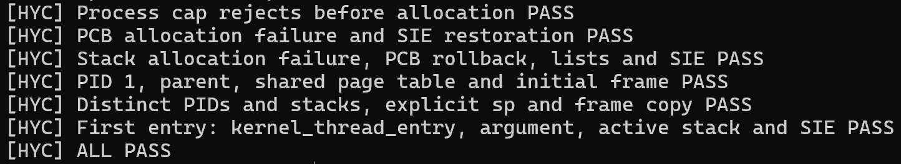

# Lab4 实验报告：进程管理（韩羽宸）

## 实验基本信息

| 项目 | 内容 |
|------|------|
| **实验名称** | Lab4：进程管理 |
| **小组成员** | 2410673-韩羽宸、2410933-马禹翔、2410936-林子媛 |
| **完成日期** | 2026-11-17（本人代码与隔离验证）。小组完成日期待联调后登记 |

### 小组分工

练习分工

| 成员 | 负责的练习/模块 |
|------|----------------|
| 2410673-韩羽宸 | `kernel_thread()`、`do_fork()`、`copy_thread()`、`copy_mm()`；首次运行链路与失败回滚；报告统稿 |
| 2410933-马禹翔 | `cpu_idle()`、`schedule()`、`proc_run()`、`switch_to()`；中断保护分析；整体联调与评分 |
| 2410936-林子媛 | `page_insert()`、`page_remove()`、`alloc_proc()`、`proc_init()`；VMA 与分页思考题；页映射和初始化验证 |

实验报告分工

| 成员 | 负责的报告内容 |
|------|----------------|
| 2410673-韩羽宸 | 基本信息、4.2.2、5.2、5.5；本人环境与总结；最终按编号统稿 |
| 2410933-马禹翔 | 第三部分、4.3、4.4、5.3、5.4；本人环境与总结 |
| 2410936-林子媛 | 第一部分、4.1、4.2.1、4.5、5.1；本人环境与总结 |

功能模块二按函数拆分。林子媛负责初始化 PCB 和建立初始进程管理状态，我负责在这些接口的基础上创建线程并准备首次运行现场。三人的正文按[总大纲](./汇总.md)的章节编号合并。

## 二、实验环境

| 项目 | 本人实际使用配置 |
|------|-----------------|
| 宿主系统与运行环境 | Windows 11 25H2，WSL Ubuntu 22.04 |
| 目标与工具链 | RV64，`riscv64-unknown-elf-gcc` 10.2.0，通过 GNU Make 构建 |
| 模拟与启动 | QEMU 7.0.0，`virt` 机型，单个 hart，OpenSBI v1.0 |
| 测试方式 | 正式源码编译检查、隔离副本中的内核断言和 QEMU 日志 |

| 成员 | AI 编程工具 | 底层模型 | 用途 |
|------|------------|---------|------|
| 2410673-韩羽宸 | OpenAI Codex 桌面端 | GPT-6 系列，具体版本未单独记录 | 梳理接口与实现约束，协助补全代码、设计验证和定位测试编译错误 |

## 四、实验内容与实现

### 4.2 功能模块二：进程创建与初始化

#### 4.2.2 内核线程创建与首次运行现场

**负责人**　2410673 韩羽宸

##### 模块功能描述

我负责的四个函数位于 [`kern/process/proc.c`](../code/kern/process/proc.c)。Lab4 先准备物理页与内核映射，初始化 VMA 管理结构，再由 `proc_init()` 将启动时已有的执行流登记为 `idleproc`，并通过 `kernel_thread()` 创建 `initproc`。我的模块把入口函数和参数转换为可被调度的线程：建立 PCB、独立的内核栈和首次运行现场，完成登记后将线程置为 `PROC_RUNNABLE`。调度部分随后选择线程并切换到它的现场。这样，Lab2 的页分配机制给新线程提供内核栈，Lab3 的 Trap 返回机制可以用来恢复人为构造的首次运行现场。

**功能说明与 SPEC**

| 函数 | 输入与依赖 | 成功后的状态 | 边界与错误 |
|------|------------|--------------|------------|
| `kernel_thread(fn, arg, clone_flags)` | 线程入口 `fn`、参数 `arg` 和创建标志。依赖 `kernel_thread_entry` 的汇编约定 | 构造临时 `trapframe`，用 `s0` 保存函数地址、`s1` 保存参数，`epc` 指向 `kernel_thread_entry`。加上 `CLONE_VM` 调用 `do_fork()`，将返回值传给调用者 | 临时现场先清零。将 `SPP` 和 `SPIE` 置位，清掉 `SIE` |
| `do_fork(clone_flags, stack, tf)` | 创建标志、可选的首次恢复栈指针和有效的源现场。依赖 `alloc_proc()` 提供干净的 PCB 和内核页表物理地址 | 保存 `parent = current`，准备内核栈、地址空间和运行现场。分配唯一 PID，加入进程链表和 PID 哈希表，进程数加一，然后唤醒线程。返回新 PID | 进程数达到 `MAX_PROCESS` 时返回 `-E_NO_FREE_PROC`。PCB 或栈分配失败返回 `-E_NO_MEM`。按已取得的资源逆序清理，保留调用前的中断状态 |
| `copy_thread(proc, esp, tf)` | 已取得内核栈的 PCB、可选栈指针和源现场 | 将源现场复制到新栈顶部，子线程保存的 `a0` 置零。`esp` 为零时，恢复后的 `sp` 使用该现场的起始地址。首次调度的 `context.ra` 指向 `forkret`，`context.sp` 指向新现场 | `esp` 非零时保留调用者指定的首次恢复栈指针。只改子线程副本，源现场保持原值 |
| `copy_mm(clone_flags, proc)` | 创建标志和已初始化的 PCB | 将 `mm` 保持为 `NULL`，沿用 `alloc_proc()` 设置的内核页表，返回 0 | Lab4 的调用场景是内核线程。用户地址空间复制及引用管理留给后续实验 |

**SPEC 设计过程**

我先从手册的功能模块二确认四个函数的责任，再对照源码把描述拆成能落在寄存器和字段上的条件。例如，手册要求线程第一次获得 CPU 时调用传入的函数，我就从 `kernel_thread_entry` 的 `move a0, s1` 和 `jalr s0` 推出 `s1` 必须保存参数，`s0` 必须保存函数地址。这两个字段在创建时写入，之后由 `sret` 前的现场恢复取回。[实验手册](../../../lab_book/手册完整版.html) · [`proc.h`](../code/kern/process/proc.h) · [`trap.h`](../code/kern/trap/trap.h) · [`entry.S`](../code/kern/process/entry.S)

接着把「创建成功」写成可验证的顺序。栈与现场准备好后才分配 PID、更新链表和计数，最后再唤醒线程。这样，分配失败只需要按顺序收回已经取得的资源，调度器也只会看到完成初始化的线程。当前 Lab4 的分配接口不会睡眠，我在 `do_fork()` 开始时保存并关闭本地中断，直到创建结束或回滚完成才恢复原状态。这个范围覆盖进程数检查、PID 分配和登记，符合本次单核执行环境。

**核心函数与首次运行过程**

`kernel_thread()` 构造的现场保存了线程的入口和参数，但这个局部变量在创建者的栈上。`copy_thread()` 把它完整复制到子线程 `kstack + KSTACKSIZE - sizeof(struct trapframe)` 处，使创建者返回后子线程仍能使用这份现场。这里的内核栈大小为两个 4 KiB 页，RV64 的 Trap frame 占 36 个 8 字节槽位。按这个布局，栈顶减去 288 字节后仍满足 16 字节对齐。父调用直接收到 `do_fork()` 返回的 PID，子现场里的 `a0 = 0` 是另一套返回约定。实际进入内核线程函数前，`kernel_thread_entry` 会用 `s1` 把函数参数装入 `a0`。

我在这里把两套现场分开看。PCB 中的 `context` 供调度切换使用，保存 `ra`、`sp` 和被调用者保存寄存器。内核栈上的 `trapframe` 保存 Trap 返回需要的完整通用寄存器现场和相关 CSR。第一轮切换恢复 `context` 后，从 `forkret` 开始执行。`forkret` 把 `current->tf` 交给 `forkrets`，后者把栈指向这份现场并跳转到 `__trapret`。`__trapret` 恢复寄存器和 CSR，`sret` 把执行流送到 `epc` 中的 `kernel_thread_entry`。此时 `SPP=1` 使返回进入 S 模式，`SPIE=1` 使返回后打开 S 模式中断。保存的 `SIE` 为零，使 `__trapret` 写回 `sstatus` 之后、尚未恢复完寄存器时不提前开启中断。最后，入口汇编把 `s1` 转成第一个参数并调用 `s0` 指向的函数，完整启动路径中的目标函数是 `init_main`。

`do_fork()` 的错误路径由「资源已经拿到哪一步」决定。PCB 分配失败时直接结束，栈分配失败时进入 `free_proc`，归还 PCB。如果将来 `copy_mm()` 能返回错误，这时内核栈已经分配，便先从 `free_stack` 归还栈，再继续归还 PCB。三条路径都发生在分配 PID 之前，进程表、哈希和计数因此无需撤销。它们和成功路径共用 `out` 恢复调用前的中断状态。尤其在 `proc_init()` 阶段，调用者原本可能关着中断，此时直接执行 `intr_enable()` 会改变启动阶段的状态。

##### 最终提示词

**提示词设计过程**

我先写一组实现提示词确定四个接口的边界，再分别把容易出错的资源回滚和首次运行现场整理成核对提示词。最后一组把前面的约束转成 QEMU 里的断言。这四组根据本次任务、源码和实际验证整理，其中两组专项提示词对应代码复核。

**HYC-P1　实现内核线程创建接口**

```text
[PROMPT]
按 Lab4 分工在 proc.c 完成 kernel_thread、do_fork、copy_thread 和 copy_mm。
请按创建者发出请求、PCB 登记、调度器接手三个环节说明各个函数负责的状态变化。

[RELY]
- proc.c 已有 get_pid、hash_proc、setup_kstack、put_kstack、forkret 和 find_proc。
- alloc_proc 成功时提供初始 PCB 和内核页表地址。proc_init 在首次创建前准备进程链表、PID 哈希和 current。
- wakeup_proc 将已准备好的 PCB 置为 PROC_RUNNABLE。kernel_thread_entry 按 s0 保存函数地址、s1 保存参数的约定取值。
- proc.h、trap.h、trapentry.S 已约定 PCB、context 和 trapframe 的布局。当前实验运行在单 hart 上。

[GUARANTEE]
- 修改限于四个函数及为调用队友接口所需的声明。保留已有接口、结构布局和队友负责的代码区域。
- 四个函数保留 LAB4 function2 注释并填写学号 2410673。
- 内核线程沿用共享的内核页表，copy_mm 完成当前阶段所需的处理，并维持既有签名。

[SPECIFICATION]
- kernel_thread 先清零临时 trapframe，再填入口、参数和 S 模式返回所需的状态。将 clone_flags 与 CLONE_VM 合并后交给 do_fork。
- do_fork 设置 parent、分配内核栈、完成首次运行现场。随后分配 PID、登记到链表和哈希、增加计数，最后唤醒子线程并返回 PID。
- copy_thread 将临时现场复制到子线程栈顶，令子现场 a0 为零，按 esp 是否为零选择恢复用的 sp，并给调度现场设置 forkret。
- copy_mm 成功时保持 mm 为 NULL，沿用 alloc_proc 初始化的 pgdir，返回 0。
- 进程数达到上限及 PCB、栈分配失败时返回对应错误码，按已取得的资源回滚，恢复调用前的中断状态。
```

**HYC-P2　核对 `do_fork()` 的资源回滚与登记顺序**

```text
[PROMPT]
顺着 do_fork 的每个返回位置检查：当 PCB 没有分到、内核栈没分到，或者以后 copy_mm 可能出错时，
分别有哪些资源已经取得，具体该走到哪个清理标签？请把这三个时点和成功登记的顺序写清楚。

[RELY]
- alloc_proc 成功后持有一个由 kmalloc 分配的 PCB。setup_kstack 成功后持有 KSTACKPAGE 个连续物理页。
- kfree 归还 PCB，put_kstack 释放内核栈。当前这些分配和释放接口不会睡眠。
- get_pid、hash_proc、list_add、nr_process 和 wakeup_proc 位于资源准备阶段之后。
- local_intr_save 记录原 SIE 状态并在需要时关中断。local_intr_restore 根据记录恢复状态。

[GUARANTEE]
- 回滚只处理已取得的资源。先归还内核栈，再释放 PCB。失败路径不留下可查找的子线程或多出的进程计数。
- 调用前关闭中断时，返回后保持关闭。调用前开启中断时，返回后恢复开启。
- 保持本阶段 copy_mm 固定成功的实现。未来失败分支按源码核对，测试结论以实际触发的场景为准。

[SPECIFICATION]
- 达到 MAX_PROCESS 时在调用 alloc_proc 前返回 -E_NO_FREE_PROC。
- PCB 分配失败时返回 -E_NO_MEM，跳到 out。栈分配失败时先经过 free_proc，再到 out。
- 若 copy_mm 返回错误，应保留这个错误码，依次经过 free_stack、free_proc 和 out。
- 成功时核对 PID、哈希、链表、计数与可运行状态的发布顺序，保证唤醒时 PCB 和两套现场均已准备好。
- 为前两类内存分配失败设计独立断言，检查返回码、空闲物理页数、PID 哈希和链表，以及进入和退出时的 SIE。
```

**落实情况。** `do_fork()` 使用 `free_stack → free_proc → out` 共用清理路径。隔离测试实际触发了进程数上限、PCB 和内核栈分配失败。空闲页数、登记状态和 SIE 检查见 5.2。

**HYC-P3　核对 `context`、`trapframe` 与首次运行**

```text
[PROMPT]
从 copy_thread 给子线程写入的 ra、sp 开始，跟到 kernel_thread_entry 调用 fn(arg)。
请指出每一步读的是 PCB 内的 context，还是子线程栈上的 trapframe，并说明 a0、sp、s0、s1 和 epc 的值从哪里来。

[RELY]
- proc_struct 内嵌 context，trapframe 位于子线程内核栈顶。KSTACKSIZE 为两页，RV64 的 trapframe 对应 36 个 8 字节槽位。
- forkret 读取 current->tf。forkrets 设置 sp 后跳到 __trapret，后者恢复现场并执行 sret。
- kernel_thread_entry 使用 move a0, s1 和 jalr s0 调用线程函数。
- sret 根据 SPP 决定返回的特权级，并根据 SPIE 更新返回后的 SIE。

[GUARANTEE]
- 保持 proc.h、trap.h 和现有汇编的接口、编译布局及寄存器槽位。
- copy_thread 复制源现场，保留源 tf 本身。对外 do_fork 返回 PID，子现场中的 a0 应单独核对。
- 区分首次调度所用的 context.sp、Trap 恢复所用的 gpr.sp 和线程函数实际执行时的 sp。

[SPECIFICATION]
- 写出子现场的地址表达式 kstack + KSTACKSIZE - sizeof(struct trapframe)，检查默认栈布局与 16 字节对齐。
- 分别解释 esp 为零及非零时 gpr.sp 的取值。核对 context.sp 都指向子现场，context.ra 都指向 forkret。
- 逐步列出 forkret、forkrets、__trapret、sret 和 kernel_thread_entry 的交接值，解释 SPP=1、SPIE=1、SIE=0 对首次返回的作用。
- 核对子现场 a0=0 与入口汇编将 s1 装入 a0 的先后关系。以实际入口函数读到正确参数、使用本线程栈并保持预期 SIE 作为运行验收。
```

**落实情况。** 测试检查了默认栈指针和显式 `esp` 两种输入，也检查了复制过程中源现场未改写。随后加载子线程的 `ra`、`sp`，经实际的 Trap 返回汇编进入测试函数。

**HYC-P4　在 QEMU 中重现与核验**

```text
[PROMPT]
写一个可重复执行的验证入口。先编译正式源码，再在 QEMU 的隔离副本中验证我负责的创建代码。
请为每项通过结果给出可识别的终端标记，并保留构建与运行日志供报告引用。

[RELY]
- 使用正式 proc.c 的四个函数、现有 Trap 返回汇编、真实物理页分配器和 SLOB。
- 正式源码的页映射、初始化及调度仍需要队友代码。可以在隔离副本里跳过相关页表自检，补最小 PCB 初始化和首次上下文入口。
- 使用本机 WSL、RV64 工具链以及 QEMU，验证脚本和日志放到附加材料。

[GUARANTEE]
- 测试代码、故障注入和临时构建产物只进入隔离副本。以源文件校验值关联正式源码与运行记录。
- 用断言通过标记和 QEMU 的退出结果验证本轮是否成功。正式源码的链接状态及全组 make grade 进度各自据实记录。

[SPECIFICATION]
- 核对 PID、父进程、可运行状态、链表、哈希、独立内核栈和 trapframe/context 布局。构造一个显式 esp 用例，与默认栈用例分别验证。
- 触发进程数上限、一次 PCB 分配失败和连续 64 次栈分配失败。检查错误码、空闲页数、计数、登记项及 SIE。
- 用测试入口加载已构造的 ra、sp，再走正式 Trap 返回链。在线程函数中断言参数、current、sp、satp 和 SIE。
- 保留可区分各用例的 PASS 行。全部完成后打印 [HYC] ALL PASS，使用 SBI 结束 QEMU。
```

**落实情况。** 脚本在正式源码副本中完成编译检查，又在隔离副本中完成内核链接、镜像生成和 QEMU 运行。六组断言的输出与原始日志列于 5.2。

##### 实现迭代过程

**第一次实现。** 先把四个函数串联起来，在正式目录副本中编译并核对链接输出。`proc.c` 编译为目标文件，编译器提示队友负责的静态 `alloc_proc()` 尚缺定义，最终链接也报告 `proc_init`、`cpu_idle`、`page_insert` 和 `page_remove` 缺失。为了先验证自己的功能，我用临时的 PCB 初始化和上下文入口提供测试条件，保留真实的内存分配器、线程入口和 Trap 返回汇编。[正式编译日志](../附加材料/韩羽宸代码实现与验证/formal-build.log)

**测试代码修正。** 第一次编译 AI 生成的测试副本时，编译器报 `'true' undeclared` 和 `'false' undeclared`。当前内核头文件定义了 `bool` 类型，隔离测试的编译环境没有提供这两个字面量。将两处故障开关的赋值改用已有代码采用的 `1` 和 `0` 后，重新编译和运行通过。这次修复落在测试脚本生成的代码里。正式实现经复测保持同一版本，已运行用例中未观察到需要修改正式代码的问题。[验证脚本](../附加材料/韩羽宸代码实现与验证/verify.sh)

**交互终端复测。** 从 PowerShell 运行脚本时，隔离构建成功，但 QEMU 在交互终端中超时，串口没有输出。我在 WSL 的伪终端复现了这一现象。测试无需键盘输入，因此把 QEMU 的标准输入接到 `/dev/null`，并用 `tee` 同步显示和保存串口输出。使用相同的交互终端条件复测后，QEMU 打印 `[HYC] ALL PASS` 并正常退出。[复测日志](../附加材料/韩羽宸代码实现与验证/isolated-qemu.log)

## 五、测试与验证

### 5.2 线程创建与首次运行验证

**负责人**　2410673 韩羽宸

**验证版本**　2026-11-17 的本地代码提交 `0d23951`。四个函数保留了 `LAB4 function2` 标记并注明 `2410673`。提交中的 `proc.c` 与本次验证的源文件一致。[源码校验值](../附加材料/韩羽宸代码实现与验证/proc.sha256)

测试分为正式源码编译检查和隔离运行。正式检查在副本中运行 `make -j4 -k`，确认 `proc.c` 已产出目标文件。隔离运行由脚本跳过依赖未完成 `page_insert()/page_remove()` 的两项页表自检，并用测试初始化建立 PID 为 0 的父线程。脚本完成构建后用 `make qemu` 启动。测试中的一段汇编只加载新线程的 `context.ra` 和 `context.sp`，后面的 `forkret → forkrets → __trapret → kernel_thread_entry` 走框架原有路径。

在本机 WSL 中复现验证的命令如下。

```bash
cd '/mnt/e/Grade3_1/操作系统/os_lab/lab4/附加材料/韩羽宸代码实现与验证'
bash ./verify.sh
```

| 验证项 | 条件与实际结果 |
|--------|----------------|
| 进程数上限 | 将计数置为 `MAX_PROCESS`。返回 `-E_NO_FREE_PROC`，PCB 分配没有被调用，计数和原本开启的中断状态保持一致 |
| PCB 分配失败 | 注入一次 `alloc_proc()` 失败。返回 `-E_NO_MEM`，进程数仍为 1，调用前开启的中断恢复 |
| 内核栈分配失败 | 连续 64 次拒绝两页内核栈的申请。每次返回 `-E_NO_MEM`。测试结束后空闲页数与测试前相同，普通进程链表和 PID 哈希均为空，进程数仍为 1，调用前关闭的中断保持关闭 |
| 创建与共享页表 | 成功创建的第一个子线程 PID 为 1，父进程是 `idleproc`，状态为 `PROC_RUNNABLE`。`mm == NULL`，使用内核启动页表。现场位于子线程自己的栈顶，函数地址、参数、`epc` 以及首次恢复用的 `ra`、`sp` 与预期一致 |
| 指定栈指针与现场复制 | 第二次调用 `do_fork()` 得到 PID 2。两个线程的内核栈独立，第二个现场中的 `sp` 等于传入值，原始现场未被改写。两次成功创建后，普通进程链表含两个子线程，进程总数为 3 |
| 首次运行 | 切入第一个子线程。实际调用测试线程函数后，该函数检查收到的参数、`current`、栈范围及对齐、`satp` 和 `SIE`。全部断言通过，QEMU 输出 `[HYC] ALL PASS` 并通过 SBI 正常退出 |

上述结果验证了创建、登记、失败回滚和真实 Trap 返回路径。`copy_mm()` 在本阶段固定成功，`do_fork()` 保留了该调用返回错误时先释放栈再释放 PCB 的分支，该分支仅做源码核查。隔离测试用测试函数复现首次进入线程，正式 `init_main` 输出、调度选择和完整 `make grade` 待全组联调记录。当前框架的 `do_exit()` 会触发占位 `panic`，本次隔离测试在入口验证后主动调用 SBI 关机。[QEMU 原始日志](../附加材料/韩羽宸代码实现与验证/isolated-qemu.log)

**图 1　QEMU 中的线程创建与首次进入**



图中是复跑个人 QEMU 验证时的终端输出。首个子线程取得 PID 1，两个子线程的 PID 和内核栈各自独立。`First entry` 一行出现在实际进入线程函数并通过参数、栈和 SIE 断言之后，最后的 `[HYC] ALL PASS` 表示六组检查全部通过。

**图 2　全组联调后的首次运行**

<!-- 待插入图 2：./images/2410673/02_initproc首次运行.png -->

待合并后以正式运行输出记录 `initproc` 的 PID、名称与入口参数。全组评分结果由 5.4 汇总。

### 5.5 报告整理与最终提交检查

**负责人**　2410673 韩羽宸，三人分别核对本人实现与材料。

| 检查项 | 当前记录 |
|--------|----------|
| 个人代码 | 2026-11-17 已在本地 `lab4` 分支提交 `0d23951`「完成韩羽宸负责的Lab4内核线程创建」，该提交只包含 `code/kern/process/proc.c` |
| 个人报告与材料 | 本报告采用 Markdown，按 4.2.2、5.2、5.5 及共享章节撰写。现场图放在 `report/images/2410673/`，通过相对路径插入。个人验证脚本和原始日志保存在本地 `附加材料` |
| 小组统稿 | 收齐三份报告后按统一标题编号合并。检查功能模块与扩展题有对应文字，SPEC、提示词、实际问题及修复、测试证据和 OS 理论对照都能从正文找到。公共标题保留一次 |
| 最终源码与提交 | 合并时逐函数核对 `LAB4` 标记和贡献者学号，联合运行后确认报告中的版本与证据一致。小组最终 commit、推送时间及远端核对结果待联调后登记 |

小组仓库为 `ACobayashi/OSLab62`，实验分支为 `lab4`。本表记录的是个人代码的本地提交进度。

## 六、实验总结与收获

### 对操作系统的理解

**负责人**　2410673 韩羽宸

| 本实验知识点 | 对应 OS 原理及含义 | 本实验中的联系与差异 |
|--------------|-------------------|----------------------|
| PCB、PID 和 `parent` | PCB 记录操作系统用来管理执行实体的状态。PID 是可查找的标识，父子关系可用于管理创建、退出与回收 | Lab4 中内核线程同样用 `proc_struct` 管理，可由 PID 哈希查找，且拥有自己的内核栈。父子关系由 `parent` 建立，本次只用到创建阶段 |
| 私有内核栈与共享内核页表 | 内核栈保存线程在内核态的调用现场。页表描述虚拟地址到物理页的映射 | 两个线程可以使用同一份内核映射，同时用不同的栈保存各自的函数调用与现场。Lab4 内核线程的 `mm` 为 `NULL`，没有独立的用户地址空间 |
| `context`、`trapframe` 和第一次执行 | 调度器恢复线程运行所需的上下文。Trap 返回另外需要原特权级、返回地址及通用寄存器等信息 | Lab3 恢复的是被打断时保存的真实现场。Lab4 提前构造现场，用同一套恢复流程进入从未运行过的线程，把「保存后继续」的机制扩展到了「构造后首次进入」 |
| 创建顺序、回滚与中断保护 | 资源获取和状态发布有先后关系，内核要避免其他执行路径观察到半初始化的对象 | Lab4 在 PCB、栈和现场齐备后才登记并唤醒。失败时回收已取得的资源。本地关中断适用于当前单核环境，多核共享结构通常还需要锁等跨核同步 |

本实验仍有三项重要的 OS 原理没有覆盖。**用户地址空间复制与写时复制**涉及独立页表、页面共享、引用计数和写入时的缺页处理，本次 `copy_mm()` 只对应内核线程的共享情形。**退出、等待和资源回收**决定一个线程停止后，谁来接收退出状态，谁最终释放 PCB 和栈。本次只验证创建失败时的回滚，完整的退出生命周期仍留在后续实验。**抢占式调度与多核同步**需要时钟参与调度决策，并在多个 CPU 之间维护运行状态的一致性。本次的隔离验证覆盖单核下的首次进入。

### AI 协作开发的经验

**负责人**　2410673 韩羽宸

这次比较有效的做法是把提示词写到接口、字段和可观察的结果。比如「支持首次运行」对应的是 `context.ra = forkret`、`context.sp` 指向新栈上的 Trap frame，以及恢复后入口函数能读到正确的参数。这样既能逐项核对 AI 生成的代码，也能把原理直接转成测试断言。

首次测试副本的编译错误提醒我，需要先核对内核自己的类型与头文件约定。补好测试后，我用正式源码的校验值把运行记录和本地提交对应起来。报告中的首次运行结论以真实 QEMU 输出为依据，全组的编译、调度和评分则以最终合并后的结果为依据。
