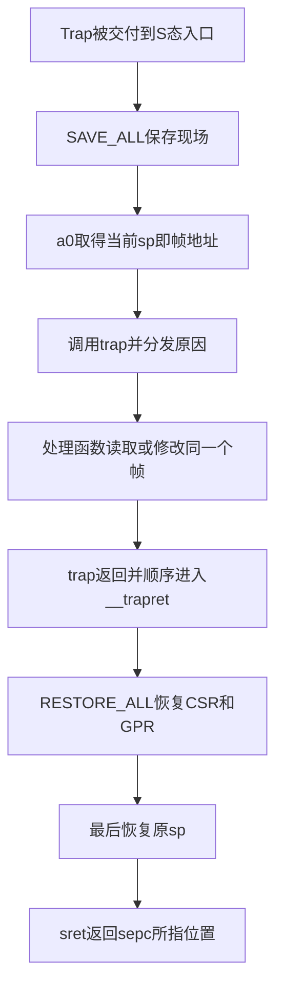
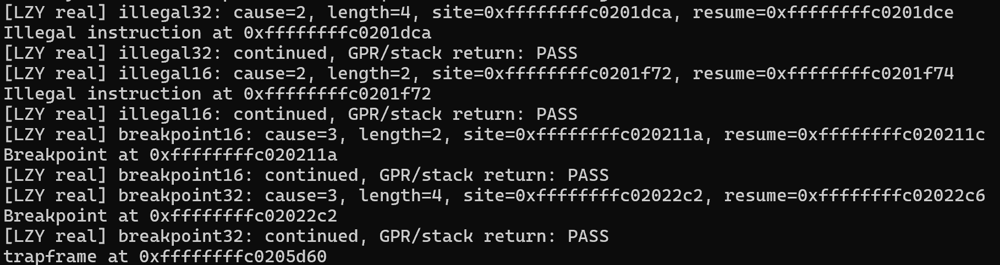
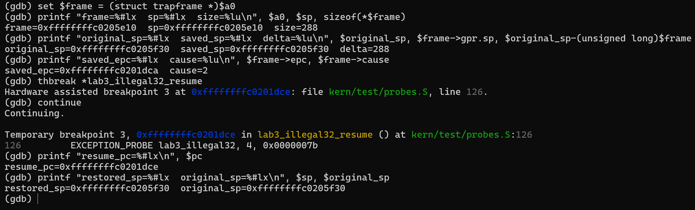

# Lab3 实验报告：中断与异常处理——韩羽宸负责部分

## 实验基本信息

| 项目 | 内容 |
| --- | --- |
| 实验名称 | Lab3：中断与异常处理 |
| 报告作者 | 2410673-韩羽宸 |
| 小组成员 | 2410673-韩羽宸、2410933-马禹翔、2410936-林子媛 |
| 本人代码实现与验证日期 | 2026 年 11 月 4 日 |
| 本人报告正文整理日期 | 2026 年 11 月 4 日；两张现场截图已补入 |
| 小组仓库 | [OSLab62：lab3 分支](https://github.com/ACobayashi/OSLab62/tree/lab3) |
| 本人代码提交 | `e4f5256`：韩羽宸代码部分：完成Trap上下文恢复与入口调用 |

本文按小组分工记录本人负责的功能模块一、上下文验证、提交检查、实验环境和总结。章节编号与统一报告模板对应，第一部分、第三部分、4.2—4.5、5.2—5.4 的正式正文由相应队友提供，合并时保留共同标题一次。

本文沿用 Lab2 的记录方式：先说明原理与接口，再给出 SPEC、四段式提示词、实现与真实问题，最后用命令和日志对应验证结论。提示词根据实际自然语言需求和执行过程规范整理，并非逐字聊天记录。运行日志与两张本人现场截图已经取得；截图对应真实异常返回和 GDB 入口/返回观察。可随报告查看的材料见 [证据与复现说明](evidence/2410673/README.md)。

### 小组分工

练习如何分工？

| 成员 | 负责的练习/模块 |
| --- | --- |
| 2410673-韩羽宸 | 功能模块一的 SPEC、prompt；`RESTORE_ALL`、`__alltraps`；Trap frame、栈和返回机制分析；上下文恢复验证；最终统稿 |
| 2410933-马禹翔 | `interrupt_handler()`；时钟续设、计数输出和关机；中断关闭开启、原子操作及 `do…while(0)` 分析；整体运行与评分 |
| 2410936-林子媛 | `exception_handler()`；非法指令与断点处理、指令长度及 EPC 更新；特权级、异常分类和 `stvec` 思考题；异常验证 |

实验报告如何分工？

| 成员 | 对应报告正文 |
| --- | --- |
| 韩羽宸 | 实验基本信息、4.1、5.1、5.5，以及本人实验环境和第六部分；收齐材料后按统一编号统稿 |
| 马禹翔 | 第三部分、4.2、4.4、5.2、5.4，以及本人实验环境和总结 |
| 林子媛 | 第一部分、4.3、4.5、5.3，以及本人实验环境和总结 |

功能一和功能二通过同一个 `struct trapframe *` 衔接。我负责使保存的现场正确进入 C 代码、使处理后的现场正确回到处理器；异常函数由林子媛负责决定是否以及如何修改 EPC。断点返回测试同时经过两个模块，报告注明共同依赖，不把整个结果算成某一个函数的独立证明。

---

## 二、实验环境

**负责人：2410673 韩羽宸。**

### 系统、工具链与运行方式

本人继续使用 Windows 上的 WSL2 Ubuntu-22.04。下表来自本次实际版本核对，没有直接照抄 Lab2 的旧版本。例如本轮交叉编译器实际为 GCC 15.1.0，与 Lab2 报告的旧记录不同。

| 工具或环境 | 本次实际配置 | 用途 |
| --- | --- | --- |
| 宿主与 Linux 环境 | Windows + WSL2；Ubuntu 22.04.5 LTS | 编辑文件并运行交叉构建与模拟器 |
| Linux 内核 | `6.6.87.2-microsoft-standard-WSL2` | 承载构建工具与 QEMU |
| GNU Make | 4.3 | 按 Makefile 编译和链接 |
| RISC-V GCC | `riscv64-unknown-elf-gcc` 15.1.0 | 编译内核 C 与汇编 |
| RISC-V GNU ld | 2.45 | 生成内核 ELF |
| RISC-V GDB | `16.3.90.20250610-git` | 现场断点观察 Trap 入口帧与返回后的 PC、SP；系统性检查另由运行断言提供 |
| QEMU | `/usr/local/bin/qemu-system-riscv64`，7.0.0 | 模拟 RISC-V `virt` 平台 |
| OpenSBI | 启动输出为 1.0；Runtime SBI Version 为 0.3 | 启动 S 态内核并提供 SBI 服务 |
| 模拟内存与核数 | 运行日志显示 128 MiB、1 个 HART | 本次上下文与异常验证场景 |

WSL 中将 `/home/smile/toolchains/riscv-elf-toolchains/bin` 加入 `PATH`，避免调用到另一套同名工具。内核按高地址链接，QEMU 将镜像放到物理地址 `0x80200000`；运行参数同时提供 `-kernel bin/ucore.img`，使当前 OpenSBI 获得正确的内核下一跳。该启动配置由此前整理 Lab3 初始代码时继承，本次功能一提交没有再改启动代码。

本次正式实现位于 `code/kern/trap/trapentry.S`，构建、断言和测试桩在独立副本中执行。这样既可以在队友的时钟函数尚未实现时验证本人模块，也能清楚区分课程提交源码和测试辅助代码。QEMU 加载 `bin/ucore.img`，调试器应加载带符号的 `bin/kernel`；二者分别用于执行和符号定位。

### 使用的 AI 工具

| 成员 | AI 编程工具 | 底层模型 | 主要用途 |
| --- | --- | --- | --- |
| 2410673-韩羽宸 | OpenAI Codex 桌面端 | 未单独留存可核验的具体版本记录 | 阅读手册和分工、补全汇编、设计独立验证、核对日志与版本、整理报告 |

本人先用自然语言明确“只完成韩羽宸负责的代码、检查后本地提交”，再要求正式 `code/` 同步已拉取的队友更新。报告按 Lab2 的 `[PROMPT] / [RELY] / [GUARANTEE] / [SPECIFICATION]` 结构归纳这些要求。AI 的解释需要与真实源码、断言和输出一致；工具名称和模型版本分别记录，无法核验的版本不推定填写。

---

## 四、实验内容与实现

### 4.1 功能模块一：Trap 上下文恢复与 Trap 入口功能

**负责人：2410673 韩羽宸。**

#### 模块功能描述

**需要实现/修改的函数：**

```text
RESTORE_ALL     # 与已有 SAVE_ALL 对应的上下文恢复宏
__alltraps     # SAVE_ALL 后传递帧地址并调用 trap() 的入口
```

本实验在 Lab2 已能启动、分页和管理物理内存的基础上，增加运行中的中断与异常处理。CPU 进入 S 态 Trap 时，只完成规定的控制状态更新，不会自动把 32 个通用寄存器保存成 C 结构体。汇编入口负责把现场放进栈中的 Trap frame，C 代码据此处理，再由汇编恢复处理后的现场并执行 `sret`。

本模块承接已有的 `SAVE_ALL`，补齐入口调用和返回恢复。它不负责识别每一种中断，也不统一决定异常指令应跳过多少字节。已有 `trap()` 调用 `trap_dispatch()`，按原因分发给中断和异常函数；这两个处理函数分别由队友实现。

##### 1. 输入、输出与整体衔接

| 环节 | 输入状态 | 承担的工作 | 输出状态 |
| --- | --- | --- | --- |
| 硬件进入 S 态 Trap | 被打断的执行状态 | 写入相关 CSR、更新状态位并跳到入口 | PC 到达 `__alltraps`，通用寄存器尚未由软件保存 |
| 已有 `SAVE_ALL` | 当前内核栈和寄存器 | 分配 36 个槽，保存 GPR 与四个 CSR 信息 | `sp` 指向完整 `struct trapframe` |
| 本人补全 `__alltraps` | 帧首地址位于 `sp` | `mv a0, sp`，`call trap` | C 函数获得同一帧地址，返回后 `sp` 仍为帧首 |
| 队友的 C 处理函数 | `struct trapframe *tf` | 按原因处理，必要时修改保存的 EPC 等字段 | 帧表示希望恢复的执行状态 |
| 本人实现 `RESTORE_ALL` | C 处理完成后的帧 | 恢复 `sstatus`、`sepc`、可写 GPR，最后恢复原 `sp` | 准备执行 `sret` |
| 已有 `sret` | 返回控制状态已经装入 CSR | 按返回状态切换执行权限和中断状态，PC 取自 `sepc` | 回到指定位置继续执行 |



这里有两个层次的“返回”：C 函数先按普通调用约定返回汇编，之后 `sret` 才完成 Trap 返回。二者使用的地址来源不同，不能把 C 的 `ret` 和特权返回混为一谈。

##### 2. SPEC 设计过程

先由 `SAVE_ALL` 与 `trap.h` 确定保存布局，再由 C 调用约定和 `sret` 确定传参与返回要求。规格的关键不是笼统的“恢复全部寄存器”，而是明确以下不变量；完整前后条件和用例见 HYC-P1、HYC-P2。

| 约束 | 设计理由与验收方式 |
| --- | --- |
| 保存宏、结构体、C 签名不变，36 槽按原布局解释 | 入口、C 和恢复端必须一致；核对差异、大小与字段偏移 |
| `a0=sp` 传帧，C 返回时仍以帧首为 `sp` | 保证处理与恢复操作同一现场；核对参数及原栈关系 |
| 使用处理后的 `status/epc/GPR`，临时借用寄存器最终也恢复 | C 对帧的合法修改必须生效；检查 EPC 和修改保存 `a0` 的返回值 |
| 最后恢复 x2，不额外回收帧，遵守栈对齐 | 防止读取基址失效及栈漂移；比较返回前后原栈并重复运行 |
| 返回机制不代替 C 决定 EPC、权限或中断策略 | 区分 SIE 两种初态、帧中状态及 `sret` 后状态 |
| 保留学号标记，验证副本使用本人真实汇编 | 核对两处标记、源码哈希及快照，排除参考入口替代 |

前五项来自实现接口；验证阶段进一步明确最后一项，补充证据一致性要求，没有改动功能一接口。

##### 3. Trap frame 的 36 个槽位

`struct pushregs` 的前 32 项按 x0 到 x31 顺序排列；`struct trapframe` 在其后加入 `status`、`epc`、`badvaddr` 和 `cause`。本轮为 RV64，`REGBYTES=8`，所以一帧占 288 字节。

| 槽号 | 字节偏移 | 字段或寄存器 | 用途 |
| --- | --- | --- | --- |
| 0 | 0 | x0 / `zero` | 固定为零，结构中保留位置，恢复时无需加载 |
| 1 | 8 | x1 / `ra` | 被打断代码的返回地址，区别于调用 `trap()` 时生成的临时返回地址 |
| 2 | 16 | x2 / `sp` | 进入 Trap 前的栈指针，不能保存成分配帧之后的地址 |
| 3 | 24 | x3 / `gp` | 全局指针 |
| 4 | 32 | x4 / `tp` | 线程指针，本实验保留其原值 |
| 5—7 | 40—56 | x5—x7 / `t0—t2` | 临时寄存器 |
| 8—9 | 64—72 | x8—x9 / `s0—s1` | 保存寄存器，亦被保存/恢复代码暂借 |
| 10—17 | 80—136 | x10—x17 / `a0—a7` | 参数/返回值寄存器，也属于被打断现场 |
| 18—27 | 144—216 | x18—x27 / `s2—s11` | 保存寄存器 |
| 28—31 | 224—248 | x28—x31 / `t3—t6` | 临时寄存器 |
| 32 | 256 | `status` | `sstatus` 的软件保存值 |
| 33 | 264 | `epc` | `sepc` 的软件保存值，可由 C 处理函数更新 |
| 34 | 272 | `badvaddr` | 当前代码保存 `stval`；字段沿用原名称 |
| 35 | 280 | `cause` | `scause` 的保存值，供 C 分类 |

保存宏使用 `STORE xN, N*REGBYTES(sp)`，恢复宏也按同一槽号读取。C 并不知道汇编宏的含义，它只是按结构体偏移访问内存，所以两边的对应是必须共同遵守的接口。测试实际断言 `sizeof(pushregs)=256`、`sizeof(trapframe)=288`，并核对 `status`、`epc` 的偏移为 256、264。

##### 4. `SAVE_ALL` 为什么先使用 `sscratch`

设进入入口时的栈指针为 `S`，保存宏先执行：

```asm
csrw sscratch, sp
addi sp, sp, -36 * REGBYTES
```

第一条先把 `S` 放到 `sscratch`，第二条再使 `sp=S-288`。否则如果先减栈再保存 x2，第 2 槽就会错误地保存帧首，而不是原栈指针。宏在保存完原来的通用寄存器后执行：

```asm
csrrw s0, sscratch, x0
```

该指令把 `sscratch` 中的原 `sp` 读入 `s0`，同时向 `sscratch` 写零。随后将 `s0` 存到第 2 槽。此时原来的 `s0` 已经在第 8 槽，因此可以安全借用。`s1—s4` 同样在原值保存后用于搬运 CSR。

`sscratch` 的零值是本工程关于内核执行状态的软件约定，不是硬件自动产生的“内核模式编号”。已有 `idt_init()` 先将它清零，保存宏也在使用后清零。本次恢复没有把旧 `sp` 再写回 `sscratch`，因为恢复原 `sp` 与维护 scratch 约定是两件事。

手册提到使用 `sscratch` 保存用户态进入时的内核栈指针，但当前 `SAVE_ALL` 没有完整的 U/S 栈选择和交换流程。本轮实际验证发生在 S 态内核中，不据此宣称已经实现用户态入口、自动换栈或完整嵌套异常支持。

##### 5. 为什么所有可写整数寄存器都要恢复

普通 C 调用允许被调用函数改写 `a0—a7`、`t0—t6` 和 `ra` 等调用者保存寄存器，调用者会按约定处理；Trap 却可能在被打断代码并未准备调用函数时发生。被打断代码没有提前保存这些寄存器的机会，因此 Trap 包装层必须保护这部分现场，不能只恢复 `s0—s11`。

调用约定还规定第一整数参数位于 `a0`，标准栈在过程入口保持 16 字节对齐。当前内核栈满足这一前提，减去 288 字节后仍然对齐。该论证依赖原栈已对齐，不能把“减去 16 的倍数”误认为能修正任意未对齐的输入栈。[RISC-V psABI：整数调用约定](https://riscv-non-isa.github.io/riscv-elf-psabi-doc/#_integer_calling_convention)

原 `a0` 已在 `SAVE_ALL` 时放入第 10 槽，因此入口可以用 `mv a0, sp` 传参。C 函数执行时改变的是活动寄存器；返回恢复读的是栈中保存的值。这也解释了为什么 C 修改 `tf->gpr.a0` 后，返回程序应看到修改值，而不是强制看到进入前的值。

##### 6. `RESTORE_ALL` 的实际实现

本轮新增的恢复代码如下，与正式源码一致：

```asm
    .macro RESTORE_ALL

    #lab3 function1 2410673
    # 先恢复返回所需的 CSR；暂借 s0/s1，随后从原槽位恢复它们。
    LOAD s0, 32*REGBYTES(sp)
    LOAD s1, 33*REGBYTES(sp)
    csrw sstatus, s0
    csrw sepc, s1

    LOAD x1, 1*REGBYTES(sp)
    LOAD x3, 3*REGBYTES(sp)
    LOAD x4, 4*REGBYTES(sp)
    LOAD x5, 5*REGBYTES(sp)
    LOAD x6, 6*REGBYTES(sp)
    LOAD x7, 7*REGBYTES(sp)
    LOAD x8, 8*REGBYTES(sp)
    LOAD x9, 9*REGBYTES(sp)
    LOAD x10, 10*REGBYTES(sp)
    LOAD x11, 11*REGBYTES(sp)
    LOAD x12, 12*REGBYTES(sp)
    LOAD x13, 13*REGBYTES(sp)
    LOAD x14, 14*REGBYTES(sp)
    LOAD x15, 15*REGBYTES(sp)
    LOAD x16, 16*REGBYTES(sp)
    LOAD x17, 17*REGBYTES(sp)
    LOAD x18, 18*REGBYTES(sp)
    LOAD x19, 19*REGBYTES(sp)
    LOAD x20, 20*REGBYTES(sp)
    LOAD x21, 21*REGBYTES(sp)
    LOAD x22, 22*REGBYTES(sp)
    LOAD x23, 23*REGBYTES(sp)
    LOAD x24, 24*REGBYTES(sp)
    LOAD x25, 25*REGBYTES(sp)
    LOAD x26, 26*REGBYTES(sp)
    LOAD x27, 27*REGBYTES(sp)
    LOAD x28, 28*REGBYTES(sp)
    LOAD x29, 29*REGBYTES(sp)
    LOAD x30, 30*REGBYTES(sp)
    LOAD x31, 31*REGBYTES(sp)

    # SAVE_ALL 的第 2 槽保存的是进入 Trap 前的 sp，必须最后恢复。
    LOAD x2, 2*REGBYTES(sp)

    .endm
```

**先恢复 CSR。** CSR 不能直接从内存加载，所以先用 `s0/s1` 中转，再写入 `sstatus/sepc`。这两个寄存器的原值之后分别从第 8、9 槽恢复，不会把临时 CSR 值带回原程序。

**再恢复一般寄存器。** 宏没有对 x0 执行 `LOAD`，因为 x0 恒为零；x1、x3—x31 全部按原编号槽位恢复。恢复 `ra` 后不再调用函数，避免覆盖它。恢复后也不能随意增加使用 `t0`、`a0` 等寄存器的调试输出，否则可能破坏刚恢复的现场。

**最后恢复 `sp`。** 在所有其他 `LOAD` 期间，`sp` 必须始终是帧首 `F=S-288`。若提前装入原 `S`，后续 `N*REGBYTES(sp)` 就会以错误的地址为基准读取。末尾的 `LOAD x2, 2*REGBYTES(sp)` 先以旧 `sp` 计算地址，再将槽中内容写入 x2，因而能正确取回 `S`。此后无需再加 288；额外加栈会造成重复回收。

恢复宏没有把 `badvaddr` 和 `cause` 写回 `stval/scause`。它们用于描述这次 Trap 的原因和故障信息；本实验的返回路径依赖的是 `sepc` 与 `sstatus`。保存“诊断所需的四个 CSR 信息”不等于返回前必须把四个 CSR 全部对称写回。

##### 7. `__alltraps` 如何连接汇编和 C

```asm
    .globl __alltraps
    .align(2)
__alltraps:
    SAVE_ALL

    #lab3 function1 2410673
    # 当前 sp 指向完整 Trap frame，按调用约定以 a0 传给 C 处理函数。
    mv a0, sp
    call trap
    # sp should be the same as before "jal trap"

    .globl __trapret
__trapret:
    RESTORE_ALL
    # return from supervisor call
    sret
```

`mv a0, sp` 将帧指针作为第一个参数传给 `void trap(struct trapframe *tf)`。`call trap` 建立普通函数调用的返回位置；C 函数按约定管理自己的栈，结束时恢复到调用前的 `sp`。所以返回汇编时仍能用同一个 `sp` 读取 Trap frame。

`__trapret` 紧接在调用之后，CPU 顺序执行就会到达这里，不需要额外跳转。它也是一个符号标签，不会因为 `.globl` 而形成新的调用。原源码注释提到 `iret` 属于遗留表述，本项目真实执行的是 RISC-V 的 `sret`，报告按真实指令解释。

##### 8. 硬件与软件分别保存什么

| 动作 | 硬件或软件 | 本实验中的体现 |
| --- | --- | --- |
| 记录 Trap 返回位置和原因 | 硬件 | 写 `sepc`、`scause`，按原因提供 `stval` |
| 记录进入前权限和中断使能 | 硬件 | 更新 `SPP/SPIE/SIE` |
| 定位入口 | 硬件按 `stvec` 配置 | 跳到已安装的 `__alltraps` |
| 分配栈帧并保存 GPR | 软件汇编 | `SAVE_ALL`；没有硬件自动生成结构体 |
| 读取 CSR 放入帧 | 软件汇编 | `csrr`/`csrrw` 加 `STORE` |
| 分类处理和调整返回状态 | 软件 C | `trap_dispatch()` 及队友函数 |
| 重新装入 GPR 和返回 CSR | 软件汇编 | 本人实现的 `RESTORE_ALL` |
| 最终 Trap 返回 | 软件执行指令，由硬件完成其语义 | `sret` 使用已准备的控制状态 |

“硬件已经保存 `sepc`”只表示值位于 CSR 中，不表示它已经被压进内核栈。若 C 处理过程、后续异常或调试需要保留本次信息，还需要软件将它复制到独立帧中。

##### 9. `sepc`、`sstatus` 和返回状态

`sepc` 决定 `sret` 的返回位置，`sstatus` 的相关位决定返回权限与中断状态。对本次普通 S 态 Trap，可用下表概括：

| 时刻 | `SPP` | `SPIE` | `SIE` |
| --- | --- | --- | --- |
| 进入前 | 不用它判断当前权限 | 保留此前值 | 本轮分别测试 0、1 |
| 硬件进入 S 态后 | 记录进入前权限，本次为 1 | 记录进入前 `SIE` | 清为 0 |
| 帧恢复到 CSR 后 | 来自帧，本次仍为 1 | 来自帧，保留原使能信息 | 本次保存值为 0 |
| 执行 `sret` 后 | 被置为 0 | 被置为 1 | 取返回前 `SPIE`，即恢复原 0 或 1 |

因此，`sret` 返回的状态不是把 `sstatus` 原样保持不变。需要分别观察恢复宏写回的状态和 `sret` 完成后的状态。`SPP=1` 时返回 S 态；`SPP=0` 时返回 U 态。本实验实际从 S 态内核触发并返回 S 态，不应把手册中用户态情形的说明直接套成“每次 `sret` 都返回用户态”。相关状态转换与 [RISC-V Supervisor ISA 的 `sstatus` 规定](https://docs.riscv.org/reference/isa/v20260120/priv/supervisor.html#_supervisor_status_sstatus_register) 对应。

对于本实验主动制造的非法指令、断点，队友处理函数按指令长度更新 `tf->epc`，以继续到后续指令；对异步中断通常不应机械跳过一条指令。本人恢复宏统一加载处理后的 `tf->epc`，不把 `+2` 或 `+4` 写进汇编。这样既能保留不同原因的处理策略，也能让修改确实进入硬件返回路径。

##### 10. 测试设计

验证分两层：第一层复用已提交的异常探针，确认 16/32 位非法指令、16/32 位断点都能经过真实汇编入口并继续执行；第二层在独立副本的 `trap()` 前后增加观察断言，检查传参、布局、寄存器、栈、EPC 和中断状态。

仅看到异常提示不能证明恢复正确：提示输出发生在返回之前。即使 C 函数能打印，返回时也可能跳错位置、破坏寄存器或使 `sp` 不断漂移。因此测试还必须在恢复之后检查程序确实继续、原寄存器值仍在，并验证 C 对保存现场的有意修改可以被返回代码读取。命令与实际结果集中在 5.1。

#### 最终提示词

**提示词设计过程。** 沿用 Lab2 四段式，将任务拆成实现、验证、现场观察三组：P1 约束汇编与 C 的接口，P2 将规格变成可执行断言，P3 将验证过程变成可说明的现场证据。`PROMPT` 写任务和修改范围，`RELY` 给真实布局及接口，`GUARANTEE` 列交付物，`SPECIFICATION` 写前后条件、分支和验收要求。

以下按本人实际需求、源码和已有验证方案整理，属于规范化记录，不是三次逐字聊天输入；其中 P3 对应后续按输出逐步进行的现场调试。生成前的要求与生成后的 Answer 分开，具体数值和 PASS 不预填为验收结论。

##### HYC-P1：实现 Trap 入口与上下文恢复

```markdown
[PROMPT] 任务说明
我是 2410673 韩羽宸。请依据 Lab3 手册、分工和实际源码，只完成
code/kern/trap/trapentry.S 中 RESTORE_ALL 与 __alltraps 两处功能一。
先核对正式 code 与已拉取的 lab3 分支，保留队友已完成的异常函数；
不把同步来的队友代码计作本人实现。不要修改 SAVE_ALL、公共结构体、
trap() 签名、原 __trapret、评分脚本或队友负责区域。
输出实际代码、关键顺序的解释和差异自查；验证交给 HYC-P2。
完成检查后仅将本人代码本地提交，中文说明以“韩羽宸代码部分：”开头，
不执行 git push。

[RELY] 上下文信息
项目是 RV64 ucore，REGBYTES=8，LOAD/STORE 使用工程已有宏。
SAVE_ALL 先把原 sp 存入 sscratch，再分配 36 个槽；保存完 GPR 后，
通过 csrrw 取回原 sp 并将 sscratch 清零，原 sp 写入第 2 槽。
前 32 槽按 x0—x31 排列，32/33/34/35 槽为 status/epc/badvaddr/cause，
对应保存的 sstatus/sepc/stval/scause；一帧为 288 字节。
trap.h 已定义 struct pushregs、struct trapframe，C 接口是：
void trap(struct trapframe *tf);
trap() 分发给队友的 interrupt_handler()、exception_handler()；
C 可以修改保存帧，返回时应使用处理后的内容。现有 __trapret 紧接
入口调用位置，执行 RESTORE_ALL 与 sret。本轮实际验证为 S 态内核，
不要额外设计用户态换栈、调度或扩展寄存器上下文。

[GUARANTEE] 交付清单
1. 两处完整实现及保留 lab3 function1、标注 2410673 的源码。
2. 说明帧槽位、a0 传参、CSR 中转、sp 最后恢复和 sret 的衔接。
3. 差异清单，确认保存宏、结构体、返回标签和队友实现保持原样。
4. 验证后仅含本人代码的本地提交记录，列明基线、文件和推送状态。

[SPECIFICATION] 行为规格
Pre-Condition：Trap 已进入 __alltraps；当前内核栈有效、空间足够且
按 ABI 对齐；已有 SAVE_ALL 将现场存为与 C 结构体一致的帧。
Post-Condition：以 a0=sp 调用 trap；C 返回时 sp 仍指向同一帧首。
RESTORE_ALL 从处理后的第 32/33 槽装入 sstatus/sepc，恢复 x1、x3—x31，
最后从第 2 槽恢复 x2；之后顺序执行 sret，回到帧指定的执行位置。
Case 1：临时借用 s0/s1 搬运 CSR 后，仍须从各自槽位恢复其原值。
Case 2：C 改写 epc 或保存的 a0 时，恢复必须让这些修改生效，
不能用另一份旧现场覆盖；未修改字段保持对应值。
Case 3：原全局 SIE 为 0 或 1，均按保存的状态和 sret 语义返回；
不在恢复宏强行开中断、清 SPP 或统一推进 EPC。
Requirements：x0 无需加载；本返回路径无需写回 stval/scause。
sp 在最后一次帧读取前一直作为帧基址；恢复 x2 后不再加 288。
288 字节保持原栈的 16 字节对齐，但不能修复输入栈本身未对齐。
```

**Answer。** 两处实现已完成，`SAVE_ALL` 与原 `__trapret` 保留；相对基线 `9ceb1ac`，一个文件新增 44 行、删除 2 行，其中新增实际汇编指令 37 行。本地提交为 `e4f5256`，未推送；实际差异及记录见 5.1、5.5。

##### HYC-P2：验证真实入口、处理后的帧与返回状态

```markdown
[PROMPT] 任务说明
为本人功能一建立可复现验证，检查“保存—C 处理—恢复—继续执行”
整条路径。先复用队友的异常探针，再补充帧参数、寄存器、栈、EPC
和返回状态断言。所有驱动、观察函数、构建副本及日志放在附加材料；
正式 code 和评分脚本保持不变，不修改断言来获得通过。
只打印异常不能作为恢复成功的依据；必须检查 sret 之后的实际状态。

[RELY] 上下文信息
使用 HYC-P1 的真实 trapentry.S、trap.h 和队友 exception_handler()。
已有探针覆盖 16/32 位非法指令和 16/32 位断点，设置整数寄存器标记值，
返回后比较 GPR 和栈；异常函数负责推进 EPC，恢复宏负责使其生效。
正式 interrupt_handler() 尚无定义。测试可在独立副本加入“意外中断
立即 panic”的失败桩，于第二次 idt_init() 后、clock_init() 前运行，
完成后使用现有 SBI 服务退出；不能用桩代替队友的时钟实现。
已有测试框架可能替换参考入口，必须核对实际使用的汇编而非相信提示语。

[GUARANTEE] 交付清单
1. 两种独立副本：异常联调、上下文状态检查；保留真实正式汇编。
2. 入口及处理后观察断言、ABI 安全的汇编探针、复现命令。
3. 构建日志、串口原始输出、QEMU 实际退出码、被测源码哈希和快照。
4. 按“初态—操作—预期—实际—判定”记录结果，说明联调与隔离边界。

[SPECIFICATION] 行为规格
Pre-Condition：明确被测源码和副本来源；RV64 工具链可用，栈有效。
比较正式与副本 trapentry.S 的内容及哈希；不得使用 reference-entry.S。
Post-Condition：真实触发后能继续执行，帧参数、寄存器、原栈、EPC
和返回状态均满足断言；成功退出、失败终止和未执行分别记录。
Case 1：四种真实异常分别检查恢复标签、2/4 字节 EPC 更新及返回后的
寄存器值；保留半字对齐的 32 位指令场景，不只测四字节对齐。
Case 2：在副本 trap() 前后观察同一 tf，核对大小、字段偏移、16 字节
对齐、tf+sizeof(*tf)==保存的原 sp、原因、地址和寄存器标记值。
Case 3：将 sie=0 屏蔽具体中断源，分别令全局 SIE 为 0/1，再触发同步
异常。区分进入前、帧中与 sret 后的 SPP/SPIE/SIE；重复运行检查栈漂移。
Case 4：C 有意修改 tf->gpr.a0，返回后检查实际值，证明恢复使用处理后
的现场；这项结果与未修改寄存器保持不变分别判断。
Requirements：探针先保护自身 ABI 状态，避免把测试代码破坏现场误判
为内核错误。直接调用异常函数的合成帧不算真实 Trap 返回验证。
有 PASS 但外层退出非零时，保留原记录并单独核验退出状态，不先改汇编。
隔离验证不等于时钟路径或 make grade 通过；测试次数由实际执行统计。
```

**Answer。** 两种副本均使用本人正式汇编，四类真实异常返回通过。上下文测试在两种 SIE 下各运行 128 次普通探针，再各运行一次修改保存 `a0` 的断点，共 258 次；单独复核及报告复现时 QEMU 退出码均为 0。原始输出、断言依据和未覆盖项见 5.1，不将此结果写成全组评分通过。

##### HYC-P3：现场调试与截图取证

```markdown
[PROMPT] 任务说明
请按 Lab2 的带做方式，带我现场观察功能一并补齐报告截图。
一次只给当前终端所需的少量命令，说明观察目的和预期停点，等我提供
实际输出后继续。优先复用已有验证和工具，避免无关安装、重复构建，
不要一次给完全部调试流程。先取得真实画面，再补报告中的图与说明。

[RELY] 上下文信息
当前报告 5.1 已有异常联调和上下文验证日志，但本人现场截图尚未取得。
证据目录有被测汇编快照、prepare_hyc.py、测试源与复现说明。
QEMU 运行 bin/ucore.img，RISC-V GDB 加载带符号的 bin/kernel；
两者应来自同一构建。关键位置为 __alltraps、SAVE_ALL 后的调用点、
trap()、__trapret 及恢复末尾；实际地址从当前符号和反汇编读取。

[GUARANTEE] 交付清单
1. 精简的现场步骤和每一步的输出解释，必要时区分 QEMU 与 GDB 终端。
2. 三类原图：真实异常返回、上下文状态汇总、帧与入口参数关系。
3. 原图放 report/images/2410673/，使用相对链接和解释性图注；
日志、补充命令保存在附加材料。未取得的图继续标为待补。

[SPECIFICATION] 行为规格
Pre-Condition：先核对实际工具、被测版本和会话状态，不干扰已有进程。
Post-Condition：每张图能对应真实命令、测试对象与结论，正文不重复
堆放完整日志；截图由本人现场取得，助手核对、命名、归档。
Case 1：先运行两个已有副本，分别展示四类真实返回与状态汇总、退出码；
退出码来自 shell，不能伪写成内核输出。
Case 2：GDB 在异常前记录原 sp，保存后检查帧首、原 sp 槽及状态/EPC，
在调用前核对 a0==sp，再观察处理后 EPC 和恢复末尾的原栈关系。
断点应避开改变观察结论的干扰；需要时用硬件断点，原理不明时先解释。
Case 3：停点或数值不符时先看当前指令、符号和寄存器，再决定下一步；
不通过写寄存器、改内存或填入预期数值制造成功结果。
Requirements：只截图与任务结论有关的过程，不重复放环境版本图。
不得绘制终端截图或手输 PASS；现场观察尚未执行时不能写成已验证。
```

**实际结果（Answer）。** 已按输出逐步完成异常联调与 GDB 现场观察。按本人“只挑重点”的要求，将原三类截图精简为两张：四类真实异常返回，以及入口帧与恢复后的 PC/SP；上下文状态检查保留日志。原图均已归档并插入 5.1，未逐条单步的部分不记为已观察。

#### 实现迭代过程

本模块有一次功能代码实现，随后进行异常联调、上下文状态补充验证和退出状态复核。没有为了写报告重新制造第二版、第三版代码，也没有把增加测试数量写成修复代码缺陷。

##### 第一次迭代：补全入口与恢复

**遇到的问题。** 起始代码的 `RESTORE_ALL` 为空，`__alltraps` 在 `SAVE_ALL` 后也没有传参和 C 调用。前者无法恢复现场，后者不能将保存后的上下文交给 `trap()`。这是本次待完成任务，不属于 AI 已生成实现的额外 bug。

**解决策略。** 先逐槽核对保存布局；用 `s0/s1` 恢复返回 CSR，再恢复所有需要的 GPR；保留帧基址直到最后恢复 `sp`；入口使用 `mv a0, sp` 和 `call trap`。两处标记改为本人学号。通过审查保证没有改动队友函数、保存宏和公共结构体。

**最终结果。** 独立测试副本完成编译与链接，真实异常返回及寄存器/栈探针通过；之后补充的 258 次上下文验证也通过。到本文整理时，在这些验证覆盖范围内未发现需要修改功能一实现的错误。不能因此推断任意用户态入口、浮点上下文或嵌套异常均已正确支持。

##### 联调问题一：工作副本未同步

**现象与根因。** Git 检出目录已有队友的 `exception_handler()`，正式 `code/` 仍是旧副本；两个目录分离，拉取不会自动同步。这是工程状态问题，不是恢复算法错误。

**策略与结果。** 经本人提醒，核对 `lab3` 基线 `9ceb1ac`，同步已有异常实现并保留本人汇编，再比较正式文件、Git 文件和测试来源。联调得以继续，本人提交仅含 `trapentry.S`，同步内容不计作本人新增代码。

##### 联调问题二：中断依赖尚未完成

**现象与根因。** `interrupt_handler()` 只有声明，而 `trap_dispatch()` 引用它，导致完整链接依赖不齐；即便不运行中断分支，链接仍须解析符号。

**策略与结果。** 只在副本加入意外中断即 panic 的失败桩，在第二次 `idt_init()` 后、时钟初始化前测试并退出。状态检查另将 `sie=0`。由此验证本人入口与异常返回，既未代写队友模块，也未将隔离通过记作正式工程或评分通过。

##### 证据问题与补充验证

已有异常测试的通用提示包含 `reference entry/return may be used`。这是一条测试框架提示，不代表本次一定使用了参考入口。为避免误认，核对本次副本没有替换成 `reference-entry.S`，并对两个副本的 `trapentry.S` 与正式源码计算相同哈希。

异常探针的“能够继续”还不足以单独证明帧参数和状态位正确，因此增加 `hyc_check_frame()`、`hyc_check_return()`，核对进入帧以及 C 处理后的 EPC，再在返回后检查寄存器、栈与 SIE。另增加主动修改保存 `a0` 的用例，证明恢复过程使用的是处理后的同一个帧。

第一次运行上下文测试时，外层组合命令曾返回非零，而日志已经出现全部 PASS。对这一现象没有直接判定“程序通过”，也没有凭空修改汇编；随后单独复核运行 QEMU 并显式读取退出状态，得到退出码 0。尚未将外层非零状态归因到已证实的具体原因，记录中保留这一边界。

**关键改进点。** 规格不仅描述寄存器值，还要求验证用的实现与提交实现一致；测试不仅检查输出，还检查入口帧、返回状态和帧修改；问题按同步、依赖、实现和执行命令分辨，避免给错误的层次打补丁。

---

## 五、测试与验证

### 5.1 Trap 入口与上下文恢复验证

**负责人：2410673 韩羽宸；与已提交的林子媛异常处理实现联调。**

#### 1. 验证对象与代码标记自查

| 核对项 | 实际结果 |
| --- | --- |
| 本人正式实现 | `code/kern/trap/trapentry.S` |
| 两处个人标记 | 均为 `#lab3 function1 2410673` |
| 保存宏与布局 | `SAVE_ALL`、`pushregs`、`trapframe` 未修改 |
| C 接口与返回标签 | `trap(struct trapframe *tf)`、原 `__trapret` 保留 |
| 本人代码差异 | 1 个文件、2 处区域；44 行新增、2 行删除 |
| 队友异常处理 | 同步已有 `2410936` 实现，非本人新增代码 |
| 参考入口替代 | 两个验证副本均使用本人真实 `trapentry.S` |

验证时正式汇编与两个副本的 SHA-256 一致：

```text
639770e6099b28225103e63e528adc41ce735889584a6b174098eb2d8db88405
```

报告保留 [被测汇编快照](evidence/2410673/trapentry.S.snapshot)，方便以后源码更新时追溯本次结果。哈希证明文件一致，不单独证明实现正确；正确性结论还依赖下列行为验证。

#### 2. 构建和运行方法

原始验证有两个独立目录：`附加材料/韩羽宸功能一实现与验证/exception-integration` 和 `context-state`。前者用于异常联调，后者加入上下文断言。以下为在 WSL 中复现原上下文副本的命令；目录中的测试配置已经准备好，正式 `code/` 不会因此被改写。

```bash
export PATH=/home/smile/toolchains/riscv-elf-toolchains/bin:$PATH
cd '/mnt/e/Grade3_1/操作系统/os_lab/lab3/附加材料/韩羽宸功能一实现与验证/context-state'
make -j2
/usr/local/bin/qemu-system-riscv64 \
  -machine virt -nographic -bios default \
  -kernel bin/ucore.img \
  -device loader,file=bin/ucore.img,addr=0x80200000
printf 'QEMU_EXIT_STATUS=%s\n' "$?"
```

实际构建日志出现 `+ cc kern/trap/trapentry.S`、`+ ld bin/kernel` 以及 `objcopy ... bin/ucore.img`，说明真实汇编参与了编译和链接。完整记录见 [上下文状态编译日志](evidence/2410673/上下文状态编译.log)。报告还提供 [独立副本准备脚本](evidence/2410673/prepare_hyc.py)，可从正式代码创建新的验证副本，具体操作和限制见证据目录说明。整理报告时已用随附脚本重新准备并编译两种副本，四类真实异常和 258 次上下文检查再次通过，两个 QEMU 进程退出码均为 0；记录见 [报告整理复现记录](evidence/2410673/报告整理复现记录.json)。该复核检验了报告提供的复现方法，没有改动功能一代码。

测试源文件是辅助验证，不属于课程功能一实现，也没有写入正式 `code/`。当前副本中的中断桩一旦被实际调用就会失败，不会伪造时钟计数或评分输出。

#### 3. 与异常处理模块的联调

已有探针先保存自己的调用现场，再将 x5—x31 设为 `0x100+寄存器编号`，触发异常；返回后比较这些值以及 `ra/gp/tp`，最后恢复探针自身保存的 ABI 状态。这样既能检测 Trap 是否破坏寄存器，也不会把测试函数本身破坏 C 调用约定误认为内核错误。

| 真实触发用例 | 原因码 | 指令长度 | 预期行为 | 已有实际结果 |
| --- | --- | --- | --- | --- |
| 32 位非法指令 `0x0000007b` | 2 | 4 字节 | 异常输出，EPC 前进 4 字节，继续并保持现场 | PASS |
| 16 位非法编码 `0x0000` | 2 | 2 字节 | 异常输出，EPC 前进 2 字节，继续并保持现场 | PASS |
| 16 位断点编码 `0x9002` | 3 | 2 字节 | 断点输出，跳过 2 字节，继续并保持现场 | PASS |
| 32 位 `ebreak` 编码 `0x00100073` | 3 | 4 字节 | 断点输出，跳过 4 字节，继续并保持现场 | PASS |

探针还安排 32 位指令位于半字对齐位置，避免只验证四字节对齐的便利情况。EPC 推进取决于林子媛的异常函数，本人的恢复代码必须将更新后的字段装回 `sepc`，两个环节缺一不可。

原始联调日志中的部分结果为：

```text
[LZY real] illegal32: continued, GPR/stack return: PASS
[LZY real] illegal16: continued, GPR/stack return: PASS
[LZY real] breakpoint16: continued, GPR/stack return: PASS
[LZY real] breakpoint32: continued, GPR/stack return: PASS
[LZY] All exception tests: PASS
```

完整 [异常联调日志](evidence/2410673/异常联调.log) 还包含合成帧测试：四种指令的 EPC 更新，以及原因码 5、20 的兜底输出和 EPC 不变。这些合成帧直接调用 C 函数，能够检查异常函数行为，却没有经历硬件入口和 `sret`，因此不能用它们单独证明本人汇编正确。上表四种真实触发才经过完整入口/返回路径。

**图 1：真实异常与断点返回。** 本人现场运行异常联调副本，四种真实触发均显示 `continued, GPR/stack return: PASS`。图中 `cause=2/3` 区分非法指令与断点，`length=2/4` 及 `site/resume` 展示返回位置跨过对应指令。它同时依赖队友的 EPC 更新与本人的现场恢复；运行完整输出另记录 QEMU 退出码为 0，退出码未包含在本图中。



#### 4. 帧传参、布局和寄存器的进一步检查

上下文副本仅在 `trap()` 中增加观察调用：

```c
void trap(struct trapframe *tf) {
    hyc_check_frame(tf);       // 检查真实入口传来的帧
    trap_dispatch(tf);        // 仍使用实际异常处理
    hyc_check_return(tf);      // 核对处理后的 EPC，特定用例修改保存的 a0
}
```

在普通探针用例中，入口检查实际覆盖：

| 检查对象 | 断言或判定依据 | 能发现的问题 |
| --- | --- | --- |
| 帧大小和布局 | `pushregs` 为 32 槽，`trapframe` 为 36 槽；`status/epc` 为第 32/33 槽 | C 和汇编布局不一致 |
| 帧首与栈对齐 | `tf` 为 16 字节对齐；`(uintptr_t)tf + sizeof(*tf) == tf->gpr.sp` | 参数传错、保存的原 `sp` 不对 |
| x0 与 scratch | `zero==0`；`sscratch==0` | 保存或 scratch 约定错误 |
| GPR 内容 | x5—x31 等于各自探针值；`ra` 对应探针保存值；`gp/tp` 与初值相同 | 漏保存、偏移串位、临时借用过早 |
| 原因与地址 | `cause` 为预期原因，`epc` 对应实际触发标签 | 帧位置错误或并非预期异常 |
| 进入状态 | 当前 SIE 为 0；帧 SPP 为 1、SIE 为 0，SPIE 对应进入前使能 | 状态保存或解释错误 |
| 处理后 EPC | 等于该指令的恢复标签 | 未推进、推进长度错误、帧指针不一致 |

这些断言都在 C 观察代码中访问真实帧。若入口传入了错误地址，即使偶然能打印，也无法同时满足大小、原栈关系、原因、地址和一组寄存器值。

返回后，汇编探针再比较恢复的寄存器和保存现场，测试驱动检查返回状态。因此验证不仅说明“保存帧看起来正确”，也检查 `RESTORE_ALL` 是否把它正确还原。连续多轮同时有助于发现 `sp` 每次多加或少加固定字节的累积漂移。

#### 5. 两种中断状态与 258 次真实进入/返回

状态测试先将 `sie` 写零，屏蔽具体中断源，再分别设置全局 `sstatus.SIE=0` 和 `1`。同步异常不依赖 SIE 开启，因此两种条件都能主动触发。该设计检验的是保存与恢复全局使能信息，**没有验证时钟中断真正到达，也没有验证嵌套中断**。

每个状态运行四种真实异常，各重复 32 轮，即 `4×32=128` 次；再单独触发一次用于检查保存 `a0` 修改的断点。总次数为：

```text
2 × (4 × 32 + 1) = 258
```

每次普通返回后，驱动检查 SIE 恢复为进入前的值，SPIE 为 1，SPP 为 0，`sscratch` 保持 0。这些是执行完 `sret` 后的状态，不与帧内状态混用。

特殊的 `a0` 测试在 C 观察函数中将 `tf->gpr.a0` 写成 `0x2410673`，随后 `RESTORE_ALL` 加载第 10 槽，`sret` 返回到探针的 `ret`，C 调用者读取返回值。实际返回值等于该常量，说明恢复使用了 C 处理后的帧，而不是另一个旧副本。

日志的三条汇总结果为：

```text
[HYC] SIE=0: 128 real traps, all GPR/frame/stack checks, EPC and edited a0: PASS
[HYC] SIE=1: 128 real traps, all GPR/frame/stack checks, EPC and edited a0: PASS
[HYC] 258 entry/return cycles: PASS
```

其中前两条的 `128 real traps` 统计各状态的普通四类探针；每种状态另有一次修改 `a0` 的真实断点，所以最终总数为 258，而不是 256。日志详见 [上下文状态复核](evidence/2410673/上下文状态复核.log)；单独复核运行 QEMU 的退出码为 0。

该项保留原始运行日志和上述断言说明，不再单独截图；报告只选取真实异常返回与 GDB 帧关系两张重点图。

#### 6. GDB 现场观察：入口帧与实际返回

本人使用两个终端：第一个以 `-s -S` 启动异常联调副本，第二个用 RISC-V GDB 加载同一构建的 `bin/kernel` 并连接 `localhost:1234`。先以临时硬件断点停在 `lab3_illegal32_site`，用 `set $original_sp = $sp` 记录原栈；再断在 `*trap`，在 C 函数首条指令执行前读取参数 `a0`。调试器将此地址定位到内联的 `trap_dispatch` 源码行，不影响入口地址及寄存器的核对。

令 `$frame=(struct trapframe *)$a0`，通过 `printf` 读取现场，之后继续至 `lab3_illegal32_resume`，结果如下：

| 观察项 | 现场实际值 | 对应结论 |
| --- | --- | --- |
| 入口 `a0` 与 `sp` | 均为 `0xffffffffc0205e10` | C 入口收到当前帧指针 |
| `sizeof(*$frame)` 与原栈到帧首差值 | 均为 288 字节 | 36 个 RV64 槽与实际栈分配一致 |
| 原 `sp` 与 `frame->gpr.sp` | 均为 `0xffffffffc0205f30` | 第 2 槽保存的是进入异常前的栈 |
| 帧中 EPC 与原因码 | `0xffffffffc0201dca`、2 | 对应实际的 32 位非法指令 |
| 返回后 PC | `0xffffffffc0201dce` | 已越过 4 字节指令，处理后的 EPC 经恢复路径生效 |
| 返回后 `sp` 与原 `sp` | 均为 `0xffffffffc0205f30` | 本次真实返回正确恢复原栈 |



本图记录入口与返回标签两处实际停点，没有逐条单步整个恢复宏，也没有在图中读取全部寄存器或状态 CSR；这些检查由前述断言及运行日志补充。报告共保留两张重点图，分别展示真实异常返回和入口/返回现场，不重复截图工具版本或相近测试结果。

#### 7. 验证结论与边界

在本次 S 态内核、已有整数上下文布局及隔离验证配置下，真实入口传参、寄存器保存恢复、原栈恢复、异常 EPC 生效、原 SIE 为 0/1 的返回以及保存 `a0` 的有意修改均通过验证。两份副本使用的汇编与正式实现一致。

当前正式 `interrupt_handler()` 尚未实现，因此不能据这些结果写“正式工程整体通过”或“`make grade` 已满分”。本次也未验证用户态栈切换、多核并发、浮点/向量寄存器恢复、完整嵌套 Trap 和进程调度。这些边界与本模块的分工和起始代码相符。

### 5.5 报告整理与最终提交检查

**负责人：2410673 韩羽宸；三人分别核对本人实现和材料。**

#### 1. 手册报告要求的对应关系

| 手册要求 | 本人已写内容 | 全组汇总时的对应位置 |
| --- | --- | --- |
| 使用 Markdown，以文字说明为主 | 本文原理、规格、实现、问题和验证说明；代码与图只作辅助 | 全文统一格式与图片路径 |
| 说明整体逻辑、顺序和功能推进 | 4.1 给出本模块的硬件→保存→C→恢复→返回链条 | 第三部分由马禹翔撰写全章主线与初始化顺序 |
| 解释每个核心函数或模块 | 4.1 解释本人两处实现及它们依赖的保存宏、结构体、返回指令 | 4.2、4.3 分别加入中断和异常处理正文 |
| 说明每个练习的 SPEC 和 prompt 怎样写 | 4.1 规格提取及 HYC-P1—P3 四段式规范稿 | 4.2—4.5 分别补充相应练习的设计与分析方法 |
| 记录 AI 生成过程中的 bug 与解决 | 4.1 如实记录一次实现、同步遗漏、依赖隔离、证据检查和复核；未编造汇编 bug | 其余成员补充自己的真实问题 |
| 说明实验知识与 OS 原理的含义、关系、差异 | 第六部分逐项分析上下文、ABI、特权控制、异常恢复和栈 | 合并三人总结，去除重复 |
| 列出理论重要但本实验未覆盖的知识 | 第六部分说明调度、用户态入口、多核、扩展状态与健壮嵌套 | 合并其他模块的未覆盖知识 |
| 实验目录内保存报告、代码与报告共同提交 | 本文件位于本次 `lab3/report/`，证据使用相对路径 | 最终统稿、截图和整体结果齐备后统一提交 |
| 保留 Lab3 注释并以学号替换 YOUR CODE | 本人两处已替换为 `2410673` | 队友中断区域完成后再做全局标记检查 |

#### 2. 当前交付状态

| 检查项 | 截至 2026 年 11 月 4 日的状态 |
| --- | --- |
| 本人功能一代码与解释 | 完成 |
| 本人独立验证 | 异常联调通过；上下文 258 次通过 |
| 本人 SPEC、prompt、过程与总结正文 | 已整理到本文 |
| 本人现场截图 | 真实异常返回、GDB 入口与返回现场两张原图已归档并插入 5.1 |
| 正式目录同步队友异常代码 | 已同步已有 `2410936` 实现 |
| 马禹翔的中断函数、正式整体运行和最终评分 | 当前正式代码中仍待完成，不计为通过 |
| 三人正文收齐、按编号合并 | 待队友材料齐备后执行；本次保留个人文件 |
| 全组代码与报告最终推送、远端核对 | 尚未完成本轮最终推送 |

最终统稿时，应收齐三人的实际正文，按编号合并，同名主标题只保留一次。图统一用 `images/学号/` 相对路径；链接和必要测试材料随报告可访问。检查不得残留无人回答的练习、待填写提示或误认的通过结果。本人保留当前缺失事项的真实状态，不能因正文写完就把全组作业视为已提交。

#### 3. 本地提交记录

| 项目 | 实际记录 |
| --- | --- |
| 基线 | `9ceb1ac`，已核对拉取的 `lab3` 内容 |
| 本地 Git 目录 | `附加材料/github-lab3-push`；正式 `code/` 位于实验目录中 |
| 分支 | `lab3` |
| 本人完整提交号 | `e4f52567339e2e13fd8586ea873a2a030f8e1984` |
| 提交说明 | 韩羽宸代码部分：完成Trap上下文恢复与入口调用 |
| 本地提交时间 | 2026-11-04 16:50:03，UTC+08:00 |
| 本次代码提交文件 | 仅 `code/kern/trap/trapentry.S` |
| 是否推送 | 未推送；按当时要求仅提交本地 |
| 本轮报告是否包含在该代码提交中 | 不包含；本文为之后整理的报告 |
| 课程截止时间及最终提交时间 | 当前材料未提供可核验截止时间；最终提交尚未执行，不判断为已按时提交 |

本轮个人报告、两张现场截图及正文引用的证据和复现材料另作报告提交，保留上述代码提交记录；当前仍仅提交本地，不执行推送。

该记录可与 [本地提交记录](evidence/2410673/本地提交记录.json) 对照。最终提交时再记录包含完整代码、报告和真实图片的提交号、推送时间及远端检查结果；分工文档按小组已有约定保留本地，不列入上传内容。

---

## 六、实验总结与收获

### 对操作系统的理解

**负责人：2410673 韩羽宸。**

#### 1. 实验重要知识与 OS 理论的含义、联系和差异

**（1）执行上下文与 Trap frame。** OS 的执行上下文是暂停后继续所需的状态，可含寄存器、PC、栈、地址空间与扩展状态。本实验用 288 字节帧保存整数现场和若干 CSR，将抽象状态变为 C 可访问的数据。二者都要求恢复信息有明确位置，但本帧不含页表切换、浮点/向量或调度状态，不等于完整进程上下文。

**（2）中断透明性与调用约定。** 普通 ABI 把保护责任分给调用者和被调用者，Trap 则可能打断任意指令，被打断代码没有提前保存调用者寄存器的机会。因此入口层要保护 `a0/t0/ra` 等现场，而汇编调用 C 时又须遵守参数和栈对齐约定。二者共同约束寄存器与栈，但触发时机和保护范围不同。

**（3）特权返回与处理策略。** `stvec`、状态 CSR 和 `sret` 提供取得及交还控制的机制；恢复宏装入帧，异常函数决定 EPC 是否前进。本实验跳过演示用异常指令，真实缺页修复后可能重试，不能把“异常都加 4”作为通则。本轮主要验证 S→S 返回，也未建立完整用户态隔离。

**（4）内核栈与现场生命周期。** Trap frame 位于当前栈向下扩展的空间，C 调用在其下继续用栈，最后恢复第 2 槽的旧 `sp`，使原执行的栈关系成立。这体现栈空间必须严格配对使用，但不包含每线程内核栈、保护页或异常专用栈。帧断言、返回探针和重复运行将这些要求变成可观察条件；有限测试仍不能替代对未覆盖场景的验证。

#### 2. OS 原理重要但本实验未实际实现的知识

| 未覆盖知识 | 含义与重要性 | 与当前实验的边界 |
| --- | --- | --- |
| 进程/线程调度和完整上下文切换 | 在不同执行实体间分配 CPU，维护各自寄存器、栈、地址空间和调度状态 | 本轮恢复同一段被打断执行，没有选择另一个线程或切换页表 |
| 用户态入口、系统调用和隔离 | 在受限用户程序与可信内核间安全传参、换栈、校验并返回 | 本轮没有运行 U 态用户程序，已有保存宏也未形成完整用户/内核栈切换 |
| 多核同步与跨核中断 | 各核可能同时进入内核，共享状态需要锁、原子操作和内存顺序 | 验证日志为单 HART；关闭本核中断不等于阻止其他核心访问 |
| 浮点和向量上下文管理 | 保持扩展寄存器现场，常需结合状态位、延迟保存与线程切换 | 本轮帧没有浮点/向量槽，测试集中在整数寄存器和返回 CSR |
| 完整嵌套 Trap 与异常安全 | 内核处理过程中再次异常时，需要保留各层状态并保证栈可靠 | `sscratch=0` 的约定只是基础；本轮未验证恢复过程中再异常、栈溢出等情形 |
| 缺页、按需分页与故障恢复 | 将地址空间管理与异常处理结合，建立映射后重试或终止 | 本轮未实现缺页服务；合成帧兜底输出不能代表真实页错误已恢复 |
| 中断驱动的设备 I/O | 处理中断控制器、设备状态、确认与后续任务，使 I/O 与 CPU 并行 | 本人验证屏蔽具体中断源；时钟路径待队友完成，也不等于完整设备驱动 |

这些内容与本轮的入口/恢复机制相连，但需要额外的软件状态、硬件配置和测试。识别这条边界有助于避免把一个基础框架描述成完整操作系统。

### AI 协作开发的经验

**负责人：2410673 韩羽宸。**

提示词应把“恢复现场”落实为可检查条件：原 `sp` 在第 2 槽、所有读取完成后才恢复 x2、C 返回时仍指向同一帧。实现、验证与现场观察各用一组四段式 prompt，分别交代接口、证据和交付边界，避免任务混在一起却没有明确验收。

实际协作中最需要核验的是工程状态与测试对象：Git 已拉取不代表正式目录同步，总 PASS 也不代表用了本人汇编。比较文件、哈希和快照之后，再用真实返回后的寄存器及状态判断恢复是否正确。单看 C 中的异常打印不足以得出结论。

本次功能一没有出现已证实需修复的汇编 bug；真实问题是副本同步、未完成依赖和证据核对。实现迭代、补充验证与实际现场断点观察分别记录，既不虚构多轮修复，也不把本人模块验证扩展成全组评分或提交完成。

### 参考资料与材料位置

| 资料 | 本文使用的位置 |
| --- | --- |
| 课程《手册完整版》Lab3：Trap 上下文、处理程序及实验报告要求 | 功能边界、保存布局、实现分析与 5.5 要求映射 |
| Lab3 三人分工 PDF 与统一个人大纲 | 本人的章节范围、代码范围及协作要求 |
| [正式 trapentry.S](../code/kern/trap/trapentry.S)、[trap.h](../code/kern/trap/trap.h)、[trap.c](../code/kern/trap/trap.c) | 汇编实现、结构体布局、C 分发和队友接口 |
| [RISC-V Supervisor ISA](https://docs.riscv.org/reference/isa/v20260120/priv/supervisor.html) | 核对状态位、CSR 与 S 态返回语义 |
| [RISC-V psABI](https://riscv-non-isa.github.io/riscv-elf-psabi-doc/) | 核对参数寄存器、寄存器保护责任和栈对齐 |
| [证据与复现说明](evidence/2410673/README.md) | 被测源码、测试源文件、运行日志和本地提交记录 |

课程手册和本地源码是本实验的主要上下文；规范用于核对涉及硬件语义和 ABI 的关键表述。报告内三组四段式提示词保留在 4.1，避免个人文件依赖尚未合并的全组提示词汇总。
