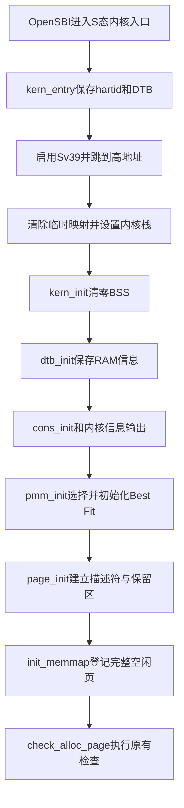
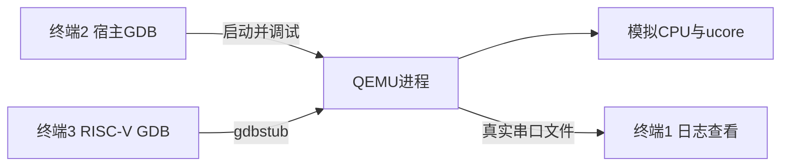

# Lab2 实验报告：物理内存和页表——韩羽宸负责部分

## 实验基本信息

| 项目 | 内容 |
| --- | --- |
| 实验名称 | Lab2：物理内存和页表 |
| 报告作者 | 2410673-韩羽宸 |
| 小组成员 | 2410673-韩羽宸、2410933-马禹翔、2410936-林子媛 |
| 本人实现与验证日期 | 2026 年 10 月 22 日 |
| 小组仓库 | [OSLab62](https://github.com/ACobayashi/OSLab62/tree/lab2) |
| 实验分支 | `lab2` |

本实验由三名成员按模块分工完成，本文记录韩羽宸负责部分的实现、分析与验证。报告中的代码说明、运行结果和截图均对应本地已经完成的实验，不将尚未推送的内容记为已提交。

### 小组分工

| 成员 | 负责的练习/模块 |
| --- | --- |
| 2410673-韩羽宸 | 启动与初始化主线；`page_init()`；Best Fit 完整实现与接入；分页设计六问；物理内存范围 Challenge；双 GDB 环境与 QEMU 页表翻译；最终报告整合 |
| 2410933-马禹翔 | First Fit 源码分析与思考题；Buddy System 实现及测试；TLB 查询与命中、未命中过程 |
| 2410936-林子媛 | SLUB 实现及测试；Sv39 基础原理；Bare/Sv39 对比；QEMU 软件 TLB 与真实 CPU TLB 的逻辑差异 |

各成员分别完成自己模块的代码、测试、提示词和报告材料，再按共同章节编号汇总。本文保留小组汇总大纲中的原编号，4.4、4.6、4.7、5.3、5.4 等队友负责章节由相应个人报告提供，便于后续合并。

提示词按实际需求和执行过程规范整理，统一采用 `[PROMPT] / [RELY] / [GUARANTEE] / [SPECIFICATION]` 四段式，并在 Answer 中记录实际交付与迭代。规范稿不是逐字聊天记录，完整七组见 [prompt.md](prompt.md)。原始日志与来源信息保留在本地附加材料中；仓库仅提交实验代码、报告与图片，正文保留关键结果和对应截图。

---

## 一、实验目的

本实验围绕页表、物理页管理和页面分配展开。结合本人分工，具体目标如下：

| 学习目标 | 本人完成的内容 |
| --- | --- |
| 理解页表的建立和使用 | 结合高地址链接与物理加载，分析 Sv39 启动页表、地址映射、分页切换和内核栈设置，并在 QEMU 源码中跟踪实际地址翻译 |
| 理解物理内存的管理方法 | 从 DTB 获取 RAM 范围，建立 `Page` 描述符数组，处理管理上界、保留区、元数据占用和页面对齐 |
| 理解页面分配算法 | 在统一 PMM 接口下实现并接入 Best Fit，分析最小合适块选择、拆分、释放、相邻块合并及碎片问题 |
| 掌握 AI 协作与人工验证方法 | 编写行为规格和四段式提示词，通过真实编译、原有检查、边界验证及双 GDB 单步核验实现与解释 |

这几项目标需要连起来理解：页表解决“虚拟地址映射到哪里以及是否允许访问”，页描述符记录“物理页当前处于什么状态”，分配器决定“从哪些连续空闲页中满足请求”。三者共同支撑内存管理，但建立地址映射并不等于已经分配了页面，`Page` 数组也不是硬件使用的页表。

---

## 二、实验环境

### 2.1 系统、工具链与运行调试环境

本人沿用 Windows 上的 WSL2 Ubuntu-22.04 完成构建、运行和调试。以下信息来自本次实际环境核对；队友使用的环境由各自报告说明。

| 工具或环境 | 实际版本/配置 | 用途 |
| --- | --- | --- |
| 操作系统环境 | Windows + WSL2；Ubuntu 22.04.5 LTS | 提供实验构建、运行和调试环境 |
| Linux 内核 | `6.6.87.2-microsoft-standard-WSL2`；x86-64 | 承载工具链及 QEMU 宿主进程 |
| GNU Make | 4.3 | 组织源码编译、链接和运行目标 |
| 宿主 GCC | 11.4.0 | 宿主侧工具环境；与内核交叉编译器区分 |
| RISC-V GCC | `riscv64-unknown-elf-gcc` 10.2.0 | 编译 RV64 裸机内核 |
| RISC-V GNU ld | 2.35.1 | 按实验链接脚本生成内核 ELF |
| QEMU | 7.0.0；RISC-V `virt` 模拟机 | 加载固件与内核，模拟 CPU 和内存系统 |
| OpenSBI | 1.0；运行输出中的 Runtime SBI Version 为 0.3 | 完成固件启动并提供 SBI 服务 |
| 宿主 GDB | `/usr/bin/gdb` 12.1 | 调试 x86-64 的 QEMU 进程及其 C 源码 |
| RISC-V GDB | `riscv64-unknown-elf-gdb`，`16.3.90.20250610-git` | 连接 QEMU gdbstub，调试 RV64 ucore |
| Python | 3.10.12 | 运行独立测试、日志整理和调试辅助脚本 |

宿主 GDB 与客体 GDB 调试不同目标：前者加载 QEMU，后者加载带符号的 `bin/kernel`。QEMU 实际加载的内核镜像为 `bin/ucore.img`，它是由 ELF 转换得到的裸镜像，不能替代 ELF 提供源码符号。专用 RISC-V GDB 的实际路径为 `/home/smile/toolchains/riscv-elf-toolchains/bin/riscv64-unknown-elf-gdb`。

QEMU 源码与调试构建位于 `/home/smile/src/qemu-7.0.0`，本次明确选用其中的 `build/qemu-system-riscv64`。已有构建包含 DWARF 调试信息，配置为 `buildtype=debug`、`debug=true`、优化级别 2，实际编译选项含 `-g -O2`。已安装副本与该构建的 SHA-256 一致，且能定位实际函数和源码，因此复用现有构建，没有执行覆盖安装。部分变量显示 `<optimized out>` 是优化构建的实际现象，后文结合真实停点和可读变量进行分析。

本机 QEMU/OpenSBI 组合需要通过 `-kernel` 提供固件下一跳。原项目仅使用 loader 时曾出现下一跳为零，实际运行保留 loader 并增加 `-kernel bin/ucore.img`，没有修改正式 Makefile。构建、测试注入和辅助脚本均在附加材料中的源码副本运行，使 `code/` 保持为实验源码目录。报告中的图片集中展示实验状态、过程和结果，不重复放工具版本或环境可运行的证明图。

### 2.2 各成员使用的 AI 工具与模型

本文记录本人的实际使用情况：

| 成员 | AI 编程工具 | 底层模型 | 主要用途 |
| --- | --- | --- | --- |
| 2410673-韩羽宸 | OpenAI Codex 桌面端 | 未单独留存可核验的具体版本记录 | 阅读手册与源码、整理规格和提示词、实现与核验代码、设计边界验证、定位启动问题、解释双 GDB 单步 |

队友在本次 Lab2 中使用的工具和模型由各自报告说明，不沿用 Lab1 的记录推定。本人通过自然语言描述任务目标、修改边界和验收结果，再把实际过程整理为四段式提示词；报告不填入无法核验的模型版本。

AI 提供候选实现和解释，最终仍依据真实源码、断言、寄存器、页表项和运行日志判断。提示词既要明确模块功能和接口，也要说明失败行为与不可修改范围；Answer 记录实际完成的内容及真实问题，没有发生的算法错误、没有执行的测试和没有保留的现场画面不写成事实。

---

## 三、实验整体逻辑分析

### 3.1 本章节的逻辑主线

Lab2 在可启动内核的基础上建立最初的高地址映射，并使内核能够发现、组织和分配物理内存。阅读时可以先理解地址、页表和 TLB，再看物理内存管理；实际执行时，静态启动页表先于动态分配器生效。否则会出现“必须先动态分配根页表才能进入分配器”的循环依赖。

启动根页表和 8 KiB 栈已放在内核镜像中。汇编使用它们进入高地址 C 代码；C 代码解析 DTB；`page_init()` 建立 `Page` 数组、保留区和初始空闲区；Best Fit 再从这些空闲区中交付连续物理页。队友的 Buddy 是另一种页级分配策略，SLUB 是建立在页分配之上的对象层；它们与当前默认 Best Fit 的独立验证方式应分别说明。

页表回答“这个虚拟地址访问哪一个物理位置”，`Page` 数组回答“这个物理页有什么管理状态”，空闲链表回答“哪些空闲页组成连续块”。同一物理页可以已有地址映射但仍被固件保留，也可以被分配器分配而不等于新建了进程映射。

### 3.2 功能实现顺序与依赖关系



当前 `init.c` 的实际顺序是 `memset -> dtb_init -> cons_init -> print_kerninfo -> pmm_init`。`cons_init()` 在本工程为空，字符输出通过 SBI 完成，因此 DTB 能先输出。部分手册示意出现的 `idt_init()`、`clock_init()`、`intr_enable()` 不在当前实际调用链中。

`pmm_init()` 内部先调用 `init_pmm_manager()` 建立空管理器，再由 `page_init()` 规划页面并调用 `init_memmap()`，之后才检查分配。这里的 `init_memmap()` 是对当前管理器回调的委托，不是重新探测 RAM。函数指针把公共调用和具体算法连接起来，替换分配策略无需重写 DTB 或启动映射。

### 3.3 项目组成与模块协作

- `kern/init/entry.S`、`init.c`：保存启动参数、切换分页和栈，安排 C 初始化；`tools/kernel.ld`、`boot.ld`、`kernel_nopage.ld`：链接布局与相应实验场景的脚本。
- `kern/driver/dtb.c`、`dtb.h`：解析设备树并提供内存查询；`console.c`、`console.h` 和 `kern/libs/stdio.c`：控制台输出接口。
- `kern/mm/pmm.c`、`pmm.h`：通用管理入口、接口委托与初始化；`best_fit_pmm.c/.h`：本人算法；`default_pmm.c/.h`：框架 First Fit；队友 Buddy 文件提供另一种实现。
- `memlayout.h`、`mmu.h`、`libs/riscv.h`：地址布局、页表及寄存器常量；`libs/list.h`、`defs.h`：链表、基础类型及成员指针转换；`libs/sbi.c/.h`：固件调用。
- `libs/string.*`、`printfmt.c`、`readline.c`、`stdio.h`、`stdarg.h`、`error.h`：字符串、格式化和基础声明；`kern/debug/assert.h`、`panic.c`：错误检测。
- `Makefile`、`tools/function.mk`：编译链接和运行目标；`tools/gdbinit`：调试配置；`tools/grade.sh`、`inject.py`、`test_lab2.c`：工程检查、注入和评分。

本文主责修改是 `pmm.c`、`best_fit_pmm.c`、`entry.S`，实现位置保留 `lab2` 并标记 `2410673`。公共状态和接口不随算法改变。页数语义也须明确：本 Best Fit 精确交付 n 页；不能未经约定就假设向上取整的其他分配器与它完全相同。

## 四、实验内容与实现

### 4.1 基础原理、管理框架与启动分页

**高地址链接与物理加载。** 链接脚本将 `BASE_ADDRESS` 设为 `0xffffffffc0200000`，ELF 中内核符号按这个高地址布局；QEMU 将裸内核镜像加载到物理地址 `0x80200000`。两者之差是 `0xffffffff40000000`。链接脚本决定地址安排，真正的运行时翻译仍由页表和 `satp` 配合完成，修改链接地址不会自动启用分页。

进入 `kern_entry` 时，实际观测到 PC 为 `0x80200000`、`satp = 0`，处于 Bare 地址转换模式，S 模式取指按物理地址进行。本轮继承的 SP 为 `0x8003def0`，属于固件启动现场；它不是内核自己的栈，也不是以后每次运行都固定不变的接口。内核在进入 C 之前换成自身分配的栈。

符号的链接地址与指令执行算出的地址要分别分析。`la`、`tail` 是伪指令，其结果与展开方式有关，不能概括为“高地址链接以后每条 `la` 都会生成高地址”。当前保存启动参数的 `la` 展开为 PC 相对的 `auipc/addi`，在低地址启动时能算出镜像中变量的物理位置。旧实验只用 `la sp`、`tail kern_init` 并不能保证建立高地址虚拟空间，即使某些 PC 相对跳转暂时仍能在低地址继续执行，也不等于高地址映射已经存在。

**分页设计六问。** 以下逐项对应手册“建立段页式管理中需要考虑的关键问题”。

1. **哪些物理空间需要映射？** 启动执行需要访问内核代码、数据、BSS、启动栈、根表、DTB，以及随后用于页描述符和分配的 RAM。本项目用一个根级大页简化覆盖从 `0x80000000` 起的 1 GiB 物理窗口，即 `[0x80000000, 0xc0000000)`。这是地址映射窗口；本轮真实 RAM 只有 `[0x80000000, 0x88000000)`，不能因为有 PTE 就把窗口剩余部分当成存在的 RAM。OpenSBI 所在的实验保留区虽落在窗口内，也不能交给分配器，实际访问还受 PMP 等权限约束。

2. **具体映射关系是什么？** 高地址区从 `0xffffffffc0000000` 开始，直至 64 位地址的最大值，对应上述物理窗口。用闭区间写即高地址 `[0xffffffffc0000000, 0xffffffffffffffff]` 映射到物理 `[0x80000000, 0xbfffffff]`。对这个窗口中的有效访问，`PA = VA - 0xffffffff40000000`。内核入口位于窗口内偏移 2 MiB 处，因此 `0xffffffffc0200000` 对应 `0x80200000`。当前修复还在过渡期用根表第 2 项临时提供低地址恒等映射，进入高地址后移除。

3. **页目录表起始地址在哪里？** Sv39 的根表符号为 `boot_page_table_sv39`。本次观测虚拟地址是 `0xffffffffc0205000`，物理地址为 `0x80205000`，物理页号为 `0x80205`。硬件通过 `satp.PPN` 定位它，不能把符号的高虚拟地址直接写成根表物理页号。

4. **页表放在哪里、需要多少空间？** 根表在 `entry.S` 的 `.data` 段静态分配并按 4 KiB 对齐，共 512 个 8 字节项，总大小 4096 字节。当前根项直接作为 1 GiB 叶项，没有继续为该映射分配中间和末级表。一般 Sv39 支持三级结构，但本实验当前用到的表内存只有一个根表页，不能说必然用了三张表。

5. **怎样设置页目录项？** Sv39 各级使用同一种 PTE 格式。若有效项的 R/W/X 均为零，它才作为通向下一级表的非叶项；有合法的 R 或 X 权限组合时可作为叶项。当前根表第 511 项是叶项，第 2 项仅在启动过渡期有效，其余项为零。进入 C 后实测只剩第 511 项有效，前 511 项为零。根表中使用了叶项，所以此处不存在另一个必须指向的下级目录。

6. **怎样设置页表项内容？** 目标 1 GiB 物理窗口的基址为 `0x80000000`，先取物理页号 `0x80000`，再移到 PTE 的 PPN 字段，得到 `(0x80000 << 10) | 0xcf = 0x200000cf`。低位 `0xcf` 表示 V、R、W、X、A、D 为 1，U、G 为 0；它是内核可读写执行、预置访问和脏标记的叶项，不是用户映射，也没有设置全局位。1 GiB 叶项的虚实基址均满足 1 GiB 对齐，不能把没有这样对齐的任意内核页地址直接填作根级大页基址。

六问中的“目录表”和“页表”是按层级职责提出的问题，Sv39 并不使用两种不同格式的表项。本项目根表同时承担叶表的功能。Sv39 允许不同级别的叶项以及对应的大页对齐要求，和规范一致。[RISC-V Supervisor ISA](https://docs.riscv.org/reference/isa/priv/supervisor.html)

**`satp` 与翻译同步。** RV64 的 `satp` 包含 MODE、ASID 和根表物理页号。当前使用 MODE=8（Sv39）、ASID=0、PPN=`0x80205`，所以数值为 `0x8000000000080205`。右移 12 位的是根表物理地址，不是整个 `satp`。Sv39 虚拟地址按规范进行高位符号扩展校验，不能把任意 64 位值都当成有效 Sv39 地址。

`sfence.vma` 用于页表更新与随后地址翻译之间的同步，并使相关翻译缓存状态满足新映射的要求。写 `satp` 本身不等于完成页表更新排序或翻译缓存失效；这里使用不限定地址、ASID 的形式。它不是刷新所有普通数据缓存或指令缓存的通用命令。[RISC-V 对 satp 与 SFENCE.VMA 的说明](https://docs.riscv.org/reference/isa/priv/supervisor.html)

**从低地址到高地址的真实过程。** 开启分页不会替 CPU 自动改写 PC。本次在 `csrw satp,t0` 执行后，PC 仍为低地址 `0x80200038`，而 `satp` 已变为 Sv39；临时根项确保下一条指令仍能取到。随后跳至 `0xffffffffc0200046`，在高地址清除根表第 2 项并执行 `sfence.vma`，再设置高地址栈并跳到 `kern_init()`。如果只保留高地址项却不处理这段过渡，低地址下一次取指就可能产生页错误；实际集成时已经用真实 `scause/stval` 定位并修复了这一问题。

启动只读 GDB 观察得到：

```text
A_Bare:                  PC=0x80200000          satp=0
C_Sv39_low_PC:           PC=0x80200038          satp=0x8000000000080205
D_High_before_cleanup:   PC=0xffffffffc0200046  root[2]=0x200000cf
E_C_entry:               PC=0xffffffffc02000ee  root[2]=0
                        SP=0xffffffffc0205000  root[511]=0x200000cf
F_DTB_parsed:            RAM base=0x80000000    size=0x08000000
```


图中 A、B 的 `satp=0`，PC 仍位于物理入口附近；C 中 `satp` 已切换为 Sv39，PC 却仍是低地址，说明开启分页和跳转高地址是两个动作。D 到达高地址时临时根项仍有效；E 进入 C 后，第 2 项清零、第 511 项保留，SP 已切换到内核栈顶。F 表明保存的 DTB 地址仍为 `0x87000000`，RAM 信息在进入物理内存管理前已经解析。最后的 `[511]` 来自对导出根表的检查，表示最终只有该索引有效。

图05是本人现场执行后取得的 GDB 状态摘要，原始断点和单步记录另行保存。它展示启动时刻的变化；QEMU 内部地址翻译源码的双 GDB 单步另以4.8的证据说明。

启动栈实际范围为 `[0xffffffffc0203000, 0xffffffffc0205000)`，长度 8192 字节，向低地址增长。栈顶与根页表起点恰好同为 `0xffffffffc0205000`，两者只是边界相接：表占据其后的一个页，栈使用其之前的空间，不是同一块内存被重叠使用。C 代码的函数序言使用 SP 后，`pmm_init()` 处观测到 SP 为 `0xffffffffc0204ff0`，不能要求后续所有断点处 SP 都仍等于初始栈顶。

**一般三级页表与本次大页。** Sv39 的地址索引可分成 VPN[2]、VPN[1]、VPN[0] 和 12 位基本页偏移；根表、中间表、末级表分别可以形成 1 GiB、2 MiB、4 KiB 的叶映射。本次根项已是叶项，因此转换在根级结束，1 GiB 内的低 30 位作为大页内偏移。例如实际 C 入口 `VA=0xffffffffc02000ee`，根索引为 511，窗口内偏移为 `0x2000ee`，所以 `PA=0x80000000+0x2000ee=0x802000ee`。这是基于已读取 PTE 的地址计算，尚不等于已经在 QEMU 源码中单步看到页表遍历，实际 QEMU 源码单步另见 4.8。

**启动故障与 AI 修复记录。** 首次完整内核构建成功但没有进入 C。实际 GDB 证据为 `scause=0xc`、`stval=0x80200038`、`satp=0x8000000000080205`，说明写 satp 后低地址下一条取指没有有效映射。修复不是增加一个 nop，也不是跳过异常，而是在过渡期间提供合法低地址映射，进入高地址后立即撤销。失败现场和修复后状态见 `initial_boot_gdb.log`（本地记录）、`final_mapping.log`（本地记录）。这是启动控制流问题，不是 Best Fit 选择错误。

**P3：启动衔接修复的四段式提示词。**

**[PROMPT]任务说明**

**任务：** 修复实际 `code/kern/init/entry.S` 中从 Bare 切换到 Sv39 后无法继续取指的问题，使完整 Lab2 内核能够进入 `kern_init()` 并执行内存管理检查。

**操作要求：** 修改实际启动汇编，标明 2410673。保留现有高地址链接、虚实偏移、根页表、OpenSBI 参数保存和原有 C 入口，不改动分配器或已有测试。只增加启动过渡所需的最小映射和控制流，进入高地址后必须移除临时映射并刷新相关地址翻译状态。

**输出要求：** 解释原故障的实际证据、临时映射覆盖的区间、何时跳转和何时清理。运行完整内核并用 GDB 核对最终页表，不得只根据输出猜测修复有效。

**[RELY] 上下文信息**

原始完整内核已成功编译，但没有输出 C 初始化信息。GDB 单步的实际结果为：`satp = 0x8000000000080205`、`scause = 0xc`、`stval = 0x80200038`。对应位置为写入 `satp` 后的 `sfence.vma` 指令，说明低地址取指产生了 instruction page fault。

原始代码以 `0xffffffffc0200000` 为链接起点，物理加载地址为 `0x80200000`，偏移为 `0xffffffff40000000`。根页表包含 512 个 8 字节项，原来仅第 511 项有效，其值为 `(0x80000 << 10) | 0xcf`，将高地址区域映射到从 `0x80000000` 起的 1 GiB 物理区。开启分页不会自动改变当前 PC 的数值。

根页表第 2 项对应从 `0x80000000` 起的低地址 1 GiB 区域。若临时填入同样的大页叶项，则启动代码当前 PC 所处的物理区可以继续按同值虚拟地址取指。实际根表符号为 `boot_page_table_sv39`，C 入口为 `kern_init`，栈顶为 `bootstacktop`。

**[GUARANTEE] 接口清单**

- 保持入口符号 `kern_entry`、根表符号 `boot_page_table_sv39`、`boot_hartid`、`boot_dtb`、`bootstack` 和 `bootstacktop` 的职责。
- 保持页表为一页、512 项，不改变最终高地址映射和原有 C 接口。
- 可增加仅供汇编内部使用的跳转标签，例如 `.Lhigh_entry`，不新增公共函数。

**[SPECIFICATION] 行为规格**

**Pre-Condition：** 内核在 `0x80200000` 开始执行，处于启动阶段，尚未使用 C 栈，OpenSBI 的 hartid 与 DTB 参数仍可保存。页表尚未作为运行中共享结构使用。

**Post-Condition：** 控制流安全进入高地址，再使用高地址栈和 C 入口。进入 C 初始化后，第 2 个根页表项为零，第 511 项仍为 `0x200000cf`，`satp` 处于 Sv39 且仍指向原根表。

**Case 1：切换时低地址 PC。** 开启 Sv39 后，到高地址跳转之前的指令必须有有效取指映射，不能依赖未设置的异常处理程序进行恢复。

**Case 2：已经进入高地址。** 临时低地址映射应被清除，之后执行 `sfence.vma`；清除动作和后续指令须依靠高地址映射继续执行。

**Requirements：** 保留失败启动日志和单步寄存器证据；修复后既要通过完整内核检查，也要用 GDB 观察实际 PC、`satp` 和两个相关根页表项。

**Answer：** 真实故障为 `scause=0xc`、`stval=0x80200038`：写入 satp 后 PC 仍低，而原页表只映射高地址。增加根表第 2 项的临时恒等映射，跳到高地址后清零该项并执行 sfence.vma，再设置栈与进入 C。修复后完整内核和原有评分通过；现场启动观察确认进入 C 后 root[2]=0、root[511]=0x200000cf。详见个人报告 4.1 及启动截图。

### 4.2 功能模块一：物理内存探测与页初始化

**任务、接口和职责。** 实际实现入口为 `static void page_init(void)`，由 `pmm_init()` 调用，不接收参数、不返回值。它消费 DTB 查询结果并建立初始页状态，不重新解析 DTB，也不负责 Best Fit 的搜索。关联接口为 `void dtb_init(void)`、`uint64_t get_memory_base(void)`、`uint64_t get_memory_size(void)`，以及内部委托 `static void init_memmap(struct Page *base, size_t n)`。实现见 [pmm.c](../code/kern/mm/pmm.c)。

**启动参数与 DTB 解析。** OpenSBI 以 a0 传入 hartid，以 a1 传入 DTB 物理地址，本轮为 0 和 `0x87000000`。`entry.S` 在改用这些寄存器之前保存到 `.data` 中的 `boot_hartid`、`boot_dtb`，因此 C 中清零 BSS 不会清掉参数。`dtb_init()` 使用编译期 `PHYSICAL_MEMORY_OFFSET` 将 DTB 地址转换为 `0xffffffffc7000000`，不依赖尚未由 `page_init()` 设置的全局偏移。

解析器验证非零地址和魔数 `0xd00dfeed`，按大端格式转换头部、结构标记和属性中的数值；头部偏移确定结构块、字符串块位置。`FDT_BEGIN_NODE` 识别节点，`FDT_PROP` 通过名称偏移查找属性，在 memory 节点中读取 `reg` 的起点和长度，处理必要的 4 字节对齐；`FDT_END_NODE`、`FDT_NOP` 和 `FDT_END` 控制遍历。结果保存到静态 `memory_base/memory_size`，由 getter 交给 PMM。当前 `dtb.c` 是框架提供的简化解析器，并非本人从零实现的通用设备树库。

空 DTB、错误魔数或未找到内存时，解析器打印信息并返回，当前启动的查询结果仍为零；后续 `page_init()` 校验并终止。不能把这些路径写成解析器本身全部 panic。当前代码没有完整遍历多段 RAM、保留区和通用 cell 编码，也不对任意损坏 DTB 提供完整边界防护。本实验遵循手册的可信启动 DTB 与单段 RAM 条件。

**四种地址和页数。** `end`、`pages` 是内核虚拟地址；RAM 起点、`maxpa`、`freemem` 是物理地址；`nbase/npage` 是物理页号；`struct Page *` 指向管理记录，不是待分配物理页的地址。

```text
nbase = DRAM_BASE / PGSIZE = 0x80000
npage = 管理末端物理地址 / PGSIZE = 0x88000（本次128 MiB）
描述符数量 = npage - nbase = 32768
page2pa(pages+i) = (nbase+i) << 12
pa2page(pa) = pages + (PPN(pa)-nbase)
```

`npage` 虽在旧注释中容易被理解为“页面数量”，实际是页号上界。把它直接当数组元素数会多算从零到 DRAM_BASE 的巨大空洞。`pa2page()` 的当前实现只显式检查上界，调用方仍须保证地址不低于 DRAM_BASE，不能将它当成任意地址的完整验证器。

`PADDR(kva)` 从内核虚拟地址减去全局偏移，当前宏检查其不低于 KERNBASE；它不执行硬件查表。手册给出 `KADDR` 反向转换思路，但本工程中的宏处于注释内，当前实现未调用它。因而报告说明转换关系，不把被注释宏写成正在使用的接口。

**布局和初始化步骤。** 实现先校验起点等于当前固定 DRAM_BASE、长度非零、起点加长度不溢出，再设置偏移。管理末端由真实内存末端与框架上界取较小值并向下按页对齐，必须能覆盖内核。描述符数组在虚拟 `end` 后向上对齐，写数组之前先检查整个数组容得下。

```text
maxpa = ROUNDDOWN(min(mem_base+mem_size, PHYSICAL_MEMORY_END), PGSIZE)
pages = ROUNDUP(end, PGSIZE)                 （虚拟地址）
page_count = npage - nbase
pages_pa = PADDR(pages)                     （物理地址）
freemem = ROUNDUP(pages_pa + page_count*sizeof(struct Page), PGSIZE)
可分配区 = [freemem, maxpa)
```

容量检查使用 `page_count > (maxpa-pages_pa)/sizeof(struct Page)`，先确定减法合法，再避免直接用一个过大乘积判断。全数组先置为引用计数零、`property=0`、保留标志置位、链表节点自环。只有确定可用的完整页面才交给当前管理器解除保留并登记，其他页面继续保留。

```text
低地址 → 高地址：
OpenSBI保留区 → 内核镜像（含启动栈/根表/BSS）→ 对齐空隙
             → Page数组 → 对齐空隙 → 可分配完整页 → 不完整尾部
```

本次完整测试镜像 `end=0xffffffffc0206078`，所以数组起点为 VA `0xffffffffc0207000`、PA `0x80207000`。当前 RV64 `sizeof(Page)=40`，32768 个元素共 `0x140000` 字节，即 320 页；空闲起点为 `0x80347000`。总共保留 839 页，剩余 31929 页。代码使用 `sizeof` 和链接符号计算，未写死这组数值；独立测试内核稍大时起点会不同。

**行为规格与边界。** 输入依赖 DTB 已解析、管理器已初始化且调用前没有登记可分配页。成功返回必须得到可管理范围、完整描述符和安全空闲区；零空闲页可以保留确定状态，但不能调用 `init_memmap()`。无效起点、零长度、溢出、内核或描述符容纳不下时，须在放出空闲页前终止。完整的分支规格与实现提示词如下。

**P1：物理内存初始化的四段式提示词。**

**[PROMPT]任务说明**

**任务：** 在当前 Lab2 项目的 `code/kern/mm/pmm.c` 中，实现 `static void page_init(void)`，将设备树提供的物理内存信息转换为页描述符布局和当前物理内存管理器的初始空闲区。需要正确区分内核虚拟地址、物理地址、物理页号与 `struct Page *`，使 OpenSBI、内核镜像、页描述符数组及对齐空隙占用的页面不会被当作空闲页。

**操作要求：** 必须修改项目中的实际文件，只在 `page_init()` 待补全位置实现本任务，并将原有 `lab2 function1 YOUR CODE` 注释中的 `YOUR CODE` 替换为 `2410673`。保留其他现有代码，不改动接口、宏、数据结构、设备树解析器、已有测试、链接脚本和启动汇编。本阶段保持当前管理器选择，不提前实现或切换 Best Fit。不要修改队友的 Buddy 模块。验证需要的临时程序、日志及构建产物全部放在“附加材料/阶段2_物理内存初始化”下，不向 `code/` 添加辅助文件。

**输出要求：** 交付完整函数实现、布局计算说明以及实际验证结果。输出探测范围、实际管理范围和完整空闲页区间，说明空闲页数。验证既要覆盖正常路径，也要覆盖不按页对齐、内存不足和无效设备树结果等分支。工程中的真实定义优先于任何示例；独立测试通过与完整内核通过必须分别记录。

**[RELY] 上下文信息**

当前工程使用 RV64，以下定义来自实际代码。

`libs/defs.h` 的基础类型：

```c
typedef unsigned long long uint64_t;
typedef uint64_t uintptr_t;
typedef uintptr_t size_t;
```

`libs/riscv.h`、`kern/mm/mmu.h`、`kern/mm/memlayout.h` 中与本任务直接相关的值：

```c
#define DRAM_BASE 0x80000000
#define PGSIZE 4096
#define PGSHIFT 12
#define PPN(la) (((uintptr_t)(la)) >> PGSHIFT)
#define PHYSICAL_MEMORY_END 0x88000000
#define PHYSICAL_MEMORY_OFFSET 0xFFFFFFFF40000000
#define KERNEL_BEGIN_PADDR 0x80200000
#define KERNBASE 0xFFFFFFFFC0200000
```

`Page` 与链表节点的实际字段：

```c
struct list_entry {
    struct list_entry *prev, *next;
};
typedef struct list_entry list_entry_t;
struct Page {
    int ref;
    uint64_t flags;
    unsigned int property;
    list_entry_t page_link;
};
```

当前 RV64 布局下 `sizeof(struct Page)` 为 40 字节，代码必须使用 `sizeof`，不能把该数值写死。

`pmm.c` 已有的状态和委托接口：

```c
struct Page *pages;
size_t npage = 0;
uint64_t va_pa_offset;
const size_t nbase = DRAM_BASE / PGSIZE;
const struct pmm_manager *pmm_manager;

static void init_memmap(struct Page *base, size_t n) {
    pmm_manager->init_memmap(base, n);
}
```

可依赖的已有函数及链接符号：

```c
uint64_t get_memory_base(void);
uint64_t get_memory_size(void);
static inline void set_page_ref(struct Page *page, int val);
static inline struct Page *pa2page(uintptr_t pa);
extern char end[];
```

这些只是已有接口的上下文清单，不要重复添加定义。`end` 是 `tools/kernel.ld` 提供的内核末尾虚拟地址；`pages` 也保存虚拟地址。`page2pa(p)` 对应物理页号 `p - pages + nbase`，`pa2page(pa)` 对应 `&pages[PPN(pa) - nbase]`，因此描述符总数是 `npage - nbase`。`npage` 是绝对物理页号的上界。

使用实际 `PADDR(kva)` 进行虚实地址转换：它会检查地址不低于 `KERNBASE`，并减去 `va_pa_offset`。在它被使用时，偏移必须已正确设置。对齐使用 `defs.h` 的 `ROUNDUP` / `ROUNDDOWN`，页面状态使用 `SetPageReserved` / `PageReserved` / `PageProperty` 等实际宏，链表节点使用 `list_init()`。`panic()` 终止执行，`cprintf()` 输出验证所需信息。

本项目 `nbase` 固定，支持 QEMU virt 上从 `DRAM_BASE` 开始的一段 RAM，不要求支持任意物理内存起点或多段 RAM。设备树默认报告 128 MiB。按手册简化约定，DTB 中的起点与长度提取后，其存储可以复用。

**[GUARANTEE] 接口清单**

- 必须实现且保持签名：`static void page_init(void)`，位于 `code/kern/mm/pmm.c`。
- 成功时对外提供一致的 `va_pa_offset`、`npage`、`pages` 和当前管理器的空闲页初始状态。
- 沿用 `init_memmap(struct Page *base, size_t n)` 委托接口，不新增或修改公开接口。
- 不需要增加辅助函数；如确有必要，辅助函数只能为模块内部的 `static` 函数，并且不能扩大允许修改的范围。

**[SPECIFICATION] 行为规格**

**Pre-Condition：** 启动分页和内核 BSS 初始化已经完成，设备树解析已执行。当前物理内存管理器已执行自身 `init()`，尚未登记本轮空闲区；`end` 可转换为实际内核末尾物理地址。该函数在启动阶段调用一次，不是可重复重置运行中分配器的接口。

**Post-Condition：** 正常返回时，虚实偏移等于 `PHYSICAL_MEMORY_OFFSET`。可管理物理地址上界不超过设备树所述末端和 `PHYSICAL_MEMORY_END`，并且按页向下对齐。`npage` 表示该上界的物理页号，描述符连续覆盖 `[nbase, npage)`。数组首地址位于 `end` 之后并按页对齐，数组本身完整落在可管理 RAM 内。

所有描述符在交给管理器前应具有确定的初始值：引用计数为零、`property` 为零、只有保留标志置位，链表节点自环。空闲区只包含描述符数组物理末端向上按页对齐后、管理上界之前的完整页面。该区之外的页保持保留，不能被分配。正常打印应能够核对原始范围、实际管理范围和空闲页数。

**Case 1：正常 RAM。** 默认 128 MiB 时，管理区为 `[0x80000000, 0x88000000)`，描述符共 32768 个；空闲页数由本次实际内核大小和描述符占用决定，不写死。若有完整空闲页，仅用对应的描述符起点和准确页数登记一次。

**Case 2：RAM 大小变化或末端不对齐。** 小于管理上限时按照实际大小计算；大于管理上限时只管理上限之内的页面；内存末端不足一页的部分不加入分配器。原始探测结果与实际管理范围应分别可见。

**Case 3：无完整空闲页或恰好一页。** 在描述符数组本身能够容纳的前提下，零空闲页时可以完成描述符初始化，但不得调用 `init_memmap()`，空闲计数保持零；恰好一页时只登记这一页。

**Case 4：输入无效。** RAM 起点不符合工程固定布局、大小为零，或起点加长度会发生无符号溢出时，使用 `panic()` 终止，不能向分配器登记页面。

**Case 5：空间不足。** 管理范围不能覆盖内核，或不能容纳整个描述符数组时，使用 `panic()` 终止。尤其要在写入描述符前确认整个数组放得下，不能依靠写越界后出现的异常发现错误。

**Requirements：** 不修改已有测试来获得通过，不跳过保留区，不把物理地址直接当作描述符指针。独立测试需检查所有描述符的状态和保留边界，并验证分配整个空闲区、耗尽后失败、释放后空闲页数恢复；完整工程测试待 Best Fit 模块完成后再执行和记录。

**Answer 与真实迭代。** 按以上规格完成实际函数并保留 `//lab2 function1 2410673`。初始化算法第一次完整执行 13 个用例均通过，没有为报告编造反复修正算法的经历。测试搭建时确有 `sbi_shutdown()` 只有声明、没有定义导致的链接错误，仅在独立驱动中用局部 SBI 退出调用处理；正式 SBI 模块不变。初始化的完整运行证据见 5.1，边界验证见 5.2。

### 4.3 Challenge：可用物理内存范围的获取

**题目：如果 OS 无法提前知道当前硬件的可用物理内存范围，有什么办法获取？**

可以让启动固件或引导程序按照约定，把运行时内存布局传给 OS。OS 不必把每台机器的 RAM 容量编译进内核，但必须知道怎样定位和解析这些启动信息。得到的应当是带起点、长度和用途的区间集合，而不能只有“装了多少 GB”一个总容量数。

在本实验中，入口寄存器 `a1` 提供 DTB 地址，内核读取 memory 节点的 `reg`，得到 RAM 起点与长度。完整设备树可以描述多段内存，且地址和长度的编码由相应 cell 数决定；保留区需要单独识别和排除。当前解析器只取找到的第一个地址、长度对，并没有实现通用多段解析及保留区处理。[设备树 memory 与 reserved-memory 约定](https://devicetree-specification.readthedocs.io/en/latest/chapter3-devicenodes.html)

其他平台可以采用不同的信息交付方式。例如传统 x86 BIOS 启动可由引导程序查询 E820 系统地址图，再将结果交给内核；UEFI 启动可在退出 Boot Services 前获取 `GetMemoryMap()` 返回的带类型内存描述符。后者需要依据类型区分可用 RAM、固件保留区和其他用途，不是拿到所有描述符就全部释放。本项目没有执行或实现这些固件接口，它们是 Challenge 的可行方法说明。[ACPI 系统地址图接口](https://uefi.org/specs/ACPI/6.5/15_System_Address_Map_Interfaces.html)、[UEFI GetMemoryMap](https://uefi.org/htmlspecs/ACPI_Spec_6_4_html/15_System_Address_Map_Interfaces/uefi-getmemorymap-boot-services-function.html)

若平台没有通用接口，也可由知道板级布局的固件依据内存控制器配置整理地址图，再按双方约定传递。此方法依赖平台文档，读取内存条容量信息本身不能自动给出所有实际映射、地址空洞和保留区。这是平台相关的补充思路，不是本次已经验证的探测程序。

获取原始区间后，还需检查起点加长度是否溢出、区间是否重复或冲突，区分 RAM 与 MMIO，并减去固件、内核、启动数据和管理元数据占用。最后将区间起点向上、末端向下按页对齐，只将确定可用的完整页交给分配器。对多段 RAM 应分别组织可用区，而不能假设从最低起点到最高末端之间全部存在内存。

不宜将“不断向更高地址写入测试值并读回”作为通用探测方案。未知物理地址可能属于 MMIO、保留数据或地址别名，写入会产生副作用；读写失败也可能来自访问权限而非 RAM 不存在。这一限制来自未知地址用途的风险分析。若完全没有平台信息或启动协议，就不能保证通过一段通用试探代码安全识别全部可用内存。

本实验按手册简化：DTB 中起点和长度提取后，后续不再需要 DTB 原结构，可以复用它占用的空间。真实系统若还要读取设备、CPU 或保留信息，应保留 DTB，或者完整复制后再释放，不能只因读过内存节点就复用。当前 `libs/sbi.h` 虽声明 `sbi_query_memory()`，实际 `sbi.c` 没有该实现，代码也没有走这条路径；不能据此宣称已经通过 SBI 自动查询全部物理内存。

因此，本题的完整回答是：**通过平台规定的启动信息获得内存区间和用途，再结合运行中必须保留的区域与对齐规则，形成可分配物理页集合。** 本次实现的是其中 DTB 单段内存的教学版本。

**Challenge 分析提示词的四段式摘要（完整分析任务见 P5）。**

**[PROMPT] 任务说明：** 根据手册回答未知物理内存范围如何获取，结合实际启动参数、DTB 和 `page_init()` 说明发现、保留和登记的完整关系。只写分析，不添加并未运行的固件调用或通用内存扫描代码。

**[RELY] 上下文信息：** 本工程 a1 提供 DTB，`dtb.c` 取得一段 RAM，`page_init()` 使用固定 nbase、管理上界和链接符号。现有 `sbi_query_memory()` 只有声明，没有实现；实验约定读取必要 DTB 信息后允许复用其存储。

**[GUARANTEE] 交付清单：** 给出直接答案、本实验路径、其他平台可行方法、保留区和对齐处理、当前简化限制；不新增公开函数。

**[SPECIFICATION] 行为规格：** 前提是平台存在可解释的启动信息协议；结果须区分总 RAM、可用区间与保留用途，说明多段和溢出检查。没有接口时不能保证通用写探测安全。只解释未在本工程执行的 E820/UEFI 方法，不写成已实现功能。

**Answer：** 通过固件/引导程序交付的内存区间与用途建立可用页集合；本工程实现 DTB 单段教学版本。上述答案覆盖信息来源和处理限制，而不仅是回答“读设备树”。

### 4.5 功能模块二任务二：Best Fit 实现与接入

**算法目标和状态约定。** 对 n 页申请，Best Fit 选择所有能满足申请的连续块中最小者；相同大小选低地址块。假设按地址有 12、6、9 页三个空闲块，请求 5 页：First Fit 会选择第一个 12 页块，本实现选择 6 页块，交付前 5 页、留下 1 页。Best Fit 的“最优”只针对当前剩余块大小，不能保证未来整体最优。

链表仍按地址排序，选择时才比较大小。地址顺序服务于释放合并，Best Fit 不要求链表必须按大小排序。内部 `static free_area_t free_area` 保存哨兵 `free_list` 和总空闲页数 `nr_free`；每个连续空闲块只有块头入链，块头的 `PG_property` 有效，`property` 是该块页数，不是空闲块个数。非块头不保留块头标志，分配后的旧长度要清零。

`Page.ref`、`flags`、`property`、`page_link` 分别表示引用、状态、块头长度和链表节点。`le2page(le,page_link)` 利用 `to_struct` 从成员地址减去字段偏移，返回所属 `Page`；不是从链表节点数值推导物理地址。描述符按物理页顺序排列，所以比较同一数组内的指针和 `base+n` 可以表达物理连续关系。标志位宏在当前工程直接修改字段，不能因为手册旧注释提到原子操作就宣称本算法已经支持并发。

**P2：Best Fit 的四段式实现提示词。**

**[PROMPT]任务说明**

**任务：** 在当前 Lab2 工程 `code/kern/mm/best_fit_pmm.c` 的待补全位置，实现完整的 Best Fit 连续物理页分配模块，定义 `best_fit_pmm_manager`，并在 `code/kern/mm/pmm.c` 的 `init_pmm_manager()` 中选择该管理器。对于一次申请，应返回所有足够大的空闲连续块中页数最少的块；若多个候选大小相同，选择物理地址较低者。支持精确匹配、较大块拆分、释放后的相邻块合并和空闲页计数。

**操作要求：** 必须修改工程中的实际文件，保留 `lab2 function2-2` 注释，将 `YOUR CODE` 替换为 `2410673`。不得修改文件中已有的 `basic_check()`、`best_fit_check()`，也不得改动已有头文件包含、`pmm.h`、`memlayout.h`、`Page` 结构、宏或公开接口。保留阶段二的 `page_init()`，不改动队友的 Buddy 模块。本任务实现范围是 Best Fit 模块及管理器选择；如完整启动发现其他问题，先提供实际诊断证据，再单独处理。

验证程序、评分副本、日志和构建产物全部放入“附加材料/阶段3_BestFit”，不向正式 `code/` 目录加入辅助程序或测试注入文件。正式代码需要通过真实 RV64 编译、原有检查和适用评分，不能通过改动测试断言获得通过。

**输出要求：** 交付完整代码、规范的行为说明、实际验证记录和改进空间分析。说明链表的组织依据、Best Fit 的选择依据、拆分后剩余区如何保留、释放后为何能够合并，以及失败时状态是否保持不变。区分原有测试、补充测试和最终评分各自证明的内容。

**[RELY] 上下文信息**

以下内容来自当前工程，不要根据其他版本猜测名称或布局。

`code/kern/mm/pmm.h` 定义的管理器接口为：

```c
struct pmm_manager {
    const char *name;
    void (*init)(void);
    void (*init_memmap)(struct Page *base, size_t n);
    struct Page *(*alloc_pages)(size_t n);
    void (*free_pages)(struct Page *base, size_t n);
    size_t (*nr_free_pages)(void);
    void (*check)(void);
};
```

`code/kern/mm/memlayout.h` 中的管理数据结构为：

```c
struct Page {
    int ref;
    uint64_t flags;
    unsigned int property;
    list_entry_t page_link;
};
typedef struct {
    list_entry_t free_list;
    unsigned int nr_free;
} free_area_t;
```

`PG_reserved` 为保留标志，`PG_property` 表示空闲块头；`property` 记录该块页数，只有空闲块头的该字段有意义。使用已有的 `SetPageProperty`、`ClearPageProperty`、`PageReserved`、`PageProperty`、`set_page_ref()`，以及 `list_init()`、`list_next()`、`list_prev()`、`list_add_before()`、`list_add_after()`、`list_del_init()` 和 `le2page()`。`list_entry_t` 包含 `prev` / `next` 两个指针，链表头是循环双向链表的哨兵节点。

`pmm.c` 已提供 `pages`、`npage`、`nbase` 和 `pmm_manager`。描述符范围为 `[pages, pages + (npage - nbase))`，描述符顺序对应物理页地址顺序。`alloc_pages()`、`free_pages()`、`nr_free_pages()` 分别委托给当前管理器的函数指针。`page_init()` 已经建立描述符，并把可用区先标为保留后交给管理器的 `init_memmap()`。

`code/kern/mm/best_fit_pmm.h` 已声明：

```c
extern const struct pmm_manager best_fit_pmm_manager;
```

该文件原有检查函数直接访问 `free_list` 和 `nr_free`，并在部分测试过程中临时保存、置空和恢复这两项状态。因此实现必须提供兼容的内部名字，允许“总数暂未重置，但链表已经置空”的测试中间状态，并保证找不到连续块时返回 `NULL`。`best_fit_check()` 内部会调用 `basic_check()`，注册后的 `.check` 必须使用原有检查函数。

`code/kern/mm/default_pmm.c` 是框架已提供的 First Fit，可阅读其状态含义和接口语义。Best Fit 的候选选择必须满足本任务规格，不能只选择遇到的第一个足够大的块。当前工程物理内存管理上界为 `0x88000000`，从 `0x80000000` 开始，最多管理 32768 个页描述符。

**[GUARANTEE] 接口清单**

必须交付下列管理函数，并通过注册结构连接到已有公共接口：

```c
static void best_fit_init(void);
static void best_fit_init_memmap(struct Page *base, size_t n);
static struct Page *best_fit_alloc_pages(size_t n);
static void best_fit_free_pages(struct Page *base, size_t n);
static size_t best_fit_nr_free_pages(void);
const struct pmm_manager best_fit_pmm_manager;
```

原有 `static void best_fit_check(void)` 保持函数体原样，用作 `.check` 回调；原有 `basic_check()` 同样保持不变。允许为插入和合并等内部操作添加 `static` 辅助函数，不增加公开 API。`init_pmm_manager()` 选择 `&best_fit_pmm_manager`。

**[SPECIFICATION] 行为规格**

**整体不变量：** 空闲链表按物理地址递增，节点只代表空闲块头，块间不重叠，物理相邻的空闲块应已合并。每个块头 `PG_property` 置位、`property > 0`；非块头不带该标志。空闲页总数等于各块长度之和，不等于块的数量。所有分配、释放操作按当前单核启动实验的顺序调用，本任务不实现并发锁。

**`best_fit_init()`**

- Pre-Condition：管理器尚未登记空闲区；该接口用于初始化，而不是运行中丢弃已有分配状态。
- Post-Condition：循环链表为空，空闲页总数为零。

**`best_fit_init_memmap(base, n)`**

- Pre-Condition：`n > 0`，连续描述符完整位于管理范围内，对应页面均处于保留状态，且没有与已经登记的空闲区重叠。
- Post-Condition：这 `n` 页不再保留，引用计数清零；空闲区按地址组织，块头元数据正确，空闲页数恰好增加 `n`。允许先后登记多个区域，登记顺序可以不同于地址顺序。
- Case：新区域与已有空闲区物理相邻时合并，不相邻时保持独立；不能越过保留区合并。

**`best_fit_alloc_pages(n)`**

- Pre-Condition：`n > 0`；零页请求违反接口约定，应触发断言。
- Post-Condition：成功时返回最小合适块的起始描述符，分配页数恰为 `n`，总空闲页数减少 `n`，已分配区不再是空闲块头。
- Case 1：候选块恰有 `n` 页，整块交付，不产生零长度空闲块。
- Case 2：候选块大于 `n` 页，交付前端 `n` 页，剩余尾部保留为空闲块，保持地址顺序。
- Case 3：存在多个等大的最佳候选，选择地址最低者，保证结果可复现。
- Case 4：总空闲页不足，或总数足够但没有足够长的连续块，返回 `NULL`，链表、块长度和总计数不变。临时空链表也不得产生无效指针。

**`best_fit_free_pages(base, n)`**

- Pre-Condition：`n > 0`，区间在管理范围内，所有页面当前已分配，未保留、未重复释放。调用者须提供准确区间；本模块不额外维护分配历史来验证任意非法释放。
- Post-Condition：区间重新可分配，引用计数和内部块长度清理，空闲页总数恰好增加 `n`。仅按真实物理相邻关系合并，不因为两个块在链表中相邻就无条件合并。
- Case：分别支持无邻居、仅前块相邻、仅后块相邻、同时连接前后两块。被合并掉的旧块头不得残留有效 `PG_property` 标记。

**`best_fit_nr_free_pages()`**

- Pre-Condition：管理器状态有效。
- Post-Condition：返回当前空闲页总数，不改变任何状态。

**验证要求：** 原有两项检查函数保持原样并实际运行；完整内核应显示 Best Fit 管理器名称及检查通过。补充验证最小合适选择、精确匹配、同尺寸选择、拆分、碎片不足、不同释放顺序和两侧合并。使用独立页面占用模型逐步核对一组重复分配与释放操作，检查指针、计数和不重叠性质，不能只凭“没有崩溃”判断正确。

**各核心接口如何协同。**

- `best_fit_init()`：把循环链表设为空，计数归零，尚不登记任何物理页。
- `best_fit_init_memmap(base,n)`：要求正页数、有效描述符范围、输入仍保留；初始化这些页，设置新块头，通过内部插入合并登记，总数只增加 n。多个区间乱序登记也能按地址组织。
- `best_fit_alloc_pages(n)`：断言 n>0；总量不足立即失败。扫描所有足够大的块，只有候选更小时才替换，所以相同大小保留先遇到的低地址块；精确匹配可提前退出。无候选返回 NULL，既不拆块也不改计数。
- 选择成功后，删除原块头、清除旧标志和长度；有剩余时以 `best+n` 为尾块头，把它插回原链表位置，保持地址顺序；计数只减少 n。精确匹配不生成零长度尾块。
- `best_fit_free_pages(base,n)`：调用者提供有效已分配区间；逐页清理状态，设置新块头，插入并尝试左右合并，总数只增加本次归还的 n。不是通过观察某个页的 ref 为零就能证明任意释放合法。
- `best_fit_insert_block(base)`：找到地址插入点，断言不与左右块重叠；先并左，令左块成为头，再从合并结果检查右邻居，故能一次连接两边。旧头标志与长度被清除、节点自环。链表相邻还不够，必须满足 `left+left->property==base` 等物理邻接条件。
- `best_fit_nr_free_pages()` 返回总空闲页数；注册结构将以上五个回调及原有 `best_fit_check()` 交给框架，`init_pmm_manager()` 选择 `&best_fit_pmm_manager`。只完成算法但没有切换管理器时，原内核运行的仍可能是 First Fit。

原有测试会暂时置空链表而尚未同步改计数，所以实现不能假定 `nr_free>=n` 必然存在候选。搜索无结果仍返回 NULL，兼容原测试的状态约定。原有 `basic_check()`、`best_fit_check()` 保持不变，并未另写“更容易通过”的版本替代它们。

**Answer、迭代与限制。** 本人完整模块、管理器注册和切换均已落到 [best_fit_pmm.c](../code/kern/mm/best_fit_pmm.c) 与 `pmm.c`，标记 `2410673`。原有检查 6/6、两项任务 PASS、评分 20/20 和补充模型核对均通过。未观察到需要改测试或修正选择算法才能通过的情况；实际集成中遇到的启动取指故障已在 4.1 分析。

零页申请违反接口前提并触发断言；本实现不维护完整分配历史表，不能声称检测任意重复释放、跨申请错误释放和所有非法指针。当前是单核启动阶段顺序调用的实验，没有并发锁。

**思考题：Best Fit 是否还有改进空间？** 设空闲块数为 B，当前分配最坏扫描 O(B)，精确匹配可提前停止；释放需处理 n 个描述符并定位插入点，约为 O(n+B)。可增加按大小的平衡树等索引快速找最小合适块，同时保留按地址定位邻居的能力；代价是拆分、合并和删除都要同步索引，增加元数据和一致性维护。尺寸分组也可减少搜索，但分组过粗可能改变严格 Best Fit 语义。

此外，最小剩余策略可能留下大量小块。立即合并只能合并已经空闲且物理相邻的区间，不能跨越已分配页；两个 3 页块不能满足一个 4 页连续请求，尽管空闲总量足够。这是外部碎片。按页分配小对象留下页内空间则涉及另一层内部碎片，需联系队友的 SLUB。本人没有实现上述索引或做速度基准，报告不给出未经测量的加速结论。

### 4.8 分支任务：QEMU/GDB 地址翻译与 TLB 调试

**双 GDB 与三个终端。** 宿主 GDB 看到的是 QEMU 的 C 源码、宿主线程和模拟状态；客体 GDB 看到的是 RISC-V 指令、内核符号和寄存器。前者加载 QEMU，后者加载 `bin/kernel`，不是把同一个目标打开两次。

本机 `ptrace_scope=1`，因此采用宿主 GDB 直接启动自己的 QEMU 子进程，不从其他终端 sudo attach，也不修改全局权限。相较手册的启动后附加方式，只改变了父进程关系。终端 1 用 `tail` 显示串口日志，终端 2 的宿主 GDB 启动并调试 QEMU，终端 3 的 RISC-V GDB 连接 stub。该权限策略的依据见 [Linux Yama 文档](https://docs.kernel.org/admin-guide/LSM/Yama.html)。没有实际执行一次被拒绝的 attach，故不将它写成已复现故障。



QEMU 的 `-S` 暂停模拟 CPU，`-gdb tcp:127.0.0.1:1234` 开启客体连接；QEMU 进程仍可处理调试请求。宿主断点则暂停 QEMU 本身，此时客体命令等待，需要先继续宿主。区分这两种暂停，才能理解为什么终端 3 看似“没有反应”。相关选项职责见 [QEMU 官方 gdbstub 文档](https://www.qemu.org/docs/master/system/gdb.html)。

宿主设置 `handle SIGPIPE nostop noprint pass`，实际显示 Stop=No、Print=No、Pass=Yes，保留信号传递而不因此暂停。SIGPIPE 通常与向已关闭连接写入有关；本轮未故意复现省略配置后的现象，不写成已观察到的 bug。断点按内核代码页和 `MMU_INST_FETCH` 限定，减少固件访问引起的无关停止。


图06是本人现场在宿主端取得的原图。实际请求地址为 `0xffffffffc0200046`，访问类型为取指；调用栈和 `cpu_helper.c:1184` 清晰可见。栈中宿主指针和宿主代码地址属于 QEMU 进程，不能当作模拟机器物理地址。此处只是进入翻译慢路径，还不是完成查表。

宿主继续后，客体在当前 ELF 的 `kern_init` 第一条指令停住。使用 `hbreak *0xffffffffc02000ee` 指定实际入口，避免仅按源码行设置断点时受函数序言影响。


图07的 PC 为 `0xffffffffc02000ee`，SP 为 `0xffffffffc0205000`，satp 为 `0x8000000000080205`。按配置的读取顺序，`$1=0` 是 root[2]，`$2=0x200000cf` 是 root[511]，说明过渡映射已经撤销。寄存器旁的负十进制数是相同位模式的有符号显示，应按十六进制解释 satp 字段。

**观测目标与选择理由。** 本次使用 QEMU 7.0.0，宿主 GDB 调试 QEMU 实现，RISC-V GDB 控制 ucore。选择内核从低地址跳到高地址标签时发生的一次取指，实际虚拟地址为 `0xffffffffc0200046`，访问类型为 `MMU_INST_FETCH`。该位置在现有 `entry.S` 中必然执行，与上述环境验证的观测目标一致，不需要临时向正式代码插入访存或修改页表。

这个地址位于 `kern_init` 所在页，但不是 C 入口 `0xffffffffc02000ee`。按代码页设置条件，可以捕获更早的首次高地址取指，避免该页已经缓存后再期待 C 入口精确地址触发同样的翻译。它是内核指令读取，不是用户程序的数据读写。页表翻译函数还会被调试器读取客体内存时调用，因此断点额外限制 `is_debug=false`，确认捕获的确是 CPU 执行产生的访问。

**源码调用路径和入口分支。** 双 GDB 实测的外层取指路径为 `tb_htable_lookup -> get_page_addr_code -> get_page_addr_code_hostp -> tlb_fill -> riscv_cpu_tlb_fill`。本轮继续观察到 `riscv_cpu_tlb_fill` 在 `target/riscv/cpu_helper.c:1278` 通过单阶段分支调用 `get_physical_address`，宿主调用栈直接显示了这次调用。上述路径属于本次取指翻译慢路径，不能直接替代所有数据访存或 TLB 命中路径。

条件断点按当前 ELF 推导的内核代码页设置：

```gdb
break get_physical_address if (addr & ~0xfffULL) == 0xffffffffc0200000 && access_type == MMU_INST_FETCH && first_stage && !two_stage && !is_debug
```

实际参数为 `first_stage=true`、`two_stage=false`、`is_debug=false`，客体特权级为 1，即 S 态。这里的一阶段/两阶段指虚拟化翻译，与 Sv39 的三级页表不是同一个概念。本次没有进入虚拟化第二阶段，也没有走 M 态或 Bare 的直接返回分支，而是从 `env->satp` 取得普通 S 态的页表配置。

**从 satp 找到页表。** 实测 `satp=0x8000000000080205`。MODE 为 8，对应 Sv39；ASID 为 0；根表物理页号为 `0x80205`。因此根表物理地址为 `0x80205 << 12 = 0x80205000`。这里保存的是物理页号，不是高地址符号 `0xffffffffc0205000`，也不是 QEMU 宿主进程中的对象指针。

`get_physical_address` 的 821～842 行先提取 `base` 和 `vm`，再由模式选择 `levels=3`、`ptidxbits=9`、`ptesize=8`。这说明 Sv39 最多用三个 9 位索引查表，每项 8 字节。随后代码检查虚拟地址高位是否合法，避免将不符合符号扩展要求的地址直接用于遍历；本次高地址通过该检查。Sv39 的三级结构以及各级允许叶项、大页须满足对齐的体系结构依据见 [RISC-V 官方 Supervisor 规范](https://docs.riscv.org/reference/isa/priv/supervisor.html)。

**循环、索引和 PTE 读取。** 本版本的主要遍历循环位于 876 行，`i` 从 0 开始，表示从根向下的第几轮；它与一些教材从顶层编号 2 再递减的写法不同。`ptshift=(levels-1)*ptidxbits` 初值为 18；每向下一层减 9。索引提取还要加上 12 位的普通页内偏移，因此根层取的是虚拟地址的第 38～30 位。

本次真实值为：

```text
VA           = 0xffffffffc0200046
VPN[2]       = 511
VPN[1]       = 1
VPN[0]       = 0
4 KiB offset = 0x46
i            = 0
ptshift      = 18
base         = 0x80205000
```

这里“最多三级”是架构能力，不是已经执行三轮。首轮根索引为 511，代码在普通单阶段分支计算：

```text
pte_addr = base + idx * ptesize
         = 0x80205000 + 511 * 8
         = 0x80205ff8
```

912 行先检查读取该 PTE 所在物理内存的 PMP 权限，RV64 分支在 923 行调用 `address_space_ldq(cs->as, pte_addr, attrs, &res)`。此调用通过 QEMU 的地址空间访问模拟机器的物理内存；不能在宿主 GDB 中直接把客体物理地址强转成普通宿主指针。

本轮先停在读调用之前，确认地址和索引，再用一次 `next` 执行读调用，停在 926 行。实际 `res=0`，即本次内存事务成功；实际读到 `pte=0x200000cf`。这两个值分别说明“读表成功”和“读到什么”，还不能省略后续合法性和权限判断。


图08是本人现场执行一次 `next` 跨过读表调用后的结果。根表、索引、PTE物理地址、值和标志位都来自当前会话，`MemTxResult=0` 只证明读取成功，访问合法性仍由后面的检查确定。

**有效性、叶项、权限和对齐。** 由实际 PTE 解码，`V=1 R=1 W=1 X=1 U=0 G=0 A=1 D=1`，PPN 为 `0x80000`。源码检查与本次情况如下：

- 941 行检查 V；本次有效。之后还检查扩展和保留位，不能只看 V 就宣告合法。
- 946 行检查 R/W/X 是否全零。全零且其余约束满足时才作为下级表指针继续走；本次 R/W/X 都为 1，是叶项候选，所以不会进入 `base=ppn<<12` 的下级遍历路径。953～957 行还排除了不合法的 W 组合，本次不属于这些组合。
- 958～965 行处理 U/S 权限。本次 `U=0` 且访问来自 S 态，允许继续；S 态不能因为打开 SUM 就任意执行用户页，这也是代码将取指单独考虑的原因。
- 966 行检查大页物理页号对齐。当前 `ptshift=18`，`ppn & ((1<<18)-1)=0`，满足根级 1 GiB 叶项的对齐要求。如果 PPN 的这些低位不为零，不能简单清零后继续使用，而会失败。
- 969～978 行依访问类型检查 R、W、X。本次是取指，X 为 1，通过执行权限检查；这不能代替对其他读写访问分别判断。

叶项位于根级，因此当前覆盖 1 GiB。本次仅读取一个根表项，`i` 仍为 0，并没有读取 VPN[1]、VPN[0] 对应的下层表。低两段 VPN 将参与形成大页内部的位置。

981～985 行根据访问类型计算 `updated_pte`。本次 A 已为 1，且不是存储；D 也已预设为 1，观察到 `updated_pte=0x200000cf` 与原值相同，因此不执行随后映射 RAM、原子比较交换和重走页表的更新路径。报告可以解释这条备选路径的用途，但不能写成本轮真的发生过 A/D 缺失或原子更新冲突。

**物理地址怎样形成。** 单步通过上述检查后，代码在 1033～1035 行形成结果。当前没有走 Svnapot 扩展，`napot_bits=0`。公式可按本轮实际状态化简为：

```text
vpn = VA >> 12
PA  = ((ppn | (vpn & ((1 << ptshift) - 1))) << 12)
      | (VA & 0xfff)
```

大页对齐保证 PPN 的相应低位为零，合并虚拟地址提供的低页号不会覆盖已有物理页号。代入本次观察值，也可以用更直观的大页基址与偏移表示：

```text
1 GiB page base = 0x80000 << 12 = 0x80000000
1 GiB offset    = VA & 0x3fffffff = 0x200046
PA              = 0x80000000 + 0x200046 = 0x80200046
```

`0x46` 只是最低 12 位偏移；若错误地把它直接加到大页物理基址，会漏掉低两段 VPN 对应的位置。代码正是用 `ptshift=18` 把这些位合入结果。

本轮在赋值语句前后各停一次，实际读取 QEMU 写出的 `*physical=0x80200046`，再使用观察到的 PPN 和 VA 独立计算，结果相同。按本实验固定映射偏移核对，`VA - 0xffffffff40000000` 也得到这个地址；固定偏移是对本启动映射的额外核对，不是 QEMU 任意页表都可使用的通用算法。

随后源码根据页表权限形成输出保护位。本次返回调用者后观察 `ret=0`、`pa=0x80200046`、`prot=7`，即翻译成功并带有本轮对应的读写执行保护位。调用者之后还要执行最终物理地址的 PMP 检查，成功才进入 `tlb_set_page`；PTE 本身所在地址的 PMP 检查和最终目标地址的 PMP 检查是两个位置。TLB 查询与填充的详细观察由队友负责，本段只交代与本人页表翻译的接口。


图09是本人现场物理地址赋值后的原图，实际输出和独立计算均为 `0x80200046`，并保留完整拼接语句。随后 `walk-return` 真实返回 `riscv_cpu_tlb_fill`，得到 `ret=0`、`pa=0x80200046`、`prot=7`，返回数据另有JSON记录。

**实际调试细节与 AI 帮助。** `walk_commands.py` 提供分段命令，内部执行真正的 `next`，每次记录源文件、行号和宿主 PC，随后读取变量。原始逐步观察及交付原样配置都实际运行了 52 次 `next`，没有为截屏修改 PC、`satp`、PTE 或指令。自定义命令是缩短重复操作的工具，报告仍需解释每段对应的源码行为，不能把看到一行“equal=true”当作理解完成。

实际单步中遇到的理解难点是现有 QEMU 的 `-g -O2` 优化：部分局部值只在一定范围可读，`next` 也会显示内联函数所在的头文件；返回时甚至显示到共享 `return TRANSLATE_SUCCESS` 的 793 行。不能据此倒推本次走了那里前面的 M 态分支。结合已记录的 `satp`、实际 PTE 读取、i/ptshift 和物理地址，才能确认本次真实走了 Sv39 根级叶项路径。AI 协助定位源码、整理停点和交叉核对值，本轮没有据此重编译 QEMU，也没有虚构新的内核 bug。

另一个容易误判的点是 `env->pc`：源码入口注释明确提醒它在此处不保证是当前异常处理时所用的准确 PC。本次使用实际 `addr` 与访问类型识别正在翻译的请求，并用已知启动代码位置解释目标，避免把宿主 GDB 的 PC、QEMU 保存的客体状态和正在翻译的地址混为一谈。

**P6、P7：双 GDB 和页表单步提示词的四段式摘要。** 完整接口、前后状态及异常处理分别收录于 `prompt.md` 的 P6、P7。

**[PROMPT] 任务说明：** 在真实本机环境建立宿主/客体联动，选择内核必然执行的取指请求，逐步展示页表读取、关键检查、叶项和物理地址形成；只写附加调试材料，不修改内核、QEMU 或已有测试。先验证用户将使用的原样配置，再逐步指导现场操作。

**[RELY] 上下文信息：** 当前 QEMU 7.0.0 的 `riscv_cpu_tlb_fill -> get_physical_address`、已有调试符号、已测 ELF、satp 和启动根表。入口参数为 `env/physical/prot/addr/fault_pte_addr/access_type/mmu_idx/first_stage/two_stage/is_debug`，以实际函数定义为准；取指限定 `MMU_INST_FETCH`，排除 `is_debug`。

**[GUARANTEE] 交付清单：** 两份 GDB 配置、三终端说明、真实 next 轨迹、关键变量、独立计算、正常返回和退出验证。`walk-to-load`、`walk-read`、`walk-check`、`walk-result`、`walk-return` 只在宿主 GDB 内辅助观察，不增加内核公开接口。

**[SPECIFICATION] 行为规格：** 源码与镜像一致且会话可用时，先停在读取前，再执行读调用并记录事务结果与 PTE，之后完成合法性/权限/对齐检查和真实物理地址赋值。根项为大页叶项就按实际层级结束；变量不可读、布局变化或结果不符应停止并保留证据，不代入预期值，不修改客体状态。翻译返回和后续 PMP/TLB 行为分别说明，不能把源码推断写成已实测的错误分支。

**Answer 与真实问题。** 自动双 GDB、原样交互配置和本人现场源码返回均有实际证据。辅助脚本最初的 MI 中断处理需开启异步模式，另一处关闭启动 shell 却保留字面引号使 QEMU 将 `"-machine"` 当作文件名；只修正附加材料脚本，重跑通过。现场多行粘贴也曾让 GDB 把 `continue` 当作 `disable` 的参数，逐条输入后正常恢复。以上是调试控制问题，不冒充内核算法错误。

## 五、测试与验证

### 5.1 整体编译运行、评分与提交检查

正式实现位于 `code/`，实际测试副本位于本地附加材料，避免把构建目录、注入调用或临时程序加入提交代码。完整内核验证脚本复制当前源码，使用原有 `tools/inject.py` 只在副本注入任务检查，按 `make -j2 DEFS=-Ducore_test` 构建。`ucore_test` 显示原有分配检查的六个进度点。

本机已执行的入口是：

```bash
cd '/mnt/e/Grade3_1/操作系统/os_lab/lab2/附加材料/阶段3_BestFit'
python3 run_kernel.py
python3 verify_grade.py
```

现场展示在 `kernel_tree` 中使用以下真实命令；它与构建脚本采用相同镜像及加载参数：

```bash
qemu-system-riscv64 -machine virt -nographic -bios default \
  -kernel bin/ucore.img \
  -device loader,file=bin/ucore.img,addr=0x80200000
```

若只下载仓库，辅助脚本不在提交范围，可把 `code/` 复制到本地独立工作目录后，用工程自带 `tools/inject.py` 在该副本注入、执行上述 make 构建并运行。正式源码不应直接注入。Makefile 的常规 `qemu` 目标在本机可通过 `QEMU="qemu-system-riscv64 -kernel bin/ucore.img"` 覆盖适配，而不修改文件。


图01从 DTB 信息开始保留完整关键输出：RAM 起点 `0x80000000`，大小 `0x08000000`（128 MiB），闭区间末端 `0x87ffffff`；对应半开管理区间 ``0x80000000,0x88000000)`。管理器名称为 `best_fit_pmm_manager`，空闲区 `[0x80347000,0x88000000)`，共 31929 页。原有检查达到 6/6，`check_alloc_page()` 成功，最后两项任务分别 PASS。

符号输出中 `entry` 实际由 `print_kerninfo()` 打印 `kern_init` 的地址，不等于汇编 `kern_entry`；`etext`、`edata`、`end` 分别对应相关段边界。此次输出内核占用约 24 KiB，是由实际符号算出的展示值，空闲区还需扣除固件保留和描述符数组，不能直接用“128 MiB 减 24 KiB”得到空闲量。根表虚拟、物理地址分别为 `0xffffffffc0205000`、`0x80205000`，符合固定映射偏移。

启动前的 OpenSBI 原始输出记录平台 `riscv-virtio,qemu`、一个 HART、当前 hartid=0、固件基址 `0x80000000`、大小 252 KB、Runtime SBI Version 0.3，下一跳为 `0x80200000`、S-mode。ISA/PMP 信息描述模拟 CPU 能力与物理访问权限，不是分配器给出的空闲区。固件报告的实际镜像大小与手册约定为 OpenSBI 保留的 2 MiB 不同，本实现仍按实验布局排除完整保留区。见 [kernel_boot.log`（本地记录）。

内核完成初始化后进入既有无限循环，终端停留在结果是预期行为。自动脚本观察到完整检查后结束五秒等待，不把 QEMU 未自行退出判作初始化失败。

评分脚本在另一副本运行原始 `make grade`，同时把 `GRADE_TMP` 指向附加材料工作区，并覆盖本机需要的 QEMU 参数。没有修改测试断言或评分条件。


图04显示 `check page init: OK`、`check best fit: OK`，总分 20/20。它只覆盖原有评分中的这两项，不能证明 Buddy、SLUB、理论题或全部调试要求完成。原日志保留了 Windows/WSL 文件时间的亚秒级偏差警告及编译、运行输出，没有隐藏警告或改系统时钟，见 `official_grade.log`（本地记录）。

本人源文件标记、原有检查函数不变、当前源码与已测版本一致均另行核对。当前报告完成不等于全组提交完成：队友模块与正文、汇总报告及最终 GitHub 推送仍应按各自交付和审核结果处理。

### 5.2 物理初始化与 Best Fit 验证

**验证来源。** 原有 `test_page_init()`、`test_best_fit()`、`basic_check()`、`best_fit_check()` 和评分来自工程。下面的 13 个初始化场景、10 组 Best Fit 行为及模型验证是依据手册规格补充设计的测试，不是手册列出的额外作业题。

**初始化边界。** 隔离 RV64 测试内核直接包含正式 `pmm.c`，使用真实结构和宏；默认场景读取真实 DTB，其余场景由测试驱动替换两个 getter 的返回值，不改正式 DTB 模块。13 个场景全部通过：

- 默认真实 DTB 的 128 MiB：调用原有任务一检查，核对页面布局和保留边界。
- 64 MiB、64 MiB 加 123 字节、报告 256 MiB：分别检查较小容量、末尾不足一页和框架上限裁剪。
- 描述符后恰好零页或一页：零页不调用 `init_memmap()`；一页只登记一页，并可分配、耗尽和恢复。
- 起点为零、起点不匹配、零长度、范围相加溢出：必须在放出空闲页前终止。
- RAM 不能覆盖内核、放不下描述符数组、小于一页：检查空间不足与数量下溢防护。

异常场景的 PASS 表示捕获预期 panic，不能说无效输入也完成正常初始化。成功场景逐页检查初始保留标志、引用计数、property 和节点自环，登记后检查保留/空闲边界，再分配全空闲区、确认耗尽、释放并检查恢复。测试镜像故意令 end 不按页对齐，能够检验对齐处理；其空闲起点 `0x80348000` 比图01高一页，源于测试镜像大小，不是正式算法前后矛盾。

**Best Fit 行为。** 在 96 个真实 `Page` 描述符的隔离池中，直接包含实际分配器源码，执行 10 组：空状态、乱序登记及相邻合并、最小合适选择与尾块拆分、后方精确匹配、同尺寸低地址、碎片/总量不足保持状态、左/右/双侧合并、耗尽与恢复、未修改的原有检查，以及独立模型操作。

独立模型只记录每页保留/空闲/已分配，自行从连续空闲段推导预期选择，不读取被测链表和 property 作为答案。3000 次确定性申请/释放逐次比较返回位置、计数、保留边界、块头、双向链表与区间不重叠；最后归还全部存活块，共完成 3060 次状态核对。这样比“程序没有崩溃”更能发现错误选块、漏合并或计数问题，但有限序列仍不是对所有输入的形式化证明。

结果摘要见 `page_init_cases.json`（本地记录） 和 `best_fit_boundary.log`（本地记录）。为控制同类图片数量，正文不重复铺测试汇总；已取得的两张补充图作为可点击佐证：[初始化边界测试](images/hyc/02_物理内存初始化边界测试.png)、[Best Fit补充测试与模型核对](images/hyc/03_BestFit补充测试与模型核对.png)。

**验证提示词摘要（完整 P4 见 prompt.md）。**

**[PROMPT]：** 保留原有检查和评分，在附加材料副本补充能核验初始化、最小选择、拆分、合并和失败不变性的验证；实际运行、保存源码哈希和日志，不向 code 添加驱动。

**[RELY]：** 真实 page_init、Page、地址宏和 PMM 接口；Best Fit 的最小合适/同尺寸低地址规则、正页数前提，以及当前 QEMU/OpenSBI 的加载方式。

**[GUARANTEE]：** 初始化隔离验证、Best Fit 行为和独立逐页模型、完整内核运行、原有评分及真实证据；不新增正式 C 接口。

**[SPECIFICATION]：** 每项明确初态、操作和可核对结果；失败或未执行不得标通过。异常初始化需捕获预期终止且不登记页面，分配失败保持原状态，最终恢复计数。独立测试与完整运行分开判断，不能把有限评分扩大成全组全部任务通过。

### 5.5 页表、TLB 与模式对比调试证据

本人完成页表部分，图05～09分别放在启动分析、双 GDB 环境和具体读表/地址形成处，不在本节重复插图。TLB 查询及 Bare/Sv39 对比由队友单独交付；本次只能说明相应衔接，不能用同一条 Sv39 轨迹冒充这两类对比证据。

本地已验证流程为：终端1准备串口文件并跟踪，终端2启动宿主，终端3连接客体；宿主按页和访问类型停在 `get_physical_address`，再逐条执行 `walk-to-load`、`walk-read`、`walk-check`、`walk-result`、`walk-return`、`continue`。这些命令内部执行真正的 next，原始与交互配置各记录52次。单步前后变量与物理地址不是预置打印值。

脱离辅助命令也可以用标准 GDB复现同样核心过程：宿主加载对应 QEMU，设置带 `-S -gdb tcp:127.0.0.1:1234` 的加载参数和4.8所列条件断点后 run；客体加载当前 ELF、`target remote 127.0.0.1:1234`、按实际入口 hbreak 后 continue。宿主逐次 next 到当前源码923行，读取 base/idx/pte_addr；再 next 读取 pte/res；继续经过检查，在1033行前后读取 `*physical`，最后返回调用者。关键源码行只对应本次构建，换版本必须重新定位，不保证 next 次数固定。

手动查看本轮核心值时，在对应仍可读的停点使用 `p/x addr`、`p/x env->satp`、`p/x base`、`p idx`、`p/x pte_addr`、`p/x pte`、`p/x ppn`。`physical` 是宿主输出指针，`*physical` 才是本次客体物理地址数值。调试器中临时保存输出指针只改变 GDB 自身便利变量，不修改客体寄存器或页表。

两个 GDB 联动的源码断点和 C 入口见 `host_dual_gdb.log`（本地记录）、`guest_C_entry.log`（本地记录）。页表现场单步见 `page_walk_user.log`（本地记录）、`page_walk_user.json`（本地记录），独立核对见 `page_walk_summary.json`（本地记录）。自动原样交互验证见 `page_walk_config_verification.json`（本地记录）。本地证据清单记录来源与哈希，原始文件不随仓库上传。

证据范围也需要诚实说明：本人现场完成了页表返回并确认结束会话；本轮现场客体日志没有保留恢复后再次到 C 入口的完整输出，且末尾有命令时机和输入流提示。因此“宿主继续后客体正常到 C”采用已通过的原样配置自动验证，并另有图07的现场入口证据，不补写本轮未保留的画面，也不把结束阶段的提示当作新的内核算法错误。

正常顺序是客体到断点后逐条 detach、quit，再在宿主 Ctrl+C 返回提示符后逐条 kill、quit，最后退出 tail。宿主停住期间不要催客体继续或多行粘贴；暂停层次和命令提示符应先确认。中断到宿主 `__ppoll` 时缺少 glibc 源码不等于 QEMU 源码匹配失败。

## 六、实验总结与收获

### 6.1 实验知识与 OS 理论的联系

- **虚拟地址空间与物理内存：** 理论上页表允许隔离、共享和分散物理页；本次只有一个内核启动映射，实际实现是固定高地址窗口，尚没有各进程页表。链接地址、运行时PC和物理加载地址必须分开。
- **页表与硬件翻译：** OS准备PTE和satp，CPU使用它们完成翻译。QEMU用C代码模拟硬件行为，内核不需要每次手动查表。现场根级叶项说明三级结构不等于每次访问三个表页，大页能减少本次下层读取，但要求对齐并以更大粒度管理权限。
- **物理页框管理：** Page数组和保留位把实际资源变为可管理对象，管理元数据自身也占物理页。理论上的可用RAM不是一个容量数字，还要排除固件、内核、描述符与不完整页面；本实现只处理固定起点单段内存。
- **连续分配与碎片：** Best Fit 是当前请求下的选择策略；总量足够仍可能缺少足够长的连续块。拆分和邻接合并管理外部碎片，SLUB等对象层解决另一类粒度问题，不能用更换页表替代连续分配策略。
- **缓存与一致性：** TLB利用局部性减少重复翻译，sfence.vma服务于页表修改和地址翻译同步，区别于普通数据缓存清理。实际软件TLB的数据结构与真实硬件实现应按队友观察说明，不直接等同。
- **模块接口与不变量：** pmm_manager把策略与框架分离，但函数指针签名相同还不够，页数、失败返回、块头和计数语义也必须一致。测试核验的是这些状态约定，而不是函数名字是否齐全。

### 6.2 重要但本实验未覆盖的 OS 知识

本次尚未建立用户进程及独立地址空间、用户/内核完整隔离，也未实现缺页异常恢复、按需分页、页替换、换入换出、写时复制、文件映射和共享内存生命周期。它们需要进程、异常、存储等更多机制，仅靠启动大页和物理页分配器不能完成。

真实系统还要处理多核并发下的分配器同步、跨核TLB失效、NUMA与多段内存、通用固件保留区、内存热插拔和细粒度执行权限。当前单核教学实现没有这些能力，不能因为使用若干状态位就称为生产系统内存管理。未实现内容是本实验范围的边界，也为以后分析“为什么还需要下一层机制”提供问题线索。

### 6.3 AI 协作开发的经验

有效提示词应先说完整模块目标，再给真实依赖、交付接口和行为规格。只说“实现某函数”容易漏掉保留区和失败状态；逐行伪代码又会把未经验证的实现细节写死。本次把最小合适选择、同尺寸策略、失败不改状态、零空闲页不登记等要求先变为可检查条件，再让 AI 设计实现。

最有价值的核验不是让同一模型再口头确认一次，而是检查原有断言、对照独立状态模型、读取寄存器与PTE。声明存在不代表链接时有实现，初始化顺序应以真实源码为准，开启分页不自动改变PC；这些都是仅看生成代码容易漏掉的工程语义。

实际问题按性质记录：测试驱动的缺失定义、启动取指映射、GDB导出文件名、MI异步控制、启动参数引用和现场输入顺序。没有为了报告形式虚构page_init或Best Fit算法bug。附加材料保留实现前备份、失败与成功记录；版本提交另按审核执行，不把本次未发生的commit或push编写进经历。

报告中的提示词经过规范整理，正文解释与代码、图和原始日志逐一对应。AI帮助提高了定位和整理效率，但学号只标明本人主责任务，不能代替本人对模块行为和答辩内容的理解。
