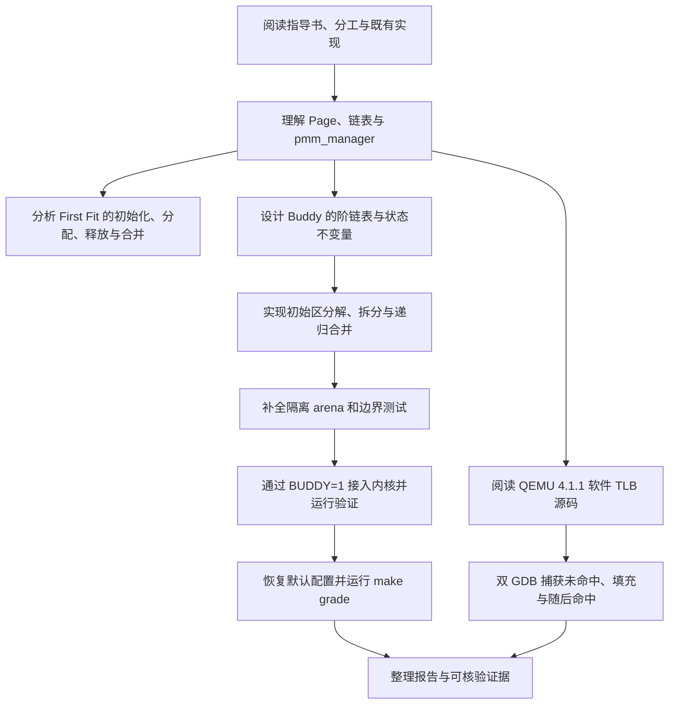

# Lab2 实验报告：物理内存和页表——马禹翔负责部分

## 实验基本信息

| 项目 | 内容 |
| --- | --- |
| 实验名称 | Lab2：物理内存和页表 |
| 报告作者 | 马禹翔（学号：2410933） |
| 小组成员 | 韩羽宸（2410673）、马禹翔（2410933）、林子媛（2411550） |
| 本人实现与验证日期 | 2026 年 10 月 23 日 |
| 小组仓库 | [ACobayashi/OSLab62](https://github.com/ACobayashi/OSLab62) |
| 实验分支 | `lab2` |

本文按照小组统一报告的章节编号，集中记录本人承担的 First Fit 源码分析与思考题、Buddy System 设计实现及边界测试、QEMU TLB 查询与命中/未命中分析。Buddy 结论来自本人虚拟机中的真实构建与运行输出；TLB 结论来自 QEMU 4.1.1 源码和本人实际 GDB 会话，不使用其他成员的页表遍历截图替代本人的调试证据。

### 小组分工

| 成员 | 主要任务 |
| --- | --- |
| 韩羽宸 | 启动与初始化流程、`page_init()`、Best Fit、分页机制思考题、物理内存范围挑战、双 GDB/QEMU 页表遍历以及最终整合 |
| 马禹翔 | First Fit 分析与思考题、Buddy System 设计实现和边界测试、QEMU TLB 命中/未命中流程分析与调试 |
| 林子媛 | SLUB 分配器、Sv39 页表机制、Bare/Sv39 模式比较，以及软件 TLB 与硬件 TLB 分析 |

本人报告与小组汇总报告使用相同章节编号，因此只展开与本人分工直接相关的 4.1、4.4、4.6、4.8、5.3 和 5.5。AI 交流按指导书要求整理为 `[PROMPT] / [RELY] / [GUARANTEE] / [SPECIFICATION]` 四段式，完整记录见 [马禹翔_prompt.md](马禹翔_prompt.md)。

---

## 一、实验目的

| 学习目标 | 本人对应工作 |
| --- | --- |
| 理解物理页、描述符和空闲块的关系 | 分析 `struct Page`、`free_area_t`、空闲链表和 `pmm_manager` |
| 掌握连续物理页分配的基本策略 | 阅读 First Fit，并比较 First Fit、Best Fit 与 Buddy 的选择及碎片特征 |
| 能够实现并验证新的物理内存管理器 | 完成 Buddy 的初始区分解、按阶拆分、递归合并、计数及边界测试 |
| 理解地址翻译缓存的查询与填充 | 跟踪 QEMU 软件 TLB 的查询、未命中、页表翻译、填充和随后命中 |
| 形成可核验的 AI 协作过程 | 将需求改写为四段式提示词，用编译、断言、运行输出和 GDB 截图验证结论 |

本人的学习主线是把“物理内存—物理页—页描述符—空闲块—分配器”连接起来，再从地址翻译角度理解页表与 TLB 的分工。物理内存管理器决定哪些页可以分配；页表保存虚拟页到物理页的映射；TLB 缓存近期翻译以减少重复查表。三者有关联，但不能把空闲页链表、页表项和 TLB 条目视作同一种结构。

---

## 二、实验环境

### 2.1 系统、工具链与运行调试环境

| 项目 | 实际环境 |
| --- | --- |
| 开发主机 | Windows，使用 VMware 中的 Ubuntu 26.10 实验虚拟机 |
| Linux 内核 | 7.3.0-9-generic，x86-64 |
| GNU Make | 4.4.1 |
| RISC-V GCC | `riscv64-unknown-elf-gcc 15.3.0` |
| QEMU | 4.1.1，RISC-V `virt` 机器 |
| 固件 | OpenSBI v0.4，运行时 SBI 版本 0.1 |
| 宿主调试器 | GDB 17.2，用于调试 x86-64 QEMU 进程 |
| 客体调试器 | `gdb-multiarch` 17.2，用于调试 RISC-V ucore |
| Python | 3.14.8，用于辅助检查文本与实验材料，不参与内核运行 |

QEMU 4.1.1 源码位于 `/home/s1nk/qemu-4.1.1`，TLB 调试使用带符号的 `/home/s1nk/qemu-4.1.1/riscv64-softmmu/qemu-system-riscv64`。宿主 GDB 观察 QEMU 内部的软件 TLB，客体 GDB 控制 ucore 的执行；当宿主断住 QEMU 时，客体暂停等待属于正常现象。

### 2.2 各成员使用的 AI 工具与模型

| 成员 | AI 工具与模型 | 本实验中的用途 |
| --- | --- | --- |
| 马禹翔 | OpenAI Codex 桌面端，GPT-5 系列 Codex | 阅读指导与分工、解释 PMM 结构、生成并审查 Buddy 初稿、补全边界测试、定位接入问题、整理四段式记录与报告 |

会话界面未提供可独立核验的更细模型子版本，因此报告只记录为 GPT-5 系列 Codex，不臆测具体版本。所有“通过”结论均以真实编译、QEMU 输出、源码断言或 GDB 现场数据为依据；AI 生成内容不直接作为正确性证明，关键不变量由本人结合 `Page` 状态、链表、绝对物理页号、空闲页计数和失败路径重新核对。

---

## 三、实验整体逻辑分析

### 3.1 本章节的逻辑主线

内核进入 `kern_init()` 后调用 `pmm_init()`。物理内存管理框架先选择 `pmm_manager` 并初始化算法内部状态，再由 `page_init()` 根据设备树提供的内存范围建立 `pages[]` 描述符数组、排除内核及保留区域，并通过 `init_memmap()` 把实际可用区交给当前分配器。最后，`check_alloc_page()` 调用管理器自检。

默认评分路径继续使用 Best Fit；Buddy 通过 `BUDDY=1` 显式启用，以免新增算法改变原始评分行为。分配器解决“哪些物理页可供使用”，页表解决“虚拟页映射到哪个物理页”，QEMU 软件 TLB 则缓存近期地址翻译并在未命中时进入 RISC-V 页表遍历与填充路径。

### 3.2 功能实现顺序与依赖关系



### 3.3 项目组成与模块协作

| 模块 | 作用及与本人任务的关系 |
| --- | --- |
| `kern/mm/pmm.h`、`pmm.c` | 定义统一管理器接口和 PMM 初始化、分配、释放包装；Buddy 通过该接口接入 |
| `kern/mm/memlayout.h` | 定义 `struct Page`、状态位和空闲区结构，是 First Fit 与 Buddy 的共同数据基础 |
| `libs/list.h` | 提供循环双向链表；各空闲块只把块头的 `page_link` 接入链表 |
| `kern/mm/default_pmm.c` | First Fit 参考实现，本人以只读方式分析其搜索、拆分、插入和相邻合并逻辑 |
| `kern/mm/buddy_pmm.c/.h` | 本人实现的 Buddy 管理器、内部辅助函数、自检及唯一公开注册对象 |
| `Makefile`、`kern/mm/pmm.c` 的条件配置 | 使用 `BUDDY=1` 选择 Buddy；默认仍使用 Best Fit |
| QEMU `accel/tcg/cputlb.c` | 实现软件 TLB 的查询、victim 查找和条目填充 |
| QEMU `target/riscv/cpu_helper.c` | 在 TLB 未命中时完成 RISC-V 地址翻译、权限/PMP 检查并回填条目 |

上述模块形成两条可独立验证的路径：一条在 ucore 内核中验证物理页分配与回收，另一条在 QEMU 宿主进程中观察客体访存的地址翻译缓存。报告分别保留 Buddy 启动输出、默认评分结果和 TLB 的前后状态截图，避免仅以源码阅读代替运行证据。

---

## 四、实验内容与实现

### 4.1 基础原理、管理框架与启动分页

#### 4.1.1 `Page` 描述符与物理页

物理页是物理内存中按 `PGSIZE` 划分的一段真实空间；`struct Page` 是内核为物理页保存的软件元数据。二者不能混为一谈。项目用连续的 `pages[]` 数组描述从 `nbase` 开始的物理页，转换关系为：

```c
page2ppn(page) = page - pages + nbase;
page2pa(page)  = page2ppn(page) << PGSHIFT;
```

`struct Page` 的四个字段含义如下：

- `ref`：页框引用计数。本实验的连续页分配测试主要把它初始化为 0；它不等价于“该页一定空闲”。
- `flags`：状态位集合。`PG_reserved` 表示页面尚不能交给普通分配器，`PG_property` 表示该描述符是空闲连续块的块头。
- `property`：块级元数据。First Fit/Best Fit 中只在带 `PG_property` 的空闲块头上表示连续页数；Buddy 中空闲块头保存实际的 2 的幂块大小，已分配块头也暂存向上取整后的实际大小以校验释放参数。
- `page_link`：嵌入在 `Page` 中的双向链表节点。空闲链表只挂块头，不会把同一连续块中的每个页都挂入链表。

因此，仅看到 `property != 0` 不能断言某页是空闲块头，必须同时检查 `PageProperty(page)`。同样，`flags` 只是描述符的一个字段，并不是完整的物理页描述符。

#### 4.1.2 空闲链表与成员指针转换

`list_entry_t` 是带 `prev/next` 的循环双向链表节点。链表头是哨兵，不对应实际 `Page`；空链表满足 `head.next == head`。`list_add()` 在指定节点之后插入，`list_add_before()` 在指定节点之前插入，`list_del_init()` 删除节点后将其重新初始化为自环。

链表节点嵌在 `struct Page` 中，遍历得到的是 `page_link` 的地址。项目通过以下宏恢复外层对象：

```c
#define offsetof(type, member) ((size_t)(&((type *)0)->member))
#define to_struct(ptr, type, member) \
    ((type *)((char *)(ptr) - offsetof(type, member)))
#define le2page(le, member) to_struct((le), struct Page, member)
```

其思想是“成员地址减去成员在结构体中的偏移量，得到结构体首地址”。`free_area_t` 中的 `free_list` 保存块头节点，`nr_free` 保存空闲页总数，不是链表节点数；一个 16 页块在链表里只有一个节点，但会给 `nr_free` 贡献 16。

#### 4.1.3 `pmm_manager` 统一接口

`struct pmm_manager` 用函数指针隔离通用框架与分配策略：

| 字段 | 责任 |
| --- | --- |
| `name` | 管理器名称，用于启动输出和核对当前实现 |
| `init` | 初始化算法自己的链表、分组和计数，不登记真实页 |
| `init_memmap` | 接收上层确认可用的 `[base, base+n)`，建立初始空闲结构 |
| `alloc_pages` | 分配连续页并返回块头，失败返回 `NULL` |
| `free_pages` | 释放从 `base` 开始的页面并按算法规则合并 |
| `nr_free_pages` | 返回空闲页总数，不改变状态 |
| `check` | 运行该管理器自己的正确性断言 |

`pmm.c` 中的 `alloc_pages()`、`free_pages()`、`nr_free_pages()` 只是统一包装，真正操作由当前 `pmm_manager` 完成；`alloc_page()` 和 `free_page()` 是单页宏。实际初始化顺序为：

```text
kern_init
  -> pmm_init
       -> init_pmm_manager       选择算法并调用 manager->init()
       -> page_init              发现内存、建立 Page 数组和保留区
            -> init_memmap       调用 manager->init_memmap(base,n)
       -> check_alloc_page       调用 manager->check()
```

不是“`pmm_manager` 先主动启动，再调用 `pmm_init()`”。`page_init()` 也不是另一个并列入口，而是 `pmm_init()` 内部把真实空闲区交给所选算法的阶段。

### 4.4 功能模块二任务一：First Fit 理解与思考

#### 4.4.1 任务规格与分析方法

First Fit 维护按块头地址递增的空闲链表。申请 `n` 页时从表头开始寻找第一个 `property >= n` 的块；释放后把新区间插回地址顺序，并与物理相邻的前后块合并。分析重点不是只复述循环，而是跟踪每一步的块头标志、`property`、链表位置和 `nr_free` 是否一致。

前置条件是调用者传入正页数；`init_memmap()` 的区间已经由 `page_init()` 判定为可用、完整且尚未交给分配器的页面。后置条件是链表中每个节点代表一个不重叠的连续空闲块，所有块的长度总和等于 `nr_free`。

#### 4.4.2 四个核心函数

**`default_init()`** 将哨兵头初始化为自环，并把 `nr_free` 清零。此时只建立算法内部空状态，还没有真实可分配页。

**`default_init_memmap(base,n)`** 不是探测占用页。上层已经确认该区间可用，函数中的 `assert(PageReserved(p))` 检查这些描述符仍处于“尚未交给分配器”的统一保留状态。循环清除旧标志、旧长度和引用计数；随后只在 `base` 上设置 `property=n` 和 `PG_property`，将整个区间作为一个块插入地址有序链表，最后令 `nr_free += n`。

**`default_alloc_pages(n)`** 先用总量快速排除明显失败，再顺序遍历链表。找到第一个足够大的块后删除旧块头。如果块长度大于请求，剩余部分从 `page+n` 开始，成为新的块头并保留在原来的有序位置；成功后清除被分配块头的 `PG_property`，`nr_free` 精确减少 `n`。它选择的是第一个可用块，不保证剩余最小。

**`default_free_pages(base,n)`** 逐页断言页面不是 Reserved、也不是现有空闲块头，然后清理状态，以 `base` 建立新块头并令 `nr_free += n`。插入地址有序链表后，只需检查前驱和后继：若 `prev + prev->property == base` 就向左合并；再从合并后的块头检查右侧，若 `base + base->property == next` 就向右合并。地址相邻是 First Fit 合并的充分条件之一，而 Buddy 还要求同阶且真正互为伙伴。

#### 4.4.3 改进空间与代价

设空闲块数为 `B`，当前 First Fit 的分配最坏需要扫描 `O(B)`；释放还需要寻找插入点。可以考虑：

1. **游标式 Next Fit**：从上次停止位置继续扫描，可能改善反复从头遍历的开销，但结果依赖历史，可能错过低地址更合适的块。
2. **按大小建立平衡树或尺寸桶**：能更快定位可容纳请求的块，但释放、拆分、合并时必须同时维护地址关系与大小索引，元数据和一致性成本更高。
3. **延迟合并或定期整理**：可降低每次释放的即时成本，但在整理前更容易因外部碎片导致大块申请失败。
4. **改用 Best Fit/Buddy**：Best Fit 尝试减少当次剩余，Buddy 使拆分合并更规则；前者仍可能留下很多小洞，后者对非 2 次幂请求产生内部碎片。

因此不存在对所有负载都绝对更好的策略。优化结论需要结合请求分布、碎片率和时间开销测量，不能只凭复杂数据结构断言一定更快。

### 4.6 功能模块二任务三：Buddy System

#### 4.6.1 功能规格与接口约定

Buddy 把空闲页分成大小为 `2^order` 的块，每个 order 有一条独立链表。公共头文件只导出：

```c
extern const struct pmm_manager buddy_pmm_manager;
```

初始化、登记、分配、释放、计数和辅助函数均为 `buddy_pmm.c` 内部 `static` 实现。非 2 次幂请求向上取整，例如 3 页实际占用 4 页，5 页实际占用 8 页；分配计数和释放校验都使用这个实际块大小，避免申请和归还语义不一致。

关键不变量如下：

- 空闲块头设置 `PG_property`，`property` 为该阶实际页数，并且只出现在对应 order 链表中一次。
- 空闲块内部页不设置 `PG_property`，不独立进入链表。
- 已分配块头不设置 `PG_property`，但保留实际块大小用于释放校验。
- `buddy_nr_free` 是所有阶空闲页之和；拆分和合并不改变它，只有真正分配和释放改变它。
- order 为 `k` 的块必须按 `2^k` 物理页号对齐。伙伴页号为 `base_ppn ^ (1 << k)`。
- 只有范围内、同阶、空闲且真正互为伙伴的块才能合并；地址相邻但不满足 XOR 关系的块不能合并。

#### 4.6.2 核心实现

`buddy_init()` 初始化 0～31 阶链表和每阶块计数，并清零总空闲页数。

`buddy_init_memmap(base,n)` 先清理已确认可用的描述符，再从低地址开始，反复选择“不超过剩余长度且当前物理页号满足对齐”的最大 2 的幂块。这样即使起点和长度不是 2 的幂，也不会生成越界或错误对齐的块。每个分块通过统一的合并插入函数登记，总计数最后只增加原始 `n`。

`buddy_alloc_pages(n)` 计算最小目标阶，从该阶向上寻找第一个非空链表。取出高阶块后逐级二分：左半继续拆分，右半进入低一阶空闲链表，直到目标阶。最后总计数减少实际块大小，并在返回块头保存该大小。

`buddy_free_pages(base,n)` 用相同规则重新计算阶，校验范围、对齐、块头状态和实际大小，清理整块描述符，总计数只增加一次。随后计算伙伴：伙伴同阶且空闲时先从链表删除，选择低地址作为合并后的块头并提高一阶，循环直到不能继续，最后把结果插入对应链表。

最终注册对象把上述回调交给通用框架。普通构建仍选择 Best Fit；Makefile 新增默认关闭的测试配置：

```bash
make BUDDY=1
make BUDDY=1 qemu
```

`CONFIG_BUDDY_PMM` 只在显式设置 `BUDDY=1` 时定义，因此原始评分和最终默认管理器不受影响。

#### 4.6.3 两份最终四段式提示词摘要

**第一份：Buddy 实现 Prompt**

- **[PROMPT]** 新建 `buddy_pmm.h/.c`，实现符合 `struct pmm_manager` 的按阶初始化、初始区分解、分配拆分、释放递归合并、计数、自检和注册对象；不修改 First Fit/Best Fit 原测试。
- **[RELY]** 依赖 `pmm.h` 的 Page/页号接口、`memlayout.h` 状态语义、`list.h` 循环链表和已确定的非 2 次幂向上取整规则。
- **[GUARANTEE]** 内部状态与回调保持 `static`，公共头只导出管理器；伙伴用绝对物理页号 XOR 计算；失败不改状态；拆分合并不改总计数。
- **[SPECIFICATION]** 对 `init`、`init_memmap`、`alloc_pages`、`free_pages`、`nr_free_pages`、`check` 分别规定前置条件、后置条件、精确命中、向高阶查找、递归合并和越界失败行为。

**第二份：Buddy 边界测试 Prompt**

- **[PROMPT]** 扩展 `buddy_check()`，使用真实内部接口验证拆分、伙伴判定、递归合并、向上取整、耗尽、不重叠、相邻非伙伴和不规则初始区。
- **[RELY]** 依赖各阶链表、总计数、已分配块头的实际大小，以及 `buddy_find_free_buddy()` 的范围、状态和同阶检查。
- **[GUARANTEE]** 使用隔离的 16 页 arena；保存并恢复真实链表与计数；覆盖 1/2/3/5/16 页请求和偏移 1、长度 13 页的登记；失败路径不破坏状态。
- **[SPECIFICATION]** 每组断言明确初态、操作和预期结果；相邻非伙伴不得误合并；13 个单页必须位于登记范围且互不重复；最终归还 arena 后总空闲页数恢复。

完整提示词和实际交流迭代见 [马禹翔_prompt.md](马禹翔_prompt.md)。

#### 4.6.4 真实迭代

1. 最初需求希望在头文件公开多个函数和变量。结合项目中 `default_pmm.h`、`best_fit_pmm.h` 的封装方式，将公共接口收紧为只导出 `buddy_pmm_manager`，其余实现保持模块私有。
2. 第一版自检对全局空闲布局存在不必要假设，随后改为先申请一个对齐 arena，隔离真实各阶链表，在受控环境测试后恢复，避免测试依赖某个特定全局块形状。
3. arena 从 8 页扩展到 16 页，以同时覆盖两个 5 页请求向上取整到 8 页、相邻非伙伴和多级恢复。
4. 完整构建最初被尚未完成的 Best Fit 阻断，Buddy 对象文件先独立编译验证；公共 `page_init()` 和 Best Fit 更新后，再加入默认关闭的 `BUDDY=1` 内核入口完成运行级验证。
5. 为便于报告截图给边界组增加 `cprintf()` 时，第一次编译因缺少 `<stdio.h>` 被 `-Werror` 拒绝；补齐头文件后重新构建和运行通过。这是输出接入问题，不是分配算法错误。

### 4.8 分支任务：QEMU/GDB 地址翻译与 TLB 调试

#### 4.8.1 TLB 为什么有效

没有 TLB 时，每次访存除访问最终数据外，还可能需要逐级读取页表。TLB 缓存近期虚拟页到物理页及权限的翻译，命中后避免重复页表遍历。程序通常具有时间局部性（短时间重复访问相同代码或数据）和空间局部性（相邻地址往往落在同一页或附近页），所以少量翻译项即可覆盖大量访存。

TLB 不是普通数据缓存：它保存地址翻译和权限。修改页表后需要用 `sfence.vma` 建立页表更新与后续翻译之间的正确关系；这不等价于刷新普通数据缓存或指令缓存。

#### 4.8.2 QEMU 4.1.1 中的查询、未命中与填充

本机源码位于 `/home/s1nk/qemu-4.1.1`，带调试信息的程序是 `riscv64-softmmu/qemu-system-riscv64`。它与手册版本一致。关键路径如下：

```text
取指或数据访问
  -> 计算 mmu_idx 和 tlb_index
  -> tlb_entry 取得直接映射项
  -> tlb_hit 比较虚拟页号
       命中：使用 entry->addend 形成宿主地址，直接继续访问
       未命中：检查 victim_tlb_hit
           victim 命中：交换回主 TLB
           仍未命中：tlb_fill
               -> riscv_cpu_tlb_fill
               -> get_physical_address 遍历 RISC-V 页表
               -> PMP/权限检查
               -> tlb_set_page
               -> tlb_set_page_with_attrs 写入主 TLB
```

对应源码位置：

- `include/exec/cpu-all.h:348-361`：`tlb_hit_page()` 和 `tlb_hit()`，比较页对齐后的虚拟地址与条目地址。
- `include/exec/cpu_ldst.h:163-181`：`tlb_index()` 与 `tlb_entry()`，根据虚拟页和 MMU 索引选择直接映射槽位。
- `accel/tcg/cputlb.c:1023-1037`：取指路径 `get_page_addr_code()`；主 TLB 不命中时先查 victim TLB，再调用 `tlb_fill()`。
- `accel/tcg/cputlb.c:1252-1280`：数据读取慢路径使用同样的主表、victim 表和 fill 次序。
- `target/riscv/cpu_helper.c:435-474`：`riscv_cpu_tlb_fill()` 调用 `get_physical_address()`，翻译和 PMP 检查成功后调用 `tlb_set_page()`。
- `accel/tcg/cputlb.c:697-838`：`tlb_set_page_with_attrs()` 计算索引，必要时把旧项放入 victim TLB，并写入 `addr_read/addr_code/addr_write`、`addend` 和 IOTLB 数据。

QEMU 的软件 TLB 是模拟器为了加速客体访存而维护的数据结构，不等于真实处理器厂商的硬件阵列实现。但它模拟了软件可见的关键逻辑：按地址空间和虚拟页查翻译、区分权限、未命中时查页表、页表或模式变化后失效。

#### 4.8.3 调试策略与证据边界

只在 `riscv_cpu_tlb_fill()` 断点能证明发生了未命中慢路径，但不能单独证明命中；命中恰恰会绕过该函数。因此现场应取得两类证据：

1. **未命中与填充**：在 `riscv_cpu_tlb_fill`、`tlb_set_page_with_attrs` 设置断点，记录同一虚拟页的 `address/vaddr/paddr/prot/mmu_idx`，证明查页表后写入条目。
2. **随后命中**：在 `get_page_addr_code` 的 `tlb_hit` 判断附近停住，记录 `addr`、`entry->addr_code` 和 `tlb_hit(...)` 返回真，并确认这次没有再次进入 `riscv_cpu_tlb_fill`。

为了避免固件阶段大量无关事件，实际会话先由客体 GDB 启动模拟 CPU，再由宿主 GDB 对 `0xffffffffc0200000` 内核代码页设置条件断点。宿主 GDB 调试的是 x86-64 QEMU 进程，客体 `gdb-multiarch` 调试的是 RISC-V ucore；宿主暂停时客体会等待，不能把等待误判成死机。实际截图表明第一次访问时 `entry->addr_code=0xffffffffffffffff`，随后进入 `riscv_cpu_tlb_fill()` 和 `tlb_set_page_with_attrs()`；填充后再次访问同一页时，`entry->addr_code=0xffffffffc0200000`，与 `addr=0xffffffffc0200046` 的页基址相同。GDB 无法直接调用被优化内联的 `tlb_hit()`，因此结合源码定义和页基址相等关系判断命中，而不把 `No symbol "tlb_hit"` 误认为 QEMU 运行失败。

---

## 五、测试与验证

### 5.3 Buddy System 验证

#### 5.3.1 配置和入口

普通 `make` 保持 `best_fit_pmm_manager`。Buddy 使用独立配置：

```bash
cd /home/s1nk/OperatingSystems/lab2/lab2_new
make clean
make BUDDY=1
timeout 10s make BUDDY=1 qemu
```

2026 年 10 月 23 日实际构建成功，并在 128 MiB QEMU 内存中输出：

```text
memory management: buddy_pmm_manager
free:    [0x0000000080347000, 0x0000000088000000), 31929 pages.
[Buddy] oversized allocation: PASS
[Buddy] order split and buddy merge: PASS
[Buddy] rounding, non-overlap and exhaustion: PASS
[Buddy] adjacent non-buddies and recursive merge: PASS
[Buddy] unaligned 13-page range and state restore: PASS
[Buddy] all boundary tests: PASS
check_alloc_page() succeeded!
```

最后出现的 `terminating on signal 15 ... (timeout)` 是测试命令在 10 秒后结束内核的既有无限循环，不是 panic。成功条件是上述 PASS 和 `check_alloc_page() succeeded!` 均已出现，且之前没有 assertion failure。

各输出对应的错误发现能力：

| 测试组 | 覆盖行为 | 可发现的问题 |
| --- | --- | --- |
| oversized allocation | 请求超过空闲量 | 失败路径错误修改状态或越界寻找 |
| order split and buddy merge | 单页拆分、两页精确复用 | 拆分阶数、XOR 伙伴或块头错误 |
| rounding/non-overlap/exhaustion | 3→4、5→8、两块不重叠、耗尽 | 非 2 次幂计数、重叠分配和错误成功 |
| adjacent non-buddies | 相邻但不互为伙伴 | 仅凭地址相邻就错误合并 |
| unaligned 13-page range | 偏移起点、非 2 次幂长度、保留边界 | 初始区越界、错误对齐、重复分配 |
| state restore | 隔离前后总计数相同 | 测试污染真实分配器状态 |

完成上述验证后再次运行默认 `make grade`，原有 Page Init 和 Best Fit 均为 OK，总分仍为 `20/20`，说明测试入口没有改变默认提交行为。


图 1 保留实际物理内存范围、31929 个空闲页、六组 Buddy 边界结果和最终成功行。管理器身份由同一次启动中此前输出的 `memory management: buddy_pmm_manager` 核对。


图 2 是恢复默认配置后的原始评分结果。它用于证明新增 Buddy 测试入口没有破坏默认实现，不把这 20 分解释成评分程序已经覆盖 Buddy。

### 5.5 页表、TLB 与模式对比调试证据

本人负责 TLB 查询、未命中和填充，不重复其他成员的完整页表遍历或 Bare/Sv39 对比。本次在带调试信息的 QEMU 4.1.1 中对内核高地址代码页设置条件断点，取得了以下实际证据。


图 3 停在 `cputlb.c:1030` 的 `get_page_addr_code()`：请求地址为 `0xffffffffc0200046`，当前 `entry->addr_code=0xffffffffffffffff`，不是目标页基址，因此主 TLB 未命中。`tlb_hit()` 是头文件中的 `static inline` 函数，优化构建中没有独立 GDB 符号；红色提示只表示无法从 GDB 直接调用该内联函数，不改变两个实际数值所表示的未命中状态。


图 4 记录随后进入 `riscv_cpu_tlb_fill()`：`address=0xffffffffc0200046`、`access_type=MMU_INST_FETCH`、`mmu_idx=1`。调用栈从 `get_page_addr_code()` 经 `tlb_fill()` 到 RISC-V 架构相关填充函数，之后命中 `tlb_set_page_with_attrs()`，证明本次确实走了未命中慢路径，而不是只阅读到源码分支。


图 5 在 `tlb_set_page_with_attrs()` 中记录 `vaddr=0xffffffffc0200000`、`paddr=0x80200000`、`prot=7`、`mmu_idx=1`。虚拟地址和物理地址均按 4 KiB 页基址传入，权限值 7 对应本次可读、可写、可执行的启动映射；调用栈能够回溯到 `riscv_cpu_tlb_fill()`。


图 6 再次停在同一查询位置：`addr=0xffffffffc0200046`，而 `entry->addr_code=0xffffffffc0200000`。将请求地址按 4 KiB 向下对齐也得到 `0xffffffffc0200000`，两者页基址一致，因此按照 `tlb_hit_page()` 的源码定义判断为命中；此时还可看到已建立的 `entry->addend`。这与图 3 的无效条目形成前后状态对照，完成“未命中—页表翻译—填充—随后命中”的证据链。

---

## 六、实验总结与收获

### 6.1 实验知识与 OS 理论的联系

- `Page` 数组把物理资源转成可维护的软件状态，但描述符不是物理页内容，页表也不是空闲页链表。
- First Fit、Best Fit 和 Buddy 都解决连续物理页分配，但选择和碎片取舍不同。First Fit 查到第一个足够块即停；Best Fit 扫描选择最小足够块；Buddy 用规则的 2 的幂拆分换取快速伙伴合并，并承担内部碎片。
- 页表解决虚拟地址映射和权限，物理分配器决定哪些页可被占用。一个页被映射不等于它已经由当前分配请求取得，分配页面也不自动创建新的进程映射。
- TLB 利用局部性缓存翻译。命中降低重复查表成本，未命中才进入架构相关页表遍历和填充。`sfence.vma` 管理翻译一致性，不是普通缓存的通用刷新指令。
- 统一的 `pmm_manager` 体现策略与机制分离，但函数签名相同并不足以保证可替换，实际块大小、失败状态、计数和释放参数等语义也必须约定并测试。

### 6.2 重要但本实验未覆盖的 OS 知识

本实验仍未覆盖多核并发分配锁、每 CPU 页缓存、NUMA、多段和热插拔内存、跨核 TLB shootdown、用户进程独立页表、缺页异常恢复、按需分页、页面置换、换入换出、写时复制和文件映射。当前 Buddy 也没有维护完整分配历史，不能检测所有错误指针、部分释放或重复释放。真实内核还需要针对大规模内存控制最大 order，并处理不可用洞、固件保留区和设备内存。

### 6.3 AI 协作开发的经验

本次最有效的方法是先把自然语言需求变成可验证不变量，再生成和审查代码。例如“实现 Buddy”过于宽泛，而“非 2 次幂如何计数、伙伴以哪个页号为基准、相邻非伙伴是否合并、失败是否改状态”都可以直接写成断言。

AI 的第一次实现和测试仍可能隐含布局假设。把自检改成隔离 arena、扩大到 16 页并恢复真实链表，是人工审查后得到的改进。后来为截图增加输出又真实触发了缺少 `<stdio.h>` 的编译错误，说明即使算法未变也必须重新构建。对于调试问题，源码定位只能说明“可能经过哪里”，真正的命中、未命中和参数仍需 GDB 现场核对。

### 6.4 参考资料与交互记录

1. 项目源码：`kern/mm/pmm.h`、`pmm.c`、`memlayout.h`、`default_pmm.c`、`buddy_pmm.c`、`libs/list.h`、`libs/defs.h`。
2. QEMU 4.1.1 本地源码：`accel/tcg/cputlb.c`、`include/exec/cpu-all.h`、`include/exec/cpu_ldst.h`、`target/riscv/cpu_helper.c`。
3. [RISC-V Supervisor ISA Specification](https://docs.riscv.org/reference/isa/priv/supervisor.html)：Sv39、`satp` 与 `SFENCE.VMA`。
4. [QEMU GDB usage documentation](https://www.qemu.org/docs/master/system/gdb.html)：QEMU gdbstub 与客体调试方式。
5. AI 交流记录：[马禹翔_prompt.md](马禹翔_prompt.md)，采用 `[PROMPT] / [RELY] / [GUARANTEE] / [SPECIFICATION]` 四段式，并区分需求、依赖、保证条件和验证规格。
