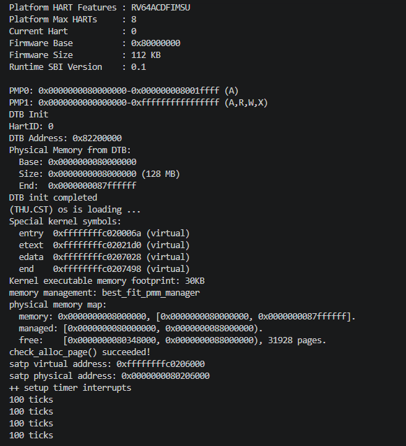
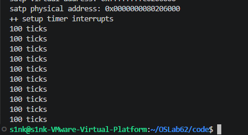
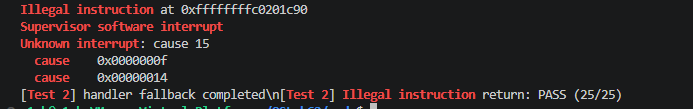
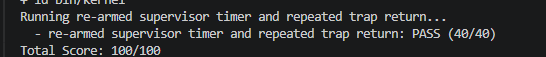

# Lab3 实验报告：中断与异常处理——马禹翔负责部分

## 实验基本信息

| 项目 | 内容 |
| --- | --- |
| 实验名称 | Lab3：中断与异常处理 |
| 报告作者 | 2410933-马禹翔 |
| 小组成员 | 2410673-韩羽宸、2410933-马禹翔、2410936-林子媛 |
| 本人完成日期 | 2026 年 11 月 5 日 |
| 小组仓库 | [OSLab62：lab3 分支](https://github.com/ACobayashi/OSLab62/tree/lab3) |
| 本人代码范围 | `interrupt_handler()` |

本文只记录本人分工：Lab3 整体逻辑、`interrupt_handler()`、中断关闭与开启分析、中断测试、整体评分以及本人总结。Trap 入口和恢复由韩羽宸负责，异常处理由林子媛负责；本文只在解释接口衔接和整体测试时引用这些模块，不把队友实现计入本人代码成果。

---

## 二、实验环境

**负责人：2410933 马禹翔。**

| 工具或环境 | 本次实际配置 | 用途 |
| --- | --- | --- |
| 宿主环境 | Windows + VMware Workstation | 编辑、截图并连接实验虚拟机 |
| 虚拟机系统 | Ubuntu 26.10，Linux `7.3.0-9-generic` | 编译、运行和测试内核 |
| 连接方式 | VS Code Remote SSH，主机别名 `os-vm` | 远程编辑与终端操作 |
| GNU Make | 4.4.1 | 根据 Makefile 构建内核和评分副本 |
| RISC-V GCC | `riscv64-unknown-elf-gcc` 15.3.0 | 编译 RV64 C 与汇编源码 |
| GNU ld | 2.47 | 链接内核 ELF |
| RISC-V GDB | 本虚拟机未安装 | 本人模块没有使用 GDB 作为验证证据 |
| QEMU | `qemu-system-riscv64` 4.1.1 | 模拟 RISC-V `virt` 平台 |
| OpenSBI | 启动输出 OpenSBI v0.4，Runtime SBI Version 0.1 | 启动 S 态内核并提供定时器、关机等 SBI 服务 |
| 模拟硬件 | 128 MiB 内存，运行于 Hart 0 | 本次单 hart 中断实验 |

实验代码位于虚拟机 `/home/s1nk/OSLab62/code`。本人使用 OpenAI Codex 桌面端和 GPT-5 阅读实验指导书、核对分工、组织四段式 prompt、修改源码、执行测试并整理报告。所有结论均以当前仓库源码和实际日志为准；未安装或未使用的工具不推定填写。

完整提示词与迭代记录见 [2410933_prompt.md](./2410933_prompt.md)。

---

## 三、实验整体逻辑分析

**负责人：2410933 马禹翔。**

### 3.1 本章节的逻辑主线

Lab2 已建立内核启动、物理内存管理和页表基础，Lab3 在此之上解决“CPU 遇到中断或异常时，怎样暂时离开当前执行流，交给内核处理，再准确返回”的问题。完整链条为：

```text
Trap 发生
  -> 硬件保存 sepc/scause/stval 等控制状态并跳转 stvec
  -> SAVE_ALL 在内核栈建立 struct trapframe
  -> __alltraps 将 Trap frame 地址作为 a0 调用 trap(tf)
  -> trap_dispatch() 根据 scause 最高位区分中断与异常
  -> interrupt_handler() 或 exception_handler() 处理具体原因
  -> RESTORE_ALL 恢复处理后的 CSR 和通用寄存器
  -> sret 返回 sepc 指定的位置
```

硬件、汇编和 C 代码的职责不同。硬件负责发现事件、记录必要 CSR、改变中断状态并转移控制；汇编负责保存普通 C 函数无法自动保护的完整寄存器现场，并在末尾恢复；C 层负责按原因码进行可读、可维护的具体策略处理。本人的中断函数处于 C 层，不重新保存寄存器，也不直接执行 `sret`。

中断与异常统称 Trap，但触发方式不同。中断是异步事件，例如时钟到期；异常由当前指令同步触发，例如非法指令和断点。`trap_dispatch()` 通过把 `tf->cause` 解释为有符号整数，利用最高位判断两类事件；具体 handler 再解释低位原因码。

### 3.2 功能的逐步实现

1. **继承 Lab2 基础。** 内核首先完成 BSS 清零、DTB 解析、控制台和物理内存管理，确保 Trap 处理时已有可靠的内存和输出环境。
2. **建立统一入口和返回。** `idt_init()` 把 `stvec` 指向 `__alltraps`。韩羽宸实现的入口/恢复代码先把处理器现场变成 `struct trapframe`，再把处理后的帧还原；后续 C handler 都依赖这一通道。
3. **按类型分发。** `trap()` 调用 `trap_dispatch()`。异步中断进入本人实现的 `interrupt_handler()`；同步异常进入林子媛实现的 `exception_handler()`。
4. **初始化并开启时钟。** `clock_init()` 在 `sie` 中使能 S 模式时钟中断、设置第一次定时事件并把 `ticks` 清零；`intr_enable()` 再设置 `sstatus.SIE`，允许当前 hart 接受 S 模式中断。
5. **形成持续时钟。** OpenSBI 定时事件是单次的，因此本人在每次 `IRQ_S_TIMER` 中断中调用 `clock_set_next_event()`，再增加 `ticks`。否则系统只会收到第一次时钟中断。
6. **联调闭环。** 正常 `make qemu` 验证持续时钟和关机；构造帧测试验证软件/未知中断分支；`make grade` 同时经过入口、异常、本人中断函数和返回路径，验证全组接口能正确衔接。

---

## 四、实验内容与实现

### 4.2 功能模块二：中断处理 `interrupt_handler()`

**负责人：2410933 马禹翔。**

#### 1. 模块功能与接口

必须实现的接口为：

```c
void interrupt_handler(struct trapframe *tf);
```

`trap_dispatch()` 已经判断本次 Trap 是中断，但传入的 `tf->cause` 仍保留最高位的中断标志。因此函数首先去掉最高位，再对低位原因码进行 `switch` 分类。模块承担三类任务：

| 类型 | 行为 | 验收点 |
| --- | --- | --- |
| S 模式时钟中断 | 设置下一次事件、`ticks++`、每 100 次输出、达到阈值关机 | 持续出现 `100 ticks`，评分达到 `ticks=200`，普通运行最终退出 |
| 已知其他中断 | 输出明确的中断类型 | 软件中断包含 `Supervisor software interrupt` |
| 未知中断 | 输出低位原因码并打印完整 Trap frame | 出现 `Unknown interrupt: cause 15` 和完整 frame |

#### 2. SPEC 设计过程

SPEC 不是直接罗列代码，而是先从手册、已有接口和评分脚本提取前后条件：

- **输入条件**：`tf` 是有效 Trap frame；调用者已确认是中断；`cause` 最高位仍可能存在。
- **正常后置状态**：已知中断完成对应处理；时钟分支已安排下一事件；未知中断留下足够调试信息。
- **时钟用例**：每次恰好计数一次，每到 `TICK_NUM` 输出一次，关机不能早于评分所需的 200 ticks。
- **兜底用例**：低位原因码未知时，既打印简短原因，也调用 `print_trapframe()`。
- **修改边界**：不修改 Trap frame、函数签名、队友代码和评分脚本；保留 Lab3 注释并标注学号。

起始代码只给出 `TICK_NUM=100`，没有定义指导书所称的 `SHUTDOWN_AFTER`。本人把它定义为 10 个统计周期，即 1000 ticks 后关机。该值既能展示十次周期输出，又晚于自动评分所需的 200 ticks。

#### 3. 核心实现

原因码提取使用与字长相关的最高位掩码：

```c
uintptr_t cause = tf->cause &
                  ~((uintptr_t)1 << (sizeof(uintptr_t) * 8 - 1));
```

不能直接 `switch (tf->cause)`，因为真实中断的最高位为 1，完整数值不会等于 `IRQ_S_TIMER` 等小整数宏。时钟核心分支为：

```c
case IRQ_S_TIMER:
    clock_set_next_event();
    ticks++;
    if (ticks % TICK_NUM == 0) {
        print_ticks();
        if (ticks / TICK_NUM >= SHUTDOWN_AFTER) {
            sbi_shutdown();
        }
    }
    break;
```

先续设下一事件，再更新软件统计。`ticks` 声明为 `volatile`，避免编译器假定它不会在异步执行路径中改变；但 `volatile` 只约束编译器访问，不能替代锁或原子同步。

未知中断分支为：

```c
default:
    cprintf("Unknown interrupt: cause %d\n", cause);
    print_trapframe(tf);
    break;
```

简短文本便于自动检索，完整 Trap frame 则保留状态、EPC、相关地址和寄存器，便于人工排查。

#### 4. 四段式 Prompt 设计

本人最初按一个完整功能模块整理 prompt；根据实验记录要求，又按可独立核验的职责拆成三段：

- **V1-A：中断原因分类与兜底。** `[RELY]` 提供真实 IRQ 宏和 `print_trapframe()`；`[SPECIFICATION]` 要求去掉最高位、已知类型提示和 cause 15 兜底。
- **V1-B：持续时钟与计数。** `[RELY]` 只提供 `ticks`、`clock_set_next_event()`、`TICK_NUM`、`print_ticks()`；规格要求每次续设、恰好加一并能达到 200 ticks。
- **V1-C：关机与集成。** 提供 `sbi_shutdown()`，规定 10 个统计周期后关机，并要求运行编译和完整评分。

三段都使用课程统一的 `[PROMPT] / [RELY] / [GUARANTEE] / [SPECIFICATION]`。完整原文见 [Prompt V1-A 至 V1-C](./2410933_prompt.md)。拆分只改变记录粒度，没有事后改变已经通过的代码行为。

#### 5. 实现迭代过程

本模块代码经历一次实现：先写规格，再修改真实 `trap.c`，随后执行 `make clean && make` 和 `make grade`。实现一次通过，没有出现已证实需要修复的 AI 代码 bug。

实现前的 `undefined reference to interrupt_handler` 是起始代码只有声明、没有本人实现造成的正常基线，不能写成 AI 生成 bug。之后把单段 prompt 重构为 V1-A/B/C，是为了使分类、计时和集成可以分别核验，也不属于代码修复迭代。

自动评分证明规定路径通过；其他已知 IRQ 分支只完成提示输出，没有真实设备逐一触发，因此报告不声称已验证所有设备中断处理。

### 4.4 练习：中断的关闭和开启

**负责人：2410933 马禹翔。**

#### 1. 中断关闭与旧状态保存

`intr_disable()` 清除当前 hart 的 `sstatus.SIE`：

```c
void intr_disable(void) { clear_csr(sstatus, SSTATUS_SIE); }
```

`__intr_save()` 先检查旧状态。若 SIE 原为 1，它关闭中断并返回 1；若原本已经关闭，则保持关闭并返回 0。这个返回值表示进入临界区前的状态，不是固定的成功标志。

`alloc_pages()`、`free_pages()`、`nr_free_pages()` 会访问空闲链表、空闲页计数、页属性和连续块信息。一次操作可能修改多个相关状态；若同一 hart 在中间状态被会访问相同结构的中断路径重入，就可能观察到不一致数据。因此框架在调用具体 PMM 操作前保存并关闭中断，结束后再恢复。

该方法只屏蔽当前 hart 的 S 模式可屏蔽中断，不屏蔽同步异常，也不能阻止其他 hart 访问，所以不是多核锁。临界区过长还会增加中断延迟，保护范围应尽量短。

#### 2. `do { ... } while (0)` 思考题

```c
#define local_intr_save(x) \
    do {                   \
        x = __intr_save(); \
    } while (0)
```

`do { ... } while (0)` 把宏整体包装成一条语句。调用者可以像调用普通函数一样在末尾写分号；宏放进没有花括号的 `if/else` 时，也不会因展开为多条语句产生悬空 `else` 或只执行第一条语句。条件恒为 0，主体只执行一次，并非真正循环。

#### 3. 为什么必须按旧状态恢复

```c
static inline void __intr_restore(bool flag) {
    if (flag) {
        intr_enable();
    }
}
```

`flag=1` 表示进入前开启，退出时才重新设置 SIE；`flag=0` 表示调用者或外层临界区进入前已经关闭，因此应继续保持关闭。如果无条件调用 `intr_enable()`，会破坏调用者原状态，并可能使嵌套临界区的内层退出时提前打开中断。

例如外层在 SIE=1 时保存 1 并关闭；内层看到 SIE=0，保存 0。内层恢复 0 时不打开中断，只有最外层恢复 1 时才重新开启。每个 `intr_flag` 必须与产生它的保存操作配对；若受保护区域以后增加提前返回，也要保证恢复不会被跳过。

#### 4. 与原子位操作的关系

`atomic.h` 使用 RISC-V AMO 指令实现 `set_bit()`、`clear_bit()`、`change_bit()`、`test_and_set_bit()` 和 `test_and_clear_bit()`，能保证一次机器字读-改-写不可分割；普通 `test_bit()` 只是读取判断。

AMO 适合单个位或机器字的并发更新。关闭当前 hart 中断则防止本 hart 的中断处理重入。一次 AMO 无法自动维护“链表 + 计数 + 多个 Page 字段”组成的复合不变量，关闭本 hart 中断又不能阻止其他 hart。因此复杂 PMM 操作仍需临界区；真正的多核内核还需要自旋锁等跨 hart 同步。

#### 5. SPEC、Prompt 与核验

本练习拆为 V2-A“关闭与状态保存”和 V2-B“条件恢复与开启”。前者要求分析 SIE 两种初态、PMM 临界区、宏语法及 AMO 边界；后者要求分析 true/false 恢复、嵌套语义和配对要求。完整四段式内容见 [Prompt V2-A 与 V2-B](./2410933_prompt.md)。

本任务只分析已有实现，没有修改内核代码。结论通过逐行核对 `intr.c`、`sync.h`、`pmm.c`、`atomic.h`，并推演初始开启、初始关闭和两层嵌套三种状态。没有发现源码冲突，也没有虚构运行时 bug。

---

## 五、测试与验证

### 5.2 中断处理验证

**负责人：2410933 马禹翔。**

代码标记已经从 `YOUR CODE` 改为：

```c
//lab3 function2 2410933 (interrupt_handler)
```

#### 1. 普通运行：持续时钟和自动关机

执行：

```bash
cd /home/s1nk/OSLab62/code
make clean
make qemu
```

启动输出表明 DTB 识别 128 MiB 内存、Best Fit 自检成功，随后打印 `++ setup timer interrupts`。第一张图记录初始化完成和连续时钟输出：



第二张图显示总共十次 `100 ticks`，随后 QEMU 退出并重新出现 shell 提示符。这与 `SHUTDOWN_AFTER=10`、`TICK_NUM=100` 一致，证明系统持续接收至少 1000 次时钟中断，并在第十个统计周期调用关机接口。



完整文本见 [普通 QEMU 运行日志](evidence/2410933/02_qemu_run.log)。日志中的时钟事件来自 QEMU/OpenSBI 的真实定时器路径，不是直接调用 handler 的合成测试。

#### 2. 软件中断和未知中断兜底

评分测试构造 Trap frame，分别把 cause 设置为带最高位的 `IRQ_S_SOFT` 和原因码 15，再直接调用 `interrupt_handler()`；异常 cause 20 则交给异常函数打印 Trap frame。输出为：



图中可见：

- `Supervisor software interrupt`：说明函数正确去掉中断标志并识别 S 模式软件中断；
- `Unknown interrupt: cause 15`：说明 default 分支使用低位原因码；
- Trap frame 中 `cause 0x00000014`：说明未实现的异常进入完整帧兜底；
- `[Test 2] ... PASS (25/25)`：非法指令返回及兜底组合测试通过。

完整输出见 [中断兜底日志](evidence/2410933/03_interrupt_fallback.log)。这里的软件和未知中断是构造帧测试，没有经过真实外设或完整硬件入口；其价值是隔离验证 C 分支逻辑，不能单独证明汇编入口和 `sret`。

### 5.4 整体编译运行与评分

**负责人：2410933 马禹翔。**

首先执行 `make clean && make`，所有 C/汇编文件成功编译并链接为 `bin/kernel`，随后生成 `bin/ucore.img`。编译记录见 [构建日志](evidence/2410933/01_make.log)。

最终执行：

```bash
make grade
```

评分结果为：

| 评分项 | 分值 | 结果 | 主要依赖 |
| --- | ---: | --- | --- |
| Trap 入口、寄存器恢复、断点 EPC | 35 | PASS | 韩羽宸入口/恢复 + 林子媛断点处理 |
| 非法指令 EPC、软件/未知中断和兜底 | 25 | PASS | 林子媛异常处理 + 本人中断分类 |
| 时钟续设与重复 Trap 返回 | 40 | PASS | 本人时钟处理 + 韩羽宸返回路径 |
| 总计 | 100 | `100/100` | 三个模块联调 |



第四张现场图裁剪范围显示最后一项 `40/40` 和 `Total Score: 100/100`；三项各自的 PASS 以 [完整评分日志](evidence/2410933/04_make_grade.log) 为准。报告没有把裁剪图本身描述成包含全部三行。

评分证明本实验要求的入口、异常、兜底和持续到 200 ticks 的时钟路径通过；普通运行又补充验证了 1000 ticks 后关机。尚未验证真实软件 IPI、真实外部设备中断、多 hart 并发和压力条件下的中断嵌套。

---

## 六、实验总结与收获

### 对操作系统的理解

**负责人：2410933 马禹翔。**

#### 1. 实验知识与 OS 原理的联系和差异

| 实验知识 | 对应 OS 原理 | 联系 | 本实验的边界或差异 |
| --- | --- | --- | --- |
| `scause` 分类与 Trap 分发 | 中断/异常统一入口和分层处理 | 都先取得控制权，再按原因选择策略 | 本实验类型较少，没有完整设备中断控制器 |
| 定时事件续设与 `ticks` | OS 时钟、时间片和定时器 | 周期时钟为调度、超时、统计提供时间基础 | 当前只计数输出，没有调度进程或维护定时器队列 |
| Trap frame 与透明返回 | 中断透明性、执行上下文 | 处理前后必须保持被打断状态一致 | 当前主要保存整数寄存器，没有浮点/向量和完整进程状态 |
| 关闭 SIE 的临界区 | 单核并发控制 | 防止本 hart 在复合更新中被中断路径重入 | 不能阻止其他 hart，不能代替多核锁 |
| RISC-V AMO 位操作 | 原子读改写 | 对共享机器字提供硬件不可分割操作 | 单次 AMO 不能维护复杂链表和多字段不变量 |
| OpenSBI 定时器与关机 | 固件抽象和硬件服务 | S 态通过 SBI 请求更高特权服务 | 真机平台和现代 SBI 接口可能不同，本实验使用较旧 OpenSBI |

时钟中断让我看到，操作系统中的“周期”并非硬件自动重复调用同一函数，而是一次事件处理结束前主动安排下一次事件。中断透明性也不是只保存 PC：C handler 会使用并改写寄存器，因此入口和返回必须共同维护完整现场。

#### 2. OS 原理重要但本实验未覆盖的知识

| 未覆盖知识 | 重要性 | 与本实验的关系 |
| --- | --- | --- |
| 抢占式调度与时间片 | 防止单一任务长期占用 CPU | 本实验已有周期时钟，但没有可调度进程和调度器 |
| PLIC/设备驱动及中断确认 | 处理磁盘、网卡等真实外设 | 本人只输出外部中断类型，没有读设备状态和完成确认 |
| 多核锁与内存顺序 | 防止不同 hart 同时破坏共享状态 | 关闭当前 hart 中断不足以解决跨核竞争 |
| 用户态系统调用 | 建立应用到内核的受控入口 | 本实验有 Trap 框架，但没有完整用户进程和 syscall 分发 |
| 完整嵌套中断策略 | 提高中断响应并保证多层现场安全 | 当前处理期间通常关闭 SIE，没有系统验证多层嵌套 |
| 浮点/向量上下文 | 保持使用扩展寄存器的程序正确运行 | 当前 Trap frame 只覆盖整数寄存器和几个 CSR |

### AI 协作开发的经验

**负责人：2410933 马禹翔。**

本次最有效的方法是先从真实源码和评分脚本提取约束，再生成代码。若只提示“实现时钟中断”，AI 容易遗漏 `scause` 最高位、下一事件续设、未知分支或关机阈值。四段式中的 `[RELY]` 让宏和接口名称与工程一致，`[GUARANTEE]` 限制修改范围，`[SPECIFICATION]` 则把不同 case 的前后状态变成可检查条件。

把中断实现拆成 V1-A 分类、V1-B 持续时钟、V1-C 关机集成后，每段都有独立验收点。中断关闭与开启也拆成 V2-A 和 V2-B，避免把“清 SIE”和“按旧状态恢复”误写成简单的一开一关。

代码一次通过，因此没有为了满足报告格式虚构 bug。起始链接错误被记录为待实现函数缺失，prompt 拆分被记录为文档结构调整。测试同样需要区分证据能力：构造 Trap frame 能验证 C 分支，却不能证明真实入口；`make grade` 能验证 200 ticks，却不能替代普通运行对 1000 ticks 关机的检查。以后使用 AI 完成内核代码时，应继续坚持“接口约束—最小修改—分层测试—明确边界”的流程。

### 本人材料位置

| 材料 | 位置 |
| --- | --- |
| 四段式 Prompt 与执行记录 | [2410933_prompt.md](./2410933_prompt.md) |
| 中断处理源码 | [trap.c](../code/kern/trap/trap.c) |
| 普通运行日志 | [02_qemu_run.log](evidence/2410933/02_qemu_run.log) |
| 中断兜底日志 | [03_interrupt_fallback.log](evidence/2410933/03_interrupt_fallback.log) |
| 完整评分日志 | [04_make_grade.log](evidence/2410933/04_make_grade.log) |
| 本人截图 | [images/2410933](images/2410933/) |
