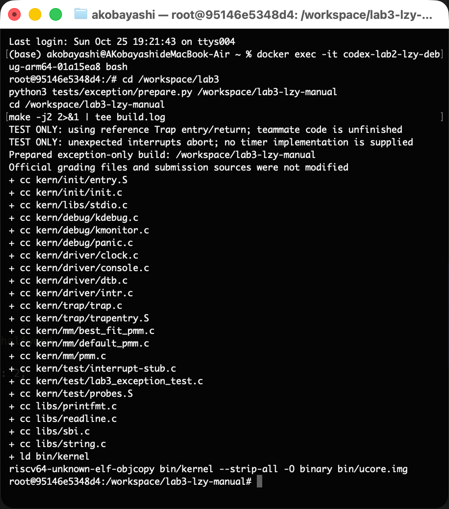
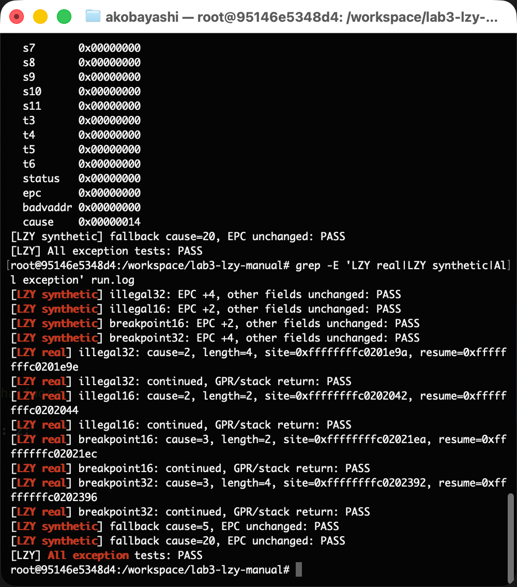
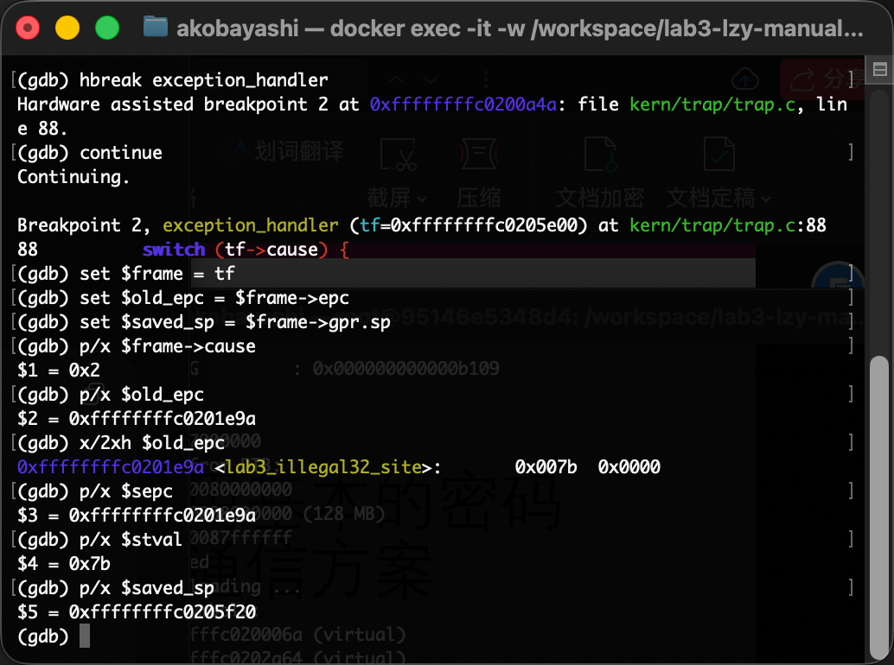
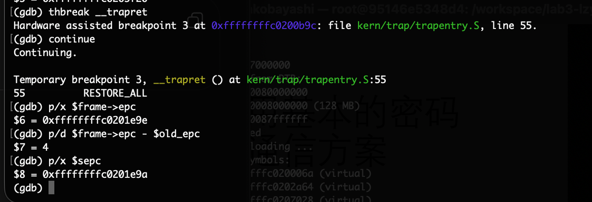
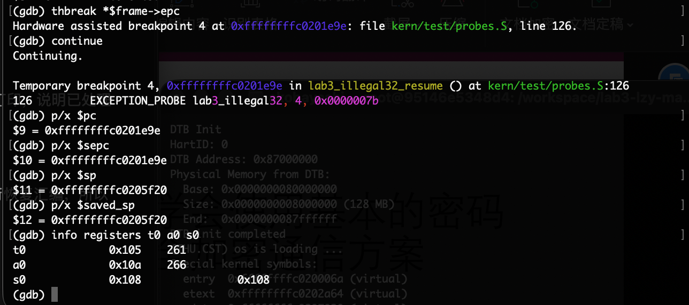
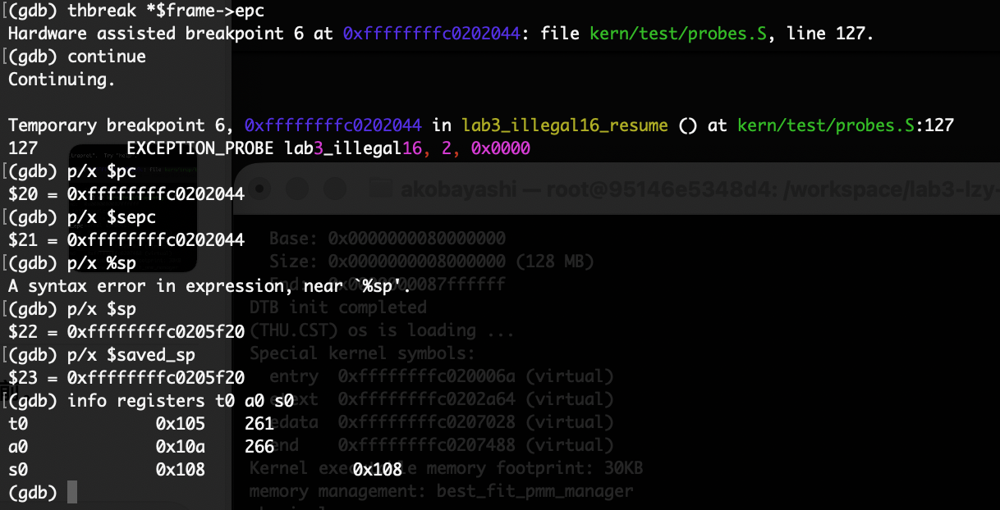
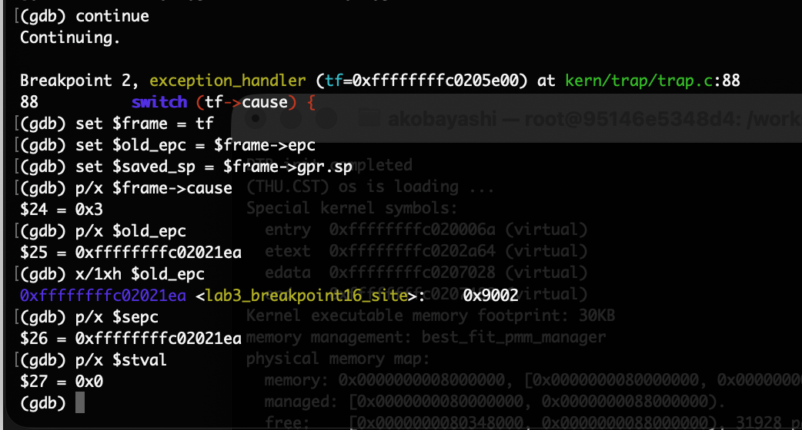
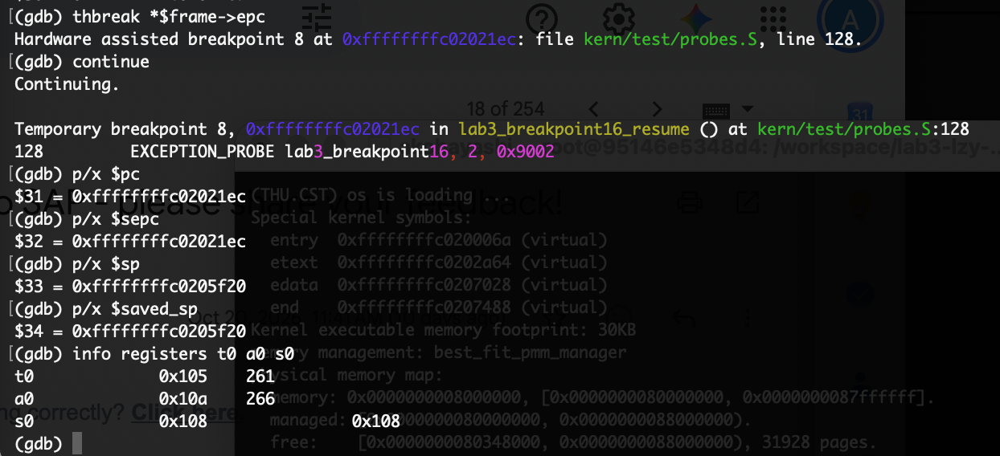
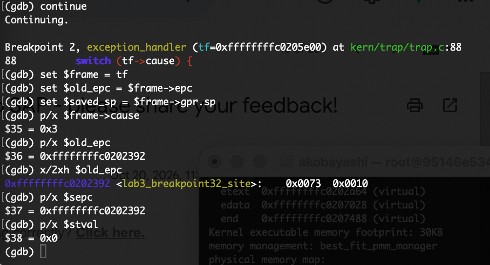
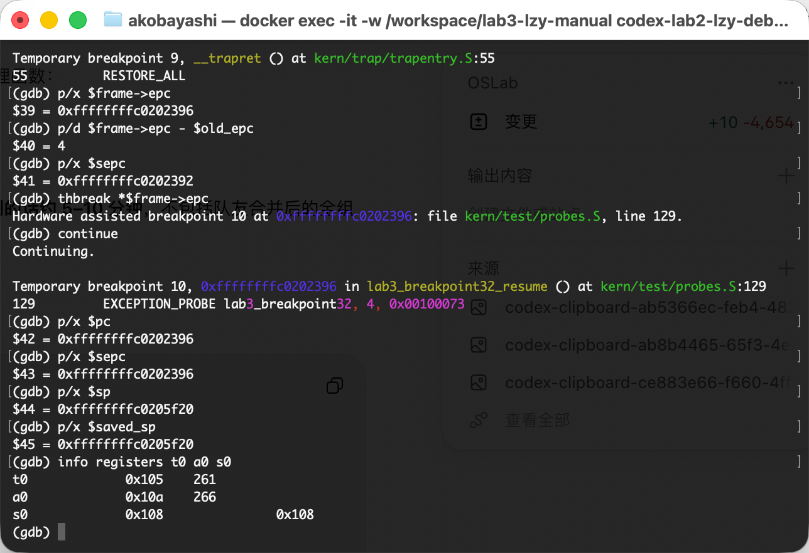

# 2410936 林子媛：Lab3 中断与异常处理实验报告

本人负责功能模块二中的 `exception_handler()`、`stvec` 兼容性分析及异常处理验证。章节编号沿用小组大纲，其余成员负责的模块只在说明接口和联调结果时引用。

## 一、实验目的

**负责人：** 2410936 林子媛

1. 理解 RISC-V 中 Trap、同步异常与异步中断的关系，区分硬件记录异常状态、软件保存上下文和 C 函数处理异常的不同职责。
2. 结合 M/S/U 特权级和异常委托，理解实验内核进入 S 模式异常入口的条件，掌握 `scause`、`sepc`、`stval` 与 Trap frame 的对应关系。
3. 完成非法指令和断点处理，按照实际指令长度更新 EPC，使程序跳过故障指令继续执行，而不是反复陷入同一个异常。

---

## 二、实验环境

**负责人：** 2410936 林子媛

| 项目    | 本人实际使用的环境                                                                    |
| ----- | ---------------------------------------------------------------------------- |
| 实验环境  | Docker 容器 `codex-lab2-lzy-debug-arm64-01a15ea8`，Ubuntu 22.04.2 LTS，`aarch64` |
| 交叉编译器 | `riscv64-unknown-elf-gcc` 10.2.0                                             |
| 模拟器   | `qemu-system-riscv64` 6.2.0，`virt` 机器，目标为 RV64，包含 C 压缩指令扩展                   |
| 调试器   | `gdb-multiarch` 12.1，通过 QEMU 的 GDB 接口观察内核                                    |
| 启动固件  | 实际启动输出为 OpenSBI v0.9，使用 `-bios default`                                      |

Ubuntu 容器自身是 ARM64 环境，RISC-V 内核由交叉编译器生成，再在 QEMU 中运行。

| 成员          | AI 编程工具    | 底层模型        | 使用方式              |
| ----------- | ---------- | ----------- | ----------------- |
| 2410936 林子媛 | Codex 桌面应用 | GPT-6.1 Sol | 辅助分析、实现、生成自测或调试命令 |

---

## 四、实验内容与实现

### 4.3 功能模块二：异常处理 exception_handler()

**负责人：** 2410936 林子媛

#### 模块功能描述

需要完成的接口为：

```c
void exception_handler(struct trapframe *tf);
```

`tf` 指向汇编入口保存的异常现场。`trap_dispatch()` 已按 `cause` 的最高位区分中断和异常，本函数只处理同步异常。我的实现负责分类、提示和选择返回位置，不负责重新实现保存现场、恢复寄存器或时钟计数。

**功能 SPEC：**

| 编号  | 输入、行为与验收条件                                                                            |
| --- | ------------------------------------------------------------------------------------- |
| S1  | 保留函数签名和现有 `struct trapframe` 布局，不改动 `SAVE_ALL`、`trap()` 或评分条件。                        |
| S2  | `tf->cause == CAUSE_ILLEGAL_INSTRUCTION`，即原因码 2 时，输出 `Illegal instruction at <原EPC>`。 |
| S3  | `tf->cause == CAUSE_BREAKPOINT`，即原因码 3 时，输出 `Breakpoint at <原EPC>`。                   |
| S4  | 对本实验受测的 16/32 位指令读取首个 16 位半字：低两位为 `11` 时前进 4 字节，否则前进 2 字节。不按异常类别固定长度。                 |
| S5  | 上述两类只修改 `tf->epc`，其他帧字段保持不变。经过恢复路径后，CPU 应停在故障指令后的第一条指令。                               |
| S6  | 其他异常调用 `print_trapframe(tf)`；不读取其 EPC 指向的内存，不修改 EPC 和其他帧字段。该分支不承诺从故障中恢复。              |
| S7  | 保留 `lab3` 注释，只把本人完成部分的 `YOUR CODE` 替换成 `2410936`，不替其他成员署名。                            |

**SPEC 设计过程：**

首先按分工限定修改范围，再对照 `trap.h`、已有 `SAVE_ALL` 和分发函数确认输入来自哪里。接着把“处理后能继续执行”拆成两个可分别检查的条件：C 函数正确修改内存中的 EPC，以及汇编确实把新 EPC 恢复到 `sepc` 并执行返回。只满足前者不能证明完整流程成立。

长度规则是边界条件中的重点：同样是断点，`c.ebreak` 为 2 字节，`ebreak` 为 4 字节；非法编码也分别安排了 16 位和 32 位测试。如果统一加 4，可能跳过下一条合法指令；统一加 2，则可能返回到 32 位指令的中间。RISC-V 的长度编码支持用低位区分这些情况，但也预留了更长的编码，因此这里的两分判断明确限定在本实验的 16/32 位范围内。[指令长度编码依据](https://riscv.github.io/riscv-unified-db/manual/html/isa/isa_20240411/chapters/intro.html)

这次实现没有出现需要反复更改需求的失败案例。SPEC 的整理是把自然语言要求细化为可测试条件，另一个明确前提是：本实验触发异常的内核指令地址可读。

#### 核心函数与异常返回机制的理解

同步异常与当前执行的指令有关，例如非法编码和断点；时钟中断则属于异步事件。两者都经过 Trap 机制，但分发和返回策略并不相同，不能对时钟中断也机械地把 EPC 增加一个指令长度。

本实验中各字段的关系如下：

| 硬件状态或软件字段                | 在本实验中的用途                                        |
| ------------------------ | ----------------------------------------------- |
| `scause` → `tf->cause`   | 保存 Trap 的类别和原因；本次真实非法指令读得 2，真实断点读得 3。           |
| `sepc` → `tf->epc`       | `sepc` 是硬件 CSR，`tf->epc` 是保存到栈中、可由 C 修改的副本。     |
| `stval` → `tf->badvaddr` | 保存异常附加信息。框架字段名仍为 `badvaddr`，实际读取的是 `stval`。     |
| `sstatus` → `tf->status` | 保存返回所需的特权级和中断状态。                                |
| `tf->gpr`                | 保存通用寄存器；硬件不会自动生成这个完整的 C 结构体，需要 `SAVE_ALL` 软件保存。 |

`sepc` 记录发生异常的指令位置，`stval` 则可能提供附加信息，也可能为零。因此实现不假定 `stval` 总是包含非零指令编码，而是读取本实验可访问的故障地址。实际 GDB 观察也说明：32 位非法指令时 `stval=0x7b`，其余三例为零。[CSR 定义依据](https://docs.riscv.org/reference/isa/v20260120/priv/supervisor.html)

结合已有框架，执行链为：

```text
执行非法指令或断点
  → 硬件记录 S 模式 Trap 状态，跳到 stvec 指定的入口
  → __alltraps / SAVE_ALL 保存现场，a0 传递当前 Trap frame
  → trap() → trap_dispatch() → exception_handler()
  → 修改 tf->epc
  → __trapret / RESTORE_ALL 恢复 sepc、其他状态及通用寄存器
  → sret，从新 EPC 继续执行
```

OpenSBI 工作在 M 模式，实验内核运行在 S 模式；U 模式是用户程序的较低特权级。本次异常直接进入 S 模式，依赖 M 模式对相应异常的委托，而不是“任何异常天然都进入 S 模式”。[委托机制依据](https://docs.riscv.org/reference/isa/v20260120/priv/machine.html)

进入 S 模式 Trap 时，原中断使能状态进入 SPIE，SPP 记录原特权级，SIE 被清零；返回时则需要恢复相应状态。`sret` 根据 SPP 确定返回的特权级，并从 SPIE 恢复中断使能。本次探针原本在 S 模式内核中执行，返回后仍继续内核代码。下列代码与当前仓库本人负责的实现一致：

```c
//lab3 function2 2410936 (exception_handler)
void exception_handler(struct trapframe *tf) {
    switch (tf->cause) {
        case CAUSE_ILLEGAL_INSTRUCTION:
        case CAUSE_BREAKPOINT: {
            // RV64GC instructions are 16 or 32 bits; read only the first halfword.
            uint16_t instruction = *(const volatile uint16_t *)tf->epc;
            uintptr_t instruction_length = (instruction & 0x3) == 0x3 ? 4 : 2;

            if (tf->cause == CAUSE_ILLEGAL_INSTRUCTION) {
                cprintf("Illegal instruction at %p\n", (void *)tf->epc);
            } else {
                cprintf("Breakpoint at %p\n", (void *)tf->epc);
            }
            tf->epc += instruction_length;
            break;
        }
        default:
            print_trapframe(tf);
            break;
    }
}
```

读取半字而不是整个 32 位字，还避免了把“32 位指令必须四字节对齐”作为隐含假设。测试特意把两条 32 位故障指令放在只满足两字节对齐的位置。

#### 测试设计与测试函数的 SPEC

测试程序由 AI 辅助编写，本人再通过命令行运行、GDB 观察和截图核对。

| 层次       | 设计方法                                                         | 能证明什么                                             |
| -------- | ------------------------------------------------------------ | ------------------------------------------------- |
| 构造帧单元测试  | 初始化整个帧，设置 `cause` 和故障地址，复制期望帧，仅修改期望 EPC，调用后用 `memcmp` 比较整个帧。 | EPC 增量正确，其他字段未被改写。不能单独证明真实 Trap 返回。               |
| 真实指令探针   | 执行四个显式编码，预设通用寄存器，异常返回后比较并返回状态码。C 驱动断言状态码为 0。                 | CPU 确实触发异常，经过入口、处理、恢复后继续执行；覆盖寄存器恢复。               |
| GDB 交叉检查 | 分别在处理函数入口、`__trapret` 和新 EPC 处暂停。                            | 直接观察实际原因码、帧 EPC、硬件 `sepc`、恢复 PC 和 SP，不只依赖自测程序的文字。 |

四种真实编码为 `0x0000007b`、`0x0000`、`0x9002` 和 `0x00100073`，覆盖“非法指令/断点 × 16/32 位”。另用原因码 5、20 和 `EPC=0` 验证默认分支保持整个帧不变，是构造帧调用。

`[LZY]` 是测试程序中写入的日志前缀，取自姓名拼音首字母。`[LZY real]` 开始行中的 `cause`、`length`、`site`、`resume` 是测试用例的预期信息，不是自动读取硬件后的诊断；实际原因码由 GDB 核对。

#### 最终提示词

完整四段式提示词集中记录于 [prompt.md：LZY-P1—LZY-P5](prompt.md#lzy-p1)，分别覆盖实现、自测生成、Ubuntu 复现、GDB 检查与问题分析；整合版回归见 [LZY-P7](prompt.md#lzy-p7)。下文保留提示词设计过程与简要复现版本。

**原始任务输入与来源说明。** 本次通过连续自然语言对话完成，没有另外保存一份反复修改的结构化“最终提示词”。可核验的原始输入包括以下节选，省略处是原任务中其他要求：

```text
我是林子媛，负责功能二的其中一个函数……
我是2410936。帮我把我这部分代码写完并进行调试，我docker的Ubuntu应该开着呢，可以直接在这个环境里面调试。
你先写着，完事之后带着我命令行手动调试一边，我要记录流程和结论并且截图。
```

**提示词设计过程。** 原始输入确定了分工、修改标记、Docker 环境和手动调试要求；结合代码分析，进一步明确接口、16/32 位边界、只修改 EPC 及默认分支行为。测试要求则单独组织，避免 AI 以修改评分条件、替队友完成代码或无条件打印 PASS 的方式“通过测试”。

下面两段是根据已经完成的工作整理的**复现提示词**，用于说明怎样把 SPEC 组织成可执行任务，并非冒充当时逐字发送过的历史原文。

**实现复现提示词：**

```text
任务：在当前 Lab3 框架中，只完成林子媛（2410936）负责的 exception_handler(struct trapframe *tf)。
先阅读 trap.c、trap.h、trapentry.S 和分工，不覆盖 Lab2，也不要实现或署名队友的函数。

功能约束：
1. 原因码 2 输出 Illegal instruction at <原EPC>；原因码 3 输出 Breakpoint at <原EPC>。
2. 针对本实验可读内核地址上的 16/32 位指令，用首半字低两位判断长度，正确增加 tf->epc。
3. 只修改 tf->epc，不直接写 sepc，不修改寄存器快照、sstatus 或其他帧字段。
4. 其他原因只调用 print_trapframe(tf)，不取指、不移动 EPC，不声称实现通用异常恢复。
5. 保持函数签名、已有框架和评分文件不变；保留 lab3 注释，本人位置标注 2410936。

验收：在 Ubuntu/QEMU 中验证 16/32 位非法指令和断点，说明测试依赖与边界，
再分步指导我用 GDB 检查实际原因码、EPC 增量、恢复 PC、SP 及寄存器。
```

**测试函数复现提示词：**

```text
任务：为 exception_handler 设计独立、可重复的异常自测，不修改正式评分条件。
1. prepare.py 只向全新副本注入测试，拒绝覆盖已有目录，不修改提交源码。
2. 用四个显式编码覆盖 illegal32=0x0000007b、illegal16=0x0000、
   breakpoint16=0x9002、breakpoint32=0x00100073；预期 EPC 增量分别为 4、2、2、4。
3. 构造帧测试初始化所有字段，复制期望帧，仅调整期望 EPC，逐字节比较整个帧。
4. 汇编探针真实执行上述编码，预设临时、参数和保存寄存器；返回后比较，
   保留调用者的被调用者保存寄存器。32 位故障编码安排在只满足两字节对齐的位置。
5. 默认分支用 cause=5 和 cause=20、EPC=0，断言整个帧不变。
   明确这些是构造帧调用，不是实际访存异常恢复。
6. PASS 必须放在断言成功之后，失败时立即报错；输出 [LZY] 便于识别，
   但明确预期元数据、自测结果和仓库 make grade 的区别。
7. 队友入口未完成时，只在副本使用明确标示的参考入口和中断失败桩。
   队友完成后使用真实实现重新测试，并核对是否仍注入了参考代码。
8. 给出 GDB 三个检查点，不用 finish 猜测汇编返回位置；不得生成或伪造终端截图。
```

#### 实现迭代过程

**实现版本：1 版。** 本人异常函数第一次实现后，在已覆盖的测试范围内通过，没有观察到需要修改该函数的 bug；之后拉取小组整合代码时，本人函数也未被改写。因此不虚构第二、第三次代码迭代。

实际发生的调整主要在验证方法上：

1. **预演使用 `finish` 误停。** Codex 自动预演时，`finish` 越过了当前异常返回，命中下一次 `exception_handler`。Trap frame 使用同一栈空间，读到下一次 EPC 后得出差值 424。这不是当前指令的正确长度，也不是已经证明的内核错误。改为在 `__trapret` 设置临时硬件断点，再在更新后的 EPC 设置断点，才把“C 已处理”和“CPU 已返回”分开观察；复测增量与返回位置均正确。
2. **手动输入错误与代码错误分开。** 我曾把 `$sepc` 写成带空格的表达式，也把 `$sp` 写成 `%sp`，GDB 报语法错误。修正命令后取得预期结果；这些命令没有证明内核出错，也没有成为修改内核的理由。图 6 保留了 `%sp` 输入错误及随后正确的 `$sp` 结果。

最终结果见 5.3：个人构造帧、四类真实异常和手动返回检查均通过；最终整合版又通过异常回归、普通启动运行和仓库 `make grade`。

### 4.5 练习：stvec 模式编码的向后兼容

**负责人：** 2410936 林子媛

**SPEC 是怎样写的：** 本题需要说明“新增模式字段为什么不破坏旧的入口地址写法”，因此先确定旧用法的四字节对齐约束，再按新编码分离 BASE 和 MODE，最后与本实验的实际初始化代码对照。验收条件是入口地址和旧行为都保持不变，而不是只说“低位原来没用”。

新编码把 `stvec` 低两位作为 MODE，地址由高位和补零后的低两位组成。MODE 为 0 时使用 Direct；MODE 为 1 时，同步异常仍到 BASE，异步中断按 `BASE + 4 × cause` 进入相应位置。BASE 至少需要四字节对齐，Vectored 还可能有更严格要求。[编码定义依据](https://docs.riscv.org/reference/isa/v20260120/priv/supervisor.html)

据此，对题目所述的旧版四字节对齐入口地址 `A`，可以推导：

```text
A & 3 = 0
新解释的 MODE = A & 3 = 0，即 Direct
新解释的入口地址 = A & ~3 = A
```

也就是说，旧程序原样写入 `A`，在新解释下仍从同一个入口统一接收 Trap，不需要改写原来的初始化逻辑。例如 `0x80001000` 的低两位为 `00`，新增字段后仍表示 Direct 模式和同一个入口。要启用新向量模式，则需要显式写入相应模式值，并提供满足要求的向量布局。**这是新设计兼容旧用法，不是旧硬件能够识别所有新模式。**

本实验的 `idt_init()` 实际写法为：

```c
extern void __alltraps(void);
write_csr(sscratch, 0);
write_csr(stvec, &__alltraps);
```

`__alltraps` 通过汇编 `.align(2)` 保证四字节对齐，其地址低两位为零，所以这里采用 Direct 模式，中断和异常都先进入 `__alltraps`，再由软件读取原因码分发。指令支持两字节对齐，不等于 `stvec` 的入口基址也可以只按两字节对齐。此外，向量槽位的步长 4 与本函数按故障指令长度增加的 2/4 字节是两件事，不能相互替代。

**prompt 是怎样写的：** 本题借助 AI 分析并对照规范核验，但没有单独保存当时的独立分析 prompt。完整四段式记录见 [prompt.md：LZY-P6](prompt.md#lzy-p6)。为说明组织方式，整理以下复现版本，不将其标成历史原文：

```text
请结合当前 idt_init() 和 __alltraps 的对齐设置，解释 stvec 新增 MODE 字段如何兼容旧用法。
先列出旧地址四字节对齐产生的低位约束，再推导原样写入后 MODE 和 BASE 的值，
用一个具体地址验证；区分 Direct、Vectored 下同步异常和异步中断的入口。
说明本实验实际使用哪种模式，不把向量表步长与故障指令长度混淆。
以规范编码和现有源码为依据，不声称本实验运行过未实现的向量模式。
```

**分析中的问题与核对：** 本题没有记录到需要修复的代码 bug。核对重点是“向量模式并非把所有异常都分散到向量槽位”和“向后兼容不等于双向兼容”。本次采用编码推导与源码对照，没有修改 `stvec` 模式开展额外运行测试。

---

## 五、测试与验证

### 5.3 异常处理验证

**负责人：** 2410936 林子媛

#### 5.3.1 代码标记与验证范围

最终整合版的四个位置均保留 `lab3`，并按实际实现者署名：

| 位置                    | 标记                                             |
| --------------------- | ---------------------------------------------- |
| `RESTORE_ALL`         | `#lab3 function1 2410673`                      |
| `__alltraps` 中传参和调用   | `#lab3 function1 2410673`                      |
| `interrupt_handler()` | `//lab3 function2 2410933 (interrupt_handler)` |
| `exception_handler()` | `//lab3 function2 2410936 (exception_handler)` |

本人的功能代码只在异常函数中实现，未把测试参考汇编作为自己的功能贡献。截图中的旧测试副本与最终整合复测的关系如下：

| 阶段              | 入口、恢复与中断依赖                                               | 证据用途                                           |
| --------------- | -------------------------------------------------------- | ---------------------------------------------- |
| 早期个人手动验证        | 副本使用 `reference-entry.S` 和中断失败桩，在时钟初始化前运行测试。             | 证明本人函数的分类、长度、EPC 修改和在明确依赖下的实际返回。下文十张截图均属这一阶段。  |
| 2026-11-06 最终复测 | 使用 `dbe2dde` 的正式 `trapentry.S`、`trap.c`；异常副本不注入参考入口或中断桩。 | 证明合并三人实现后仍能运行，补齐最终联调和仓库评分。以实际命令输出记录，不套用旧截图的地址。 |

#### 5.3.2 创建个人副本、编译和自测

本人在 Ubuntu 终端执行的步骤为：

```bash
cd /workspace/lab3
python3 tests/exception/prepare.py /workspace/lab3-lzy-manual
cd /workspace/lab3-lzy-manual
make -j2 2>&1 | tee build.log
make qemu 2>&1 | tee run.log
grep -E 'LZY real|LZY synthetic|All exception' run.log
```

图 1 中 `TEST ONLY` 明确说明当时使用了参考入口和中断桩。



图 2 汇总了四项构造帧 EPC 检查、四项真实异常返回和两项默认分支检查，最终为 `All exception tests: PASS`。上方还保留了原因码 `0x14` 的兜底打印，说明默认分支并非没有执行。



#### 5.3.3 GDB 检查方法与实际结果

先在终端 A 的个人副本中执行 `make debug`，再在终端 B 连接：

```bash
docker exec -it -w /workspace/lab3-lzy-manual \
  codex-lab2-lzy-debug-arm64-01a15ea8 gdb-multiarch -q bin/kernel
```

在 GDB 中先跳过构造帧调用，再进入第一条真实探针：

```gdb
set pagination off
target remote 127.0.0.1:1234
hbreak lab3_illegal32
continue
delete 1
hbreak exception_handler
continue
```

对四个案例分别执行以下检查；每次进入处理函数都重新保存 `$frame`、`$old_epc` 和 `$saved_sp`。

```gdb
set $frame = tf
set $old_epc = $frame->epc
set $saved_sp = $frame->gpr.sp
p/x $frame->cause
x/2xh $old_epc
p/x $sepc
p/x $stval
thbreak __trapret
continue
p/x $frame->epc
p/d $frame->epc - $old_epc
p/x $sepc
thbreak *$frame->epc
continue
p/x $pc
p/x $sepc
p/x $sp
p/x $saved_sp
info registers t0 a0 s0
```

`p/x` 表示以十六进制打印，`p/d` 以十进制打印；`$39` 等是 GDB 的结果历史编号，不是第 39 个寄存器。`$sepc` 是寄存器，`$frame` 等则是我在 GDB 中建立的便利变量。

**个人手动副本的实际记录：**

| 场景       | 故障编码                  | 实际 cause | 原 EPC                | 处理后 EPC / 返回 PC      | 增量  |
| -------- | --------------------- | -------- | -------------------- | -------------------- | --- |
| 32 位非法指令 | `0x0000007b`          | 2        | `0xffffffffc0201e9a` | `0xffffffffc0201e9e` | 4   |
| 16 位非法指令 | `0x0000`              | 2        | `0xffffffffc0202042` | `0xffffffffc0202044` | 2   |
| 16 位断点   | `0x9002`，`c.ebreak`   | 3        | `0xffffffffc02021ea` | `0xffffffffc02021ec` | 2   |
| 32 位断点   | `0x00100073`，`ebreak` | 3        | `0xffffffffc0202392` | `0xffffffffc0202396` | 4   |

四例的返回 SP 均与保存值 `0xffffffffc0205f20` 一致，检查的寄存器为 `t0=0x105`、`a0=0x10a`、`s0=0x108`。它们分别代表临时寄存器、参数/返回值寄存器和被调用者保存寄存器。

**（1）32 位非法指令：观察完整的三个阶段。**

图 3 的 `cause=2`、半字 `0x007b 0x0000` 和 `sepc` 共同确认实际异常类型与故障位置；原 EPC 是 `0xffffffffc0201e9a`，本例 `stval=0x7b`。



图 4 停在 `__trapret`，此时帧 EPC 已变为 `0xffffffffc0201e9e`，差值为 4；但硬件 `sepc` 仍为原地址。这正好说明 C 函数修改的是帧副本，汇编尚未将其恢复到 CSR，并不是 EPC 修改失败。



图 5 在 `lab3_illegal32_resume` 暂停，`pc=sepc=0xffffffffc0201e9e`，SP 和三个寄存器也符合预设值，补齐了“修改帧 → 恢复硬件状态 → 实际继续执行”的证据。



**（2）16 位非法指令：不能统一加 4。**

本例原 EPC 为 `0xffffffffc0202042`，应只前进 2 字节。图 6 在 `lab3_illegal16_resume` 读得 `pc=sepc=0xffffffffc0202044`，SP 和寄存器保持正确。图中的 `%sp` 是一次输入错误；其后改为 `$sp` 成功读取，不影响本例的内核验证结果。



**（3）16 位断点：核对断点原因与压缩指令。**

图 7 读得 `cause=3`、故障半字 `0x9002` 和原 EPC `0xffffffffc02021ea`，确定执行的是压缩断点。图 8 的恢复 PC 和 `sepc` 都是 `0xffffffffc02021ec`，只增加 2 字节，SP 与哨兵值也恢复正确。





**（4）32 位断点：同类异常也可能需要不同增量。**

图 9 同样读得 `cause=3`，但两个半字是 `0x0073 0x0010`，组成 32 位 `ebreak`。图 10 同时记录了处理后的 EPC、差值 4、恢复前的旧 `sepc`，以及实际返回后的 PC、`sepc`、SP 和寄存器。由此可见，“断点统一加 2”也不正确。





实际返回断点位于故障指令之后，后续探针还会完成寄存器比较。图 2 中四项 `continued, GPR/stack return: PASS` 则说明未挂调试器的一次完整运行已经走完四个探针，不是仅打印测试开始行，也没有一直重复执行同一故障指令。

#### 5.3.4 默认分支验证

测试分别构造 `cause=5` 和 `cause=20`、`EPC=0` 的帧，调用 `exception_handler()` 后比较整个帧，均保持不变，并经过 `print_trapframe()` 输出。图 2 同时保存了两条 `fallback ... EPC unchanged: PASS`，因此不再重复插入整屏寄存器图片。

原因码 5 对应 load access fault，但本项只是用该原因码测试 C 分支，并没有实际访问非法地址后成功恢复。原因码 20 在这里用作另一个未专门处理的原因值，同样只验证默认路径，不把它解释为已经实现某种新异常。

#### 5.3.5 三人整合后的最终复测

2026-11-06 拉取到 `dbe2dde` 后，由 Codex 在原 Ubuntu 容器中新建 `/workspace/lab3-lzy-final-20261106-dbe2dde`，复制当前 `code` 和 `tests`，没有覆盖此前手动调试目录，也没有接管原 GDB 会话。本节是工具执行的最终复测，不标作本人手动截图。

使用的主要命令为：

```bash
cd /workspace/lab3-lzy-final-20261106-dbe2dde/code
make grade GRADE_TMP=/workspace/lab3-lzy-final-20261106-dbe2dde/grade-tmp
make -j2
timeout 20s make qemu

cd /workspace/lab3-lzy-final-20261106-dbe2dde
python3 tests/exception/prepare.py /workspace/lab3-lzy-final-20261106-dbe2dde/exception
cd exception
make -j2
timeout 20s make qemu
```

`GRADE_TMP` 只指定独立临时目录，没有修改评分脚本、测试内容或通过条件。异常副本中正式 `trap.c`、`trapentry.S` 与整合源码的 SHA-256 分别一致，测试目录也只有驱动、头文件和探针，没有中断桩；准备输出不再出现早期的两条 `TEST ONLY`。驱动仍保留“可能使用参考入口”的通用提示，不能把这句固定文案当作是否实际替换入口的判据。

| 复测项目                 | 实际结果                                              |
| -------------------- | ------------------------------------------------- |
| 仓库评分：入口、寄存器恢复和断点 EPC | PASS，35/35                                        |
| 仓库评分：非法指令返回和处理函数兜底   | PASS，25/25                                        |
| 仓库评分：重复时钟中断及 Trap 返回 | PASS，40/40；总分 `100/100`，命令退出 0                    |
| 普通内核构建与运行            | 构建退出 0；输出十次 `100 ticks` 后正常关机，QEMU 命令退出 0，未因超时结束。 |
| 最终实现下的个人异常回归         | 四项构造帧、四项真实异常返回、两项默认分支全部 PASS，QEMU 命令退出 0。         |

最终异常回归中的四个故障地址依次为 `0xffffffffc0201f32`、`0xffffffffc02020da`、`0xffffffffc0202282`、`0xffffffffc020242a`，对应恢复位置分别增加 4、2、2、4 字节。它们与早期截图中的绝对地址不同，是构建布局变化的正常结果；不能拿旧截图声称新二进制仍在同一地址运行。

本次复测的关键输出为：

```text
trap entry, register restore, and breakpoint EPC: PASS (35/35)
illegal instruction EPC advance and return: PASS (25/25)
re-armed supervisor timer and repeated trap return: PASS (40/40)
Total Score: 100/100

[LZY] All exception tests: PASS
```

前四行来自仓库评分，最后一行来自另一次个人异常回归，列在一起仅为汇总，并非伪造为一次连续输出。原始日志留作本地核验，不用日志文件代替本报告的过程解释和现场截图。

**验证结论：** 本人异常函数的分类、提示、按长度更新 EPC、默认分支行为及实际返回均已验证；组员最终入口和中断实现合并后的普通运行、个人异常回归与仓库评分也已通过。

---

## 六、实验总结与收获

### 对操作系统的理解

**负责人：** 2410936 林子媛

#### 1. 实验知识与 OS 原理的联系和差异

| 实验知识点                   | 对应的 OS 原理与含义                             | 联系、差异和本实验边界                                              |
| ----------------------- | ---------------------------------------- | -------------------------------------------------------- |
| 统一 Trap 入口与原因分发         | 中断和异常是操作系统获得控制权的机制；前者可以来自异步事件，后者与当前指令有关。 | 统一入口不等于统一处理策略。时钟中断通常继续原执行流，本实验的非法指令和断点则主动跳过指令。           |
| Trap frame、CSR 和 `sret` | 上下文保存恢复要求处理结束后，程序能在规定位置和状态继续。            | 硬件只完成部分状态记录，通用寄存器由软件保存。异常返回不等于进程切换；本次仍返回同一段内核执行流。        |
| M/S/U 特权级与异常委托          | 特权隔离规定哪些代码能够访问受保护资源，异常入口使受控的处理成为可能。      | 本实验利用 OpenSBI 和 S 模式内核，没有实际建立并运行 U 模式进程；不是验证了完整的用户/内核隔离。 |
| EPC 更新及变长指令             | 恢复执行必须区分重试、跳过、模拟或终止等不同语义，返回地址不是随意设置的。    | 本实验选择跳过两类测试指令，不意味着缺页异常也应跳过。缺页通常需要修复映射后重试原指令。             |

通过对比 `tf->epc`、`sepc` 和 `pc`，我能够把“软件决定下一步去哪里”与“硬件已经实际去到哪里”分开。仅看到 C 变量正确还不够，必须继续检查恢复路径和真实返回位置，这也是本次使用三个 GDB 检查点的原因。

#### 2. OS 原理中重要但本实验未实现的内容

- **用户态系统调用与安全取参：** 系统调用需要从不可信用户环境受控进入内核，并检查参数及地址。本实验没有实现 U 模式进程、系统调用分发或安全读取用户指令。
- **缺页处理与按需分页：** 需要结合页表、权限和后备存储修复故障，可能重试原指令。本函数对未专门处理的异常只打印现场，没有提供这类恢复。
- **抢占式调度和进程上下文切换：** 时钟中断可以成为调度触发点，但当前实验只验证计数、续设和返回，不包含运行队列、进程选择或地址空间切换。
- **通用复杂异常处理：** 未验证任意嵌套异常、不可读故障地址、所有长指令编码及浮点等扩展状态的完整保存恢复。通过本次整数寄存器探针，不等于所有体系结构状态都已覆盖。

### AI 协作开发的经验

**负责人：** 2410936 林子媛

1. **先写边界，再要求生成代码。** 只说“完成异常处理”容易混入队友工作或不必要的恢复逻辑。限定接口、本人位置、可修改字段及不支持的情况，更便于审查。
2. **AI 生成的测试也需要理解。** 我实际追问了 PASS 和 `[LZY]` 的来源，明确它们来自自测代码；之后用 GDB 读取真实原因码和返回寄存器，避免把程序自己打印的预期信息当成外部证明。
3. **把失败分层。** GDB 语法输入错误、`finish` 的误停、队友实现未完成和本人函数 bug 不是同一类问题。应先确定观察点和验证对象，再决定是否修改代码。
4. **依赖变化后必须重测。** 早期参考入口只能支持个人阶段结论。最终使用组员真实汇编重跑，并核对副本中没有参考入口或中断桩，才形成小组联调结论。
5. **如实记录提示词与贡献。** 原始自然语言输入、事后整理的复现提示词、AI 自动验证和本人手动截图分别标明来源；没有出现的代码修复不计作迭代，组员代码也不署为本人完成。

本次最重要的收获是：异常处理函数并不是孤立的一段 `switch`，而是硬件状态、内存中的现场结构、C 决策和汇编恢复共同组成的执行链。证明代码正确，需要让这些环节在同一次异常中对应起来。
