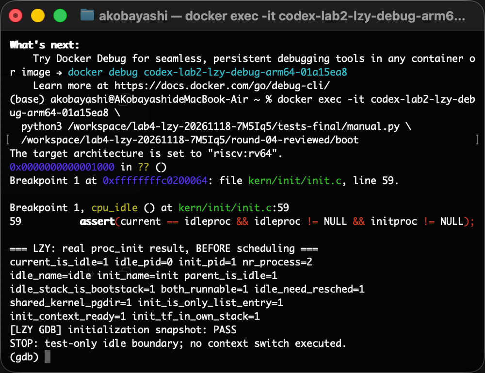
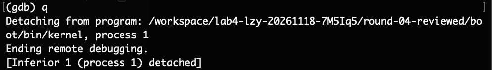
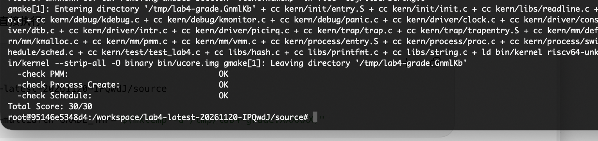

# Lab4 实验报告：进程管理（林子媛）

- 本人完成 `page_insert()`、`page_remove()`、`alloc_proc()`、`proc_init()`，补充私有辅助函数 `page_remove_pte()`；阅读 VMA 框架并完成分页模式与 `get_pte()` 接口设计分析。

## 一、实验目的

**负责人：** 2410936 林子媛

1. 在物理页分配的基础上维护页映射，理解 PTE、物理页引用计数与 TLB 三者必须一致：修改内存中的页表项，不等于处理器已经放弃旧翻译。
2. 理解从单一启动执行流到可调度线程的过程：先建立内存基础和 VMA 描述，再初始化 PCB 与 idle，调用创建接口得到 init，最后由调度模块交给 CPU 执行。
3. 区分 PCB、内核栈、`trapframe` 和 `context`：PCB 管理线程身份与状态，内核栈承载执行，`trapframe` 服务于 Trap 返回，`context` 服务于线程切换。
4. 明确实验边界：本次创建的是共享内核地址空间的内核线程，不是已经具有独立用户地址空间、按需分页和页面置换的完整用户进程系统。

---

## 二、实验环境

**系统与工具链：** 沿用已有 Docker Ubuntu 调试环境，但为 Lab4 创建新的工作目录。

| 项目    | 实际配置                                                  |
| ----- | ----------------------------------------------------- |
| 宿主    | macOS 26.6.2，Build 25G83                              |
| 容器    | `lzy-debug-arm64-01a15ea8`，Ubuntu 22.04.2 LTS，aarch64 |
| 编译与构建 | `riscv64-unknown-elf-gcc` 10.2.0，GNU Make 4.3         |
| 模拟目标  | QEMU 6.2.0，`virt`，RV64，单 hart，128 MiB 内存              |
| 固件    | 默认 OpenSBI v0.9，启动日志报告 Runtime SBI Version 0.2        |
| 调试    | `gdb-multiarch` 12.1；隔离初始化检查使用端口 12436，原评分使用端口 1234   |

你们使用的 AI 工具

| 成员          | AI 编程工具          | 备注                                |
| ----------- | ---------------- | --------------------------------- |
| 2410936-林子媛 | OpenAI Codex 桌面端 | 辅助核对规格、生成补丁与测试、分析日志、整理报告；本人复现关键结果 |

**说明：** Lab4 位于独立仓库目录。Lab3 的物理页与 Trap 实现作为已有基础沿用；Lab4 新增的页表接口、SLOB、VMA、PCB 和调度结构保留当前框架。

---

## 四、实验内容与实现

### 4.1 功能模块一：虚拟内存页操作

**负责人：** 2410936 林子媛

#### 模块功能描述

**需要实现/修改的函数：** [`page_insert()`、`page_remove()`](../code/kern/mm/pmm.c)，并加入同文件私有辅助函数 `page_remove_pte()`。

**功能说明与 SPEC：**

前置条件是物理页分配器和根页表可用，调用者提供有效的页描述符及与当前框架一致的普通末级页表。

| 情况         | 后置条件与允许改变的状态                                                               |
| ---------- | -------------------------------------------------------------------------- |
| 新建映射       | `page_insert` 返回 0，目标 PTE 记录物理页号和传入权限，增加该数据页的映射引用                          |
| 同页重映射或更新权限 | 更新 PTE 权限，引用计数不净增加，也不释放仍被映射的物理页                                            |
| 替换为另一物理页   | 撤销旧引用，旧页引用归零时释放；新页取得一个映射引用                                                 |
| 多地址共享同一页   | 每个有效映射分别计数，删除一个别名不能释放仍有其他引用的页                                              |
| 插入失败       | `get_pte(pgdir, la, 1)` 返回 NULL 时返回 `-E_NO_MEM`；不改变数据页引用，不发布末级映射，不破坏其他已有映射 |
| 删除有效映射     | 清空 PTE、失效对应 TLB，再减少旧数据页引用，归零后调用 `free_page`                                |
| 未映射地址或重复删除 | 安静返回；使用 `get_pte(..., 0)`，不能为了删除而分配页表                                      |

**SPEC 设计过程：** 我先从手册提取“建立、替换、撤销映射”的任务，再对照 `get_pte`、`pte_create` 和引用计数接口，把“映射正确”拆为 PTE 内容、页引用和 TLB 三组可检查条件。随后分别列出同页重映射、异页替换、别名和内存不足，避免提示词只覆盖首次插入。

**核心函数或功能模块的理解：**

- `get_pte` 返回目标页表项的内核虚拟地址，不是数据页物理地址。插入允许它建立缺失的中间表，删除则禁止分配。
- `page_insert` 取得 PTE 后先增加新页引用。若旧映射就是新页，抵消临时增加的引用并直接更新权限；若是另一页，再撤销旧映射。最后用 `pte_create(page2ppn(page), perm)` 编码并失效 TLB。
- `page_remove_pte` 集中处理撤销过程：通过 `pte2page` 取得旧页，清空条目、失效翻译，再减引用并按需释放。`page_remove` 仅负责查找并调用它。
- VMA 是地址区间的逻辑描述，PTE 是处理器进行地址翻译的具体条目。已有 [`vmm.c`](../code/kern/mm/vmm.c) 中，`mm_create` 建立描述对象，`vma_create` 建立区间，`insert_vma_struct` 按顺序插入并检查不重叠，`find_vma` 查找包含地址的 `[vm_start, vm_end)` 区间，`mm_destroy` 释放描述对象。

**测试/分析设计：** 先沿用 `check_pgdir` 与 `check_boot_pgdir` ，再在独立副本中补充同页权限更新、异页替换、别名、重复删除和资源恢复。通过当前页表执行合法的真实读写验证别名与 TLB 更新；通过第 N 次分配失败检查两个中间级分配的不同失败时点。实际结果见 5.1。

#### 最终提示词：代码生成（LZY-P1）

**提示词设计过程：** 将页表操作从笼统的“填写函数”收紧为状态转换问题，重点加入同页重映射、引用归零、TLB 与分配失败约束。以下 LZY-P1 属于代码生成阶段的整理版提示词。

```text
[PROMPT]
按 Lab4 分工，仅完成林子媛 2410936 的 page_insert、page_remove。
请先核对实际源码，再给出最小补丁；必要时加入私有的 page_remove_pte 辅助函数。

[RELY]
当前 pmm.h 提供 get_pte、pte_create、pte2page、page2ppn、page_ref_inc/dec、
free_page 和 tlb_invalidate。get_pte 的 create 参数决定能否分配中间表；
它在后一级分配失败时可能保留已分配的空中间表。物理页分配器由前序实验提供。

[GUARANTEE]
保持函数签名、页表格式和已有自检不变，保留 LAB4 function1 并填写 2410936。
不修改 get_pte、评分脚本、队友函数，不硬编码测试地址或预期输出。
只维护普通末级页映射，不扩展大页拆分或用户地址空间复制。

[SPECIFICATION]
插入成功返回 0，定位/创建 PTE 失败返回 -E_NO_MEM，失败时不增加数据页引用。
新映射增加引用；同页重映射只更新权限，不净增引用、不释放该页；
异页替换撤销旧引用，归零后释放旧页。每次有效映射更新均失效对应 TLB。
删除时使用 create=0；未映射或重复删除不分配、不报错；有效映射清空并失效后减引用。
核对多地址别名、旧页仍有引用、分配失败和空中间表保留的边界。
```

#### 实现迭代过程

本部分完成一轮核心功能实现，随后进行多轮独立验证。

##### 第一次迭代

**遇到的问题：** 源码核对发现，`get_pte` 不是完整事务接口，不能把一次插入失败笼统解释为“任何页表页都未分配”。

**问题解决策略：** 在 SPEC 中分别约束数据页引用、末级映射和中间表，测试中注入第一、第二次中间表分配失败，并对框架留下的空表进行测试清理；不通过修改原断言掩盖状态。

**最终结果：** 两个失败时点均返回 `-E_NO_MEM`，候选数据页引用未增加，已有映射保持；正常映射、替换、删除和真实别名读写检查通过。最终合并版本的原评分 PMM 项为 OK。

**关键改进点总结：** 将“数据页映射接口的保证”与“页表树整体回收”分开，并用私有删除辅助函数统一引用释放与 TLB 处理顺序。

### 4.2 功能模块二：进程创建与初始化

#### 4.2.1 PCB 分配与初始线程初始化

**负责人：** 2410936 林子媛

##### 模块功能描述

**需要实现/修改的函数：** [`alloc_proc()`、`proc_init()`](../code/kern/process/proc.c)。PCB 和切换现场的布局沿用 [`proc.h`](../code/kern/process/proc.h)。

**功能说明与 SPEC：**

`alloc_proc` 的前置条件是堆分配器和启动页表已可用。成功时返回安全的空白 PCB，失败返回 NULL，不登记线程、不增加进程数、不分配内核栈。

| 字段                                     | 初值                                 |
| -------------------------------------- | ---------------------------------- |
| `state`、`pid`                          | `PROC_UNINIT`、-1，尚未发布为可运行线程        |
| `runs`、`kstack`、`need_resched`、`flags` | 均为 0                               |
| `parent`、`mm`、`tf`                     | 均为 NULL                            |
| `context`、`name`                       | 全部清零                               |
| `pgdir`                                | `boot_pgdir_pa`，是根页表的物理地址，不是内核虚拟指针 |
| `list_link`、`hash_link`                | 分别初始化为自环节点，尚未挂接到全局结构               |

`proc_init` 在启动阶段调用一次，完成如下顺序：

1. 初始化 `proc_list` 和所有 `hash_list` 桶，先准备好创建模块依赖的全局登记结构。
2. 调用 `alloc_proc` 得到 idle PCB，失败则 panic，不能继续解引用空指针。
3. 设置 idle 的 PID 为 0、状态为 `PROC_RUNNABLE`、内核栈为已有 `bootstack`、`need_resched=1`、名称为 idle，并令 `current=idleproc`。
4. 将 idle 计入 `nr_process`，但不加入普通进程链表和非零 PID 哈希。idle 是对当前启动现场的包装，不是普通 fork 出来的线程。
5. 调用韩羽宸的 `kernel_thread(init_main, "Hello world!!", 0)`；由其创建流程设置父进程、内核栈、首次现场、PID、普通链表/哈希和可运行状态，并增加子线程计数。
6. 检查创建返回值，失败则 panic；成功后通过 `find_proc(pid)` 取得 `initproc` 并设置名称 init，不重复分配 PID、挂链或计数。

初始化完成、尚未运行 init 时应满足：`current==idleproc`，idle/init PID 为 0/1，`nr_process==2`；普通链表与哈希中各只有 init 一个线程。

**SPEC 设计过程：** 我先逐项核对实际 `proc_struct`，区分“分配空白 PCB”和“创建完整线程”。再阅读已合入的 `do_fork` 与 `find_proc`，明确普通线程登记属于创建模块，idle 的特殊计数属于初始化模块。最后把成功结果写成能够直接在内核断言和 GDB 中检查的字段关系，避免两名成员同时修改计数或重复挂链。

**核心函数或功能模块的理解：** `alloc_proc` 先清零整个对象，再设置 PID、页表和自环节点，保证队友的创建函数拿到的是安全初态。idle 复用启动栈与正在执行的控制流；init 则经创建接口取得自己的内核栈和首次现场。两者共享内核地址空间，`mm` 为 NULL，`context` 与 `trapframe` 的内容由后续创建和切换路径组织。

**测试/分析设计：** 在独立副本中检查 PCB 全字段，注入 `kmalloc` 失败验证 NULL 返回；再走真实 `proc_init -> kernel_thread -> do_fork` 检查 idle/init、父子关系、页表、计数和登记。GDB 停在初始化之后、首次调度之前读取现场。另分别注入 idle 分配失败和 init PCB 分配失败，核对真实启动错误路径。

##### 最终提示词：代码生成（LZY-P2）

**提示词设计过程：** LZY-P2 把共享文件按函数划界，将字段初值和跨成员接口写入约束，尤其明确“idle 计数但不进入普通链表”和“init 由 do_fork 登记”。名称处理也根据实际辅助函数的固定长度复制行为约束。

```text
[PROMPT]
在当前 proc.c 中只完成林子媛 2410936 负责的 alloc_proc 和 proc_init。
先列出各字段初值以及与已合入创建模块的接口约定，再给出最小补丁。

[RELY]
proc.h 已定义 proc_struct、context 和进程状态。kmalloc 可能返回 NULL。
boot_pgdir_pa 是内核根页表物理地址，bootstack 是已有启动栈。
kernel_thread/do_fork 先不负责，负责子线程内核栈、现场、PID、登记、计数和唤醒。
find_proc 仅查找合法的非零 PID；set_proc_name 固定复制 PROC_NAME_LEN 字节。

[GUARANTEE]
保持声明、结构体布局、创建接口和队友代码不变，保留 LAB4 function2 并逐函数标记 2410936。
不重复设置其负责的线程登记状态，不硬编码评分输出。
给固定长度名称复制接口传入足够长的零填充数组，避免越过短字符串对象读取。

[SPECIFICATION]
alloc_proc 失败返回 NULL；成功时清零对象，设置 PROC_UNINIT、pid=-1、
pgdir=boot_pgdir_pa，两个链表节点分别自环，不分配栈、不登记、不计数。
proc_init 先初始化全局链表和哈希，再建立 PID=0 的 idle：复用 bootstack，
置为可运行、需要重调度，并设置 current 和名称。idle 计数但不挂普通链表/哈希。
通过真实 kernel_thread 创建 init；检查返回值、find_proc 的结果，再命名为 init。
启动关键分配失败时 panic。初始化结束时核对 PID、父子、状态、页表和计数一致性。
```

字段断言、失败注入和整合评分的实际结果见 5.1。

##### 实现迭代过程

###### 第一次迭代

**遇到的问题：** 初次实现需要核对 idle 和 init 的登记责任；若在 `proc_init` 再次登记 init，会与已存在的 `do_fork` 重复。

**问题解决策略：** 只在本函数增加 idle 的计数，普通子线程由创建模块统一处理。通过遍历普通链表与哈希，并同时检查 `nr_process`，验证两个成员的接口配合。

**最终结果：** PCB 初值与分配失败检查通过；真实初始化得到 PID 0/1、总进程数 2、普通链表/哈希各一个节点。GDB 读取的父子关系、启动栈、共享页表和 init 首次现场均符合预期。

###### 第二次迭代：固定长度名称复制的复核

**发现与修正：** 现有 `set_proc_name` 先清零目标，再固定复制 `PROC_NAME_LEN`（15）字节。若直接传入较短的 idle/init 字符串对象，会越过该源对象的边界读取。源码复核后，我改用 `PROC_NAME_LEN + 1` 长度的静态常量名称数组，保留原辅助接口，不修改队友函数。

**实际结果：** 修正后重新从正式源码生成副本，复测 PCB、真实初始化、两类启动失败与 GDB 现场；最终整合评分的 Process Create 项为 OK。

### 4.5 扩展分析：分页模式与 get_pte 接口设计

**负责人：** 2410936 林子媛

#### Question

1. 深入理解不同分页模式的工作原理（思考题）。

`get_pte()` 函数位于 `kern/mm/pmm.c`，用于在页表中查找或创建页表项，从而实现对指定线性地址对应的物理页的访问和映射操作。这在操作系统的分页机制下，是虚拟内存与物理内存建立映射关系的关键基础。

- `get_pte()` 函数中有两段形式类似的代码，结合 `sv32`、`sv39`、`sv48` 的异同，解释这两段代码为什么如此相像。
- 目前 `get_pte()` 函数将页表项查找和页表页分配合并在一个函数里，你认为这种写法好吗？有没有必要把两个功能拆开？

#### Answer

##### 两段代码为什么相像？

Sv32、Sv39、Sv48 都采用多级树形页表，将虚拟地址拆成各级索引和页内偏移，再沿页表逐级查找。基本页大小均为 4 KiB，所以页内偏移都是 12 位；每级索引宽度由一页中能容纳的页表项数量决定。

| 模式   | 页表层数 | PTE 大小 | 每个表页条目数 | 虚拟地址的索引与偏移           |
| ---- | ---- | ------ | ------- | -------------------- |
| Sv32 | 2    | 4 字节   | 1024    | 10 + 10 + 12 位       |
| Sv39 | 3    | 8 字节   | 512     | 9 + 9 + 9 + 12 位     |
| Sv48 | 4    | 8 字节   | 512     | 9 + 9 + 9 + 9 + 12 位 |

Sv32 每个表页有 `4096/4=1024` 项，需要 10 位索引；Sv39 和 Sv48 每个表页有 `4096/8=512` 项，需要 9 位索引。层数增加主要用于覆盖更大的虚拟地址范围，共同的逐级查表方式没有改变。[RISC-V 特权架构规范](https://docs.riscv.org/reference/isa/v20240411/priv/supervisor.html)

本实验实际采用 Sv39。虽然 `mmu.h` 上方仍有 Sv32 的旧注释，但实际索引宏分别右移 30、21、12 位并取 9 位，启动代码将 `satp.MODE` 设为 8。对普通 4 KiB 映射，查找路径为：

```text
根页表[PDX1(la)] -> 中间页表[PDX0(la)] -> 末级页表[PTX(la)]
```

根页表已经存在，`get_pte()` 需要处理余下两个表级：

1. 第一段通过 `PDX1(la)` 找到根表项 `pdep1`，检查中间页表是否存在；若不存在且允许创建，就分配、清零一个表页，设置引用计数，并将下一级页表的物理页号写入父项。
2. 第二段通过 `PDX0(la)` 找到中间表项 `pdep0`，用同样方式检查或创建末级页表。
3. 最后通过 `PTX(la)` 返回末级 PTE 的内核虚拟地址。返回的是条目位置，不表示该条目已经建立了数据页映射。

两段代码相像，是因为每一级页表都采用相同的条目组织方式，都要完成“检查父项是否有效、按需分配下级表、初始化表页、连接父子表”的操作，区别只在当前层级和索引。父项保存物理地址，内核通过 `PDE_ADDR` 和 `KADDR` 访问下一张表。

对于普通基本页路径，根表已有时，Sv32 需要一次这样的非叶层下降，Sv39 需要两次，Sv48 需要三次；缺失的表才分配，已经存在的表会复用。这种结构具有递归性，可以用按层循环抽象公共逻辑，但不能仅增加一段相似代码就认为已经完成另一种分页模式的支持。

##### 是否应该拆分查找与分配？

我认为，当前合并写法适合调用关系较简单的教学内核，但不是所有场景下都最清晰；是否拆分，应根据副作用控制、错误处理和维护需求判断，而不是为了拆分而拆分。

合并写法的优点是调用方便，查找和创建复用同一套遍历过程。例如，`page_remove()` 传入 `create=0`，只查找已有 PTE；`page_insert()` 传入 `create=1`，在需要时准备缺失的中间表。调用方不必先查找、失败后再单独发起分配。

它的不足主要有三点：

1. **副作用不够直观。** 相同函数名既可能只查询，也可能修改页表和消耗物理内存，调用者必须正确理解 `create` 参数；本应只读的检查若误传 1，就可能意外创建页表。
2. **错误语义依赖调用约定。** NULL 在只查询模式中可以表示中间表不存在，在创建模式中又可能表示分配失败，调用者需要结合参数才能解释结果。
3. **分配后的清理约定不明确。** 当前实现第一次分配成功、第二次分配失败时，会返回 NULL，但已建立的空中间表仍保留。返回失败不等于整个页表树已恢复到调用前，接口需要明确是否回滚、由谁清理。

如果后续调用场景更复杂，可以将对外接口拆成以下形式，签名仅为设计示意：

```c
pte_t *lookup_pte(pde_t *pgdir, uintptr_t la);
int ensure_pte(pde_t *pgdir, uintptr_t la, pte_t **ptep_store);
```

`lookup_pte()` 明确保证不分配、不修改页表；`ensure_pte()` 负责准备所需表页，并用错误码报告失败、通过输出参数返回 PTE 位置。两个接口仍可共用内部遍历辅助函数，避免重复实现。分配接口还应明确失败策略：若承诺回滚，只撤销本次新建且可安全回收的表页，不得破坏已有映射。

拆分后，接口意图、副作用边界和测试目标更明确，但会增加接口数量及维护成本；也不能自动解决大页识别或多核同步问题。例如，遇到高层叶项时不能仅凭 V=1 就把它当作下级页表继续访问。

因此，本实验保留 `get_pte(pgdir, la, create)` 是合理的，不必为完成思考题修改生产代码；若扩展到更复杂的内存管理系统，我更倾向于拆分对外的查询与创建接口，同时复用内部遍历逻辑，并明确错误、回滚和大页处理约定。

---

## 五、测试与验证

### 5.1 页映射与进程初始化验证

**负责人：** 2410936 林子媛

#### 测试生成提示词：LZY-P4

本阶段把 4.1、4.2.1 的规格变成可执行检查。先区分本人函数、真实创建接口和未完成的调度依赖，再决定是否需要测试夹具。

```text
[PROMPT]
针对 page_insert、page_remove、alloc_proc、proc_init 生成独立测试方案和最小测试代码，
分开验证函数级状态、真实内存访问、启动初始化、完整内核和原仓库评分。

[RELY]
已有 Docker Ubuntu、RV64 GCC、QEMU 和 gdb-multiarch。
映射依赖真实页表与 pmm_manager，PCB 依赖真实 SLOB；创建接口由队友提供。
早期调度函数可能未实现，现有自检与 tools/grade.sh 的验收条件必须保留。

[GUARANTEE]
每轮在不存在的新目录复制正式源码，不覆盖 /lab、旧测试目录或旧 GDB 会话。
失败注入、测试入口和停止型夹具仅存在于副本；不把它们混入提交代码。
不改评分规则，不打印未经断言验证的 PASS。

[SPECIFICATION]
检查新映射、同页权限更新、异页替换、别名引用、重复删除及空闲页恢复。
通过实际加载/存储验证别名可见性和重映射后的翻译；分别注入两级表页分配失败。
逐项核对 PCB 初值，并注入 kmalloc 失败；通过真实创建接口核对 idle/init、
父子、栈、现场、计数、链表和哈希。分别触发 idle 与 init 创建失败的启动错误路径。
缺少调度时只在边界停止并明确未验证范围；合入真实调度后另做无自建夹具回归。
```

#### 调试分析提示词：LZY-P5

```text
[PROMPT]
结合当前源码、测试日志和本人终端截图定位问题，先判断是代码、测试、
Docker 版本、GDB 停点还是命令输入错误，再决定是否需要修改。

[RELY]
宿主 Git 仓库与 Docker 里的复制目录相互独立，git pull 不会自动更新旧副本。
原评分需要完整内核；链接失败会导致缺少 kernel.sym、QEMU 输出和有效运行评分。
set_proc_name 的实际实现使用固定长度 memcpy；页表注释与实际宏也可能不一致。

[GUARANTEE]
不根据单个总分猜测根因，不删除断言或降低标准，不因队友缺失而越界补代码。
只把真实出现的错误记为运行问题，源码复核发现的风险需明确标注。
GDB 检查使用独立端口；不结束其他会话，不把初始化快照当成上下文切换证据。

[SPECIFICATION]
从第一条编译/运行错误往后追踪，核对当前目录、来源提交、函数定义和测试注入位置。
说明原因分类、必要修改或目录切换，以及用全新源码副本复测的方法。
对名称固定长度复制、get_pte 失败保留空表、旧 Sv32 注释分别核对实际代码。
手动复现只选择关键自检、初始化现场和最终评分截图，不要求逐条命令截图。
```

#### 最终回归提示词：LZY-P6

```text
[PROMPT]
在队友调度与上下文切换代码合入后，为当前 lab4 提交执行完整整合回归，
确认本人的映射和初始化与真实创建、调度、切换路径共同工作。

[RELY]
正式代码应包含本人四个函数、队友的线程创建接口，以及 cpu_idle、schedule、
proc_run 和 switch_to。原仓库提供 Makefile、测试注入器和 grade.sh。
Docker 中有 gdb-multiarch；评分支持通过命令行指定 GDB 与独立 GRADE_TMP。

[GUARANTEE]
锁定提交并重新复制正式源码，不复用旧构建，不加入自建调度夹具。
原评分断言、分值和预期输出保持不变，GRADE_TMP 不覆盖旧目录。
评分前检查固定调试端口；本次结果不改写为本人独立完成整个进程管理模块。

[SPECIFICATION]
先 make 编译，再 make qemu 观察真实 initproc 入口与字符串输出，
区分框架 do_exit 的预期 panic 与异常失败。
执行 make grade GDB=gdb-multiarch，并指定新的评分临时目录。
分别记录 PMM、Process Create、Schedule 的检查和总分，保留实际输出及来源版本。
若失败，回到最早不确定环节；若通过，再由本人手动复现并保存一张评分汇总图。
```

#### 操作与说明

**图 1：页映射、PCB 与初始化自检（2026-11-18，独立测试副本）。** 原有框架自检与 `[LZY UNIT]`、`[LZY LIVE]` 均通过；`idle=0 init=1 nr_process=2 list=1 hash=1` 同时核对特殊 idle 计数和普通线程登记。

**图 2：GDB 核验真实初始化结果（2026-11-18，首次调度之前）。** `current_is_idle=1`，PID 为 0/1，总进程数为 2；父子关系、启动栈、可运行状态、共享页表、普通链表节点及 init 首次现场的布尔检查均为 1。



**图 3：退出调试会话（2026-11-18）。** 在 GDB 输入 `q`，出现 Detaching 和 Ending remote debugging，表示结束远程调试。



**图 4：最新真实代码的完整整合评分（2026-11-20）。** 当前目录是最新源码副本，三项分别显示 `check PMM: OK`、`check Process Create: OK`、`check Schedule: OK`，总分 30/30。



#### 当前版本的复现命令

本次在宿主终端进入最新正式源码副本：

```bash
docker exec -it \
  -w /workspace/lab4-latest-20261120-IPQwdJ/source \
  codex-lab2-lzy-debug-arm64-01a15ea8 bash
```

在容器 Bash 中运行：

```bash
make grade GDB=gdb-multiarch GRADE_TMP="$(mktemp -d /tmp/lab4-grade.XXXXXX)"
```

---

## 六、实验总结与收获

### 对操作系统的理解

**负责人：** 2410936 林子媛

| 实验知识点               | 对应 OS 原理及联系                               | 差异与本次边界                                                  |
| ------------------- | ----------------------------------------- | -------------------------------------------------------- |
| 页映射、PTE 权限          | 地址转换与内存保护：通过页表决定虚拟地址到物理页的映射和访问属性          | 维护普通末级映射不等于实现所有大页、用户隔离和非法访问处理                            |
| 页引用计数               | 共享资源的生命周期管理：多个映射可引用同一物理页，最后一个引用消失后才能回收    | 只维护相应页引用，不等于具有完整进程退出、文件或跨地址空间资源回收                        |
| TLB 失效              | 缓存一致性：软件页表更新后，处理器不能继续依赖旧翻译                | 本实验在单 hart 使用 sfence.vma，不代表实现多核 TLB shootdown 和 ASID 管理 |
| VMA 与页表             | 地址空间的逻辑描述和具体映射是两个层次，区间是否合法与当前有无 PTE 是不同问题 | VMA 框架存在，不代表已经支持按需分配、换入换出或完整用户页表销毁                       |
| PCB、idle 与 init     | 执行实体的身份、状态和登记管理；启动执行流也可纳入统一的线程抽象          | idle 有特殊栈与登记规则；当前内核线程共享内核地址空间，不是独立用户进程                   |
| context 与 trapframe | 上下文切换和异常返回都依赖现场保存，但服务的控制流边界不同             | context 保存切换所需寄存器，trapframe 保存 Trap 返回现场；不能把两个结构混为一谈     |

OS 原理中重要而本次未完整实现的内容包括：按需分页需要缺页分配与重试，页面置换需要驻留集、置换策略和后备存储；用户地址空间隔离需要独立页表及用户/内核访问边界；完整进程退出需要回收地址空间、栈和父子关系；多核并发还需要跨 hart 同步与 TLB 一致性。本实验建立页映射、VMA、PCB 和线程切换的基础，但不能由 30/30 推出这些后续功能也已完成。

### AI 协作开发的经验

**负责人：** 2410936 林子媛

1. **先约束状态，再要求生成代码。** 将同页重映射、分配失败、idle 特殊登记等条件写入 SPEC，比只列函数名更能限制错误实现。四段式提示词也使“可以依赖的框架”和“本人可以修改的范围”更清楚。
2. **阅读实际接口，不能套用其他版本。** 固定长度名称复制、`boot_pgdir_pa` 的物理地址语义、旧 Sv32 注释与真实 Sv39 宏的差别，都说明 AI 给出的通用答案必须回到当前源码核对。
3. **把风险、真实错误和测试结果分开。** 名称越界读是源码复核发现的风险；旧 Docker 目录导致的 undefined reference 是实际环境/版本错误；夹具的 20/30 与最新真实代码的 30/30 则有不同证明范围，不能混写为同一次成功过程。
4. 本文按代码生成、测试生成、调试分析和最终回归整理提示词，截图只保留关键自检、初始化现场、退出记录与最终评分，并通过相对路径随报告携带。
