# Lab3 实验报告：中断与异常处理

## 实验基本信息

| 项目 | 内容 |
|------|------|
| **实验名称** | Lab3：中断与异常处理 |
| **小组成员** | 2410673-韩羽宸、2410936-林子媛、2410933-马禹翔 |
| **完成日期** | 2026-11-06 |

本报告由小组三名成员共同完成，各模块按分工整理。完成日期为三份个人材料汇总及最终联调记录整理日期。

### 小组分工

练习分工

| 成员 | 负责的练习/模块 |
|------|----------------|
| 2410673-韩羽宸 | 功能模块一：`RESTORE_ALL`、`__alltraps`；Trap frame、栈与返回机制分析；上下文恢复验证 |
| 2410936-林子媛 | 功能模块二：`exception_handler()`；非法指令与断点、指令长度及 EPC 更新；特权级与 `stvec` 思考题；异常验证 |
| 2410933-马禹翔 | 功能模块二：`interrupt_handler()`；持续时钟、计数和关机；中断关闭与开启、原子操作及宏分析；整体运行与评分 |

实验报告分工

| 成员 | 负责的报告内容 |
|------|----------------|
| 2410673-韩羽宸 | 基本信息、功能模块一、上下文验证、报告整理与提交检查；本人环境和总结；最终统稿 |
| 2410936-林子媛 | 实验目的、异常处理、`stvec` 兼容性、异常验证；本人环境和总结 |
| 2410933-马禹翔 | 整体逻辑、中断处理、中断关闭与开启、时钟测试和整体评分；本人环境和总结 |

断点返回同时依赖异常函数更新 EPC 和汇编恢复现场，整体时钟测试同时依赖中断处理与 Trap 返回，相关验证按共同接口说明。

---

## 一、实验目的

1. 理解 RISC-V 中 Trap、同步异常与异步中断的关系，区分硬件记录异常状态、软件保存上下文和 C 函数处理异常的不同职责。
2. 结合 M/S/U 特权级和异常委托，理解实验内核进入 S 模式异常入口的条件，掌握 `scause`、`sepc`、`stval` 与 Trap frame 的对应关系。
3. 完成非法指令和断点处理，按照实际指令长度更新 EPC，使程序跳过故障指令继续执行，而不是反复陷入同一个异常。

4. 掌握 Trap frame 的布局、汇编与 C 的调用约定、通用寄存器与栈指针的恢复顺序，建立完整的入口和返回链条。
5. 实现可持续的 S 模式时钟中断，理解事件续设、中断使能、临界区保护和原子操作的适用范围。
6. 学习先写 SPEC、再组织四段式提示词的 AI 协作方法，用实际运行、调试及评分核验生成结果，记录真实问题和实现边界。

## 二、实验环境

### 2.1 系统、工具链与运行调试环境

三人的实测环境分别列出。固件版本以实际启动输出为准，调试地址与绝对路径只对应各自的构建和运行。

#### 2.1.1 韩羽宸的构建与 Trap 上下文调试环境

**负责人：2410673 韩羽宸**

本人继续使用 Windows 上的 WSL2 Ubuntu-22.04。下表来自本次实际版本核对，没有直接照抄 Lab2 的旧版本。例如本轮交叉编译器实际为 GCC 15.1.0，与 Lab2 报告的旧记录不同。

| 工具或环境 | 本次实际配置 | 用途 |
| --- | --- | --- |
| 宿主与 Linux 环境 | Windows + WSL2；Ubuntu 22.04.5 LTS | 编辑文件并运行交叉构建与模拟器 |
| Linux 内核 | `6.6.87.2-microsoft-standard-WSL2` | 承载构建工具与 QEMU |
| GNU Make | 4.3 | 按 Makefile 编译和链接 |
| RISC-V GCC | `riscv64-unknown-elf-gcc` 15.1.0 | 编译内核 C 与汇编 |
| RISC-V GNU ld | 2.45 | 生成内核 ELF |
| RISC-V GDB | `16.3.90.20250610-git` | 现场断点观察 Trap 入口帧与返回后的 PC、SP；系统性检查另由运行断言提供 |
| QEMU | `/usr/local/bin/qemu-system-riscv64`，7.0.0 | 模拟 RISC-V `virt` 平台 |
| OpenSBI | 启动输出为 1.0；Runtime SBI Version 为 0.3 | 启动 S 态内核并提供 SBI 服务 |
| 模拟内存与核数 | 运行日志显示 128 MiB、1 个 HART | 本次上下文与异常验证场景 |

WSL 中将 `/home/smile/toolchains/riscv-elf-toolchains/bin` 加入 `PATH`，避免调用到另一套同名工具。内核按高地址链接，QEMU 将镜像放到物理地址 `0x80200000`；运行参数同时提供 `-kernel bin/ucore.img`，使当前 OpenSBI 获得正确的内核下一跳。该启动配置由此前整理 Lab3 初始代码时继承，本次功能一提交没有再改启动代码。

本次正式实现位于 `code/kern/trap/trapentry.S`，构建、断言和测试桩在独立副本中执行。这样既可以在队友的时钟函数尚未实现时验证本人模块，也能清楚区分课程提交源码和测试辅助代码。QEMU 加载 `bin/ucore.img`，调试器应加载带符号的 `bin/kernel`；二者分别用于执行和符号定位。

#### 2.1.2 马禹翔的中断与整体测试环境

**负责人：2410933 马禹翔**

| 工具或环境 | 本次实际配置 | 用途 |
| --- | --- | --- |
| 宿主环境 | Windows + VMware Workstation | 编辑、截图并连接实验虚拟机 |
| 虚拟机系统 | Ubuntu 26.10，Linux `7.3.0-9-generic` | 编译、运行和测试内核 |
| 连接方式 | VS Code Remote SSH，主机别名 `os-vm` | 远程编辑与终端操作 |
| GNU Make | 4.4.1 | 根据 Makefile 构建内核和评分副本 |
| RISC-V GCC | `riscv64-unknown-elf-gcc` 15.3.0 | 编译 RV64 C 与汇编源码 |
| GNU ld | 2.47 | 链接内核 ELF |
| RISC-V GDB | 本虚拟机未安装 | 本人模块没有使用 GDB 作为验证证据 |
| QEMU | `qemu-system-riscv64` 4.1.1 | 模拟 RISC-V `virt` 平台 |
| OpenSBI | 启动输出 OpenSBI v0.4，Runtime SBI Version 0.1 | 启动 S 态内核并提供定时器、关机等 SBI 服务 |
| 模拟硬件 | 128 MiB 内存，运行于 Hart 0 | 本次单 hart 中断实验 |

实验代码位于虚拟机 `/home/s1nk/OSLab62/code`。所有结论均以当前仓库源码和实际日志为准；未安装或未使用的工具不推定填写。

完整提示词与迭代记录见 [2410933_prompt.md](./2410933_prompt.md)。

#### 2.1.3 林子媛的异常处理与 GDB 环境

**负责人：2410936 林子媛**

| 项目    | 本人实际使用的环境                                                                    |
| ----- | ---------------------------------------------------------------------------- |
| 实验环境  | Docker 容器 `codex-lab2-lzy-debug-arm64-01a15ea8`，Ubuntu 22.04.2 LTS，`aarch64` |
| 交叉编译器 | `riscv64-unknown-elf-gcc` 10.2.0                                             |
| 模拟器   | `qemu-system-riscv64` 6.2.0，`virt` 机器，目标为 RV64，包含 C 压缩指令扩展                   |
| 调试器   | `gdb-multiarch` 12.1，通过 QEMU 的 GDB 接口观察内核                                    |
| 启动固件  | 实际启动输出为 OpenSBI v0.9，使用 `-bios default`                                      |

Ubuntu 容器自身是 ARM64 环境，RISC-V 内核由交叉编译器生成，再在 QEMU 中运行。

### 2.2 各成员使用的 AI 工具与模型

| 成员 | AI 编程工具 | 底层模型 | 备注 |
|------|------------|---------|------|
| 2410673-韩羽宸 | OpenAI Codex 桌面端 | 未单独留存可核验的具体版本记录 | 手册与源码分析、汇编实现、独立验证、现场调试和报告整理 |
| 2410933-马禹翔 | OpenAI Codex 桌面端 | GPT-5（个人报告记录） | 中断实现、四段式提示词、运行评分；VS Code Remote SSH 连接虚拟机 |
| 2410936-林子媛 | Codex 桌面应用 | GPT-6.1 Sol（个人报告记录） | 异常分析与实现、自测生成、命令行与 GDB 调试 |

AI 编程工具记录实际界面，底层模型记录个人材料中留存的版本，无法核验的版本不推定填写。提示词按 `[PROMPT] / [RELY] / [GUARANTEE] / [SPECIFICATION]` 组织；事后规范整理的复现提示词在正文中明确标注。

## 三、实验整体逻辑分析

**负责人：2410933 马禹翔。**

### 3.1 本章节的逻辑主线

Lab2 已建立内核启动、物理内存管理和页表基础，Lab3 在此之上解决“CPU 遇到中断或异常时，怎样暂时离开当前执行流，交给内核处理，再准确返回”的问题。完整链条为：

```text
Trap 发生
  -> 硬件保存 sepc/scause/stval 等控制状态并跳转 stvec
  -> SAVE_ALL 在内核栈建立 struct trapframe
  -> __alltraps 将 Trap frame 地址作为 a0 调用 trap(tf)
  -> trap_dispatch() 根据 scause 最高位区分中断与异常
  -> interrupt_handler() 或 exception_handler() 处理具体原因
  -> RESTORE_ALL 恢复处理后的 CSR 和通用寄存器
  -> sret 返回 sepc 指定的位置
```

硬件、汇编和 C 代码的职责不同。硬件负责发现事件、记录必要 CSR、改变中断状态并转移控制；汇编负责保存普通 C 函数无法自动保护的完整寄存器现场，并在末尾恢复；C 层负责按原因码进行可读、可维护的具体策略处理。本人的中断函数处于 C 层，不重新保存寄存器，也不直接执行 `sret`。

中断与异常统称 Trap，但触发方式不同。中断是异步事件，例如时钟到期；异常由当前指令同步触发，例如非法指令和断点。`trap_dispatch()` 通过把 `tf->cause` 解释为有符号整数，利用最高位判断两类事件；具体 handler 再解释低位原因码。

### 3.2 功能实现顺序与依赖关系

1. **继承 Lab2 基础。** 本章补回 Lab2 的启动、页初始化与 Best Fit 基础；`kern_init()` 实际先清零 BSS、解析 DTB、初始化控制台并输出内核信息，再首次调用 `idt_init()`，随后执行 `pmm_init()` 并再次设置 Trap 入口。时钟与全局中断使能位于这些初始化之后。
2. **建立统一入口和返回。** `idt_init()` 把 `stvec` 指向 `__alltraps`。韩羽宸实现的入口/恢复代码先把处理器现场变成 `struct trapframe`，再把处理后的帧还原；后续 C handler 都依赖这一通道。
3. **按类型分发。** `trap()` 调用 `trap_dispatch()`。异步中断进入本人实现的 `interrupt_handler()`；同步异常进入林子媛实现的 `exception_handler()`。
4. **初始化并开启时钟。** `clock_init()` 在 `sie` 中使能 S 模式时钟中断、设置第一次定时事件并把 `ticks` 清零；`intr_enable()` 再设置 `sstatus.SIE`，允许当前 hart 接受 S 模式中断。
5. **形成持续时钟。** OpenSBI 定时事件是单次的，因此本人在每次 `IRQ_S_TIMER` 中断中调用 `clock_set_next_event()`，再增加 `ticks`。否则系统只会收到第一次时钟中断。
6. **联调闭环。** 正常 `make qemu` 验证持续时钟和关机；构造帧测试验证软件/未知中断分支；`make grade` 同时经过入口、异常、本人中断函数和返回路径，验证全组接口能正确衔接。

### 3.3 项目组成与模块协作

| 核心模块 | 职责 | 与其他模块的关系 |
|----------|------|----------------|
| `kern/init/init.c` | 组织启动、PMM、Trap 入口及中断初始化 | 先建立可用环境，最后允许时钟中断进入 |
| `trapentry.S`：`SAVE_ALL`、`__alltraps` | 保存整数现场和 CSR，把帧地址传入 C | 布局必须与 `trap.h` 一致 |
| `trap.c`：`trap()`、`trap_dispatch()` | 根据原因最高位区分中断与同步异常 | 两类 handler 共用同一帧及返回路径 |
| `interrupt_handler()`、`clock.c` | 中断分类、设置下次事件、计数、输出与关机 | 通过 SBI 设置定时器，依赖汇编透明返回 |
| `exception_handler()` | 非法指令与断点提示、按长度推进 EPC；其他异常打印现场 | 修改帧中的 EPC，由恢复宏写回 `sepc` |
| `trapentry.S`：`RESTORE_ALL`、`__trapret` | 恢复 CSR 和 GPR，最后恢复原 SP 并 `sret` | 恢复的是 C 处理后的帧 |
| `intr.c`、`sync.h`、`atomic.h` | 中断使能、旧状态保存恢复及原子位操作 | 保护 PMM 复合更新；本核屏蔽不等于跨核互斥 |
| `tools/grade.sh` 与测试程序 | 隔离验证入口、异常与持续时钟 | 与个人构造帧和 GDB 观察互相补充 |

## 四、实验内容与实现

### 4.1 功能模块一：Trap 上下文恢复与 Trap 入口功能

**负责人：2410673 韩羽宸。**

#### 模块功能描述

**需要实现/修改的函数：**

```text
RESTORE_ALL     # 与已有 SAVE_ALL 对应的上下文恢复宏
__alltraps     # SAVE_ALL 后传递帧地址并调用 trap() 的入口
```

本实验在 Lab2 已能启动、分页和管理物理内存的基础上，增加运行中的中断与异常处理。CPU 进入 S 态 Trap 时，只完成规定的控制状态更新，不会自动把 32 个通用寄存器保存成 C 结构体。汇编入口负责把现场放进栈中的 Trap frame，C 代码据此处理，再由汇编恢复处理后的现场并执行 `sret`。

本模块承接已有的 `SAVE_ALL`，补齐入口调用和返回恢复。它不负责识别每一种中断，也不统一决定异常指令应跳过多少字节。已有 `trap()` 调用 `trap_dispatch()`，按原因分发给中断和异常函数；这两个处理函数分别由队友实现。

##### 1. 输入、输出与整体衔接

| 环节 | 输入状态 | 承担的工作 | 输出状态 |
| --- | --- | --- | --- |
| 硬件进入 S 态 Trap | 被打断的执行状态 | 写入相关 CSR、更新状态位并跳到入口 | PC 到达 `__alltraps`，通用寄存器尚未由软件保存 |
| 已有 `SAVE_ALL` | 当前内核栈和寄存器 | 分配 36 个槽，保存 GPR 与四个 CSR 信息 | `sp` 指向完整 `struct trapframe` |
| 本人补全 `__alltraps` | 帧首地址位于 `sp` | `mv a0, sp`，`call trap` | C 函数获得同一帧地址，返回后 `sp` 仍为帧首 |
| 队友的 C 处理函数 | `struct trapframe *tf` | 按原因处理，必要时修改保存的 EPC 等字段 | 帧表示希望恢复的执行状态 |
| 本人实现 `RESTORE_ALL` | C 处理完成后的帧 | 恢复 `sstatus`、`sepc`、可写 GPR，最后恢复原 `sp` | 准备执行 `sret` |
| 已有 `sret` | 返回控制状态已经装入 CSR | 按返回状态切换执行权限和中断状态，PC 取自 `sepc` | 回到指定位置继续执行 |

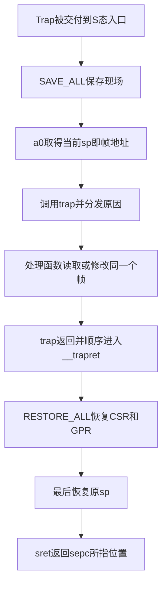

这里有两个层次的“返回”：C 函数先按普通调用约定返回汇编，之后 `sret` 才完成 Trap 返回。二者使用的地址来源不同，不能把 C 的 `ret` 和特权返回混为一谈。

##### 2. SPEC 设计过程

先由 `SAVE_ALL` 与 `trap.h` 确定保存布局，再由 C 调用约定和 `sret` 确定传参与返回要求。规格的关键不是笼统的“恢复全部寄存器”，而是明确以下不变量；完整前后条件和用例见 HYC-P1、HYC-P2。

| 约束 | 设计理由与验收方式 |
| --- | --- |
| 保存宏、结构体、C 签名不变，36 槽按原布局解释 | 入口、C 和恢复端必须一致；核对差异、大小与字段偏移 |
| `a0=sp` 传帧，C 返回时仍以帧首为 `sp` | 保证处理与恢复操作同一现场；核对参数及原栈关系 |
| 使用处理后的 `status/epc/GPR`，临时借用寄存器最终也恢复 | C 对帧的合法修改必须生效；检查 EPC 和修改保存 `a0` 的返回值 |
| 最后恢复 x2，不额外回收帧，遵守栈对齐 | 防止读取基址失效及栈漂移；比较返回前后原栈并重复运行 |
| 返回机制不代替 C 决定 EPC、权限或中断策略 | 区分 SIE 两种初态、帧中状态及 `sret` 后状态 |
| 保留学号标记，验证副本使用本人真实汇编 | 核对两处标记、源码哈希及快照，排除参考入口替代 |

前五项来自实现接口；验证阶段进一步明确最后一项，补充证据一致性要求，没有改动功能一接口。

##### 3. Trap frame 的 36 个槽位

`struct pushregs` 的前 32 项按 x0 到 x31 顺序排列；`struct trapframe` 在其后加入 `status`、`epc`、`badvaddr` 和 `cause`。本轮为 RV64，`REGBYTES=8`，所以一帧占 288 字节。

| 槽号 | 字节偏移 | 字段或寄存器 | 用途 |
| --- | --- | --- | --- |
| 0 | 0 | x0 / `zero` | 固定为零，结构中保留位置，恢复时无需加载 |
| 1 | 8 | x1 / `ra` | 被打断代码的返回地址，区别于调用 `trap()` 时生成的临时返回地址 |
| 2 | 16 | x2 / `sp` | 进入 Trap 前的栈指针，不能保存成分配帧之后的地址 |
| 3 | 24 | x3 / `gp` | 全局指针 |
| 4 | 32 | x4 / `tp` | 线程指针，本实验保留其原值 |
| 5—7 | 40—56 | x5—x7 / `t0—t2` | 临时寄存器 |
| 8—9 | 64—72 | x8—x9 / `s0—s1` | 保存寄存器，亦被保存/恢复代码暂借 |
| 10—17 | 80—136 | x10—x17 / `a0—a7` | 参数/返回值寄存器，也属于被打断现场 |
| 18—27 | 144—216 | x18—x27 / `s2—s11` | 保存寄存器 |
| 28—31 | 224—248 | x28—x31 / `t3—t6` | 临时寄存器 |
| 32 | 256 | `status` | `sstatus` 的软件保存值 |
| 33 | 264 | `epc` | `sepc` 的软件保存值，可由 C 处理函数更新 |
| 34 | 272 | `badvaddr` | 当前代码保存 `stval`；字段沿用原名称 |
| 35 | 280 | `cause` | `scause` 的保存值，供 C 分类 |

保存宏使用 `STORE xN, N*REGBYTES(sp)`，恢复宏也按同一槽号读取。C 并不知道汇编宏的含义，它只是按结构体偏移访问内存，所以两边的对应是必须共同遵守的接口。测试实际断言 `sizeof(pushregs)=256`、`sizeof(trapframe)=288`，并核对 `status`、`epc` 的偏移为 256、264。

##### 4. `SAVE_ALL` 为什么先使用 `sscratch`

设进入入口时的栈指针为 `S`，保存宏先执行：

```asm
csrw sscratch, sp
addi sp, sp, -36 * REGBYTES
```

第一条先把 `S` 放到 `sscratch`，第二条再使 `sp=S-288`。否则如果先减栈再保存 x2，第 2 槽就会错误地保存帧首，而不是原栈指针。宏在保存完原来的通用寄存器后执行：

```asm
csrrw s0, sscratch, x0
```

该指令把 `sscratch` 中的原 `sp` 读入 `s0`，同时向 `sscratch` 写零。随后将 `s0` 存到第 2 槽。此时原来的 `s0` 已经在第 8 槽，因此可以安全借用。`s1—s4` 同样在原值保存后用于搬运 CSR。

`sscratch` 的零值是本工程关于内核执行状态的软件约定，不是硬件自动产生的“内核模式编号”。已有 `idt_init()` 先将它清零，保存宏也在使用后清零。本次恢复没有把旧 `sp` 再写回 `sscratch`，因为恢复原 `sp` 与维护 scratch 约定是两件事。

手册提到使用 `sscratch` 保存用户态进入时的内核栈指针，但当前 `SAVE_ALL` 没有完整的 U/S 栈选择和交换流程。本轮实际验证发生在 S 态内核中，不据此宣称已经实现用户态入口、自动换栈或完整嵌套异常支持。

##### 5. 为什么所有可写整数寄存器都要恢复

普通 C 调用允许被调用函数改写 `a0—a7`、`t0—t6` 和 `ra` 等调用者保存寄存器，调用者会按约定处理；Trap 却可能在被打断代码并未准备调用函数时发生。被打断代码没有提前保存这些寄存器的机会，因此 Trap 包装层必须保护这部分现场，不能只恢复 `s0—s11`。

调用约定还规定第一整数参数位于 `a0`，标准栈在过程入口保持 16 字节对齐。当前内核栈满足这一前提，减去 288 字节后仍然对齐。该论证依赖原栈已对齐，不能把“减去 16 的倍数”误认为能修正任意未对齐的输入栈。[RISC-V psABI：整数调用约定](https://riscv-non-isa.github.io/riscv-elf-psabi-doc/#_integer_calling_convention)

原 `a0` 已在 `SAVE_ALL` 时放入第 10 槽，因此入口可以用 `mv a0, sp` 传参。C 函数执行时改变的是活动寄存器；返回恢复读的是栈中保存的值。这也解释了为什么 C 修改 `tf->gpr.a0` 后，返回程序应看到修改值，而不是强制看到进入前的值。

##### 6. `RESTORE_ALL` 的实际实现

本轮新增的恢复代码如下；当前正式源码另有解释性行内注释，指令逻辑一致：

```asm
    .macro RESTORE_ALL

    #lab3 function1 2410673
    # 先恢复返回所需的 CSR；暂借 s0/s1，随后从原槽位恢复它们。
    LOAD s0, 32*REGBYTES(sp)
    LOAD s1, 33*REGBYTES(sp)
    csrw sstatus, s0
    csrw sepc, s1

    LOAD x1, 1*REGBYTES(sp)
    LOAD x3, 3*REGBYTES(sp)
    LOAD x4, 4*REGBYTES(sp)
    LOAD x5, 5*REGBYTES(sp)
    LOAD x6, 6*REGBYTES(sp)
    LOAD x7, 7*REGBYTES(sp)
    LOAD x8, 8*REGBYTES(sp)
    LOAD x9, 9*REGBYTES(sp)
    LOAD x10, 10*REGBYTES(sp)
    LOAD x11, 11*REGBYTES(sp)
    LOAD x12, 12*REGBYTES(sp)
    LOAD x13, 13*REGBYTES(sp)
    LOAD x14, 14*REGBYTES(sp)
    LOAD x15, 15*REGBYTES(sp)
    LOAD x16, 16*REGBYTES(sp)
    LOAD x17, 17*REGBYTES(sp)
    LOAD x18, 18*REGBYTES(sp)
    LOAD x19, 19*REGBYTES(sp)
    LOAD x20, 20*REGBYTES(sp)
    LOAD x21, 21*REGBYTES(sp)
    LOAD x22, 22*REGBYTES(sp)
    LOAD x23, 23*REGBYTES(sp)
    LOAD x24, 24*REGBYTES(sp)
    LOAD x25, 25*REGBYTES(sp)
    LOAD x26, 26*REGBYTES(sp)
    LOAD x27, 27*REGBYTES(sp)
    LOAD x28, 28*REGBYTES(sp)
    LOAD x29, 29*REGBYTES(sp)
    LOAD x30, 30*REGBYTES(sp)
    LOAD x31, 31*REGBYTES(sp)

    # SAVE_ALL 的第 2 槽保存的是进入 Trap 前的 sp，必须最后恢复。
    LOAD x2, 2*REGBYTES(sp)

    .endm
```

**先恢复 CSR。** CSR 不能直接从内存加载，所以先用 `s0/s1` 中转，再写入 `sstatus/sepc`。这两个寄存器的原值之后分别从第 8、9 槽恢复，不会把临时 CSR 值带回原程序。

**再恢复一般寄存器。** 宏没有对 x0 执行 `LOAD`，因为 x0 恒为零；x1、x3—x31 全部按原编号槽位恢复。恢复 `ra` 后不再调用函数，避免覆盖它。恢复后也不能随意增加使用 `t0`、`a0` 等寄存器的调试输出，否则可能破坏刚恢复的现场。

**最后恢复 `sp`。** 在所有其他 `LOAD` 期间，`sp` 必须始终是帧首 `F=S-288`。若提前装入原 `S`，后续 `N*REGBYTES(sp)` 就会以错误的地址为基准读取。末尾的 `LOAD x2, 2*REGBYTES(sp)` 先以旧 `sp` 计算地址，再将槽中内容写入 x2，因而能正确取回 `S`。此后无需再加 288；额外加栈会造成重复回收。

恢复宏没有把 `badvaddr` 和 `cause` 写回 `stval/scause`。它们用于描述这次 Trap 的原因和故障信息；本实验的返回路径依赖的是 `sepc` 与 `sstatus`。保存“诊断所需的四个 CSR 信息”不等于返回前必须把四个 CSR 全部对称写回。

##### 7. `__alltraps` 如何连接汇编和 C

```asm
    .globl __alltraps
    .align(2)
__alltraps:
    SAVE_ALL

    #lab3 function1 2410673
    # 当前 sp 指向完整 Trap frame，按调用约定以 a0 传给 C 处理函数。
    mv a0, sp
    call trap
    # sp should be the same as before "jal trap"

    .globl __trapret
__trapret:
    RESTORE_ALL
    # return from supervisor call
    sret
```

`mv a0, sp` 将帧指针作为第一个参数传给 `void trap(struct trapframe *tf)`。`call trap` 建立普通函数调用的返回位置；C 函数按约定管理自己的栈，结束时恢复到调用前的 `sp`。所以返回汇编时仍能用同一个 `sp` 读取 Trap frame。

`__trapret` 紧接在调用之后，CPU 顺序执行就会到达这里，不需要额外跳转。它也是一个符号标签，不会因为 `.globl` 而形成新的调用。原源码注释提到 `iret` 属于遗留表述，本项目真实执行的是 RISC-V 的 `sret`，报告按真实指令解释。

##### 8. 硬件与软件分别保存什么

| 动作 | 硬件或软件 | 本实验中的体现 |
| --- | --- | --- |
| 记录 Trap 返回位置和原因 | 硬件 | 写 `sepc`、`scause`，按原因提供 `stval` |
| 记录进入前权限和中断使能 | 硬件 | 更新 `SPP/SPIE/SIE` |
| 定位入口 | 硬件按 `stvec` 配置 | 跳到已安装的 `__alltraps` |
| 分配栈帧并保存 GPR | 软件汇编 | `SAVE_ALL`；没有硬件自动生成结构体 |
| 读取 CSR 放入帧 | 软件汇编 | `csrr`/`csrrw` 加 `STORE` |
| 分类处理和调整返回状态 | 软件 C | `trap_dispatch()` 及队友函数 |
| 重新装入 GPR 和返回 CSR | 软件汇编 | 本人实现的 `RESTORE_ALL` |
| 最终 Trap 返回 | 软件执行指令，由硬件完成其语义 | `sret` 使用已准备的控制状态 |

“硬件已经保存 `sepc`”只表示值位于 CSR 中，不表示它已经被压进内核栈。若 C 处理过程、后续异常或调试需要保留本次信息，还需要软件将它复制到独立帧中。

##### 9. `sepc`、`sstatus` 和返回状态

`sepc` 决定 `sret` 的返回位置，`sstatus` 的相关位决定返回权限与中断状态。对本次普通 S 态 Trap，可用下表概括：

| 时刻 | `SPP` | `SPIE` | `SIE` |
| --- | --- | --- | --- |
| 进入前 | 不用它判断当前权限 | 保留此前值 | 本轮分别测试 0、1 |
| 硬件进入 S 态后 | 记录进入前权限，本次为 1 | 记录进入前 `SIE` | 清为 0 |
| 帧恢复到 CSR 后 | 来自帧，本次仍为 1 | 来自帧，保留原使能信息 | 本次保存值为 0 |
| 执行 `sret` 后 | 被置为 0 | 被置为 1 | 取返回前 `SPIE`，即恢复原 0 或 1 |

因此，`sret` 返回的状态不是把 `sstatus` 原样保持不变。需要分别观察恢复宏写回的状态和 `sret` 完成后的状态。`SPP=1` 时返回 S 态；`SPP=0` 时返回 U 态。本实验实际从 S 态内核触发并返回 S 态，不应把手册中用户态情形的说明直接套成“每次 `sret` 都返回用户态”。相关状态转换与 [RISC-V Supervisor ISA 的 `sstatus` 规定](https://docs.riscv.org/reference/isa/v20260120/priv/supervisor.html#_supervisor_status_sstatus_register) 对应。

对于本实验主动制造的非法指令、断点，队友处理函数按指令长度更新 `tf->epc`，以继续到后续指令；对异步中断通常不应机械跳过一条指令。本人恢复宏统一加载处理后的 `tf->epc`，不把 `+2` 或 `+4` 写进汇编。这样既能保留不同原因的处理策略，也能让修改确实进入硬件返回路径。

##### 10. 测试设计

验证分两层：第一层复用已提交的异常探针，确认 16/32 位非法指令、16/32 位断点都能经过真实汇编入口并继续执行；第二层在独立副本的 `trap()` 前后增加观察断言，检查传参、布局、寄存器、栈、EPC 和中断状态。

仅看到异常提示不能证明恢复正确：提示输出发生在返回之前。即使 C 函数能打印，返回时也可能跳错位置、破坏寄存器或使 `sp` 不断漂移。因此测试还必须在恢复之后检查程序确实继续、原寄存器值仍在，并验证 C 对保存现场的有意修改可以被返回代码读取。命令与实际结果集中在 5.2。

#### 最终提示词

**提示词设计过程。** 沿用 Lab2 四段式，将任务拆成实现、验证、现场观察三组：P1 约束汇编与 C 的接口，P2 将规格变成可执行断言，P3 将验证过程变成可说明的现场证据。`PROMPT` 写任务和修改范围，`RELY` 给真实布局及接口，`GUARANTEE` 列交付物，`SPECIFICATION` 写前后条件、分支和验收要求。

以下按本人实际需求、源码和已有验证方案整理，属于规范化记录，不是三次逐字聊天输入；其中 P3 对应后续按输出逐步进行的现场调试。生成前的要求与生成后的 Answer 分开，具体数值和 PASS 不预填为验收结论。

##### HYC-P1：实现 Trap 入口与上下文恢复

```markdown
[PROMPT] 任务说明
我是 2410673 韩羽宸。请依据 Lab3 手册、分工和实际源码，只完成
code/kern/trap/trapentry.S 中 RESTORE_ALL 与 __alltraps 两处功能一。
先核对正式 code 与已拉取的 lab3 分支，保留队友已完成的异常函数；
不把同步来的队友代码计作本人实现。不要修改 SAVE_ALL、公共结构体、
trap() 签名、原 __trapret、评分脚本或队友负责区域。
输出实际代码、关键顺序的解释和差异自查；验证交给 HYC-P2。
完成检查后仅将本人代码本地提交，中文说明以“韩羽宸代码部分：”开头，
不执行 git push。

[RELY] 上下文信息
项目是 RV64 ucore，REGBYTES=8，LOAD/STORE 使用工程已有宏。
SAVE_ALL 先把原 sp 存入 sscratch，再分配 36 个槽；保存完 GPR 后，
通过 csrrw 取回原 sp 并将 sscratch 清零，原 sp 写入第 2 槽。
前 32 槽按 x0—x31 排列，32/33/34/35 槽为 status/epc/badvaddr/cause，
对应保存的 sstatus/sepc/stval/scause；一帧为 288 字节。
trap.h 已定义 struct pushregs、struct trapframe，C 接口是：
void trap(struct trapframe *tf);
trap() 分发给队友的 interrupt_handler()、exception_handler()；
C 可以修改保存帧，返回时应使用处理后的内容。现有 __trapret 紧接
入口调用位置，执行 RESTORE_ALL 与 sret。本轮实际验证为 S 态内核，
不要额外设计用户态换栈、调度或扩展寄存器上下文。

[GUARANTEE] 交付清单
1. 两处完整实现及保留 lab3 function1、标注 2410673 的源码。
2. 说明帧槽位、a0 传参、CSR 中转、sp 最后恢复和 sret 的衔接。
3. 差异清单，确认保存宏、结构体、返回标签和队友实现保持原样。
4. 验证后仅含本人代码的本地提交记录，列明基线、文件和推送状态。

[SPECIFICATION] 行为规格
Pre-Condition：Trap 已进入 __alltraps；当前内核栈有效、空间足够且
按 ABI 对齐；已有 SAVE_ALL 将现场存为与 C 结构体一致的帧。
Post-Condition：以 a0=sp 调用 trap；C 返回时 sp 仍指向同一帧首。
RESTORE_ALL 从处理后的第 32/33 槽装入 sstatus/sepc，恢复 x1、x3—x31，
最后从第 2 槽恢复 x2；之后顺序执行 sret，回到帧指定的执行位置。
Case 1：临时借用 s0/s1 搬运 CSR 后，仍须从各自槽位恢复其原值。
Case 2：C 改写 epc 或保存的 a0 时，恢复必须让这些修改生效，
不能用另一份旧现场覆盖；未修改字段保持对应值。
Case 3：原全局 SIE 为 0 或 1，均按保存的状态和 sret 语义返回；
不在恢复宏强行开中断、清 SPP 或统一推进 EPC。
Requirements：x0 无需加载；本返回路径无需写回 stval/scause。
sp 在最后一次帧读取前一直作为帧基址；恢复 x2 后不再加 288。
288 字节保持原栈的 16 字节对齐，但不能修复输入栈本身未对齐。
```

**Answer（个人实现阶段）。** 两处实现已完成，`SAVE_ALL` 与原 `__trapret` 保留；相对基线 `9ceb1ac`，一个文件新增 44 行、删除 2 行，其中新增实际汇编指令 37 行。本地提交为 `e4f5256`，未推送；实际差异及记录见 5.2、5.5。

##### HYC-P2：验证真实入口、处理后的帧与返回状态

```markdown
[PROMPT] 任务说明
为本人功能一建立可复现验证，检查“保存—C 处理—恢复—继续执行”
整条路径。先复用队友的异常探针，再补充帧参数、寄存器、栈、EPC
和返回状态断言。所有驱动、观察函数、构建副本及日志放在附加材料；
正式 code 和评分脚本保持不变，不修改断言来获得通过。
只打印异常不能作为恢复成功的依据；必须检查 sret 之后的实际状态。

[RELY] 上下文信息
使用 HYC-P1 的真实 trapentry.S、trap.h 和队友 exception_handler()。
已有探针覆盖 16/32 位非法指令和 16/32 位断点，设置整数寄存器标记值，
返回后比较 GPR 和栈；异常函数负责推进 EPC，恢复宏负责使其生效。
正式 interrupt_handler() 尚无定义。测试可在独立副本加入“意外中断
立即 panic”的失败桩，于第二次 idt_init() 后、clock_init() 前运行，
完成后使用现有 SBI 服务退出；不能用桩代替队友的时钟实现。
已有测试框架可能替换参考入口，必须核对实际使用的汇编而非相信提示语。

[GUARANTEE] 交付清单
1. 两种独立副本：异常联调、上下文状态检查；保留真实正式汇编。
2. 入口及处理后观察断言、ABI 安全的汇编探针、复现命令。
3. 构建日志、串口原始输出、QEMU 实际退出码、被测源码哈希和快照。
4. 按“初态—操作—预期—实际—判定”记录结果，说明联调与隔离边界。

[SPECIFICATION] 行为规格
Pre-Condition：明确被测源码和副本来源；RV64 工具链可用，栈有效。
比较正式与副本 trapentry.S 的内容及哈希；不得使用 reference-entry.S。
Post-Condition：真实触发后能继续执行，帧参数、寄存器、原栈、EPC
和返回状态均满足断言；成功退出、失败终止和未执行分别记录。
Case 1：四种真实异常分别检查恢复标签、2/4 字节 EPC 更新及返回后的
寄存器值；保留半字对齐的 32 位指令场景，不只测四字节对齐。
Case 2：在副本 trap() 前后观察同一 tf，核对大小、字段偏移、16 字节
对齐、tf+sizeof(*tf)==保存的原 sp、原因、地址和寄存器标记值。
Case 3：将 sie=0 屏蔽具体中断源，分别令全局 SIE 为 0/1，再触发同步
异常。区分进入前、帧中与 sret 后的 SPP/SPIE/SIE；重复运行检查栈漂移。
Case 4：C 有意修改 tf->gpr.a0，返回后检查实际值，证明恢复使用处理后
的现场；这项结果与未修改寄存器保持不变分别判断。
Requirements：探针先保护自身 ABI 状态，避免把测试代码破坏现场误判
为内核错误。直接调用异常函数的合成帧不算真实 Trap 返回验证。
有 PASS 但外层退出非零时，保留原记录并单独核验退出状态，不先改汇编。
隔离验证不等于时钟路径或 make grade 通过；测试次数由实际执行统计。
```

**Answer。** 两种副本均使用本人正式汇编，四类真实异常返回通过。上下文测试在两种 SIE 下各运行 128 次普通探针，再各运行一次修改保存 `a0` 的断点，共 258 次；单独复核及报告复现时 QEMU 退出码均为 0。原始输出、断言依据和未覆盖项见 5.2，不将此结果写成全组评分通过。

##### HYC-P3：现场调试与截图取证

```markdown
[PROMPT] 任务说明
请按 Lab2 的带做方式，带我现场观察功能一并补齐报告截图。
一次只给当前终端所需的少量命令，说明观察目的和预期停点，等我提供
实际输出后继续。优先复用已有验证和工具，避免无关安装、重复构建，
不要一次给完全部调试流程。先取得真实画面，再补报告中的图与说明。

[RELY] 上下文信息
当前报告 5.2 已有异常联调和上下文验证日志，但本人现场截图尚未取得。
证据目录有被测汇编快照、prepare_hyc.py、测试源与复现说明。
QEMU 运行 bin/ucore.img，RISC-V GDB 加载带符号的 bin/kernel；
两者应来自同一构建。关键位置为 __alltraps、SAVE_ALL 后的调用点、
trap()、__trapret 及恢复末尾；实际地址从当前符号和反汇编读取。

[GUARANTEE] 交付清单
1. 精简的现场步骤和每一步的输出解释，必要时区分 QEMU 与 GDB 终端。
2. 三类原图：真实异常返回、上下文状态汇总、帧与入口参数关系。
3. 原图放 report/images/2410673/，使用相对链接和解释性图注；
日志、补充命令保存在附加材料。未取得的图继续标为待补。

[SPECIFICATION] 行为规格
Pre-Condition：先核对实际工具、被测版本和会话状态，不干扰已有进程。
Post-Condition：每张图能对应真实命令、测试对象与结论，正文不重复
堆放完整日志；截图由本人现场取得，助手核对、命名、归档。
Case 1：先运行两个已有副本，分别展示四类真实返回与状态汇总、退出码；
退出码来自 shell，不能伪写成内核输出。
Case 2：GDB 在异常前记录原 sp，保存后检查帧首、原 sp 槽及状态/EPC，
在调用前核对 a0==sp，再观察处理后 EPC 和恢复末尾的原栈关系。
断点应避开改变观察结论的干扰；需要时用硬件断点，原理不明时先解释。
Case 3：停点或数值不符时先看当前指令、符号和寄存器，再决定下一步；
不通过写寄存器、改内存或填入预期数值制造成功结果。
Requirements：只截图与任务结论有关的过程，不重复放环境版本图。
不得绘制终端截图或手输 PASS；现场观察尚未执行时不能写成已验证。
```

**实际结果（Answer）。** 已按输出逐步完成异常联调与 GDB 现场观察。按本人“只挑重点”的要求，将原三类截图精简为两张：四类真实异常返回，以及入口帧与恢复后的 PC/SP；上下文状态检查保留日志。原图均已归档并插入 5.2，未逐条单步的部分不记为已观察。

#### 实现迭代过程

本模块有一次功能代码实现，随后进行异常联调、上下文状态补充验证和退出状态复核。没有为了写报告重新制造第二版、第三版代码，也没有把增加测试数量写成修复代码缺陷。

##### 第一次迭代：补全入口与恢复

**遇到的问题。** 起始代码的 `RESTORE_ALL` 为空，`__alltraps` 在 `SAVE_ALL` 后也没有传参和 C 调用。前者无法恢复现场，后者不能将保存后的上下文交给 `trap()`。这是本次待完成任务，不属于 AI 已生成实现的额外 bug。

**解决策略。** 先逐槽核对保存布局；用 `s0/s1` 恢复返回 CSR，再恢复所有需要的 GPR；保留帧基址直到最后恢复 `sp`；入口使用 `mv a0, sp` 和 `call trap`。两处标记改为本人学号。通过审查保证没有改动队友函数、保存宏和公共结构体。

**最终结果。** 独立测试副本完成编译与链接，真实异常返回及寄存器/栈探针通过；之后补充的 258 次上下文验证也通过。到本文整理时，在这些验证覆盖范围内未发现需要修改功能一实现的错误。不能因此推断任意用户态入口、浮点上下文或嵌套异常均已正确支持。

##### 联调问题一：工作副本未同步

**现象与根因。** Git 检出目录已有队友的 `exception_handler()`，正式 `code/` 仍是旧副本；两个目录分离，拉取不会自动同步。这是工程状态问题，不是恢复算法错误。

**策略与结果。** 经本人提醒，核对 `lab3` 基线 `9ceb1ac`，同步已有异常实现并保留本人汇编，再比较正式文件、Git 文件和测试来源。联调得以继续，本人提交仅含 `trapentry.S`，同步内容不计作本人新增代码。

##### 联调问题二：中断依赖尚未完成

**现象与根因。** `interrupt_handler()` 只有声明，而 `trap_dispatch()` 引用它，导致完整链接依赖不齐；即便不运行中断分支，链接仍须解析符号。

**策略与结果。** 只在副本加入意外中断即 panic 的失败桩，在第二次 `idt_init()` 后、时钟初始化前测试并退出。状态检查另将 `sie=0`。由此验证本人入口与异常返回，既未代写队友模块，也未将隔离通过记作正式工程或评分通过。

##### 证据问题与补充验证

已有异常测试的通用提示包含 `reference entry/return may be used`。这是一条测试框架提示，不代表本次一定使用了参考入口。为避免误认，核对本次副本没有替换成 `reference-entry.S`，并对两个副本的 `trapentry.S` 与正式源码计算相同哈希。

异常探针的“能够继续”还不足以单独证明帧参数和状态位正确，因此增加 `hyc_check_frame()`、`hyc_check_return()`，核对进入帧以及 C 处理后的 EPC，再在返回后检查寄存器、栈与 SIE。另增加主动修改保存 `a0` 的用例，证明恢复过程使用的是处理后的同一个帧。

第一次运行上下文测试时，外层组合命令曾返回非零，而日志已经出现全部 PASS。对这一现象没有直接判定“程序通过”，也没有凭空修改汇编；随后单独复核运行 QEMU 并显式读取退出状态，得到退出码 0。尚未将外层非零状态归因到已证实的具体原因，记录中保留这一边界。

**关键改进点。** 规格不仅描述寄存器值，还要求验证用的实现与提交实现一致；测试不仅检查输出，还检查入口帧、返回状态和帧修改；问题按同步、依赖、实现和执行命令分辨，避免给错误的层次打补丁。

### 4.2 功能模块二：中断处理 `interrupt_handler()`

**负责人：2410933 马禹翔。**

#### 模块功能描述

必须实现的接口为：

```c
void interrupt_handler(struct trapframe *tf);
```

`trap_dispatch()` 已经判断本次 Trap 是中断，但传入的 `tf->cause` 仍保留最高位的中断标志。因此函数首先去掉最高位，再对低位原因码进行 `switch` 分类。模块承担三类任务：

| 类型 | 行为 | 验收点 |
| --- | --- | --- |
| S 模式时钟中断 | 设置下一次事件、`ticks++`、每 100 次输出、达到阈值关机 | 持续出现 `100 ticks`，评分达到 `ticks=200`，普通运行最终退出 |
| 已知其他中断 | 输出明确的中断类型 | 软件中断包含 `Supervisor software interrupt` |
| 未知中断 | 输出低位原因码并打印完整 Trap frame | 出现 `Unknown interrupt: cause 15` 和完整 frame |

#### SPEC 设计过程

SPEC 不是直接罗列代码，而是先从手册、已有接口和评分脚本提取前后条件：

- **输入条件**：`tf` 是有效 Trap frame；调用者已确认是中断；`cause` 最高位仍可能存在。
- **正常后置状态**：已知中断完成对应处理；时钟分支已安排下一事件；未知中断留下足够调试信息。
- **时钟用例**：每次恰好计数一次，每到 `TICK_NUM` 输出一次，关机不能早于评分所需的 200 ticks。
- **兜底用例**：低位原因码未知时，既打印简短原因，也调用 `print_trapframe()`。
- **修改边界**：不修改 Trap frame、函数签名、队友代码和评分脚本；保留 Lab3 注释并标注学号。

起始代码只给出 `TICK_NUM=100`，没有定义指导书所称的 `SHUTDOWN_AFTER`。本人把它定义为 10 个统计周期，即 1000 ticks 后关机。该值既能展示十次周期输出，又晚于自动评分所需的 200 ticks。

#### 核心实现

原因码提取使用与字长相关的最高位掩码：

```c
uintptr_t cause = tf->cause &
                  ~((uintptr_t)1 << (sizeof(uintptr_t) * 8 - 1));
```

不能直接 `switch (tf->cause)`，因为真实中断的最高位为 1，完整数值不会等于 `IRQ_S_TIMER` 等小整数宏。时钟核心分支为：

```c
case IRQ_S_TIMER:
    clock_set_next_event();
    ticks++;
    if (ticks % TICK_NUM == 0) {
        print_ticks();
        if (ticks / TICK_NUM >= SHUTDOWN_AFTER) {
            sbi_shutdown();
        }
    }
    break;
```

`clock_set_next_event()` 实际调用 `sbi_set_timer(get_cycles() + timebase)`，其中当前 `timebase=100000` 表示计数器增量，不能脱离平台计时频率直接当作秒。`clock_init()` 设置 `sie.STIE` 并安排首个事件，`intr_enable()` 设置 `sstatus.SIE`；只有局部来源使能与全局开关配合，才能持续进入 S 态处理。

先续设下一事件，再更新软件统计。`ticks` 声明为 `volatile`，避免编译器假定它不会在异步执行路径中改变；但 `volatile` 只约束编译器访问，不能替代锁或原子同步。

未知中断分支为：

```c
default:
    cprintf("Unknown interrupt: cause %d\n", cause);
    print_trapframe(tf);
    break;
```

简短文本便于自动检索，完整 Trap frame 则保留状态、EPC、相关地址和寄存器，便于人工排查。

#### 最终提示词

本人最初按一个完整功能模块整理 prompt；根据实验记录要求，又按可独立核验的职责拆成三段：

- **V1-A：中断原因分类与兜底。** `[RELY]` 提供真实 IRQ 宏和 `print_trapframe()`；`[SPECIFICATION]` 要求去掉最高位、已知类型提示和 cause 15 兜底。
- **V1-B：持续时钟与计数。** `[RELY]` 只提供 `ticks`、`clock_set_next_event()`、`TICK_NUM`、`print_ticks()`；规格要求每次续设、恰好加一并能达到 200 ticks。
- **V1-C：关机与集成。** 提供 `sbi_shutdown()`，规定 10 个统计周期后关机，并要求运行编译和完整评分。

三段都使用课程统一的 `[PROMPT] / [RELY] / [GUARANTEE] / [SPECIFICATION]`。完整原文见 [Prompt V1-A 至 V1-C](./2410933_prompt.md)。拆分只改变记录粒度，没有事后改变已经通过的代码行为。

**Prompt V1-A：中断原因分类与兜底处理**

````markdown
[PROMPT]

**任务**：修改 `code/kern/trap/trap.c` 中本人负责的 `interrupt_handler()`，先完成中断原因码提取、已知中断分类提示和未知中断兜底。

**操作要求**：必须修改实际文件。保留 Trap frame、`trap_dispatch()`、队友实现和评分脚本，只修改本人函数区域及必要头文件。保留 Lab3 注释并将本人标记改为 `2410933`。

**输出要求**：使用工程中的真实 IRQ 宏和已有打印接口，不修改测试条件。完成后解释为什么必须去掉 `scause` 最高位。

[RELY]

```c
#define IRQ_U_SOFT   0
#define IRQ_S_SOFT   1
#define IRQ_H_SOFT   2
#define IRQ_M_SOFT   3
#define IRQ_U_TIMER  4
#define IRQ_S_TIMER  5
#define IRQ_H_TIMER  6
#define IRQ_M_TIMER  7
#define IRQ_U_EXT    8
#define IRQ_S_EXT    9
#define IRQ_H_EXT    10
#define IRQ_M_EXT    11
#define IRQ_COP      12
#define IRQ_HOST     13

void print_trapframe(struct trapframe *tf);
```

`trap_dispatch()` 使用 `((intptr_t)tf->cause < 0)` 判断中断。`tf->cause` 最高位是中断标志，低位才是原因码。评分要求 S 模式软件中断输出包含 `Supervisor software interrupt`，未知原因 15 输出包含 `Unknown interrupt: cause 15`。

[GUARANTEE]

必须实现或修改：

```c
void interrupt_handler(struct trapframe *tf);
```

本阶段完成原因码提取、已知类型分支和 default 兜底；时钟分支的具体计数行为由下一段规格补充。

[SPECIFICATION]

## interrupt_handler：分类部分

**Pre-Condition**:

- `tf` 指向有效 Trap frame。
- 调用者已确认本次 Trap 是中断。

**Post-Condition**:

- 使用去除最高位后的低位原因码进行分类。
- 已知原因码输出可辨识的英文类型名称。
- 未知原因码先输出 `Unknown interrupt: cause <原因码>`，再调用 `print_trapframe(tf)`。

**Requirements**:

- S 模式软件中断输出必须包含评分要求的固定文本。
- 不得直接以包含最高中断标志位的完整 `tf->cause` 与小整数 IRQ 宏比较。
````

**Prompt V1-B：持续时钟中断与计数输出**

````markdown
[PROMPT]

**任务**：完善 `interrupt_handler()` 的 `IRQ_S_TIMER` 分支，使 OpenSBI 的单次时钟事件形成持续时钟中断，并完成计数与周期输出。

**操作要求**：直接修改实际函数，只补充时钟分支，不改变其他中断分类、Trap 返回流程和测试代码。

**输出要求**：说明时钟事件续设、`ticks` 更新和 `TICK_NUM` 输出三者的先后关系，并以持续达到 200 ticks 为验收目标。

[RELY]

```c
extern volatile size_t ticks;
void clock_set_next_event(void);

#define TICK_NUM 100
static void print_ticks(void);
```

`clock_set_next_event()` 调用 OpenSBI 设置下一次单次事件。评分脚本等待 `ticks >= 200`，并检查 `100 ticks` 和 `ticks=200`。

[GUARANTEE]

必须完善：

```c
void interrupt_handler(struct trapframe *tf);
```

本阶段只规定 `IRQ_S_TIMER` 的持续触发、计数和周期输出行为。

[SPECIFICATION]

## interrupt_handler：S 模式时钟分支

**Pre-Condition**:

- 低位原因码等于 `IRQ_S_TIMER`。
- `clock_init()` 已使能时钟中断并设置第一次时钟事件。

**Post-Condition**:

- 已安排下一次时钟事件。
- `ticks` 对本次时钟中断恰好增加一次。
- 每达到 `TICK_NUM` 的整数倍输出一次统计信息。

**Requirements**:

- 每次时钟中断都必须调用 `clock_set_next_event()`，否则系统只能收到一次事件。
- 不得直接写入评分通过文本代替真实计时过程。
- 系统必须能持续运行到评分所需的 200 ticks。
````

**Prompt V1-C：关机条件与整体集成验证**

````markdown
[PROMPT]

**任务**：为完成后的中断处理模块补充课程要求的关机条件，并进行编译、运行和完整评分验证。

**操作要求**：只增加必要的 `sbi_shutdown()` 依赖和模块内部阈值，不修改公开接口、队友代码或评分脚本。

**输出要求**：关机时机必须晚于 200 ticks。依次执行编译和正式评分，记录真实结果与未覆盖边界。

[RELY]

```c
void sbi_shutdown(void);
#define TICK_NUM 100
```

实验要求累计输出达到规定次数后关机；当前起始代码没有提供 `SHUTDOWN_AFTER`。采用 10 个统计周期作为模块内部阈值，即 1000 ticks 后关机。

[GUARANTEE]

必须完成：

```c
void interrupt_handler(struct trapframe *tf);
```

允许增加 `#include <sbi.h>` 和模块内部关机阈值宏。

[SPECIFICATION]

## interrupt_handler：关机与集成

**Pre-Condition**:

- 时钟续设、计数和周期输出已经实现。

**Post-Condition**:

- 每完成一个 `TICK_NUM` 周期可判断累计周期数。
- 累计 10 个统计周期后调用 `sbi_shutdown()`。
- 编译、异常/兜底测试和持续时钟测试均能通过。

**Requirements**:

- 关机条件不能早于 200 ticks。
- 不得修改测试以迁就实现。
- 使用 `make clean && make` 和 `make grade` 验证真实代码。
````

#### 实现迭代过程

本模块代码经历一次实现：先写规格，再修改真实 `trap.c`，随后执行 `make clean && make` 和 `make grade`。实现一次通过，没有出现已证实需要修复的 AI 代码 bug。

实现前的 `undefined reference to interrupt_handler` 是起始代码只有声明、没有本人实现造成的正常基线，不能写成 AI 生成 bug。之后把单段 prompt 重构为 V1-A/B/C，是为了使分类、计时和集成可以分别核验，也不属于代码修复迭代。

自动评分证明规定路径通过；其他已知 IRQ 分支只完成提示输出，没有真实设备逐一触发，因此报告不声称已验证所有设备中断处理。

### 4.3 功能模块二：异常处理 exception_handler()

**负责人：** 2410936 林子媛

#### 模块功能描述

需要完成的接口为：

```c
void exception_handler(struct trapframe *tf);
```

`tf` 指向汇编入口保存的异常现场。`trap_dispatch()` 已按 `cause` 的最高位区分中断和异常，本函数只处理同步异常。我的实现负责分类、提示和选择返回位置，不负责重新实现保存现场、恢复寄存器或时钟计数。

**功能 SPEC：**

| 编号  | 输入、行为与验收条件                                                                            |
| --- | ------------------------------------------------------------------------------------- |
| S1  | 保留函数签名和现有 `struct trapframe` 布局，不改动 `SAVE_ALL`、`trap()` 或评分条件。                        |
| S2  | `tf->cause == CAUSE_ILLEGAL_INSTRUCTION`，即原因码 2 时，输出 `Illegal instruction at <原EPC>`。 |
| S3  | `tf->cause == CAUSE_BREAKPOINT`，即原因码 3 时，输出 `Breakpoint at <原EPC>`。                   |
| S4  | 对本实验受测的 16/32 位指令读取首个 16 位半字：低两位为 `11` 时前进 4 字节，否则前进 2 字节。不按异常类别固定长度。                 |
| S5  | 上述两类只修改 `tf->epc`，其他帧字段保持不变。经过恢复路径后，CPU 应停在故障指令后的第一条指令。                               |
| S6  | 其他异常调用 `print_trapframe(tf)`；不读取其 EPC 指向的内存，不修改 EPC 和其他帧字段。该分支不承诺从故障中恢复。              |
| S7  | 保留 `lab3` 注释，只把本人完成部分的 `YOUR CODE` 替换成 `2410936`，不替其他成员署名。                            |

**SPEC 设计过程：**

首先按分工限定修改范围，再对照 `trap.h`、已有 `SAVE_ALL` 和分发函数确认输入来自哪里。接着把“处理后能继续执行”拆成两个可分别检查的条件：C 函数正确修改内存中的 EPC，以及汇编确实把新 EPC 恢复到 `sepc` 并执行返回。只满足前者不能证明完整流程成立。

长度规则是边界条件中的重点：同样是断点，`c.ebreak` 为 2 字节，`ebreak` 为 4 字节；非法编码也分别安排了 16 位和 32 位测试。如果统一加 4，可能跳过下一条合法指令；统一加 2，则可能返回到 32 位指令的中间。RISC-V 的长度编码支持用低位区分这些情况，但也预留了更长的编码，因此这里的两分判断明确限定在本实验的 16/32 位范围内。[指令长度编码依据](https://riscv.github.io/riscv-unified-db/manual/html/isa/isa_20240411/chapters/intro.html)

这次实现没有出现需要反复更改需求的失败案例。SPEC 的整理是把自然语言要求细化为可测试条件，另一个明确前提是：本实验触发异常的内核指令地址可读。

#### 核心函数与异常返回机制的理解

同步异常与当前执行的指令有关，例如非法编码和断点；时钟中断则属于异步事件。两者都经过 Trap 机制，但分发和返回策略并不相同，不能对时钟中断也机械地把 EPC 增加一个指令长度。

本实验中各字段的关系如下：

| 硬件状态或软件字段                | 在本实验中的用途                                        |
| ------------------------ | ----------------------------------------------- |
| `scause` → `tf->cause`   | 保存 Trap 的类别和原因；本次真实非法指令读得 2，真实断点读得 3。           |
| `sepc` → `tf->epc`       | `sepc` 是硬件 CSR，`tf->epc` 是保存到栈中、可由 C 修改的副本。     |
| `stval` → `tf->badvaddr` | 保存异常附加信息。框架字段名仍为 `badvaddr`，实际读取的是 `stval`。     |
| `sstatus` → `tf->status` | 保存返回所需的特权级和中断状态。                                |
| `tf->gpr`                | 保存通用寄存器；硬件不会自动生成这个完整的 C 结构体，需要 `SAVE_ALL` 软件保存。 |

`sepc` 记录发生异常的指令位置，`stval` 则可能提供附加信息，也可能为零。因此实现不假定 `stval` 总是包含非零指令编码，而是读取本实验可访问的故障地址。实际 GDB 观察也说明：32 位非法指令时 `stval=0x7b`，其余三例为零。[CSR 定义依据](https://docs.riscv.org/reference/isa/v20260120/priv/supervisor.html)

结合已有框架，执行链为：

```text
执行非法指令或断点
  → 硬件记录 S 模式 Trap 状态，跳到 stvec 指定的入口
  → __alltraps / SAVE_ALL 保存现场，a0 传递当前 Trap frame
  → trap() → trap_dispatch() → exception_handler()
  → 修改 tf->epc
  → __trapret / RESTORE_ALL 恢复 sepc、其他状态及通用寄存器
  → sret，从新 EPC 继续执行
```

OpenSBI 工作在 M 模式，实验内核运行在 S 模式；U 模式是用户程序的较低特权级。本次异常直接进入 S 模式，依赖 M 模式对相应异常的委托，而不是“任何异常天然都进入 S 模式”。[委托机制依据](https://docs.riscv.org/reference/isa/v20260120/priv/machine.html)

进入 S 模式 Trap 时，原中断使能状态进入 SPIE，SPP 记录原特权级，SIE 被清零；返回时则需要恢复相应状态。`sret` 根据 SPP 确定返回的特权级，并从 SPIE 恢复中断使能。本次探针原本在 S 模式内核中执行，返回后仍继续内核代码。下列代码展示本人负责的实现；当前仓库另有说明性行内注释，处理逻辑一致：

```c
//lab3 function2 2410936 (exception_handler)
void exception_handler(struct trapframe *tf) {
    switch (tf->cause) {
        case CAUSE_ILLEGAL_INSTRUCTION:
        case CAUSE_BREAKPOINT: {
            // RV64GC instructions are 16 or 32 bits; read only the first halfword.
            uint16_t instruction = *(const volatile uint16_t *)tf->epc;
            uintptr_t instruction_length = (instruction & 0x3) == 0x3 ? 4 : 2;

            if (tf->cause == CAUSE_ILLEGAL_INSTRUCTION) {
                cprintf("Illegal instruction at %p\n", (void *)tf->epc);
            } else {
                cprintf("Breakpoint at %p\n", (void *)tf->epc);
            }
            tf->epc += instruction_length;
            break;
        }
        default:
            print_trapframe(tf);
            break;
    }
}
```

读取半字而不是整个 32 位字，还避免了把“32 位指令必须四字节对齐”作为隐含假设。测试特意把两条 32 位故障指令放在只满足两字节对齐的位置。

#### 测试设计与测试函数的 SPEC

测试程序由 AI 辅助编写，本人再通过命令行运行、GDB 观察和截图核对。

| 层次       | 设计方法                                                         | 能证明什么                                             |
| -------- | ------------------------------------------------------------ | ------------------------------------------------- |
| 构造帧单元测试  | 初始化整个帧，设置 `cause` 和故障地址，复制期望帧，仅修改期望 EPC，调用后用 `memcmp` 比较整个帧。 | EPC 增量正确，其他字段未被改写。不能单独证明真实 Trap 返回。               |
| 真实指令探针   | 执行四个显式编码，预设通用寄存器，异常返回后比较并返回状态码。C 驱动断言状态码为 0。                 | CPU 确实触发异常，经过入口、处理、恢复后继续执行；覆盖寄存器恢复。               |
| GDB 交叉检查 | 分别在处理函数入口、`__trapret` 和新 EPC 处暂停。                            | 直接观察实际原因码、帧 EPC、硬件 `sepc`、恢复 PC 和 SP，不只依赖自测程序的文字。 |

四种真实编码为 `0x0000007b`、`0x0000`、`0x9002` 和 `0x00100073`，覆盖“非法指令/断点 × 16/32 位”。另用原因码 5、20 和 `EPC=0` 验证默认分支保持整个帧不变，是构造帧调用。

`[LZY]` 是测试程序中写入的日志前缀，取自姓名拼音首字母。`[LZY real]` 开始行中的 `cause`、`length`、`site`、`resume` 是测试用例的预期信息，不是自动读取硬件后的诊断；实际原因码由 GDB 核对。

#### 最终提示词

提示词按本报告已有内容集中摘录于 [prompt.md：LZY-P1](prompt.md#lzy-p1) 和 [LZY-P2](prompt.md#lzy-p2)，分别对应实现规范稿及异常自测、真实返回检查复现稿；整合版回归结果见 5.4.5。下文保留提示词设计过程与复现版本。

**原始任务输入与来源说明。** 本次通过连续自然语言对话完成，没有另外保存一份反复修改的结构化“最终提示词”。可核验的原始输入包括以下节选，省略处是原任务中其他要求：

```text
我是林子媛，负责功能二的其中一个函数……
我是2410936。帮我把我这部分代码写完并进行调试，我docker的Ubuntu应该开着呢，可以直接在这个环境里面调试。
你先写着，完事之后带着我命令行手动调试一边，我要记录流程和结论并且截图。
```

**提示词设计过程。** 原始输入确定了分工、修改标记、Docker 环境和手动调试要求；结合代码分析，进一步明确接口、16/32 位边界、只修改 EPC 及默认分支行为。测试要求则单独组织，避免 AI 以修改评分条件、替队友完成代码或无条件打印 PASS 的方式“通过测试”。

**LZY-P1：实现功能的完整四段式规范稿。** 下述稿件从已留存提示词记录汇入，保持原记录对任务、依赖、交付和行为的区分；其来源仍是上述自然语言需求的规范整理。

````markdown
**负责人：2410936 林子媛**

### [PROMPT] 任务说明

**任务：** 检查当前实验仓库和 Lab3 分工，确认林子媛（2410936）负责的是 `exception_handler(struct trapframe *tf)`。在不覆盖原 Lab2 工作的前提下完成本人异常函数，使非法指令、断点和其他异常分别满足既定行为。

**操作要求：** 先阅读 `code/kern/trap/trap.c`、`trap.h`、`trapentry.S` 及异常原因宏，确认真实接口再修改文件。只实现本人函数，保留既有 Trap frame、`SAVE_ALL`、分发和返回接口，不完成或署名组员的中断函数与恢复汇编。必要时保留组员函数的前向声明，但不能用空函数冒充实现。保留 `lab3`，把本人实现处的 `YOUR CODE` 替换为 `2410936`。

**输出要求：** 交付实际文件中的函数实现，解释异常原因、指令长度和返回地址的关系，给出后续测试方案。说明 `tf->epc` 与硬件 `sepc` 的区别，不以“能编译”代替运行验证，不提前宣称整组评分通过。

### [RELY] 上下文信息

工程为 RV64，目标包含 C 压缩指令扩展。与本任务直接相关的实际接口和常量为：

```c
#define CAUSE_ILLEGAL_INSTRUCTION 0x2
#define CAUSE_BREAKPOINT          0x3
#define CAUSE_FAULT_LOAD          0x5

struct trapframe {
    struct pushregs gpr;
    uintptr_t status;
    uintptr_t epc;
    uintptr_t badvaddr;
    uintptr_t cause;
};

void print_trapframe(struct trapframe *tf);
void exception_handler(struct trapframe *tf);
```

`struct pushregs` 保存 32 个通用寄存器槽位。已有 `SAVE_ALL` 将 `sstatus`、`sepc`、`stval`、`scause` 分别保存到帧中的 `status`、`epc`、`badvaddr`、`cause`。`trap_dispatch()` 用 `((intptr_t)tf->cause < 0)` 区分中断和同步异常，再调用相应处理函数。

这里只要求处理本实验中地址可读、长度为 16 或 32 位的内核故障指令。首半字低两位不为 `11` 时按 2 字节处理，为 `11` 时在本受测范围内按 4 字节处理。该简化不是针对任意 48 位以上编码的通用解码。

最终入口恢复由另一位成员负责：它应把更新后的 `tf->epc` 写回 `sepc` 后执行 `sret`。本人 C 函数不直接操作这个 CSR。

### [GUARANTEE] 交付清单

- 必须实现且保持签名：`void exception_handler(struct trapframe *tf)`。
- 在 `code/kern/trap/trap.c` 中保留 `//lab3 function2 2410936 (exception_handler)` 标记。
- 交付非法指令、断点和默认分支的处理，说明各分支允许改变的状态。
- 给出覆盖 16/32 位编码、返回位置及默认分支的测试设计。
- 不更改组员代码、原有评分脚本或评分条件，不实现用户地址安全取指、指令模拟或未要求的故障恢复。

### [SPECIFICATION] 行为规格

**Pre-Condition：** `tf` 指向有效 Trap frame，调用者已把中断分到其他路径。对非法指令和断点，EPC 指向可读、至少两字节对齐的受测指令起始位置。

**Post-Condition：** 非法指令与断点输出各自的规定提示，只将 `tf->epc` 前进到本指令之后；默认分支输出现场并保持整个帧不变。其余寄存器和 CSR 的实际恢复仍由统一汇编路径完成。

**Case 1——非法指令：** 原因码为 2，输出 `Illegal instruction at <原EPC>`，按首半字判断前进 2 或 4 字节。

**Case 2——断点：** 原因码为 3，输出 `Breakpoint at <原EPC>`。压缩断点和普通断点不能统一使用同一增量。

**Case 3——其他异常：** 只调用 `print_trapframe(tf)`，不读取 EPC 指向的指令，不修改 EPC，不声称程序一定能够恢复。

**Requirements：** 只改变允许的帧字段；输出地址必须是修改前的 EPC。保留现有签名、数据布局和注释要求。不可通过硬编码测试地址或统一增加固定偏移来代替长度判断。

````

**LZY-P1 的实际结果。** Lab3 与原 Lab2 不属于直接沿最终提交历史继续的同一工作树，因此使用独立的 `Lab3` 目录，没有覆盖 Lab2。本人函数完成后，在已经覆盖的测试范围内一次通过，未观察到需要修改本函数的 bug；后续整合也保持该函数不变。共享功能二标记按实际负责人拆开，未把其他成员待完成位置换成本人学号。

下面两段是根据已经完成的工作整理的**复现提示词**，用于说明怎样把 SPEC 组织成可执行任务，并非冒充当时逐字发送过的历史原文。

**实现复现提示词：**

```text
任务：在当前 Lab3 框架中，只完成林子媛（2410936）负责的 exception_handler(struct trapframe *tf)。
先阅读 trap.c、trap.h、trapentry.S 和分工，不覆盖 Lab2，也不要实现或署名队友的函数。

功能约束：
1. 原因码 2 输出 Illegal instruction at <原EPC>；原因码 3 输出 Breakpoint at <原EPC>。
2. 针对本实验可读内核地址上的 16/32 位指令，用首半字低两位判断长度，正确增加 tf->epc。
3. 只修改 tf->epc，不直接写 sepc，不修改寄存器快照、sstatus 或其他帧字段。
4. 其他原因只调用 print_trapframe(tf)，不取指、不移动 EPC，不声称实现通用异常恢复。
5. 保持函数签名、已有框架和评分文件不变；保留 lab3 注释，本人位置标注 2410936。

验收：在 Ubuntu/QEMU 中验证 16/32 位非法指令和断点，说明测试依赖与边界，
再分步指导我用 GDB 检查实际原因码、EPC 增量、恢复 PC、SP 及寄存器。
```

**测试函数复现提示词：**

```text
任务：为 exception_handler 设计独立、可重复的异常自测，不修改正式评分条件。
1. prepare.py 只向全新副本注入测试，拒绝覆盖已有目录，不修改提交源码。
2. 用四个显式编码覆盖 illegal32=0x0000007b、illegal16=0x0000、
   breakpoint16=0x9002、breakpoint32=0x00100073；预期 EPC 增量分别为 4、2、2、4。
3. 构造帧测试初始化所有字段，复制期望帧，仅调整期望 EPC，逐字节比较整个帧。
4. 汇编探针真实执行上述编码，预设临时、参数和保存寄存器；返回后比较，
   保留调用者的被调用者保存寄存器。32 位故障编码安排在只满足两字节对齐的位置。
5. 默认分支用 cause=5 和 cause=20、EPC=0，断言整个帧不变。
   明确这些是构造帧调用，不是实际访存异常恢复。
6. PASS 必须放在断言成功之后，失败时立即报错；输出 [LZY] 便于识别，
   但明确预期元数据、自测结果和仓库 make grade 的区别。
7. 队友入口未完成时，只在副本使用明确标示的参考入口和中断失败桩。
   队友完成后使用真实实现重新测试，并核对是否仍注入了参考代码。
8. 给出 GDB 三个检查点，不用 finish 猜测汇编返回位置；不得生成或伪造终端截图。
```

#### 实现迭代过程

**实现版本：1 版。** 本人异常函数第一次实现后，在已覆盖的测试范围内通过，没有观察到需要修改该函数的 bug；之后拉取小组整合代码时，本人函数也未被改写。因此不虚构第二、第三次代码迭代。

实际发生的调整主要在验证方法上：

1. **预演使用 `finish` 误停。** Codex 自动预演时，`finish` 越过了当前异常返回，命中下一次 `exception_handler`。Trap frame 使用同一栈空间，读到下一次 EPC 后得出差值 424。这不是当前指令的正确长度，也不是已经证明的内核错误。改为在 `__trapret` 设置临时硬件断点，再在更新后的 EPC 设置断点，才把“C 已处理”和“CPU 已返回”分开观察；复测增量与返回位置均正确。
2. **手动输入错误与代码错误分开。** 我曾把 `$sepc` 写成带空格的表达式，也把 `$sp` 写成 `%sp`，GDB 报语法错误。修正命令后取得预期结果；这些命令没有证明内核出错，也没有成为修改内核的理由。图 6 保留了 `%sp` 输入错误及随后正确的 `$sp` 结果。

最终结果见 5.4：个人构造帧、四类真实异常和手动返回检查均通过；最终整合版又通过异常回归、普通启动运行和仓库 `make grade`。

### 4.4 练习：中断的关闭和开启

**负责人：2410933 马禹翔。**

#### 1. 中断关闭与旧状态保存

`intr_disable()` 清除当前 hart 的 `sstatus.SIE`：

```c
void intr_disable(void) { clear_csr(sstatus, SSTATUS_SIE); }
```

`__intr_save()` 先检查旧状态。若 SIE 原为 1，它关闭中断并返回 1；若原本已经关闭，则保持关闭并返回 0。这个返回值表示进入临界区前的状态，不是固定的成功标志。

`alloc_pages()`、`free_pages()`、`nr_free_pages()` 会访问空闲链表、空闲页计数、页属性和连续块信息。一次操作可能修改多个相关状态；若同一 hart 在中间状态被会访问相同结构的中断路径重入，就可能观察到不一致数据。因此框架在调用具体 PMM 操作前保存并关闭中断，结束后再恢复。

该方法只屏蔽当前 hart 的 S 模式可屏蔽中断，不屏蔽同步异常，也不能阻止其他 hart 访问，所以不是多核锁。临界区过长还会增加中断延迟，保护范围应尽量短。

#### 2. `do { ... } while (0)` 思考题

```c
#define local_intr_save(x) \
    do {                   \
        x = __intr_save(); \
    } while (0)
```

`do { ... } while (0)` 把宏整体包装成一条语句。调用者可以像调用普通函数一样在末尾写分号；宏放进没有花括号的 `if/else` 时，也不会因展开为多条语句产生悬空 `else` 或只执行第一条语句。条件恒为 0，主体只执行一次，并非真正循环。

#### 3. 为什么必须按旧状态恢复

```c
static inline void __intr_restore(bool flag) {
    if (flag) {
        intr_enable();
    }
}
```

`flag=1` 表示进入前开启，退出时才重新设置 SIE；`flag=0` 表示调用者或外层临界区进入前已经关闭，因此应继续保持关闭。如果无条件调用 `intr_enable()`，会破坏调用者原状态，并可能使嵌套临界区的内层退出时提前打开中断。

例如外层在 SIE=1 时保存 1 并关闭；内层看到 SIE=0，保存 0。内层恢复 0 时不打开中断，只有最外层恢复 1 时才重新开启。每个 `intr_flag` 必须与产生它的保存操作配对；若受保护区域以后增加提前返回，也要保证恢复不会被跳过。

#### 4. 与原子位操作的关系

`atomic.h` 使用 RISC-V AMO 指令实现 `set_bit()`、`clear_bit()`、`change_bit()`、`test_and_set_bit()` 和 `test_and_clear_bit()`，能保证一次机器字读-改-写不可分割；普通 `test_bit()` 只是读取判断。

AMO 适合单个位或机器字的并发更新。关闭当前 hart 中断则防止本 hart 的中断处理重入。一次 AMO 无法自动维护“链表 + 计数 + 多个 Page 字段”组成的复合不变量，关闭本 hart 中断又不能阻止其他 hart。因此复杂 PMM 操作仍需临界区；真正的多核内核还需要自旋锁等跨 hart 同步。

#### 5. SPEC、Prompt 与核验

本练习拆为 V2-A“关闭与状态保存”和 V2-B“条件恢复与开启”。前者要求分析 SIE 两种初态、PMM 临界区、宏语法及 AMO 边界；后者要求分析 true/false 恢复、嵌套语义和配对要求。完整四段式内容见 [Prompt V2-A 与 V2-B](./2410933_prompt.md)。

**Prompt V2-A：分析中断关闭与状态保存**

````markdown
[PROMPT]

**任务**：基于 `kern/driver/intr.c`、`kern/sync/sync.h`、`kern/mm/pmm.c` 和 `libs/atomic.h` 的真实代码，分析 Lab3 中断关闭机制、临界区入口和原子位操作的边界，并形成个人报告 4.4 的前半部分。

**操作要求**：只进行源码分析和报告写作，不修改内核实现。结论必须能由给定源码逐项验证，不把关闭中断夸大为多核锁或所有 Trap 的屏蔽机制。

**输出要求**：解释 `intr_disable()`、`__intr_save()`、`local_intr_save()`、物理内存管理临界区和 AMO 位操作；回答 `do { ... } while (0)` 思考题。

[RELY]

```c
void intr_disable(void) {
    clear_csr(sstatus, SSTATUS_SIE);
}

static inline bool __intr_save(void) {
    if (read_csr(sstatus) & SSTATUS_SIE) {
        intr_disable();
        return 1;
    }
    return 0;
}

#define local_intr_save(x) \
    do {                   \
        x = __intr_save(); \
    } while (0)
```

`alloc_pages()`、`free_pages()` 和 `nr_free_pages()` 在访问 `pmm_manager` 前调用 `local_intr_save(intr_flag)`。`atomic.h` 使用 RISC-V AMO 指令实现置位、清位、翻转和 test-and-set/clear。

[GUARANTEE]

必须交付以下分析：

1. `intr_disable()` 与 `__intr_save()` 的状态变化和返回值含义；
2. 物理内存管理为何需要在更新空闲页结构时建立临界区；
3. `do { ... } while (0)` 的语法作用；
4. 关闭本 hart 中断与 AMO 原子位操作的联系、差异和适用边界。

不得修改任何 C 或汇编接口。

[SPECIFICATION]

## 中断关闭分析

**Pre-Condition**:

- 分析对象是当前 hart 的 S 模式中断使能状态。
- 以源码中的 `sstatus.SIE` 和真实调用路径为依据。

**Post-Condition**:

- 清楚说明 SIE 原为 1 时，`__intr_save()` 关闭中断并返回 1；原为 0 时保持关闭并返回 0。
- 说明返回值保存的是进入临界区前的状态，而不是固定的成功标志。
- 说明内存分配器的空闲链表、空闲页计数和页属性需要作为一个整体维护，不能在中间状态被同 hart 的中断路径重入。
- 说明多语句宏包在 `do { ... } while (0)` 中后，可在 `if/else` 等语境中表现为单条语句，并要求调用者正常添加分号。

**Requirements**:

- 关闭 SIE 只屏蔽当前 hart 的 S 模式可屏蔽中断，不等于禁止异常，也不解决其他 hart 的并发访问。
- AMO 保证一次内存读改写不可分割；它适合单个位或单字操作，但不能自动保护由链表、计数和多个字段组成的复杂不变量。
- 长时间关闭中断会增加中断响应延迟，因此临界区应尽量短。
````

**Prompt V2-B：分析中断恢复与条件开启**

````markdown
[PROMPT]

**任务**：继续分析 `__intr_restore()`、`local_intr_restore()` 和物理内存管理临界区出口，说明为什么恢复时必须依据保存的旧状态，而不能无条件开启中断，并形成个人报告 4.4 的后半部分。

**操作要求**：只进行分析和报告写作，不修改源码。用嵌套临界区和调用者原本已关闭中断的场景检查结论。

**输出要求**：解释条件恢复、嵌套语义、正常调用配对和机制边界，并与中断关闭分析组成完整章节。

[RELY]

```c
void intr_enable(void) {
    set_csr(sstatus, SSTATUS_SIE);
}

static inline void __intr_restore(bool flag) {
    if (flag) {
        intr_enable();
    }
}

#define local_intr_restore(x) __intr_restore(x);
```

`alloc_pages()`、`free_pages()` 和 `nr_free_pages()` 在受保护操作结束后使用同一个 `intr_flag` 调用 `local_intr_restore(intr_flag)`。

[GUARANTEE]

必须交付以下分析：

1. `__intr_restore(true)` 和 `__intr_restore(false)` 的不同效果；
2. 为什么不能在临界区结束时无条件调用 `intr_enable()`；
3. 外层和内层临界区的保存、恢复顺序；
4. 该机制恢复的只是 SIE，而不是完整 `sstatus` 或跨 hart 的同步状态。

不得修改任何 C 或汇编接口。

[SPECIFICATION]

## 中断恢复分析

**Pre-Condition**:

- `flag` 是同一临界区入口由 `__intr_save()` 返回的旧 SIE 状态。
- 受保护操作已经结束，控制流即将离开临界区。

**Post-Condition**:

- `flag` 为 1 时重新设置 SIE，恢复进入前的开启状态。
- `flag` 为 0 时保持中断关闭，尊重调用者或外层临界区原有状态。
- 嵌套情况下，内层在中断已关闭时保存 0，内层恢复不会提前开中断；最外层保存 1，最终由最外层恢复开启。

**Requirements**:

- 保存变量和恢复调用必须成对，且不能混用其他临界区的 flag。
- 受保护代码若增加提前返回或异常退出路径，必须保证相应恢复仍会执行。
- 该机制只恢复 `sstatus.SIE` 的逻辑状态，不是保存和还原所有 CSR 位。
````

本任务只分析已有实现，没有修改内核代码。结论通过逐行核对 `intr.c`、`sync.h`、`pmm.c`、`atomic.h`，并推演初始开启、初始关闭和两层嵌套三种状态。没有发现源码冲突，也没有虚构运行时 bug。

### 4.5 练习：stvec 模式编码的向后兼容

**负责人：** 2410936 林子媛

**SPEC 是怎样写的：** 本题需要说明“新增模式字段为什么不破坏旧的入口地址写法”，因此先确定旧用法的四字节对齐约束，再按新编码分离 BASE 和 MODE，最后与本实验的实际初始化代码对照。验收条件是入口地址和旧行为都保持不变，而不是只说“低位原来没用”。

新编码把 `stvec` 低两位作为 MODE，地址由高位和补零后的低两位组成。MODE 为 0 时使用 Direct；MODE 为 1 时，同步异常仍到 BASE，异步中断按 `BASE + 4 × cause` 进入相应位置。BASE 至少需要四字节对齐，Vectored 还可能有更严格要求。[编码定义依据](https://docs.riscv.org/reference/isa/v20260120/priv/supervisor.html)

据此，对题目所述的旧版四字节对齐入口地址 `A`，可以推导：

```text
A & 3 = 0
新解释的 MODE = A & 3 = 0，即 Direct
新解释的入口地址 = A & ~3 = A
```

也就是说，旧程序原样写入 `A`，在新解释下仍从同一个入口统一接收 Trap，不需要改写原来的初始化逻辑。例如 `0x80001000` 的低两位为 `00`，新增字段后仍表示 Direct 模式和同一个入口。要启用新向量模式，则需要显式写入相应模式值，并提供满足要求的向量布局。**这是新设计兼容旧用法，不是旧硬件能够识别所有新模式。**

本实验的 `idt_init()` 实际写法为：

```c
extern void __alltraps(void);
write_csr(sscratch, 0);
write_csr(stvec, &__alltraps);
```

`__alltraps` 通过汇编 `.align(2)` 保证四字节对齐，其地址低两位为零，所以这里采用 Direct 模式，中断和异常都先进入 `__alltraps`，再由软件读取原因码分发。指令支持两字节对齐，不等于 `stvec` 的入口基址也可以只按两字节对齐。此外，向量槽位的步长 4 与本函数按故障指令长度增加的 2/4 字节是两件事，不能相互替代。

**prompt 是怎样写的：** 本题借助 AI 分析并对照规范核验，但没有单独保存当时的独立分析 prompt。完整四段式记录见 [prompt.md：LZY-P3](prompt.md#lzy-p3)。为说明组织方式，整理以下复现版本，不将其标成历史原文：

```text
请结合当前 idt_init() 和 __alltraps 的对齐设置，解释 stvec 新增 MODE 字段如何兼容旧用法。
先列出旧地址四字节对齐产生的低位约束，再推导原样写入后 MODE 和 BASE 的值，
用一个具体地址验证；区分 Direct、Vectored 下同步异常和异步中断的入口。
说明本实验实际使用哪种模式，不把向量表步长与故障指令长度混淆。
以规范编码和现有源码为依据，不声称本实验运行过未实现的向量模式。
```

**分析中的问题与核对：** 本题没有记录到需要修复的代码 bug。核对重点是“向量模式并非把所有异常都分散到向量槽位”和“向后兼容不等于双向兼容”。本次采用编码推导与源码对照，没有修改 `stvec` 模式开展额外运行测试。

---

## 五、测试与验证

### 5.1 整体编译运行、评分与配置

**负责人：2410933 马禹翔。**

首先执行 `make clean && make`，所有 C/汇编文件成功编译并链接为 `bin/kernel`，随后生成 `bin/ucore.img`。编译记录见 [构建日志](evidence/2410933/01_make.log)。

最终执行：

```bash
make grade
```

评分结果为：

| 评分项 | 分值 | 结果 | 主要依赖 |
| --- | ---: | --- | --- |
| Trap 入口、寄存器恢复、断点 EPC | 35 | PASS | 韩羽宸入口/恢复 + 林子媛断点处理 |
| 非法指令 EPC、软件/未知中断和兜底 | 25 | PASS | 林子媛异常处理 + 本人中断分类 |
| 时钟续设与重复 Trap 返回 | 40 | PASS | 本人时钟处理 + 韩羽宸返回路径 |
| 总计 | 100 | `100/100` | 三个模块联调 |

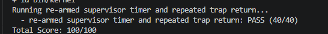

第四张现场图裁剪范围显示最后一项 `40/40` 和 `Total Score: 100/100`；三项各自的 PASS 以 [完整评分日志](evidence/2410933/04_make_grade.log) 为准。报告没有把裁剪图本身描述成包含全部三行。

评分证明本实验要求的入口、异常、兜底和持续到 200 ticks 的时钟路径通过；普通运行又补充验证了 1000 ticks 后关机。尚未验证真实软件 IPI、真实外部设备中断、多 hart 并发和压力条件下的中断嵌套。

**最终整合版的补充复测。** 林子媛于 2026-11-06 的材料记录了对 `dbe2dde2e1c13ef21f4587bd7bf1bd85a7b1e3cc` 的再次验证：仓库评分为 `100/100`，普通运行十次 `100 ticks` 后自行关机，四类真实异常和构造帧回归均通过。具体命令和输出见 5.4.5 及[最终整合复测记录](evidence/2410936/final-validation-20261106.md)。本节只保留上面一张最终评分截图；后续文字复测记录不冒充新的手动截图。

本报告汇总的是三份个人报告及随附日志中已经发生的测试。本次统稿没有重新执行内核评分。当前目录的源码补充了说明性注释，与历史测试版本的文件哈希不同；历史指纹仍用于追溯其对应测试副本，不写成当前文件逐字节一致的证明。

### 5.2 Trap 入口与上下文恢复验证

**负责人：2410673 韩羽宸；与已提交的林子媛异常处理实现联调。**

本节保留 2026-11-04 个人验证的实际配置、日志和截图；其中的中断失败桩只服务于当时的隔离测试。全组完成后的结果统一见 5.1 与 5.4.5。

#### 1. 验证对象与代码标记自查

| 核对项 | 实际结果 |
| --- | --- |
| 本人正式实现 | `code/kern/trap/trapentry.S` |
| 两处个人标记 | 均为 `#lab3 function1 2410673` |
| 保存宏与布局 | `SAVE_ALL`、`pushregs`、`trapframe` 未修改 |
| C 接口与返回标签 | `trap(struct trapframe *tf)`、原 `__trapret` 保留 |
| 本人代码差异 | 1 个文件、2 处区域；44 行新增、2 行删除 |
| 队友异常处理 | 同步已有 `2410936` 实现，非本人新增代码 |
| 参考入口替代 | 两个验证副本均使用本人真实 `trapentry.S` |

个人验证阶段，当时正式汇编与两个副本的 SHA-256 一致：

```text
639770e6099b28225103e63e528adc41ce735889584a6b174098eb2d8db88405
```

报告保留 [被测汇编快照](evidence/2410673/trapentry.S.snapshot)，方便以后源码更新时追溯本次结果。哈希证明文件一致，不单独证明实现正确；正确性结论还依赖下列行为验证。

#### 2. 构建和运行方法

原始验证有两个独立目录：`附加材料/韩羽宸功能一实现与验证/exception-integration` 和 `context-state`。前者用于异常联调，后者加入上下文断言。以下为在 WSL 中复现原上下文副本的命令；目录中的测试配置已经准备好，正式 `code/` 不会因此被改写。

```bash
export PATH=/home/smile/toolchains/riscv-elf-toolchains/bin:$PATH
cd '/mnt/e/Grade3_1/操作系统/os_lab/lab3/附加材料/韩羽宸功能一实现与验证/context-state'
make -j2
/usr/local/bin/qemu-system-riscv64 \
  -machine virt -nographic -bios default \
  -kernel bin/ucore.img \
  -device loader,file=bin/ucore.img,addr=0x80200000
printf 'QEMU_EXIT_STATUS=%s\n' "$?"
```

实际构建日志出现 `+ cc kern/trap/trapentry.S`、`+ ld bin/kernel` 以及 `objcopy ... bin/ucore.img`，说明真实汇编参与了编译和链接。完整记录见 [上下文状态编译日志](evidence/2410673/上下文状态编译.log)。报告还提供 [独立副本准备脚本](evidence/2410673/prepare_hyc.py)，可从正式代码创建新的验证副本，具体操作和限制见证据目录说明。整理报告时已用随附脚本重新准备并编译两种副本，四类真实异常和 258 次上下文检查再次通过，两个 QEMU 进程退出码均为 0；记录见 [报告整理复现记录](evidence/2410673/报告整理复现记录.json)。该复核检验了报告提供的复现方法，没有改动功能一代码。

测试源文件是辅助验证，不属于课程功能一实现，也没有写入正式 `code/`。当前副本中的中断桩一旦被实际调用就会失败，不会伪造时钟计数或评分输出。

#### 3. 与异常处理模块的联调

已有探针先保存自己的调用现场，再将 x5—x31 设为 `0x100+寄存器编号`，触发异常；返回后比较这些值以及 `ra/gp/tp`，最后恢复探针自身保存的 ABI 状态。这样既能检测 Trap 是否破坏寄存器，也不会把测试函数本身破坏 C 调用约定误认为内核错误。

| 真实触发用例 | 原因码 | 指令长度 | 预期行为 | 已有实际结果 |
| --- | --- | --- | --- | --- |
| 32 位非法指令 `0x0000007b` | 2 | 4 字节 | 异常输出，EPC 前进 4 字节，继续并保持现场 | PASS |
| 16 位非法编码 `0x0000` | 2 | 2 字节 | 异常输出，EPC 前进 2 字节，继续并保持现场 | PASS |
| 16 位断点编码 `0x9002` | 3 | 2 字节 | 断点输出，跳过 2 字节，继续并保持现场 | PASS |
| 32 位 `ebreak` 编码 `0x00100073` | 3 | 4 字节 | 断点输出，跳过 4 字节，继续并保持现场 | PASS |

探针还安排 32 位指令位于半字对齐位置，避免只验证四字节对齐的便利情况。EPC 推进取决于林子媛的异常函数，本人的恢复代码必须将更新后的字段装回 `sepc`，两个环节缺一不可。

原始联调日志中的部分结果为：

```text
[LZY real] illegal32: continued, GPR/stack return: PASS
[LZY real] illegal16: continued, GPR/stack return: PASS
[LZY real] breakpoint16: continued, GPR/stack return: PASS
[LZY real] breakpoint32: continued, GPR/stack return: PASS
[LZY] All exception tests: PASS
```

完整 [异常联调日志](evidence/2410673/异常联调.log) 还包含合成帧测试：四种指令的 EPC 更新，以及原因码 5、20 的兜底输出和 EPC 不变。这些合成帧直接调用 C 函数，能够检查异常函数行为，却没有经历硬件入口和 `sret`，因此不能用它们单独证明本人汇编正确。上表四种真实触发才经过完整入口/返回路径。

**图 1：真实异常与断点返回。** 本人现场运行异常联调副本，四种真实触发均显示 `continued, GPR/stack return: PASS`。图中 `cause=2/3` 区分非法指令与断点，`length=2/4` 及 `site/resume` 展示返回位置跨过对应指令。它同时依赖队友的 EPC 更新与本人的现场恢复；运行完整输出另记录 QEMU 退出码为 0，退出码未包含在本图中。

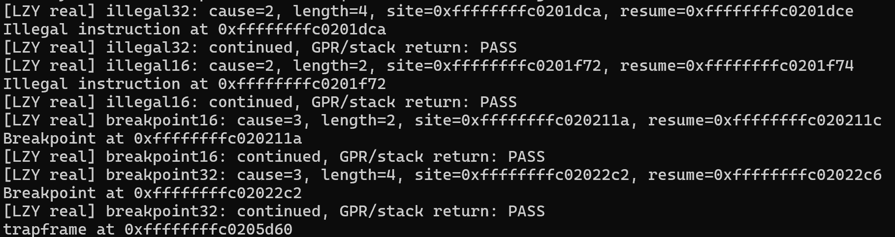

#### 4. 帧传参、布局和寄存器的进一步检查

上下文副本仅在 `trap()` 中增加观察调用：

```c
void trap(struct trapframe *tf) {
    hyc_check_frame(tf);       // 检查真实入口传来的帧
    trap_dispatch(tf);        // 仍使用实际异常处理
    hyc_check_return(tf);      // 核对处理后的 EPC，特定用例修改保存的 a0
}
```

在普通探针用例中，入口检查实际覆盖：

| 检查对象 | 断言或判定依据 | 能发现的问题 |
| --- | --- | --- |
| 帧大小和布局 | `pushregs` 为 32 槽，`trapframe` 为 36 槽；`status/epc` 为第 32/33 槽 | C 和汇编布局不一致 |
| 帧首与栈对齐 | `tf` 为 16 字节对齐；`(uintptr_t)tf + sizeof(*tf) == tf->gpr.sp` | 参数传错、保存的原 `sp` 不对 |
| x0 与 scratch | `zero==0`；`sscratch==0` | 保存或 scratch 约定错误 |
| GPR 内容 | x5—x31 等于各自探针值；`ra` 对应探针保存值；`gp/tp` 与初值相同 | 漏保存、偏移串位、临时借用过早 |
| 原因与地址 | `cause` 为预期原因，`epc` 对应实际触发标签 | 帧位置错误或并非预期异常 |
| 进入状态 | 当前 SIE 为 0；帧 SPP 为 1、SIE 为 0，SPIE 对应进入前使能 | 状态保存或解释错误 |
| 处理后 EPC | 等于该指令的恢复标签 | 未推进、推进长度错误、帧指针不一致 |

这些断言都在 C 观察代码中访问真实帧。若入口传入了错误地址，即使偶然能打印，也无法同时满足大小、原栈关系、原因、地址和一组寄存器值。

返回后，汇编探针再比较恢复的寄存器和保存现场，测试驱动检查返回状态。因此验证不仅说明“保存帧看起来正确”，也检查 `RESTORE_ALL` 是否把它正确还原。连续多轮同时有助于发现 `sp` 每次多加或少加固定字节的累积漂移。

#### 5. 两种中断状态与 258 次真实进入/返回

状态测试先将 `sie` 写零，屏蔽具体中断源，再分别设置全局 `sstatus.SIE=0` 和 `1`。同步异常不依赖 SIE 开启，因此两种条件都能主动触发。该设计检验的是保存与恢复全局使能信息，**没有验证时钟中断真正到达，也没有验证嵌套中断**。

每个状态运行四种真实异常，各重复 32 轮，即 `4×32=128` 次；再单独触发一次用于检查保存 `a0` 修改的断点。总次数为：

```text
2 × (4 × 32 + 1) = 258
```

每次普通返回后，驱动检查 SIE 恢复为进入前的值，SPIE 为 1，SPP 为 0，`sscratch` 保持 0。这些是执行完 `sret` 后的状态，不与帧内状态混用。

特殊的 `a0` 测试在 C 观察函数中将 `tf->gpr.a0` 写成 `0x2410673`，随后 `RESTORE_ALL` 加载第 10 槽，`sret` 返回到探针的 `ret`，C 调用者读取返回值。实际返回值等于该常量，说明恢复使用了 C 处理后的帧，而不是另一个旧副本。

日志的三条汇总结果为：

```text
[HYC] SIE=0: 128 real traps, all GPR/frame/stack checks, EPC and edited a0: PASS
[HYC] SIE=1: 128 real traps, all GPR/frame/stack checks, EPC and edited a0: PASS
[HYC] 258 entry/return cycles: PASS
```

其中前两条的 `128 real traps` 统计各状态的普通四类探针；每种状态另有一次修改 `a0` 的真实断点，所以最终总数为 258，而不是 256。日志详见 [上下文状态复核](evidence/2410673/上下文状态复核.log)；单独复核运行 QEMU 的退出码为 0。

该项保留原始运行日志和上述断言说明，不再单独截图；报告只选取真实异常返回与 GDB 帧关系两张重点图。

#### 6. GDB 现场观察：入口帧与实际返回

本人使用两个终端：第一个以 `-s -S` 启动异常联调副本，第二个用 RISC-V GDB 加载同一构建的 `bin/kernel` 并连接 `localhost:1234`。先以临时硬件断点停在 `lab3_illegal32_site`，用 `set $original_sp = $sp` 记录原栈；再断在 `*trap`，在 C 函数首条指令执行前读取参数 `a0`。调试器将此地址定位到内联的 `trap_dispatch` 源码行，不影响入口地址及寄存器的核对。

令 `$frame=(struct trapframe *)$a0`，通过 `printf` 读取现场，之后继续至 `lab3_illegal32_resume`，结果如下：

| 观察项 | 现场实际值 | 对应结论 |
| --- | --- | --- |
| 入口 `a0` 与 `sp` | 均为 `0xffffffffc0205e10` | C 入口收到当前帧指针 |
| `sizeof(*$frame)` 与原栈到帧首差值 | 均为 288 字节 | 36 个 RV64 槽与实际栈分配一致 |
| 原 `sp` 与 `frame->gpr.sp` | 均为 `0xffffffffc0205f30` | 第 2 槽保存的是进入异常前的栈 |
| 帧中 EPC 与原因码 | `0xffffffffc0201dca`、2 | 对应实际的 32 位非法指令 |
| 返回后 PC | `0xffffffffc0201dce` | 已越过 4 字节指令，处理后的 EPC 经恢复路径生效 |
| 返回后 `sp` 与原 `sp` | 均为 `0xffffffffc0205f30` | 本次真实返回正确恢复原栈 |

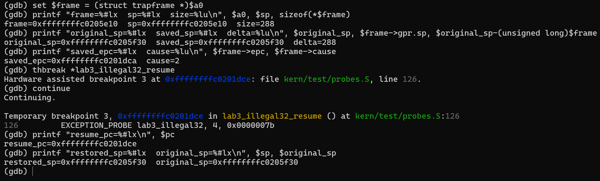

本图记录入口与返回标签两处实际停点，没有逐条单步整个恢复宏，也没有在图中读取全部寄存器或状态 CSR；这些检查由前述断言及运行日志补充。报告共保留两张重点图，分别展示真实异常返回和入口/返回现场，不重复截图工具版本或相近测试结果。

#### 7. 验证结论与边界

在本次 S 态内核、已有整数上下文布局及隔离验证配置下，真实入口传参、寄存器保存恢复、原栈恢复、异常 EPC 生效、原 SIE 为 0/1 的返回以及保存 `a0` 的有意修改均通过验证。两份当时的验证副本使用的汇编与该阶段正式实现一致；当前目录后来补充了说明注释，历史哈希不作为当前文件的逐字节指纹。

上述个人验证发生在 2026-11-04，当时正式 `interrupt_handler()` 尚未实现，因此该阶段结果只支持个人模块结论。中断实现完成后的全组运行和评分见 5.1。本次也未验证用户态栈切换、多核并发、浮点/向量寄存器恢复、完整嵌套 Trap 和进程调度。这些边界与本模块的分工和起始代码相符。

### 5.3 中断处理验证

**负责人：2410933 马禹翔。**

代码标记已经从 `YOUR CODE` 改为：

```c
//lab3 function2 2410933 (interrupt_handler)
```

#### 1. 普通运行：持续时钟和自动关机

执行：

```bash
cd /home/s1nk/OSLab62/code
make clean
make qemu
```

启动输出表明 DTB 识别 128 MiB 内存、Best Fit 自检成功，随后打印 `++ setup timer interrupts`。第一张图记录初始化完成和连续时钟输出：

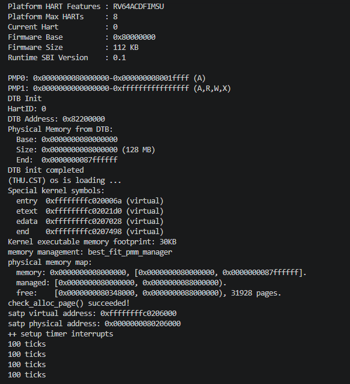

第二张图显示总共十次 `100 ticks`，随后 QEMU 退出并重新出现 shell 提示符。这与 `SHUTDOWN_AFTER=10`、`TICK_NUM=100` 一致，证明系统持续接收至少 1000 次时钟中断，并在第十个统计周期调用关机接口。

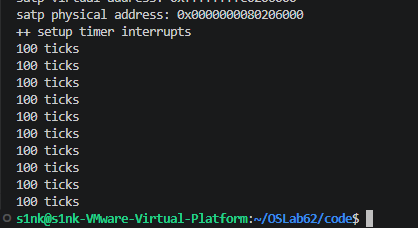

完整文本见 [普通 QEMU 运行日志](evidence/2410933/02_qemu_run.log)。日志中的时钟事件来自 QEMU/OpenSBI 的真实定时器路径，不是直接调用 handler 的合成测试。

#### 2. 软件中断和未知中断兜底

评分测试构造 Trap frame，分别把 cause 设置为带最高位的 `IRQ_S_SOFT` 和原因码 15，再直接调用 `interrupt_handler()`；异常 cause 20 则交给异常函数打印 Trap frame。输出为：

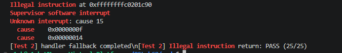

图中可见：

- `Supervisor software interrupt`：说明函数正确去掉中断标志并识别 S 模式软件中断；
- `Unknown interrupt: cause 15`：说明 default 分支使用低位原因码；
- Trap frame 中 `cause 0x00000014`：说明未实现的异常进入完整帧兜底；
- `[Test 2] ... PASS (25/25)`：非法指令返回及兜底组合测试通过。

完整输出见 [中断兜底日志](evidence/2410933/03_interrupt_fallback.log)。这里的软件和未知中断是构造帧测试，没有经过真实外设或完整硬件入口；其价值是隔离验证 C 分支逻辑，不能单独证明汇编入口和 `sret`。

### 5.4 异常处理验证

**负责人：** 2410936 林子媛

#### 5.4.1 代码标记与验证范围

最终整合版的四个位置均保留 `lab3`，并按实际实现者署名：

| 位置                    | 标记                                             |
| --------------------- | ---------------------------------------------- |
| `RESTORE_ALL`         | `#lab3 function1 2410673`                      |
| `__alltraps` 中传参和调用   | `#lab3 function1 2410673`                      |
| `interrupt_handler()` | `//lab3 function2 2410933 (interrupt_handler)` |
| `exception_handler()` | `//lab3 function2 2410936 (exception_handler)` |

本人的功能代码只在异常函数中实现，未把测试参考汇编作为自己的功能贡献。截图中的旧测试副本与最终整合复测的关系如下：

| 阶段              | 入口、恢复与中断依赖                                               | 证据用途                                           |
| --------------- | -------------------------------------------------------- | ---------------------------------------------- |
| 早期个人手动验证        | 副本使用 `reference-entry.S` 和中断失败桩，在时钟初始化前运行测试。             | 证明本人函数的分类、长度、EPC 修改和在明确依赖下的实际返回。下文十张截图均属这一阶段。  |
| 2026-11-06 最终复测 | 使用 `dbe2dde` 的正式 `trapentry.S`、`trap.c`；异常副本不注入参考入口或中断桩。 | 证明合并三人实现后仍能运行，补齐最终联调和仓库评分。以实际命令输出记录，不套用旧截图的地址。 |

#### 5.4.2 创建个人副本、编译和自测

本人在 Ubuntu 终端执行的步骤为：

```bash
cd /workspace/lab3
python3 tests/exception/prepare.py /workspace/lab3-lzy-manual
cd /workspace/lab3-lzy-manual
make -j2 2>&1 | tee build.log
make qemu 2>&1 | tee run.log
grep -E 'LZY real|LZY synthetic|All exception' run.log
```

图 1 中 `TEST ONLY` 明确说明当时使用了参考入口和中断桩。

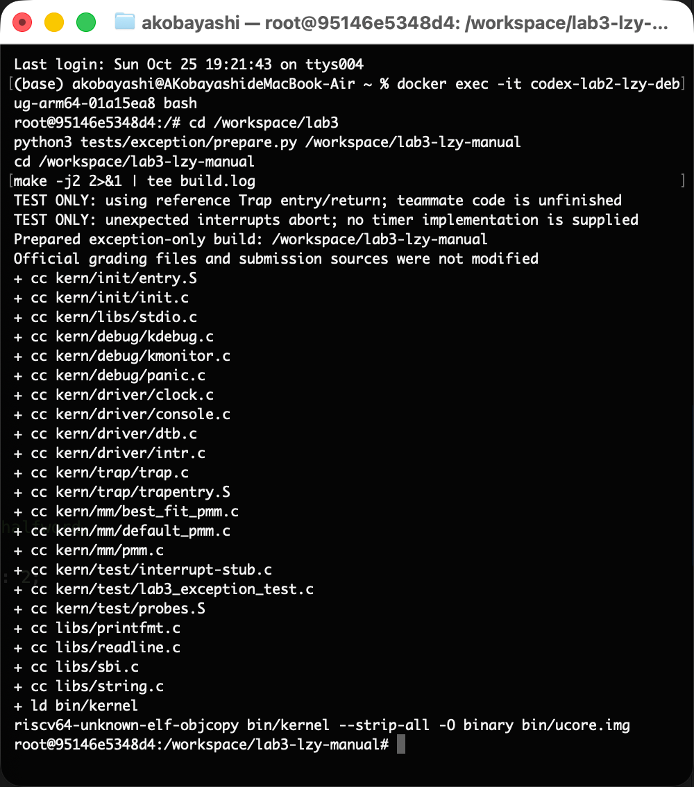

图 2 汇总了四项构造帧 EPC 检查、四项真实异常返回和两项默认分支检查，最终为 `All exception tests: PASS`。上方还保留了原因码 `0x14` 的兜底打印，说明默认分支并非没有执行。

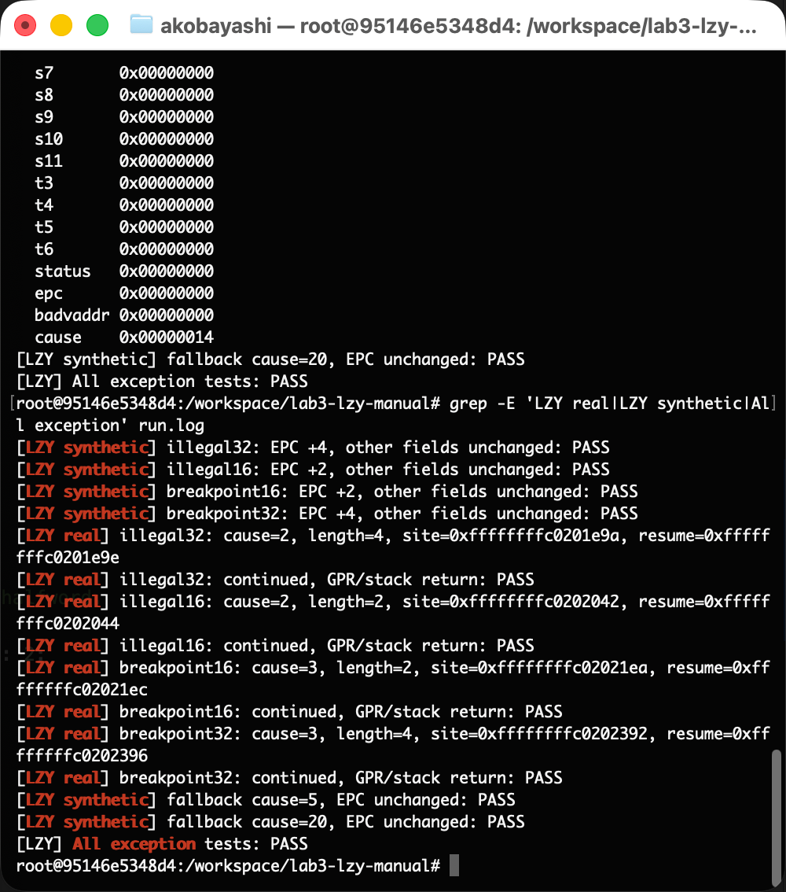

#### 5.4.3 GDB 检查方法与实际结果

先在终端 A 的个人副本中执行 `make debug`，再在终端 B 连接：

```bash
docker exec -it -w /workspace/lab3-lzy-manual \
  codex-lab2-lzy-debug-arm64-01a15ea8 gdb-multiarch -q bin/kernel
```

在 GDB 中先跳过构造帧调用，再进入第一条真实探针：

```gdb
set pagination off
target remote 127.0.0.1:1234
hbreak lab3_illegal32
continue
delete 1
hbreak exception_handler
continue
```

对四个案例分别执行以下检查；每次进入处理函数都重新保存 `$frame`、`$old_epc` 和 `$saved_sp`。

```gdb
set $frame = tf
set $old_epc = $frame->epc
set $saved_sp = $frame->gpr.sp
p/x $frame->cause
x/2xh $old_epc
p/x $sepc
p/x $stval
thbreak __trapret
continue
p/x $frame->epc
p/d $frame->epc - $old_epc
p/x $sepc
thbreak *$frame->epc
continue
p/x $pc
p/x $sepc
p/x $sp
p/x $saved_sp
info registers t0 a0 s0
```

`p/x` 表示以十六进制打印，`p/d` 以十进制打印；`$39` 等是 GDB 的结果历史编号，不是第 39 个寄存器。`$sepc` 是寄存器，`$frame` 等则是我在 GDB 中建立的便利变量。

**个人手动副本的实际记录：**

| 场景       | 故障编码                  | 实际 cause | 原 EPC                | 处理后 EPC / 返回 PC      | 增量  |
| -------- | --------------------- | -------- | -------------------- | -------------------- | --- |
| 32 位非法指令 | `0x0000007b`          | 2        | `0xffffffffc0201e9a` | `0xffffffffc0201e9e` | 4   |
| 16 位非法指令 | `0x0000`              | 2        | `0xffffffffc0202042` | `0xffffffffc0202044` | 2   |
| 16 位断点   | `0x9002`，`c.ebreak`   | 3        | `0xffffffffc02021ea` | `0xffffffffc02021ec` | 2   |
| 32 位断点   | `0x00100073`，`ebreak` | 3        | `0xffffffffc0202392` | `0xffffffffc0202396` | 4   |

四例的返回 SP 均与保存值 `0xffffffffc0205f20` 一致，检查的寄存器为 `t0=0x105`、`a0=0x10a`、`s0=0x108`。它们分别代表临时寄存器、参数/返回值寄存器和被调用者保存寄存器。

**（1）32 位非法指令：观察完整的三个阶段。**

图 3 的 `cause=2`、半字 `0x007b 0x0000` 和 `sepc` 共同确认实际异常类型与故障位置；原 EPC 是 `0xffffffffc0201e9a`，本例 `stval=0x7b`。

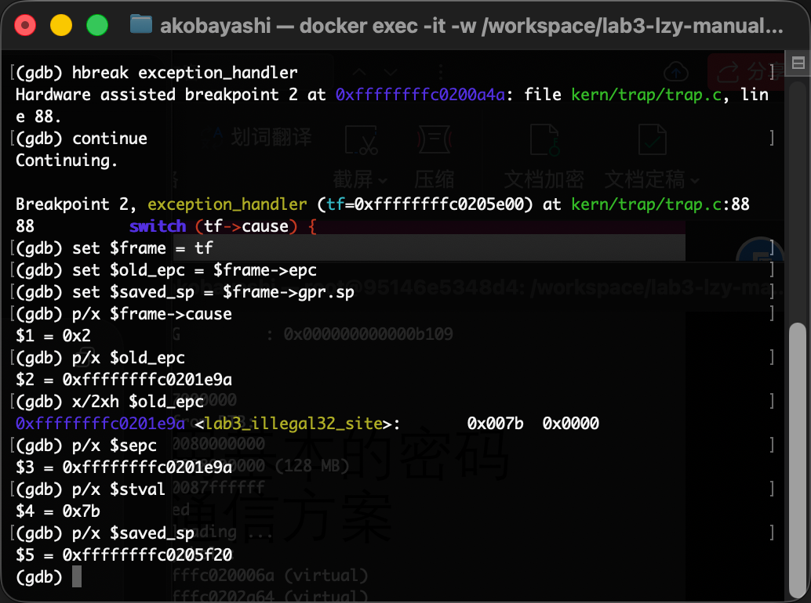

图 4 停在 `__trapret`，此时帧 EPC 已变为 `0xffffffffc0201e9e`，差值为 4；但硬件 `sepc` 仍为原地址。这正好说明 C 函数修改的是帧副本，汇编尚未将其恢复到 CSR，并不是 EPC 修改失败。

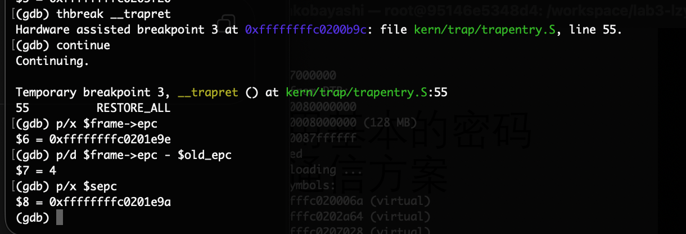

图 5 在 `lab3_illegal32_resume` 暂停，`pc=sepc=0xffffffffc0201e9e`，SP 和三个寄存器也符合预设值，补齐了“修改帧 → 恢复硬件状态 → 实际继续执行”的证据。

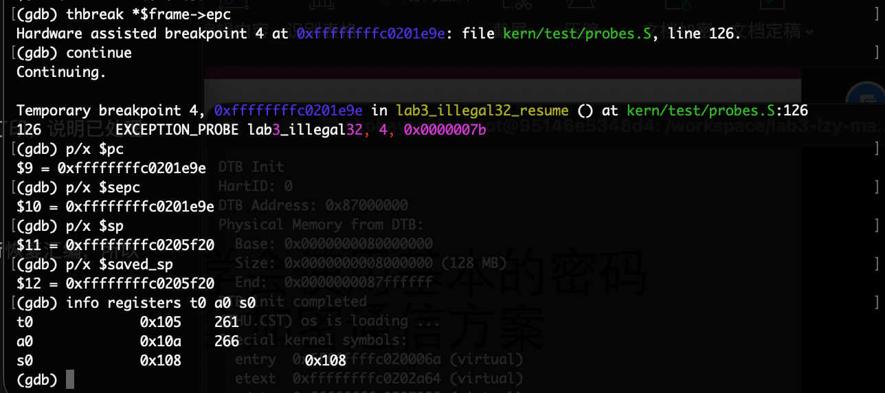

**（2）16 位非法指令：不能统一加 4。**

本例原 EPC 为 `0xffffffffc0202042`，应只前进 2 字节。图 6 在 `lab3_illegal16_resume` 读得 `pc=sepc=0xffffffffc0202044`，SP 和寄存器保持正确。图中的 `%sp` 是一次输入错误；其后改为 `$sp` 成功读取，不影响本例的内核验证结果。

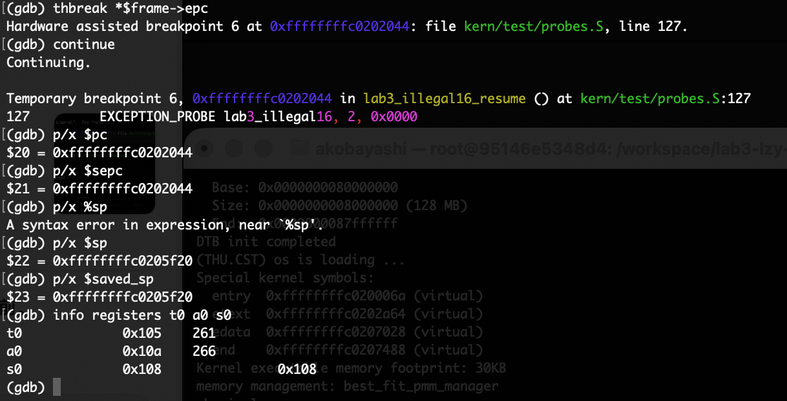

**（3）16 位断点：核对断点原因与压缩指令。**

图 7 读得 `cause=3`、故障半字 `0x9002` 和原 EPC `0xffffffffc02021ea`，确定执行的是压缩断点。图 8 的恢复 PC 和 `sepc` 都是 `0xffffffffc02021ec`，只增加 2 字节，SP 与哨兵值也恢复正确。

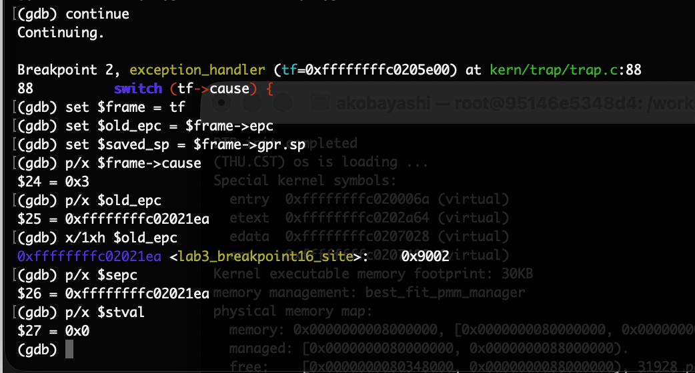

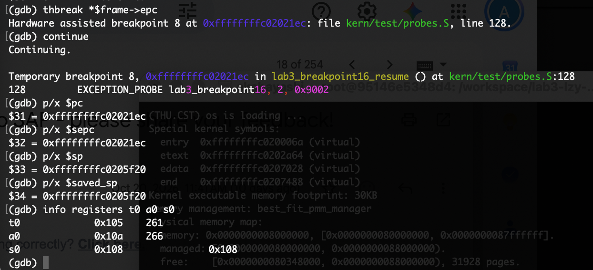

**（4）32 位断点：同类异常也可能需要不同增量。**

图 9 同样读得 `cause=3`，但两个半字是 `0x0073 0x0010`，组成 32 位 `ebreak`。图 10 同时记录了处理后的 EPC、差值 4、恢复前的旧 `sepc`，以及实际返回后的 PC、`sepc`、SP 和寄存器。由此可见，“断点统一加 2”也不正确。

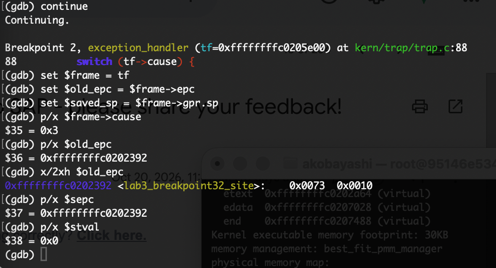

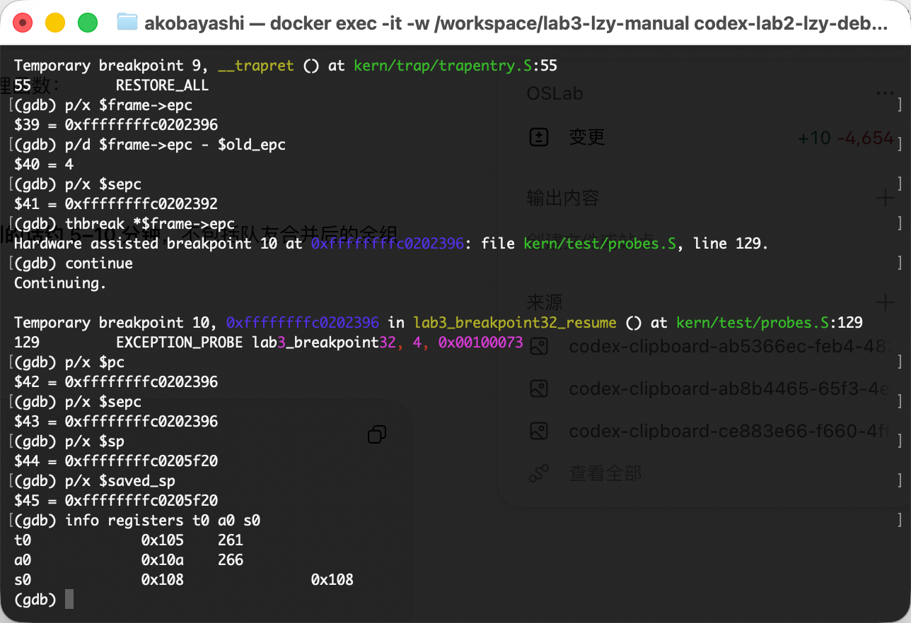

实际返回断点位于故障指令之后，后续探针还会完成寄存器比较。图 2 中四项 `continued, GPR/stack return: PASS` 则说明未挂调试器的一次完整运行已经走完四个探针，不是仅打印测试开始行，也没有一直重复执行同一故障指令。

#### 5.4.4 默认分支验证

测试分别构造 `cause=5` 和 `cause=20`、`EPC=0` 的帧，调用 `exception_handler()` 后比较整个帧，均保持不变，并经过 `print_trapframe()` 输出。图 2 同时保存了两条 `fallback ... EPC unchanged: PASS`，因此不再重复插入整屏寄存器图片。

原因码 5 对应 load access fault，但本项只是用该原因码测试 C 分支，并没有实际访问非法地址后成功恢复。原因码 20 在这里用作另一个未专门处理的原因值，同样只验证默认路径，不把它解释为已经实现某种新异常。

#### 5.4.5 三人整合后的最终复测

2026-11-06 拉取到 `dbe2dde` 后，由 Codex 在原 Ubuntu 容器中新建 `/workspace/lab3-lzy-final-20261106-dbe2dde`，复制当前 `code` 和 `tests`，没有覆盖此前手动调试目录，也没有接管原 GDB 会话。本节是工具执行的最终复测，不标作本人手动截图。

使用的主要命令为：

```bash
cd /workspace/lab3-lzy-final-20261106-dbe2dde/code
make grade GRADE_TMP=/workspace/lab3-lzy-final-20261106-dbe2dde/grade-tmp
make -j2
timeout 20s make qemu

cd /workspace/lab3-lzy-final-20261106-dbe2dde
python3 tests/exception/prepare.py /workspace/lab3-lzy-final-20261106-dbe2dde/exception
cd exception
make -j2
timeout 20s make qemu
```

`GRADE_TMP` 只指定独立临时目录，没有修改评分脚本、测试内容或通过条件。异常副本中正式 `trap.c`、`trapentry.S` 与整合源码的 SHA-256 分别一致，测试目录也只有驱动、头文件和探针，没有中断桩；准备输出不再出现早期的两条 `TEST ONLY`。驱动仍保留“可能使用参考入口”的通用提示，不能把这句固定文案当作是否实际替换入口的判据。

| 复测项目                 | 实际结果                                              |
| -------------------- | ------------------------------------------------- |
| 仓库评分：入口、寄存器恢复和断点 EPC | PASS，35/35                                        |
| 仓库评分：非法指令返回和处理函数兜底   | PASS，25/25                                        |
| 仓库评分：重复时钟中断及 Trap 返回 | PASS，40/40；总分 `100/100`，命令退出 0                    |
| 普通内核构建与运行            | 构建退出 0；输出十次 `100 ticks` 后正常关机，QEMU 命令退出 0，未因超时结束。 |
| 最终实现下的个人异常回归         | 四项构造帧、四项真实异常返回、两项默认分支全部 PASS，QEMU 命令退出 0。         |

最终异常回归中的四个故障地址依次为 `0xffffffffc0201f32`、`0xffffffffc02020da`、`0xffffffffc0202282`、`0xffffffffc020242a`，对应恢复位置分别增加 4、2、2、4 字节。它们与早期截图中的绝对地址不同，是构建布局变化的正常结果；不能拿旧截图声称新二进制仍在同一地址运行。

本次复测的关键输出为：

```text
trap entry, register restore, and breakpoint EPC: PASS (35/35)
illegal instruction EPC advance and return: PASS (25/25)
re-armed supervisor timer and repeated trap return: PASS (40/40)
Total Score: 100/100

[LZY] All exception tests: PASS
```

前四行来自仓库评分，最后一行来自另一次个人异常回归，列在一起仅为汇总，并非伪造为一次连续输出。原始日志留作本地核验，不用日志文件代替本报告的过程解释和现场截图。

**验证结论：** 本人异常函数的分类、提示、按长度更新 EPC、默认分支行为及实际返回均已验证；组员最终入口和中断实现合并后的普通运行、个人异常回归与仓库评分也已通过。

### 5.5 报告整理与最终提交检查

**负责人：2410673 韩羽宸；三人分别核对本人实现和材料。**

| 模板或手册要求 | 本报告的对应位置与整理结果 |
|----------------|--------------------------|
| 基本信息与练习、报告分工 | 开头三张表列出实验信息、代码分工和报告分工 |
| 实验目的与实际环境 | 第一部分和第二部分；三份实测环境、统一 AI 工具与模型表 |
| 整体逻辑与功能推进顺序 | 第三部分，说明硬件、汇编、C 与启动初始化的关系 |
| 逐功能解释核心接口、SPEC 和 prompt | 4.1—4.3；保留实际接口、规格设计、提示词设计和实现过程 |
| 思考题及其分析方法 | 4.4 中断关闭与开启、宏和原子操作；4.5 `stvec` 兼容性 |
| AI 生成中的问题及解决 | 各模块实现迭代；区分代码实现、依赖、同步、调试命令与证据问题 |
| 编译运行截图与一份最终评分截图 | 5.1 与 5.3 的实际运行；5.1 唯一最终评分图，结果 `100/100` |
| 模块专项验证与真实现场截图 | 5.2 上下文与入口；5.3 中断；5.4 异常及最终整合复测 |
| 实验知识与 OS 理论的含义、关系、差异 | 6.1 统一知识点表 |
| 理论重要但本实验未覆盖的知识 | 6.2 合并三人总结并说明实现边界 |
| AI 协作开发经验 | 6.3 分成员保留经验及实际问题汇总 |
| Markdown 正文、图片及材料路径 | 正文位于 `report/汇总.md`；引用 `images/学号/` 与 `evidence/学号/` |
| Lab3 注释与实际实现者学号 | 当前 `trapentry.S` 两处标记为 `2410673`，`trap.c` 的两函数分别为 `2410933`、`2410936` |

**阶段与提交状态。** 韩羽宸 2026-11-04 的个人报告记录中断尚未完成和材料待汇总，这是当时状态；马禹翔 2026-11-05 的材料已补齐中断、运行和评分，林子媛 2026-11-06 的材料补齐最终整合复测，本报告据此合并为当前完整正文。保留原始记录供追溯，不把早期缺项继续列为最终功能缺项。

| 项目 | 可核验记录或当前状态 |
|------|----------------------|
| 小组仓库与目标分支 | [OSLab62：lab3](https://github.com/ACobayashi/OSLab62/tree/lab3) |
| 韩羽宸个人代码记录 | `e4f52567339e2e13fd8586ea873a2a030f8e1984`；2026-11-04 16:50:03（UTC+08:00），当时只提交 `trapentry.S`，不包含之后整理的报告；记录见[个人提交附件](evidence/2410673/本地提交记录.json) |
| 最终整合测试版本 | 林子媛复测记录所列 `dbe2dde2e1c13ef21f4587bd7bf1bd85a7b1e3cc`；不冒充包含本次汇总文件的提交 |
| 本次报告汇总 | 已将三人正文、真实截图和对应提示词整理到本文件；个人原稿保留 |
| 本次 Git 提交、推送与远端检查 | 本次仅整理本地报告，未执行提交、推送或远端验收；最终报告是否已入远端不能据个人历史提交推定 |
| 课程截止时间与按时提交判定 | 材料未提供可核验截止时间，不填写虚构的提交时间或按时结论 |

## 六、实验总结与收获

### 6.1 实验知识与 OS 原理的联系

| 知识点 | OS 原理中的含义 | 本实验的对应、关系与差异 | 主要负责人 |
|--------|----------------|------------------------|------------|
| Trap 分类与统一入口 | 通过中断、异常取得控制权，再按来源和原因处理 | `scause` 最高位区分异步中断与同步异常；统一入口不等于相同返回策略，尚无完整设备中断控制器 | 三人 |
| 执行上下文与 Trap frame | 暂停后继续所需的寄存器、PC、栈、地址空间及扩展状态 | 288 字节帧把整数现场及四个 CSR 信息转为 C 可访问数据；不含完整进程和扩展状态 | 韩羽宸、林子媛 |
| 中断透明性与调用约定 | 任意位置被中断后应能按约定继续；ABI 分配普通函数调用的保护责任 | Trap 前没有普通调用准备，入口需保存调用者寄存器；调用 C 仍须以 `a0` 传参、保持栈对齐 | 韩羽宸 |
| 内核栈与帧生命周期 | 嵌套执行各用其栈空间，恢复后原执行的栈关系成立 | 第 2 槽保存原 SP，所有读取结束后才恢复；没有每线程内核栈、保护页或异常专用栈 | 韩羽宸 |
| 特权级、委托与返回 | 区分可信权限，提供受控进入及恢复执行的机制 | OpenSBI 在 M 态、内核在 S 态；经相应委托进入 S 态，`sret` 按 SPP/SPIE 返回；实际验证 S→S | 韩羽宸、林子媛 |
| EPC 与变长指令 | 恢复必须明确重试、跳过、模拟或终止的语义 | 非法指令与断点在受测 16/32 位范围内推进 2/4 字节；C 修改帧 EPC，汇编写回 CSR，不能对缺页照搬跳过策略 | 林子媛 |
| 时钟事件与 `ticks` | 时间基准可支持调度、超时和统计 | SBI 单次事件需每次续设，当前只计数输出并关机，没有调度器或定时器队列 | 马禹翔 |
| 中断状态与临界区 | 在共享结构的复合更新期间防止不一致状态被重入观察 | 保存 SIE 旧值并按旧状态恢复，可配对嵌套；只屏蔽本 hart 可屏蔽中断，不能阻止同步异常或其他核 | 马禹翔 |
| AMO 与复合不变量 | 原子读改写使单个机器字更新不可分割 | 位操作适合局部标记，不能靠一次 AMO 同时维护链表、页属性和计数的一致性 | 马禹翔 |
| 固件服务抽象 | 内核通过约定接口调用更高特权的平台服务 | S 态经 SBI 设置定时器与关机；不同成员 OpenSBI 版本不同，不外推所有真机平台接口 | 马禹翔 |

三人的共同体会是：硬件 CSR、栈中的 Trap frame 和最终 PC 是相互衔接的三个观察位置。C 中的 EPC 正确只是其中一步，仍须检查汇编恢复、实际返回后的 SP 与寄存器；恢复同一执行流也不等于完成进程切换。

### 6.2 重要但本实验未覆盖的 OS 知识

三人的总结合并如下，不把理论理解写成已实现功能：

1. **抢占式调度与完整进程/线程切换。** 时钟只是调度的前提，本实验没有运行队列、进程选择、独立栈与地址空间切换。
2. **用户态系统调用、换栈与安全隔离。** 尚无 U 态进程、系统调用分发、用户指针检查与安全取参，已有入口不等于完整用户/内核栈切换。
3. **缺页、按需分页与页面置换。** 需要结合页表权限、后备存储和故障恢复；本实验其他异常只打印现场，未实现修复映射后的重试。
4. **多核同步、内存顺序与跨核中断。** 单 HART 验证及关闭本核 SIE 不能证明跨核安全；仍需锁、内存序和 IPI 等机制。
5. **PLIC 与完整设备驱动。** 实际外设还需要读取设备状态、处理中断控制器并确认完成；当前其他 IRQ 分支主要提供分类提示。
6. **完整嵌套 Trap、栈溢出与异常安全。** `sscratch=0` 约定和当前保存恢复只构成基础，未系统验证恢复期间再异常、任意多层嵌套及栈保护。
7. **浮点、向量及其他扩展上下文。** 当前帧和探针集中于整数寄存器与相关 CSR，没有完整扩展寄存器保存及延迟管理。
8. **通用安全取指与复杂异常恢复。** 本次长度判定限于可读内核地址上的受测 16/32 位指令，没有支持任意用户地址、48 位以上编码、指令模拟或任意访存故障恢复。

### 6.3 AI 协作开发的经验与真实问题

#### 韩羽宸：上下文规格、被测实现与证据核对

**负责人：2410673 韩羽宸。**

提示词应把“恢复现场”落实为可检查条件：原 `sp` 在第 2 槽、所有读取完成后才恢复 x2、C 返回时仍指向同一帧。实现、验证与现场观察各用一组四段式 prompt，分别交代接口、证据和交付边界，避免任务混在一起却没有明确验收。

实际协作中最需要核验的是工程状态与测试对象：Git 已拉取不代表正式目录同步，总 PASS 也不代表用了本人汇编。比较文件、哈希和快照之后，再用真实返回后的寄存器及状态判断恢复是否正确。单看 C 中的异常打印不足以得出结论。

本次功能一没有出现已证实需修复的汇编 bug；真实问题是副本同步、未完成依赖和证据核对。实现迭代、补充验证与实际现场断点观察分别记录，既不虚构多轮修复，也不把本人模块验证扩展成全组评分或提交完成。

#### 马禹翔：原因码边界、持续时钟与分层验证

**负责人：2410933 马禹翔。**

本次最有效的方法是先从真实源码和评分脚本提取约束，再生成代码。若只提示“实现时钟中断”，AI 容易遗漏 `scause` 最高位、下一事件续设、未知分支或关机阈值。四段式中的 `[RELY]` 让宏和接口名称与工程一致，`[GUARANTEE]` 限制修改范围，`[SPECIFICATION]` 则把不同 case 的前后状态变成可检查条件。

把中断实现拆成 V1-A 分类、V1-B 持续时钟、V1-C 关机集成后，每段都有独立验收点。中断关闭与开启也拆成 V2-A 和 V2-B，避免把“清 SIE”和“按旧状态恢复”误写成简单的一开一关。

代码一次通过，因此没有为了满足报告格式虚构 bug。起始链接错误被记录为待实现函数缺失，prompt 拆分被记录为文档结构调整。测试同样需要区分证据能力：构造 Trap frame 能验证 C 分支，却不能证明真实入口；`make grade` 能验证 200 ticks，却不能替代普通运行对 1000 ticks 关机的检查。以后使用 AI 完成内核代码时，应继续坚持“接口约束—最小修改—分层测试—明确边界”的流程。

#### 林子媛：异常返回、调试观察点与依赖复测

**负责人：** 2410936 林子媛

1. **先写边界，再要求生成代码。** 只说“完成异常处理”容易混入队友工作或不必要的恢复逻辑。限定接口、本人位置、可修改字段及不支持的情况，更便于审查。
2. **AI 生成的测试也需要理解。** 我实际追问了 PASS 和 `[LZY]` 的来源，明确它们来自自测代码；之后用 GDB 读取真实原因码和返回寄存器，避免把程序自己打印的预期信息当成外部证明。
3. **把失败分层。** GDB 语法输入错误、`finish` 的误停、队友实现未完成和本人函数 bug 不是同一类问题。应先确定观察点和验证对象，再决定是否修改代码。
4. **依赖变化后必须重测。** 早期参考入口只能支持个人阶段结论。最终使用组员真实汇编重跑，并核对副本中没有参考入口或中断桩，才形成小组联调结论。
5. **如实记录提示词与贡献。** 原始自然语言输入、事后整理的复现提示词、AI 自动验证和本人手动截图分别标明来源；没有出现的代码修复不计作迭代，组员代码也不署为本人完成。

本次最重要的收获是：异常处理函数并不是孤立的一段 `switch`，而是硬件状态、内存中的现场结构、C 决策和汇编恢复共同组成的执行链。证明代码正确，需要让这些环节在同一次异常中对应起来。

**实际问题汇总。**

| 问题 | 证据或原因 | 修正与验证 |
|------|------------|------------|
| Git 检出目录更新而正式目录仍旧 | 工作副本分离，拉取不自动同步 `code/` | 比较目录与真实文件，再同步已有异常实现；不计作本人新增功能 |
| 中断函数缺失导致链接失败 | 起始阶段只有声明，分发仍引用该符号 | 个人副本使用意外中断即失败的桩；最终中断完成后另做整合评分 |
| 测试提示可能使用参考入口 | 通用提示不能证明实际被测汇编来源 | 检查副本内容与当时源码哈希，最终异常回归排除参考入口和中断桩 |
| 外层命令非零而内核日志全部 PASS | 组合命令的退出状态与内核输出不是同一证据 | 单独运行 QEMU 并读取退出码 0；未查明的外层原因不编造成汇编 bug |
| GDB `finish` 越过当前返回 | 命中下一异常、复用帧，产生 EPC 差值 424 的误读 | 改在 `__trapret` 和更新后 EPC 两处断点，分别检查帧修改和实际返回 |
| GDB 表达式输入错误 | `$sepc` 中加空格、把 `$sp` 输入为 `%sp` | 修正命令后读取真实寄存器，不以命令语法错误为由修改内核 |
| 个人验证与全组结论混用风险 | 早期隔离依赖与最终实现不同，截图地址随构建变化 | 分阶段说明；最终以正式三人实现复测，不套用旧图绝对地址 |


