# Lab2 实验报告：物理内存和页表

## 实验基本信息

| 项目 | 内容 |
|------|------|
| **实验名称** | Lab2：物理内存和页表 |
| **小组成员** | 2410673-韩羽宸、2410936-林子媛、2410933-马禹翔 |
| **完成日期** | 2026-10-24 |

本报告由小组三名成员共同完成，各模块按分工整理。

### 小组分工

| 成员 | 负责的练习/模块 |
|------|----------------|
| 2410673-韩羽宸 | 物理内存初始化、Best Fit、物理内存探测及页表调试 |
| 2410936-林子媛 | SLUB 实现与测试、Bare/Sv39 对比 |
| 2410933-马禹翔 | First Fit 分析、Buddy 实现与测试、TLB 调试 |

韩羽宸整理物理内存与页表部分；林子媛整理 SLUB 与模式对比部分并汇总报告；马禹翔整理 Buddy 与 TLB 部分。

---

## 一、实验目的

1. **理解页表与地址转换。** 区分虚拟地址、物理地址、链接地址和宿主地址，掌握 Sv39 的页号、偏移、权限及 `satp`，解释启动大页与一般三级遍历。
2. **建立物理页管理。** 从 DTB 获取 RAM 范围，排除固件、内核和元数据占用，建立 `Page` 描述符及空闲区。
3. **理解连续页分配策略。** 分析 First Fit，实现 Best Fit 和 Buddy，比较选块、拆分、合并、计数及碎片代价。
4. **实现对象级分配。** 在已有页分配器之上构建简化 SLUB，让小对象共享 slab 页面，大对象按连续页管理。
5. **完成源码级调试与验证。** 用客体 GDB 观察内核，用宿主 GDB 观察 QEMU 模拟 MMU 和软件 TLB；通过原有检查、独立边界测试、数据校验及状态统计核验实现。
6. **掌握 AI 协作方法。** 先写接口和行为规格，再组织四段式 prompt；记录真实 bug、修正方式和证据边界，不修改已有评分来获得通过。

页表解决“地址映射及访问权限”，`Page` 和页分配器解决“物理资源归属”，SLUB 解决“页内对象的布局与复用”。三者协作，但不是同一机制的不同名称。

## 二、实验环境

### 2.1 系统、工具链与运行调试环境

三人的实测环境不同，分别列出，避免把某一版本的函数参数或停点套用到另一版本。

#### 2.1.1 韩羽宸的构建与双 GDB 环境

**负责人：2410673 韩羽宸**

本人沿用 Windows 上的 WSL2 Ubuntu-22.04 完成构建、运行和调试。以下为个人实施阶段记录的环境；其余成员的环境分别列在后两个小节。

| 工具或环境         | 实际版本/配置                                          | 用途                            |
| ------------- | ------------------------------------------------ | ----------------------------- |
| 操作系统环境        | Windows + WSL2；Ubuntu 22.04.5 LTS                | 提供实验构建、运行和调试环境                |
| Linux 内核      | `6.6.87.2-microsoft-standard-WSL2`；x86-64        | 承载工具链及 QEMU 宿主进程              |
| GNU Make      | 4.3                                              | 组织源码编译、链接和运行目标                |
| 宿主 GCC        | 11.4.0                                           | 宿主侧工具环境；与内核交叉编译器区分            |
| RISC-V GCC    | `riscv64-unknown-elf-gcc` 10.2.0                 | 编译 RV64 裸机内核                  |
| RISC-V GNU ld | 2.35.1                                           | 按实验链接脚本生成内核 ELF               |
| QEMU          | 7.0.0；RISC-V `virt` 模拟机                          | 加载固件与内核，模拟 CPU 和内存系统          |
| OpenSBI       | 1.0；运行输出中的 Runtime SBI Version 为 0.3             | 完成固件启动并提供 SBI 服务              |
| 宿主 GDB        | `/usr/bin/gdb` 12.1                              | 调试 x86-64 的 QEMU 进程及其 C 源码    |
| RISC-V GDB    | `riscv64-unknown-elf-gdb`，`16.3.90.20250610-git` | 连接 QEMU gdbstub，调试 RV64 ucore |
| Python        | 3.10.12                                          | 运行独立测试、日志整理和调试辅助脚本            |

宿主 GDB 与客体 GDB 调试不同目标：前者加载 QEMU，后者加载带符号的 `bin/kernel`。QEMU 实际加载的内核镜像为 `bin/ucore.img`，它是由 ELF 转换得到的裸镜像，不能替代 ELF 提供源码符号。专用 RISC-V GDB 的实际路径为 `/home/smile/toolchains/riscv-elf-toolchains/bin/riscv64-unknown-elf-gdb`。

QEMU 源码与调试构建位于 `/home/smile/src/qemu-7.0.0`，本次明确选用其中的 `build/qemu-system-riscv64`。已有构建包含 DWARF 调试信息，配置为 `buildtype=debug`、`debug=true`、优化级别 2，实际编译选项含 `-g -O2`。已安装副本与该构建的 SHA-256 一致，且能定位实际函数和源码，因此复用现有构建，没有执行覆盖安装。部分变量显示 `<optimized out>` 是优化构建的实际现象，后文结合真实停点和可读变量进行分析。

韩羽宸验证阶段发现该 QEMU/OpenSBI 组合需要通过 `-kernel` 提供固件下一跳：仅使用 loader 时下一跳曾为零，当时在验证命令中保留 loader 并增加 `-kernel bin/ucore.img`。后续小组合入启动参数修复，当前正式 Makefile 的默认 QEMU 命令已包含 `-kernel $(UCOREIMG)`。构建、测试注入和辅助脚本均在附加材料中的源码副本运行，使 `code/` 保持为实验源码目录。报告中的图片集中展示实验状态、过程和结果，不重复放工具版本或环境可运行的证明图。

#### 2.1.2 马禹翔的 Buddy 与 TLB 环境

**负责人：2410933 马禹翔**

| 项目         | 实际环境                                    |
| ---------- | --------------------------------------- |
| 开发主机       | Windows，使用 VMware 中的 Ubuntu 26.10 实验虚拟机 |
| Linux 内核   | 7.3.0-9-generic，x86-64                  |
| GNU Make   | 4.4.1                                   |
| RISC-V GCC | `riscv64-unknown-elf-gcc 15.3.0`        |
| QEMU       | 4.1.1，RISC-V `virt` 机器                  |
| 固件         | OpenSBI v0.4，运行时 SBI 版本 0.1             |
| 宿主调试器      | GDB 17.2，用于调试 x86-64 QEMU 进程            |
| 客体调试器      | `gdb-multiarch` 17.2，用于调试 RISC-V ucore  |
| Python     | 3.14.8，用于辅助检查文本与实验材料，不参与内核运行            |

QEMU 4.1.1 源码位于 `/home/s1nk/qemu-4.1.1`，TLB 调试使用带符号的 `/home/s1nk/qemu-4.1.1/riscv64-softmmu/qemu-system-riscv64`。宿主 GDB 观察 QEMU 内部的软件 TLB，客体 GDB 控制 ucore 的执行；当宿主断住 QEMU 时，客体暂停等待属于正常现象。

#### 2.1.3 林子媛的 SLUB 与 Bare/Sv39 环境

**负责人：2410936 林子媛**

| 环境/工具       | 本人实际使用情况                                           | 用途                        |
| ----------- | -------------------------------------------------- | ------------------------- |
| 主机          | macOS、Apple Silicon                                | 编辑、交叉编译、SLUB 测试与客体调试      |
| RISC-V GCC  | `riscv64-elf-gcc` 16.2.0                           | 交叉编译 RV64 内核              |
| 客体 GDB      | `riscv64-elf-gdb` 17.2                             | 加载内核 ELF，查看 RISC-V 指令和寄存器 |
| 日常 QEMU     | 11.1.1，`virt`，128 MiB RAM                          | 启动内核和执行 SLUB 测试           |
| QEMU 源码调试环境 | 独立 Linux ARM64 容器、GNU GDB 12.1、QEMU 4.1.1 debug 构建 | 调试模拟器的 C 代码和软件 TLB        |

客体 GDB 调试的是 RISC-V 内核，宿主 GDB 调试的是运行在 ARM64 Linux 上的 QEMU，两者不是同一个调试目标。QEMU 4.1.1 通过 `--target-list=riscv64-softmmu --enable-debug` 在独立目录构建。本次直接让宿主 GDB 启动调试版并加载内核。

### 2.2 各成员使用的 AI 工具与模型

| 成员          | 工具与模型记录                                        | 主要用途                                |
| ----------- | ---------------------------------------------- | ----------------------------------- |
| 2410673 韩羽宸 | OpenAI Codex 桌面端；未单独留存可核验的具体模型版本               | 手册与源码分析、物理初始化和 Best Fit、验证及双 GDB 调试 |
| 2410933 马禹翔 | OpenAI Codex 桌面端；个人记录为 GPT-5 系列 Codex，未核验更细子版本 | PMM 概念、Buddy 实现与测试、TLB 路径及报告        |
| 2410936 林子媛 | OpenAI Codex 桌面端；未单独留存可核验的具体模型版本；VSCode 终端展示   | SLUB 规格、实现与独立测试、地址转换和软件 TLB 对比      |

## 三、实验整体逻辑分析

### 3.1 本章节的逻辑主线

**负责人：三人共同理解；启动与 PMM 主线由韩羽宸整理，对象层由林子媛补充。**

Lab2 延续 Lab1 的内核启动基础，依次回答：**有哪些内存可以管理，怎样按页分配，怎样将页面用于更小的内核对象。** 页表和 TLB 则回答 CPU 怎样访问这些内存，以及怎样减少重复翻译。

阅读时先理解地址、页表和 TLB，再看初始化、First Fit、Best Fit，最后扩展 Buddy 和 SLUB；运行时却必须先依靠镜像内的静态页表和栈进入高地址 C 代码，再初始化动态分配器。因此不是先调用 `alloc_pages()` 才能生成启动根表。

First Fit、Best Fit、Buddy 是可选的页级策略；SLUB 是页分配器之上的对象层。本组默认用 Best Fit 并启用 SLUB，Buddy 用独立页级配置验证。本版 SLUB 依赖精确页数语义，不能只因页分配接口同名就无条件替换后端。

| 核心模块                                | 职责                             |
| ----------------------------------- | ------------------------------ |
| `kern_entry`、`boot_page_table_sv39` | 保存启动参数，使用静态根表完成分页切换和高地址跳转      |
| `dtb_init()`                        | 获取 RAM 起点与长度，不把整个物理地址空间当成 RAM  |
| `page_init()`                       | 建立描述符和保留区，将确定可用的完整页交给管理器       |
| `pmm_manager`                       | 通过函数指针统一初始化、登记、分配、释放、计数与自检     |
| First Fit / Best Fit                | 从连续空闲块选块、拆分，释放后合并相邻区间          |
| Buddy                               | 按阶组织和拆分，按伙伴关系合并；实际块长可能大于请求     |
| SLUB                                | 从底层取页，在页内复用对象槽；空 slab 和大对象整块归还 |
| QEMU MMU / 软件 TLB                   | 模拟地址翻译及权限检查，并缓存翻译和宿主定位信息       |

### 3.2 功能实现顺序与依赖关系

**负责人：2410673 韩羽宸**

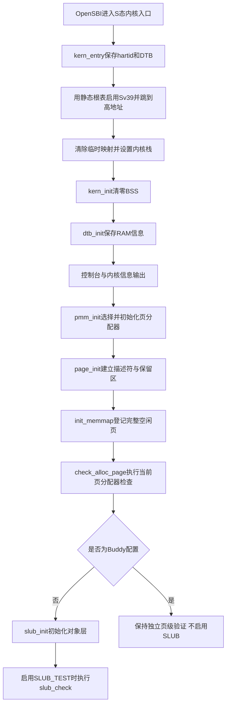

当前 `init.c` 的实际顺序是 `memset -> dtb_init -> cons_init -> print_kerninfo -> pmm_init`，之后按配置决定是否初始化 SLUB。`cons_init()` 在本工程为空，字符输出使用 SBI，因此 DTB 阶段可以先输出。部分手册示意中的 `idt_init()`、`clock_init()`、`intr_enable()` 不在当前调用链中。

`pmm_init()` 先选择管理器并执行其 `init()`，再由 `page_init()` 建立描述符和调用 `init_memmap()`，最后自检。`init_memmap()` 消费已经确认可用的区间，不负责重新探测硬件。公共函数把请求委托给具体算法，但页数、失败、回收和计数语义仍须一致。

### 3.3 项目组成与模块协作

**负责人：2410673 韩羽宸**

- `kern/init/entry.S`、`init.c`：保存启动参数、切换分页和栈，安排 C 初始化；`tools/kernel.ld`、`boot.ld`、`kernel_nopage.ld`：链接布局与相应实验场景的脚本。
- `kern/driver/dtb.c`、`dtb.h`：解析设备树并提供内存查询；`console.c`、`console.h` 和 `kern/libs/stdio.c`：控制台输出接口。
- `kern/mm/pmm.c`、`pmm.h`：通用管理入口、接口委托与初始化；`best_fit_pmm.c/.h`：Best Fit 算法；`default_pmm.c/.h`：框架 First Fit；`buddy_pmm.c/.h`：Buddy 页级实现；`slub.c/.h` 和 `slub_test.c`：对象层及内核测试。
- `memlayout.h`、`mmu.h`、`libs/riscv.h`：地址布局、页表及寄存器常量；`libs/list.h`、`defs.h`：链表、基础类型及成员指针转换；`libs/sbi.c/.h`：固件调用。
- `libs/string.*`、`printfmt.c`、`readline.c`、`stdio.h`、`stdarg.h`、`error.h`：字符串、格式化和基础声明；`kern/debug/assert.h`、`panic.c`：错误检测。
- `Makefile`、`tools/function.mk`：编译链接和运行目标；`tools/gdbinit`：调试配置；`tools/grade.sh`、`inject.py`、`test_lab2.c`：工程检查、注入和评分。

韩羽宸主责修改是 `pmm.c`、`best_fit_pmm.c`、`entry.S`。公共状态和接口不随算法改变。页数语义也须明确：本 Best Fit 精确交付 n 页；不能未经约定就假设向上取整的其他分配器与它完全相同。

## 四、实验内容与实现

### 4.1 基础原理、管理框架与启动分页

本节按“地址与页表原理—软件管理结构—启动落地”的顺序组织，分别标注负责人。

#### 4.1.1 页、物理地址空间与 Sv39

**负责人：2410936 林子媛**

##### 页、地址空间与碎片

页是按固定大小切分地址空间得到的单位，不是某一个 C 结构体。以 4 KiB 基本页为例，一页含 4096 字节，同页内各字节共享页级映射，转换时保留低 12 位偏移。虚拟页属于虚拟空间，物理页帧是 RAM 中的一段，`struct Page` 只是描述物理页帧的元数据。

如果逐字节记录映射，管理开销很大；按页翻译后，一条映射可以描述整页。不同进程可把相同虚拟地址映射到不同物理页，避免地址冲突；也可以有意映射同一物理页实现共享。连续虚拟页可对应不连续物理页，从而降低程序对物理连续空间的依赖。

分页没有消除全部碎片：固定页与 size class 会产生内部碎片；本实验的大对象仍申请连续物理页，即使总空闲页数足够，也可能因外部碎片找不到足够大的连续块。换页则还需要缺页异常、后备存储和置换算法，本实验只理解其基础，没有实现完整换页。

##### 物理地址空间不等于可用 RAM

手册给出的 QEMU `virt` 布局包括 RAM、ROM、MMIO 和未映射空洞。以下采用左闭右开区间列出主要区域：

| 物理区间                       | 手册中的含义              | 是否交给普通页分配器 |
| -------------------------- | ------------------- | ---------- |
| `[0x0, 0x100)`             | VIRT_DEBUG          | 否          |
| `[0x1000, 0x12000)`        | MROM、复位相关内容         | 否          |
| `[0x100000, 0x101000)`     | VIRT_TEST           | 否          |
| `[0x02000000, 0x02010000)` | CLINT，中断/定时器相关 MMIO | 否          |
| `[0x0c000000, 0x10000000)` | PLIC 中断控制器          | 否          |
| `[0x10000000, 0x10000100)` | UART0               | 否          |
| `[0x10001000, 0x10002000)` | VirtIO MMIO 示例窗口    | 否          |
| `[0x20000000, 0x24000000)` | Flash               | 否          |
| `[0x30000000, 0x40000000)` | PCIe ECAM           | 否          |
| `[0x40000000, 0x80000000)` | PCIe MMIO           | 否          |
| `[0x80000000, 0x88000000)` | 默认 128 MiB DRAM     | 排除保留区后管理   |

未列出的区间不能自动视为普通空闲内存。设备布局可能随 QEMU 版本调整，实际探测应结合设备树，不能只因地址落在一个大范围内就当作 RAM。

本次启动输出的 DRAM 基址是 `0x80000000`，大小为 `0x08000000`。`-m` 可以改变模拟机提供的 RAM，但当前 `memlayout.h` 把可管理上界限制在 `0x88000000`；`page_init()` 会限制管理范围，增大 QEMU 内存并不代表会自动管理全部新增空间。低于内核物理起点 `0x80200000` 的实验保留区、内核镜像和描述符数组都不能进入空闲链表。

##### Sv39 地址、PTE 与权限

Sv39 使用 39 位有效虚拟地址，但 RV64 寄存器和指针仍为 64 位。位 `[63:39]` 必须全部等于位 38；任意 64 位数不一定是合法地址。有效地址组合共 `2^39 = 512 GiB`，在 64 位表示中分为低端和高端两个规范地址区，不是一段连续的低 512 GiB 区间。

```text
VA: [63:39] 符号扩展 | [38:30] VPN[2] | [29:21] VPN[1] | [20:12] VPN[0] | [11:0] offset
位数:      25               9                9                9              12
```

每张页表为 4 KiB，每项 PTE 为 8 字节，共 512 项，恰好用 9 位索引。普通 4 KiB 映射最多用三级查表。Sv39 的物理页号字段最多为 44 位，配合 12 位偏移最多表示 56 位物理地址；这不是本次模拟机拥有如此大 RAM 的意思。

| PTE 位     | 字段        | 含义                    |
| --------- | --------- | --------------------- |
| 0         | V         | 有效标志，无效项不能作为正常映射使用    |
| 1 / 2 / 3 | R / W / X | 读、写、执行权限，也参与区分叶项与非叶项  |
| 4         | U         | 用户态访问标记，本次启动叶项为 0     |
| 5         | G         | 全局映射标记，不等于“内核页”；本次未设置 |
| 6 / 7     | A / D     | 访问状态、写入/脏状态           |
| `[9:8]`   | RSW       | 留给监督态软件使用，不作为物理页号     |
| `[53:10]` | PPN       | 非叶项指向下级页表；叶项给出映射物理页号  |
| `[63:54]` | 保留或扩展用途   | 本实验不使用相应扩展，保持为零       |

需要注意以下权限边界：

1. `V=1` 且 `R/W/X=000` 的项表示继续查下一级；合法叶项具有 R 或 X。`W=1、R=0` 是保留组合，不能作为正常只写页。
2. 常用叶权限包括只读、读写、只执行、读执行、读写执行；`MXR` 可影响只执行页能否被按数据读取，但不允许绕过任意权限。
3. `SUM` 位位于状态寄存器，不在 PTE 中，控制 S-mode 对 U 页的数据访问。S-mode 不能仅靠设置 SUM 就执行 U 页代码。访问还要结合特权级与 PMP 等检查。
4. A/D 的维护取决于相应架构机制和实现。本次启动 PTE 已将二者置 1，不把成功启动当作已验证完整的 A/D 缺失处理。

字段含义参考 [RISC-V Supervisor-Level ISA](https://docs.riscv.org/reference/isa/v20260120/priv/supervisor.html)，本实验使用的具体项以 `entry.S` 和实际读取结果为准。

多级页表按需建立下级表，不必为整个未使用空间准备平坦大表，但根表和必要的中间表本身也占内存。各级可以提前成为叶项：末级为 4 KiB，中间级为 2 MiB，根级为 1 GiB。大页要求相应物理基址对齐，形成地址时保留的大页内偏移更长。

##### 本项目的启动映射与 satp

RV64 `satp` 包含 MODE `[63:60]`、ASID `[59:44]`、PPN `[43:0]`。MODE=0 为 Bare，8 为 Sv39，9 为 Sv48；Sv48 增加一级索引，本实验没有启用。ASID 区分地址空间，具体支持位数由实现决定；本次 ASID 为 0。

本项目保留的高地址根项为：

```text
root[511] = (0x80000 << 10) | 0xcf = 0x200000cf
0xcf      = V | R | W | X | A | D
```

该项直接把从 `0xffffffffc0000000` 开始的高地址 1 GiB 窗口映射到从 `0x80000000` 开始的物理窗口。内核链接起点为 `0xffffffffc0200000`，物理加载起点为 `0x80200000`；在有效直接映射内相差 `0xffffffff40000000`。映射窗口大于本次真实 RAM，PTE 存在不代表窗口内所有物理位置都存在内存。

开启分页不会自动改写 PC。当前汇编临时设置根项 2 的低地址恒等映射，保证写 `satp` 后还能取指；进入高地址后清除此项，再执行 `sfence.vma`。后者用于地址翻译同步，不是普通数据缓存的通用刷新命令，写 `satp` 也不能替代其全部作用。

SLUB 因此不需要为每个对象修改页表：启动直接映射已经使管理范围内的 RAM 可通过内核虚拟地址访问，SLUB 只是改变页面归属和页内对象布局。

#### 4.1.2 Page、链表与 pmm_manager

**负责人：2410933 马禹翔**

##### `Page` 描述符与物理页

物理页是物理内存中按 `PGSIZE` 划分的一段真实空间；`struct Page` 是内核为物理页保存的软件元数据。二者不能混为一谈。项目用连续的 `pages[]` 数组描述从 `nbase` 开始的物理页，转换关系为：

```c
page2ppn(page) = page - pages + nbase;
page2pa(page)  = page2ppn(page) << PGSHIFT;
```

`struct Page` 的四个字段含义如下：

- `ref`：页框引用计数。本实验的连续页分配测试主要把它初始化为 0；它不等价于“该页一定空闲”。
- `flags`：状态位集合。`PG_reserved` 表示页面尚不能交给普通分配器，`PG_property` 表示该描述符是空闲连续块的块头。
- `property`：块级元数据。First Fit/Best Fit 中只在带 `PG_property` 的空闲块头上表示连续页数；Buddy 中空闲块头保存实际的 2 的幂块大小，已分配块头也暂存向上取整后的实际大小以校验释放参数。
- `page_link`：嵌入在 `Page` 中的双向链表节点。空闲链表只挂块头，不会把同一连续块中的每个页都挂入链表。

因此，仅看到 `property != 0` 不能断言某页是空闲块头，必须同时检查 `PageProperty(page)`。同样，`flags` 只是描述符的一个字段，并不是完整的物理页描述符。

##### 空闲链表与成员指针转换

`list_entry_t` 是带 `prev/next` 的循环双向链表节点。链表头是哨兵，不对应实际 `Page`；空链表满足 `head.next == head`。`list_add()` 在指定节点之后插入，`list_add_before()` 在指定节点之前插入，`list_del_init()` 删除节点后将其重新初始化为自环。

链表节点嵌在 `struct Page` 中，遍历得到的是 `page_link` 的地址。项目通过以下宏恢复外层对象：

```c
#define offsetof(type, member) ((size_t)(&((type *)0)->member))
#define to_struct(ptr, type, member) \
    ((type *)((char *)(ptr) - offsetof(type, member)))
#define le2page(le, member) to_struct((le), struct Page, member)
```

其思想是“成员地址减去成员在结构体中的偏移量，得到结构体首地址”。`free_area_t` 中的 `free_list` 保存块头节点，`nr_free` 保存空闲页总数，不是链表节点数；一个 16 页块在链表里只有一个节点，但会给 `nr_free` 贡献 16。

##### `pmm_manager` 统一接口

`struct pmm_manager` 用函数指针隔离通用框架与分配策略：

| 字段              | 责任                                  |
| --------------- | ----------------------------------- |
| `name`          | 管理器名称，用于启动输出和核对当前实现                 |
| `init`          | 初始化算法自己的链表、分组和计数，不登记真实页             |
| `init_memmap`   | 接收上层确认可用的 `[base, base+n)`，建立初始空闲结构 |
| `alloc_pages`   | 分配连续页并返回块头，失败返回 `NULL`；实际长度遵守所选算法约定 |
| `free_pages`    | 释放从 `base` 开始的页面并按算法规则合并            |
| `nr_free_pages` | 返回空闲页总数，不改变状态                       |
| `check`         | 运行该管理器自己的正确性断言                      |

`pmm.c` 中的 `alloc_pages()`、`free_pages()`、`nr_free_pages()` 只是统一包装，真正操作由当前 `pmm_manager` 完成；`alloc_page()` 和 `free_page()` 是单页宏。实际初始化顺序为：

```text
kern_init
  -> pmm_init
       -> init_pmm_manager       选择算法并调用 manager->init()
       -> page_init              发现内存、建立 Page 数组和保留区
            -> init_memmap       调用 manager->init_memmap(base,n)
       -> check_alloc_page       调用 manager->check()
```

不是“`pmm_manager` 先主动启动，再调用 `pmm_init()`”。`page_init()` 也不是另一个并列入口，而是 `pmm_init()` 内部把真实空闲区交给所选算法的阶段。

#### 4.1.3 启动映射设计、六问及分页切换

**负责人：2410673 韩羽宸**

**高地址链接与物理加载。** 链接脚本将 `BASE_ADDRESS` 设为 `0xffffffffc0200000`，ELF 中内核符号按这个高地址布局；QEMU 将裸内核镜像加载到物理地址 `0x80200000`。两者之差是 `0xffffffff40000000`。链接脚本决定地址安排，真正的运行时翻译仍由页表和 `satp` 配合完成，修改链接地址不会自动启用分页。

进入 `kern_entry` 时，实际观测到 PC 为 `0x80200000`、`satp = 0`，处于 Bare 地址转换模式，S 模式取指按物理地址进行。本轮继承的 SP 为 `0x8003def0`，属于固件启动现场；它不是内核自己的栈，也不是以后每次运行都固定不变的接口。内核在进入 C 之前换成自身分配的栈。

符号的链接地址与指令执行算出的地址要分别分析。`la`、`tail` 是伪指令，其结果与展开方式有关，不能概括为“高地址链接以后每条 `la` 都会生成高地址”。当前保存启动参数的 `la` 展开为 PC 相对的 `auipc/addi`，在低地址启动时能算出镜像中变量的物理位置。旧实验只用 `la sp`、`tail kern_init` 并不能保证建立高地址虚拟空间，即使某些 PC 相对跳转暂时仍能在低地址继续执行，也不等于高地址映射已经存在。

**分页设计六问。** 以下逐项对应手册“建立段页式管理中需要考虑的关键问题”。

1. **哪些物理空间需要映射？** 启动执行需要访问内核代码、数据、BSS、启动栈、根表、DTB，以及随后用于页描述符和分配的 RAM。本项目用一个根级大页简化覆盖从 `0x80000000` 起的 1 GiB 物理窗口，即 `[0x80000000, 0xc0000000)`。这是地址映射窗口；本轮真实 RAM 只有 `[0x80000000, 0x88000000)`，不能因为有 PTE 就把窗口剩余部分当成存在的 RAM。OpenSBI 所在的实验保留区虽落在窗口内，也不能交给分配器，实际访问还受 PMP 等权限约束。

2. **具体映射关系是什么？** 高地址区从 `0xffffffffc0000000` 开始，直至 64 位地址的最大值，对应上述物理窗口。用闭区间写即高地址 `[0xffffffffc0000000, 0xffffffffffffffff]` 映射到物理 `[0x80000000, 0xbfffffff]`。对这个窗口中的有效访问，`PA = VA - 0xffffffff40000000`。内核入口位于窗口内偏移 2 MiB 处，因此 `0xffffffffc0200000` 对应 `0x80200000`。当前修复还在过渡期用根表第 2 项临时提供低地址恒等映射，进入高地址后移除。

3. **页目录表起始地址在哪里？** Sv39 的根表符号为 `boot_page_table_sv39`。本次观测虚拟地址是 `0xffffffffc0205000`，物理地址为 `0x80205000`，物理页号为 `0x80205`。硬件通过 `satp.PPN` 定位它，不能把符号的高虚拟地址直接写成根表物理页号。

4. **页表放在哪里、需要多少空间？** 根表在 `entry.S` 的 `.data` 段静态分配并按 4 KiB 对齐，共 512 个 8 字节项，总大小 4096 字节。当前根项直接作为 1 GiB 叶项，没有继续为该映射分配中间和末级表。一般 Sv39 支持三级结构，但本实验当前用到的表内存只有一个根表页，不能说必然用了三张表。

5. **怎样设置页目录项？** Sv39 各级使用同一种 PTE 格式。若有效项的 R/W/X 均为零，它才作为通向下一级表的非叶项；有合法的 R 或 X 权限组合时可作为叶项。当前根表第 511 项是叶项，第 2 项仅在启动过渡期有效，其余项为零。进入 C 后实测只剩第 511 项有效，前 511 项为零。根表中使用了叶项，所以此处不存在另一个必须指向的下级目录。

6. **怎样设置页表项内容？** 目标 1 GiB 物理窗口的基址为 `0x80000000`，先取物理页号 `0x80000`，再移到 PTE 的 PPN 字段，得到 `(0x80000 << 10) | 0xcf = 0x200000cf`。低位 `0xcf` 表示 V、R、W、X、A、D 为 1，U、G 为 0；它是内核可读写执行、预置访问和脏标记的叶项，不是用户映射，也没有设置全局位。1 GiB 叶项的虚实基址均满足 1 GiB 对齐，不能把没有这样对齐的任意内核页地址直接填作根级大页基址。

六问中的“目录表”和“页表”是按层级职责提出的问题，Sv39 并不使用两种不同格式的表项。本项目根表同时承担叶表的功能。Sv39 允许不同级别的叶项以及对应的大页对齐要求，和规范一致。[RISC-V Supervisor ISA](https://docs.riscv.org/reference/isa/priv/supervisor.html)

**`satp` 与翻译同步。** RV64 的 `satp` 包含 MODE、ASID 和根表物理页号。当前使用 MODE=8（Sv39）、ASID=0、PPN=`0x80205`，所以数值为 `0x8000000000080205`。右移 12 位的是根表物理地址，不是整个 `satp`。Sv39 虚拟地址按规范进行高位符号扩展校验，不能把任意 64 位值都当成有效 Sv39 地址。

`sfence.vma` 用于页表更新与随后地址翻译之间的同步，并使相关翻译缓存状态满足新映射的要求。写 `satp` 本身不等于完成页表更新排序或翻译缓存失效；这里使用不限定地址、ASID 的形式。它不是刷新所有普通数据缓存或指令缓存的通用命令。[RISC-V 对 satp 与 SFENCE.VMA 的说明](https://docs.riscv.org/reference/isa/priv/supervisor.html)

**从低地址到高地址的真实过程。** 开启分页不会替 CPU 自动改写 PC。本次在 `csrw satp,t0` 执行后，PC 仍为低地址 `0x80200038`，而 `satp` 已变为 Sv39；临时根项确保下一条指令仍能取到。随后跳至 `0xffffffffc0200046`，在高地址清除根表第 2 项并执行 `sfence.vma`，再设置高地址栈并跳到 `kern_init()`。如果只保留高地址项却不处理这段过渡，低地址下一次取指就可能产生页错误；实际集成时已经用真实 `scause/stval` 定位并修复了这一问题。

启动只读 GDB 观察得到：

```text
A_Bare:                  PC=0x80200000          satp=0
C_Sv39_low_PC:           PC=0x80200038          satp=0x8000000000080205
D_High_before_cleanup:   PC=0xffffffffc0200046  root[2]=0x200000cf
E_C_entry:               PC=0xffffffffc02000ee  root[2]=0
                        SP=0xffffffffc0205000  root[511]=0x200000cf
F_DTB_parsed:            RAM base=0x80000000    size=0x08000000
```

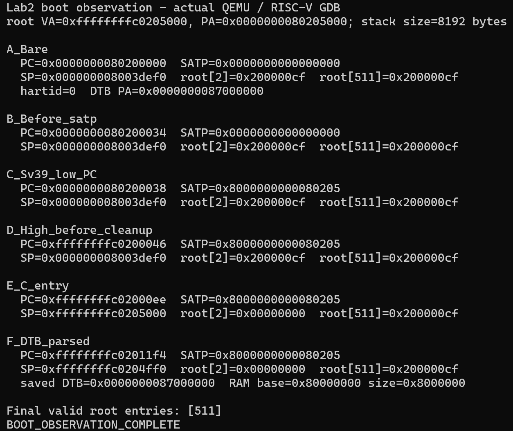

图中 A、B 的 `satp=0`，PC 仍位于物理入口附近；C 中 `satp` 已切换为 Sv39，PC 却仍是低地址，说明开启分页和跳转高地址是两个动作。D 到达高地址时临时根项仍有效；E 进入 C 后，第 2 项清零、第 511 项保留，SP 已切换到内核栈顶。F 表明保存的 DTB 地址仍为 `0x87000000`，RAM 信息在进入物理内存管理前已经解析。最后的 `[511]` 来自对导出根表的检查，表示最终只有该索引有效。

图05是本人现场执行后取得的 GDB 状态摘要，原始断点和单步记录另行保存。它展示启动时刻的变化；QEMU 内部地址翻译源码的双 GDB 单步另以4.8的证据说明。

启动栈实际范围为 `[0xffffffffc0203000, 0xffffffffc0205000)`，长度 8192 字节，向低地址增长。栈顶与根页表起点恰好同为 `0xffffffffc0205000`，两者只是边界相接：表占据其后的一个页，栈使用其之前的空间，不是同一块内存被重叠使用。C 代码的函数序言使用 SP 后，`pmm_init()` 处观测到 SP 为 `0xffffffffc0204ff0`，不能要求后续所有断点处 SP 都仍等于初始栈顶。

**一般三级页表与本次大页。** Sv39 的地址索引可分成 VPN[2]、VPN[1]、VPN[0] 和 12 位基本页偏移；根表、中间表、末级表分别可以形成 1 GiB、2 MiB、4 KiB 的叶映射。本次根项已是叶项，因此转换在根级结束，1 GiB 内的低 30 位作为大页内偏移。例如实际 C 入口 `VA=0xffffffffc02000ee`，根索引为 511，窗口内偏移为 `0x2000ee`，所以 `PA=0x80000000+0x2000ee=0x802000ee`。这是基于已读取 PTE 的地址计算，尚不等于已经在 QEMU 源码中单步看到页表遍历，实际 QEMU 源码单步另见 4.8。

**启动故障与 AI 修复记录。** 首次完整内核构建成功但没有进入 C。实际 GDB 证据为 `scause=0xc`、`stval=0x80200038`、`satp=0x8000000000080205`，说明写 satp 后低地址下一条取指没有有效映射。修复不是增加一个 nop，也不是跳过异常，而是在过渡期间提供合法低地址映射，进入高地址后立即撤销。失败现场和修复后状态见 `initial_boot_gdb.log`（本地记录）、`final_mapping.log`（本地记录）。这是启动控制流问题，不是 Best Fit 选择错误。

**最终提示词与规格：** [HYC-P3：启动分页过渡修复](prompt.md#hyc-p3)、[HYC-P5：启动原理与六问](prompt.md#hyc-p5)。启动修复的前提是 Bare 低地址入口；完成后必须进入高地址、清除 root[2]、保留 root[511]，不能靠跳过异常获得“成功”。概念澄清另见 [MYX-P1](prompt.md#myx-p1)、[MYX-P2](prompt.md#myx-p2) 和 [LZY-P3](prompt.md#lzy-p3)。

### 4.2 功能模块一：物理内存探测与页初始化

**负责人：2410673 韩羽宸**

**任务、接口和职责。** 实际实现入口为 `static void page_init(void)`，由 `pmm_init()` 调用，不接收参数、不返回值。它消费 DTB 查询结果并建立初始页状态，不重新解析 DTB，也不负责 Best Fit 的搜索。关联接口为 `void dtb_init(void)`、`uint64_t get_memory_base(void)`、`uint64_t get_memory_size(void)`，以及内部委托 `static void init_memmap(struct Page *base, size_t n)`。实现见 [pmm.c](../code/kern/mm/pmm.c)。

**启动参数与 DTB 解析。** OpenSBI 以 a0 传入 hartid，以 a1 传入 DTB 物理地址，本轮为 0 和 `0x87000000`。`entry.S` 在改用这些寄存器之前保存到 `.data` 中的 `boot_hartid`、`boot_dtb`，因此 C 中清零 BSS 不会清掉参数。`dtb_init()` 使用编译期 `PHYSICAL_MEMORY_OFFSET` 将 DTB 地址转换为 `0xffffffffc7000000`，不依赖尚未由 `page_init()` 设置的全局偏移。

解析器验证非零地址和魔数 `0xd00dfeed`，按大端格式转换头部、结构标记和属性中的数值；头部偏移确定结构块、字符串块位置。`FDT_BEGIN_NODE` 识别节点，`FDT_PROP` 通过名称偏移查找属性，在 memory 节点中读取 `reg` 的起点和长度，处理必要的 4 字节对齐；`FDT_END_NODE`、`FDT_NOP` 和 `FDT_END` 控制遍历。结果保存到静态 `memory_base/memory_size`，由 getter 交给 PMM。当前 `dtb.c` 是框架提供的简化解析器，并非本人从零实现的通用设备树库。

空 DTB、错误魔数或未找到内存时，解析器打印信息并返回，当前启动的查询结果仍为零；后续 `page_init()` 校验并终止。不能把这些路径写成解析器本身全部 panic。当前代码没有完整遍历多段 RAM、保留区和通用 cell 编码，也不对任意损坏 DTB 提供完整边界防护。本实验遵循手册的可信启动 DTB 与单段 RAM 条件。

**四种地址和页数。** `end`、`pages` 是内核虚拟地址；RAM 起点、`maxpa`、`freemem` 是物理地址；`nbase/npage` 是物理页号；`struct Page *` 指向管理记录，不是待分配物理页的地址。

```text
nbase = DRAM_BASE / PGSIZE = 0x80000
npage = 管理末端物理地址 / PGSIZE = 0x88000（本次128 MiB）
描述符数量 = npage - nbase = 32768
page2pa(pages+i) = (nbase+i) << 12
pa2page(pa) = pages + (PPN(pa)-nbase)
```

`npage` 虽在旧注释中容易被理解为“页面数量”，实际是页号上界。把它直接当数组元素数会多算从零到 DRAM_BASE 的巨大空洞。`pa2page()` 的当前实现只显式检查上界，调用方仍须保证地址不低于 DRAM_BASE，不能将它当成任意地址的完整验证器。

`PADDR(kva)` 从内核虚拟地址减去全局偏移，当前宏检查其不低于 KERNBASE；它不执行硬件查表。手册给出 `KADDR` 反向转换思路，但本工程中的宏处于注释内，当前实现未调用它。因而报告说明转换关系，不把被注释宏写成正在使用的接口。

**布局和初始化步骤。** 实现先校验起点等于当前固定 DRAM_BASE、长度非零、起点加长度不溢出，再设置偏移。管理末端由真实内存末端与框架上界取较小值并向下按页对齐，必须能覆盖内核。描述符数组在虚拟 `end` 后向上对齐，写数组之前先检查整个数组容得下。

```text
maxpa = ROUNDDOWN(min(mem_base+mem_size, PHYSICAL_MEMORY_END), PGSIZE)
pages = ROUNDUP(end, PGSIZE)                 （虚拟地址）
page_count = npage - nbase
pages_pa = PADDR(pages)                     （物理地址）
freemem = ROUNDUP(pages_pa + page_count*sizeof(struct Page), PGSIZE)
可分配区 = [freemem, maxpa)
```

容量检查使用 `page_count > (maxpa-pages_pa)/sizeof(struct Page)`，先确定减法合法，再避免直接用一个过大乘积判断。全数组先置为引用计数零、`property=0`、保留标志置位、链表节点自环。只有确定可用的完整页面才交给当前管理器解除保留并登记，其他页面继续保留。

```text
低地址 → 高地址：
OpenSBI保留区 → 内核镜像（含启动栈/根表/BSS）→ 对齐空隙
             → Page数组 → 对齐空隙 → 可分配完整页 → 不完整尾部
```

本次完整测试镜像 `end=0xffffffffc0206078`，所以数组起点为 VA `0xffffffffc0207000`、PA `0x80207000`。当前 RV64 `sizeof(Page)=40`，32768 个元素共 `0x140000` 字节，即 320 页；空闲起点为 `0x80347000`。总共保留 839 页，剩余 31929 页。代码使用 `sizeof` 和链接符号计算，未写死这组数值；独立测试内核稍大时起点会不同。

**行为规格与边界。** 输入依赖 DTB 已解析、管理器已初始化且调用前没有登记可分配页。成功返回必须得到可管理范围、完整描述符和安全空闲区；零空闲页可以保留确定状态，但不能调用 `init_memmap()`。无效起点、零长度、溢出、内核或描述符容纳不下时，须在放出空闲页前终止。完整的前后条件、分支规格及最终提示词见 [HYC-P1](prompt.md#hyc-p1)。

**实现迭代与结果。** 按以上规格完成实际函数并保留 `//lab2 function1 2410673`。初始化算法第一次完整执行 13 个用例均通过，没有为报告编造反复修正算法的经历。测试搭建时确有 `sbi_shutdown()` 只有声明、没有定义导致的链接错误，仅在独立驱动中用局部 SBI 退出调用处理；正式 SBI 模块不变。初始化的完整运行证据见 5.1，边界验证见 5.2。

### 4.3 Challenge：可用物理内存范围的获取

**负责人：2410673 韩羽宸**

**题目：如果 OS 无法提前知道当前硬件的可用物理内存范围，有什么办法获取？**

可以让启动固件或引导程序按照约定，把运行时内存布局传给 OS。OS 不必把每台机器的 RAM 容量编译进内核，但必须知道怎样定位和解析这些启动信息。得到的应当是带起点、长度和用途的区间集合，而不能只有“装了多少 GB”一个总容量数。

在本实验中，入口寄存器 `a1` 提供 DTB 地址，内核读取 memory 节点的 `reg`，得到 RAM 起点与长度。完整设备树可以描述多段内存，且地址和长度的编码由相应 cell 数决定；保留区需要单独识别和排除。当前解析器只取找到的第一个地址、长度对，并没有实现通用多段解析及保留区处理。[设备树 memory 与 reserved-memory 约定](https://devicetree-specification.readthedocs.io/en/latest/chapter3-devicenodes.html)

其他平台可以采用不同的信息交付方式。例如传统 x86 BIOS 启动可由引导程序查询 E820 系统地址图，再将结果交给内核；UEFI 启动可在退出 Boot Services 前获取 `GetMemoryMap()` 返回的带类型内存描述符。后者需要依据类型区分可用 RAM、固件保留区和其他用途，不是拿到所有描述符就全部释放。本项目没有执行或实现这些固件接口，它们是 Challenge 的可行方法说明。[ACPI 系统地址图接口](https://uefi.org/specs/ACPI/6.5/15_System_Address_Map_Interfaces.html)、[UEFI GetMemoryMap](https://uefi.org/htmlspecs/ACPI_Spec_6_4_html/15_System_Address_Map_Interfaces/uefi-getmemorymap-boot-services-function.html)

若平台没有通用接口，也可由知道板级布局的固件依据内存控制器配置整理地址图，再按双方约定传递。此方法依赖平台文档，读取内存条容量信息本身不能自动给出所有实际映射、地址空洞和保留区。这是平台相关的补充思路，不是本次已经验证的探测程序。

获取原始区间后，还需检查起点加长度是否溢出、区间是否重复或冲突，区分 RAM 与 MMIO，并减去固件、内核、启动数据和管理元数据占用。最后将区间起点向上、末端向下按页对齐，只将确定可用的完整页交给分配器。对多段 RAM 应分别组织可用区，而不能假设从最低起点到最高末端之间全部存在内存。

不宜将“不断向更高地址写入测试值并读回”作为通用探测方案。未知物理地址可能属于 MMIO、保留数据或地址别名，写入会产生副作用；读写失败也可能来自访问权限而非 RAM 不存在。这一限制来自未知地址用途的风险分析。若完全没有平台信息或启动协议，就不能保证通过一段通用试探代码安全识别全部可用内存。

本实验按手册简化：DTB 中起点和长度提取后，后续不再需要 DTB 原结构，可以复用它占用的空间。真实系统若还要读取设备、CPU 或保留信息，应保留 DTB，或者完整复制后再释放，不能只因读过内存节点就复用。当前 `libs/sbi.h` 虽声明 `sbi_query_memory()`，实际 `sbi.c` 没有该实现，代码也没有走这条路径；不能据此宣称已经通过 SBI 自动查询全部物理内存。

因此，本题的完整回答是：**通过平台规定的启动信息获得内存区间和用途，再结合运行中必须保留的区域与对齐规则，形成可分配物理页集合。** 本次实现的是其中 DTB 单段内存的教学版本。

**最终提示词：** [HYC-P5](prompt.md#hyc-p5)。SPEC 要求回答信息来源、保留区、页对齐和简化限制；未在本工程实现的 E820/UEFI 仅列为可行方法，不写成已经执行。

### 4.4 功能模块二任务一：First Fit 理解与思考

**负责人：2410933 马禹翔**

#### 4.4.1 任务规格与分析方法

First Fit 维护按块头地址递增的空闲链表。申请 `n` 页时从表头开始寻找第一个 `property >= n` 的块；释放后把新区间插回地址顺序，并与物理相邻的前后块合并。分析重点不是只复述循环，而是跟踪每一步的块头标志、`property`、链表位置和 `nr_free` 是否一致。

前置条件是调用者传入正页数；`init_memmap()` 的区间已经由 `page_init()` 判定为可用、完整且尚未交给分配器的页面。后置条件是链表中每个节点代表一个不重叠的连续空闲块，所有块的长度总和等于 `nr_free`。

#### 4.4.2 四个核心函数

**`default_init()`** 将哨兵头初始化为自环，并把 `nr_free` 清零。此时只建立算法内部空状态，还没有真实可分配页。

**`default_init_memmap(base,n)`** 不是探测占用页。上层已经确认该区间可用，函数中的 `assert(PageReserved(p))` 检查这些描述符仍处于“尚未交给分配器”的统一保留状态。循环清除旧标志、旧长度和引用计数；随后只在 `base` 上设置 `property=n` 和 `PG_property`，将整个区间作为一个块插入地址有序链表，最后令 `nr_free += n`。

**`default_alloc_pages(n)`** 先用总量快速排除明显失败，再顺序遍历链表。找到第一个足够大的块后删除旧块头。如果块长度大于请求，剩余部分从 `page+n` 开始，成为新的块头并保留在原来的有序位置；成功后清除被分配块头的 `PG_property`，`nr_free` 精确减少 `n`。它选择的是第一个可用块，不保证剩余最小。

**`default_free_pages(base,n)`** 逐页断言页面不是 Reserved、也不是现有空闲块头，然后清理状态，以 `base` 建立新块头并令 `nr_free += n`。插入地址有序链表后，只需检查前驱和后继：若 `prev + prev->property == base` 就向左合并；再从合并后的块头检查右侧，若 `base + base->property == next` 就向右合并。地址相邻是 First Fit 合并的充分条件之一，而 Buddy 还要求同阶且真正互为伙伴。

#### 4.4.3 改进空间与代价

设空闲块数为 `B`，当前 First Fit 的分配最坏需要扫描 `O(B)`；释放还需要寻找插入点。可以考虑：

1. **游标式 Next Fit**：从上次停止位置继续扫描，可能改善反复从头遍历的开销，但结果依赖历史，可能错过低地址更合适的块。
2. **按大小建立平衡树或尺寸桶**：能更快定位可容纳请求的块，但释放、拆分、合并时必须同时维护地址关系与大小索引，元数据和一致性成本更高。
3. **延迟合并或定期整理**：可降低每次释放的即时成本，但在整理前更容易因外部碎片导致大块申请失败。
4. **改用 Best Fit/Buddy**：Best Fit 尝试减少当次剩余，Buddy 使拆分合并更规则；前者仍可能留下很多小洞，后者对非 2 次幂请求产生内部碎片。

因此不存在对所有负载都绝对更好的策略。优化结论需要结合请求分布、碎片率和时间开销测量，不能只凭复杂数据结构断言一定更快。

**分析提示词：** [MYX-P3：初始化登记不等于内存探测](prompt.md#myx-p3)、[MYX-P4：空闲块插入顺序](prompt.md#myx-p4)。约束只读分析、不修改原有实现；结果需同时解释链表顺序、块头标记和总空闲页数。

### 4.5 功能模块二任务二：Best Fit 实现与接入

**负责人：2410673 韩羽宸**

**算法目标和状态约定。** 对 n 页申请，Best Fit 选择所有能满足申请的连续块中最小者；相同大小选低地址块。假设按地址有 12、6、9 页三个空闲块，请求 5 页：First Fit 会选择第一个 12 页块，本实现选择 6 页块，交付前 5 页、留下 1 页。Best Fit 的“最优”只针对当前剩余块大小，不能保证未来整体最优。

链表仍按地址排序，选择时才比较大小。地址顺序服务于释放合并，Best Fit 不要求链表必须按大小排序。内部 `static free_area_t free_area` 保存哨兵 `free_list` 和总空闲页数 `nr_free`；每个连续空闲块只有块头入链，块头的 `PG_property` 有效，`property` 是该块页数，不是空闲块个数。非块头不保留块头标志，分配后的旧长度要清零。

`Page.ref`、`flags`、`property`、`page_link` 分别表示引用、状态、块头长度和链表节点。`le2page(le,page_link)` 利用 `to_struct` 从成员地址减去字段偏移，返回所属 `Page`；不是从链表节点数值推导物理地址。描述符按物理页顺序排列，所以比较同一数组内的指针和 `base+n` 可以表达物理连续关系。标志位宏在当前工程直接修改字段，不能因为手册旧注释提到原子操作就宣称本算法已经支持并发。

**SPEC 与最终提示词。** [HYC-P2](prompt.md#hyc-p2) 规定：正页数前提；选择最小足够块，同尺寸取低地址；成功精确交付 n 页；尾部拆分；释放时仅按物理邻接合并；无合适连续块时返回 NULL 且状态不变。已有 `basic_check()`、`best_fit_check()` 和注册接口保持不变，不能为通过而修改评分。

**各核心接口如何协同。**

- `best_fit_init()`：把循环链表设为空，计数归零，尚不登记任何物理页。
- `best_fit_init_memmap(base,n)`：要求正页数、有效描述符范围、输入仍保留；初始化这些页，设置新块头，通过内部插入合并登记，总数只增加 n。多个区间乱序登记也能按地址组织。
- `best_fit_alloc_pages(n)`：断言 n>0；总量不足立即失败。扫描所有足够大的块，只有候选更小时才替换，所以相同大小保留先遇到的低地址块；精确匹配可提前退出。无候选返回 NULL，既不拆块也不改计数。
- 选择成功后，删除原块头、清除旧标志和长度；有剩余时以 `best+n` 为尾块头，把它插回原链表位置，保持地址顺序；计数只减少 n。精确匹配不生成零长度尾块。
- `best_fit_free_pages(base,n)`：调用者提供有效已分配区间；逐页清理状态，设置新块头，插入并尝试左右合并，总数只增加本次归还的 n。不是通过观察某个页的 ref 为零就能证明任意释放合法。
- `best_fit_insert_block(base)`：找到地址插入点，断言不与左右块重叠；先并左，令左块成为头，再从合并结果检查右邻居，故能一次连接两边。旧头标志与长度被清除、节点自环。链表相邻还不够，必须满足 `left+left->property==base` 等物理邻接条件。
- `best_fit_nr_free_pages()` 返回总空闲页数；注册结构将以上五个回调及原有 `best_fit_check()` 交给框架，`init_pmm_manager()` 选择 `&best_fit_pmm_manager`。只完成算法但没有切换管理器时，原内核运行的仍可能是 First Fit。

原有测试会暂时置空链表而尚未同步改计数，所以实现不能假定 `nr_free>=n` 必然存在候选。搜索无结果仍返回 NULL，兼容原测试的状态约定。原有 `basic_check()`、`best_fit_check()` 保持不变，并未另写“更容易通过”的版本替代它们。

**实现迭代与限制。** 本人完整模块、管理器注册和切换均已落到 [best_fit_pmm.c](../code/kern/mm/best_fit_pmm.c) 与 `pmm.c`，标记 `2410673`。原有检查 6/6、两项任务 PASS、评分 20/20 和补充模型核对均通过。未观察到需要改测试或修正选择算法才能通过的情况；实际集成中遇到的启动取指故障已在 4.1 分析。

零页申请违反接口前提并触发断言；本实现不维护完整分配历史表，不能声称检测任意重复释放、跨申请错误释放和所有非法指针。当前是单核启动阶段顺序调用的实验，没有并发锁。

**思考题：Best Fit 是否还有改进空间？** 设空闲块数为 B，当前分配最坏扫描 O(B)，精确匹配可提前停止；释放需处理 n 个描述符并定位插入点，约为 O(n+B)。可增加按大小的平衡树等索引快速找最小合适块，同时保留按地址定位邻居的能力；代价是拆分、合并和删除都要同步索引，增加元数据和一致性维护。尺寸分组也可减少搜索，但分组过粗可能改变严格 Best Fit 语义。

此外，最小剩余策略可能留下大量小块。立即合并只能合并已经空闲且物理相邻的区间，不能跨越已分配页；两个 3 页块不能满足一个 4 页连续请求，尽管空闲总量足够。这是外部碎片。按页分配小对象留下页内空间则涉及另一层内部碎片，需联系队友的 SLUB。本人没有实现上述索引或做速度基准，报告不给出未经测量的加速结论。

### 4.6 功能模块二任务三：Buddy System

**负责人：2410933 马禹翔**

#### 4.6.1 功能规格与接口约定

Buddy 把空闲页分成大小为 `2^order` 的块，每个 order 有一条独立链表。公共头文件只导出：

```c
extern const struct pmm_manager buddy_pmm_manager;
```

初始化、登记、分配、释放、计数和辅助函数均为 `buddy_pmm.c` 内部 `static` 实现。非 2 次幂请求向上取整，例如 3 页实际占用 4 页，5 页实际占用 8 页；分配计数和释放校验都使用这个实际块大小，避免申请和归还语义不一致。

关键不变量如下：

- 空闲块头设置 `PG_property`，`property` 为该阶实际页数，并且只出现在对应 order 链表中一次。
- 空闲块内部页不设置 `PG_property`，不独立进入链表。
- 已分配块头不设置 `PG_property`，但保留实际块大小用于释放校验。
- `buddy_nr_free` 是所有阶空闲页之和；拆分和合并不改变它，只有真正分配和释放改变它。
- order 为 `k` 的块必须按 `2^k` 物理页号对齐。伙伴页号为 `base_ppn ^ (1 << k)`。
- 只有范围内、同阶、空闲且真正互为伙伴的块才能合并；地址相邻但不满足 XOR 关系的块不能合并。

#### 4.6.2 核心实现

`buddy_init()` 初始化 0～31 阶链表和每阶块计数，并清零总空闲页数。

`buddy_init_memmap(base,n)` 先清理已确认可用的描述符，再从低地址开始，反复选择“不超过剩余长度且当前物理页号满足对齐”的最大 2 的幂块。这样即使起点和长度不是 2 的幂，也不会生成越界或错误对齐的块。每个分块通过统一的合并插入函数登记，总计数最后只增加原始 `n`。

`buddy_alloc_pages(n)` 计算最小目标阶，从该阶向上寻找第一个非空链表。取出高阶块后逐级二分：左半继续拆分，右半进入低一阶空闲链表，直到目标阶。最后总计数减少实际块大小，并在返回块头保存该大小。

`buddy_free_pages(base,n)` 用相同规则重新计算阶，校验范围、对齐、块头状态和实际大小，清理整块描述符，总计数只增加一次。随后计算伙伴：伙伴同阶且空闲时先从链表删除，选择低地址作为合并后的块头并提高一阶，循环直到不能继续，最后把结果插入对应链表。

最终注册对象把上述回调交给通用框架。普通构建仍选择 Best Fit；Makefile 新增默认关闭的测试配置：

```bash
make BUDDY=1
make BUDDY=1 qemu
```

`CONFIG_BUDDY_PMM` 只在显式设置 `BUDDY=1` 时定义，因此原始评分和最终默认管理器不受影响。

#### 4.6.3 最终提示词与测试规格

完整接口、前后条件及失败分支见 [MYX-P7：Buddy 完整实现](prompt.md#myx-p7)，测试见 [MYX-P8：Buddy 边界验证](prompt.md#myx-p8)；接口收紧过程见 [MYX-P6](prompt.md#myx-p6)。

实现 prompt 先明确按阶管理、绝对物理页号 XOR、非 2 次幂请求向上取整、失败不改状态，以及拆分/合并不改总计数。测试 prompt 再规定隔离 16 页 arena、保存并恢复真实链表和计数，覆盖 1/2/3/5/16 页、相邻非伙伴和偏移起点的 13 页区间。这样测试针对规则而非当前某个全局空闲布局。

#### 4.6.4 真实迭代

1. 最初需求希望在头文件公开多个函数和变量。结合项目中 `default_pmm.h`、`best_fit_pmm.h` 的封装方式，将公共接口收紧为只导出 `buddy_pmm_manager`，其余实现保持模块私有。
2. 第一版自检对全局空闲布局存在不必要假设，随后改为先申请一个对齐 arena，隔离真实各阶链表，在受控环境测试后恢复，避免测试依赖某个特定全局块形状。
3. arena 从 8 页扩展到 16 页，以同时覆盖两个 5 页请求向上取整到 8 页、相邻非伙伴和多级恢复。
4. 完整构建最初被尚未完成的 Best Fit 阻断，Buddy 对象文件先独立编译验证；公共 `page_init()` 和 Best Fit 更新后，再加入默认关闭的 `BUDDY=1` 内核入口完成运行级验证。
5. 为便于报告截图给边界组增加 `cprintf()` 时，第一次编译因缺少 `<stdio.h>` 被 `-Werror` 拒绝；补齐头文件后重新构建和运行通过。这是输出接入问题，不是分配算法错误。

### 4.7 功能模块二任务四：SLUB 对象分配

**负责人：2410936 林子媛**

#### 4.7.1 功能目标与 SPEC

| 项目      | 本次规格                                                                    |
| ------- | ----------------------------------------------------------------------- |
| 接口      | `slub_init()`、`kmalloc(size_t)`、`kfree(void *)`；`slub_get_stats()` 辅助验证 |
| 初始化前提   | `pmm_init()` 完成，使用受支持的后端，单执行流                                           |
| 小对象     | 16、32、64、128、256、512、1024、2048 八档，选择最小足够类别                              |
| 返回指针    | 至少 16 字节对齐，内容不保证清零                                                      |
| slab 布局 | 一页一个 slab，页内管理头后排列对象槽位                                                  |
| 大对象     | 大于 2048 字节走连续页路径，头部与对齐开销计入页数                                            |
| 释放回收    | 校验归属、槽起点、分配状态；空 slab 立即回收，大对象按原页数归还                                     |
| 正常失败    | 0、内存不足、超大或溢出请求返回 NULL，不破坏已有对象与统计                                        |
| 异常输入    | `kfree(NULL)` 无操作；可检测的非法/重复释放在修改状态前 panic                               |
| 范围限制    | 不承诺并发安全、Linux SLUB 全部优化、识别地址复用后的全部悬空指针                                  |

SPEC 同时约束生成代码和测试：例如“空页立即归还”要对应底层页数恢复，而不只是 `kfree()` 不报错；“大对象包括块头”要对应跨页临界点的精确计数。

#### 4.7.2 两层接口和地址转换

```text
kmalloc(bytes) / kfree(ptr)
  -> SLUB：分类、空闲槽链、bitmap、在用计数、活动块登记
  -> alloc_pages(n) / free_pages(base, n)
  -> 默认 Best Fit 的空闲物理页管理
```

`alloc_pages()` 返回 `struct Page *`，不能直接当作页面数据地址。本实现将转换集中在 `slub_page_kva()`：先检查描述符是否属于 `pages` 数组、对齐及页数是否有效，再调用 `page2pa(page)`，按 `KVA = PA + va_pa_offset` 转换，并检查溢出与映射范围。

当前 `KADDR` 被注释，因此没有直接调用不可用宏，也没有把虚实地址加减散落到每个分配、释放函数。对象层向下仍使用原有页接口，不改变 Best Fit 的实现或测试。

#### 4.7.3 页面布局与对象元数据

公共 `slub_block` 保存 magic、块类型、原始 `Page *`、申请页数和活动链表节点。`slub_slab` 再保存分类号、容量、`inuse`、空闲槽链头、分类链节点和分配 bitmap；`slub_large` 保存大对象请求大小等信息。

```text
小对象：| 对齐后的页内管理头 | 槽0 | 槽1 | ... | 槽N-1 | 尾部余量 |
大对象：| 管理头及对齐填充   | 调用者的 size 字节       | 末页余量 |
```

空闲槽位开头保存下一个空闲对象的指针；分配后这段空间完全交给调用者，不额外为每个在用对象插入独立头。分配状态在 slab 头的 bitmap 中记录，数量由 `inuse` 记录，因而同时支持复用、统计和重复释放检查。

本次 RV64 的小对象头对齐后为 128 字节，容量为 `floor((4096 - 128) / class_size)`：

| size class | 16  | 32  | 64  | 128 | 256 | 512 | 1024 | 2048 |
| ---------- | --- | --- | --- | --- | --- | --- | ---- | ---- |
| 每页容量       | 248 | 124 | 62  | 31  | 15  | 7   | 3    | 1    |

这些值来自当前结构布局，不是所有 SLUB 的通用规定。各分类的 `partial_slabs[]` 只登记仍有空闲槽的非空 slab；所有存活块另外登记在 `active_blocks` 中。

#### 4.7.4 核心函数与状态变化

**小对象分配。** `kmalloc()` 扫描八档分类后调用 `slub_alloc_small()`。若没有可分配 slab，`slub_new_slab()` 用 `alloc_pages(1)` 取页，计算容量并建立空闲槽链。分配时弹出一个槽、设置 bitmap、增加 `inuse`；满页从 partial 链移除。同类后续请求可以复用槽位，不必每个对象都调用页分配器。

**大对象分配。** `slub_alloc_large()` 先检查头部加法溢出，再计算：

```c
total = size + LARGE_HEADER_SIZE;
npages = total / PGSIZE + (total % PGSIZE != 0);
```

这种写法避免 `total + PGSIZE - 1` 的再次溢出。本次大对象头与对齐共占 64 字节，因此 4096 字节请求实际需要两页，8192 字节请求需要三页。空闲页总数足够也不能保证连续块申请成功，仍须处理 `alloc_pages()` 返回 NULL。

**释放前校验。** `kfree()` 先处理 NULL，再检查范围与对齐，用 `slub_find_block()` 在可信活动头链表中寻找归属。没有直接把任意输入向下取整后解引用为管理头，避免读取不可信元数据。

**小对象释放。** `slub_slot_index()` 校验有效槽起点，bitmap 判断是否仍在用。确认后清位、减少 `inuse`。原来满页释放一个对象后重新加入 partial 链；仍非空时把槽压回空闲链；最后一个对象释放后，移除链节点并归还整页，不保留空 slab。

**大对象释放。** 输入必须是管理头之后的准确返回地址，内部指针不能释放整块。`slub_release_block()` 先保存原始页描述符和页数，注销活动块并使 magic 失效，再调用 `free_pages(page, npages)`；归还后不再读页内头。

**统计。** `slub_get_stats()` 遍历活动块，分别统计存活对象、小对象 slab 页、大对象页。释放查找与统计存在遍历开销，本实现以清晰可验证为主，不声称具有 Linux SLUB 的生产性能。

#### 4.7.5 两份最终提示词

- [LZY-P1：SLUB 实现](prompt.md#lzy-p1)：先给接口、size class、页内元数据、准确页数、大对象、空页回收及失败约定，再生成实现；明确不改页表、MMU 和原有评分。
- [LZY-P2：SLUB 独立测试](prompt.md#lzy-p2)：阅读实际代码，先列已有/缺失覆盖，再复用原有检查并新增用例；危险释放各自启动 QEMU，精确匹配保护信息。

两份原始最终提示词均按四段式完整收录在配套文件；对象层依赖和后端兼容分析另见 [LZY-P3](prompt.md#lzy-p3)、[LZY-P4](prompt.md#lzy-p4)。

#### 4.7.6 AI 生成与集成中实际遇到的问题

**一、交叉工具链名称不匹配。** 最初 `make qemu` 报 `riscv64-unknown-elf-gcc: command not found`，这是默认前缀与本机安装工具不一致，不是 SLUB 的 C 语法错误。先识别工具链的运行平台，再在本机用 `GCCPREFIX=riscv64-elf-` 构建；不能把 Linux 预编译目录加入 macOS PATH 就认为兼容。

**二、Buddy 与 SLUB 启用配置冲突。** 初版 SLUB 明确只接受 First Fit/Best Fit，而集成入口原来无条件调用 `slub_init()`。组员选择 Buddy 时因此触发 `slub: requires the First-Fit or Best-Fit page allocator`。这是上下层契约和配置不一致，不代表 SLUB 原理上永远不能使用 Buddy。

本组 Buddy 把请求向上取整到 2 的幂，本版 SLUB 却按请求页数记录、释放，并依赖精确页数语义。例如申请 3 页，若实际交付 4 页却仍记录 3 页，统计与回收长度就不能按本版规格直接核对。组员最终把 Buddy 作为独立页级配置，跳过 SLUB，并禁止同时启用 `BUDDY=1` 与 `SLUB_TEST`；默认 Best Fit 下执行完整 SLUB 测试。没有删除保护或修改既有检查来掩盖问题。未来适配须明确实际块长和回收规则，再验证统计语义。

**四、实现完成不等于验证完整。** 初次提交名为“SLUB实现（没有非法释放测试）”，当时不能宣称非法释放已覆盖。后续保留原有测试，新增独立负向用例和边界检查。本轮没有发现新的 SLUB 分配算法错误，因此不为报告编造越界或泄漏案例。

#### 4.7.7 测试设计的有效性

- 分类边界检查两侧，发现错误向下分类；容量测试填满再多申请一个，发现元数据开销遗漏和容量多算。
- 混合对象同时存活，检查区间并写不同数据模式，在释放部分对象后继续核对存活数据，发现串改与错误复用。
- 同时比较对象数、slab 页、大对象页及底层空闲页，区分“槽位释放”与“整页归还”。
- 大对象把块头计入临界点，检查分配和释放页数一致。
- 真正耗尽底层页面，同时确认已有同类 slab 的空闲槽仍可复用，不把“无空闲页”错误解释成所有对象请求必失败。
- 负向测试每次新启动 QEMU，精确识别实际保护信息；一个 panic 不阻止其他用例，也不把任意崩溃当作通过。

### 4.8 分支任务：QEMU/GDB 地址翻译与 TLB 调试

**分工：韩羽宸观察页表翻译；马禹翔观察 TLB 未命中、填充和命中；林子媛比较 Bare/Sv39 与软硬件 TLB。**

三部分共同覆盖“访存请求—缓存查询—必要时读表—权限检查—形成物理地址—缓存填充—随后命中”，但来自各自独立环境。下面保留具体版本和现场数据，不把它们描述为同一进程上的连续操作。

#### 4.8.1 双 GDB 与 QEMU 页表翻译

**负责人：2410673 韩羽宸**

**双 GDB 与三个终端。** 宿主 GDB 看到的是 QEMU 的 C 源码、宿主线程和模拟状态；客体 GDB 看到的是 RISC-V 指令、内核符号和寄存器。前者加载 QEMU，后者加载 `bin/kernel`，不是把同一个目标打开两次。

本机 `ptrace_scope=1`，因此采用宿主 GDB 直接启动自己的 QEMU 子进程，不从其他终端 sudo attach，也不修改全局权限。相较手册的启动后附加方式，只改变了父进程关系。终端 1 用 `tail` 显示串口日志，终端 2 的宿主 GDB 启动并调试 QEMU，终端 3 的 RISC-V GDB 连接 stub。该权限策略的依据见 [Linux Yama 文档](https://docs.kernel.org/admin-guide/LSM/Yama.html)。没有实际执行一次被拒绝的 attach，故不将它写成已复现故障。

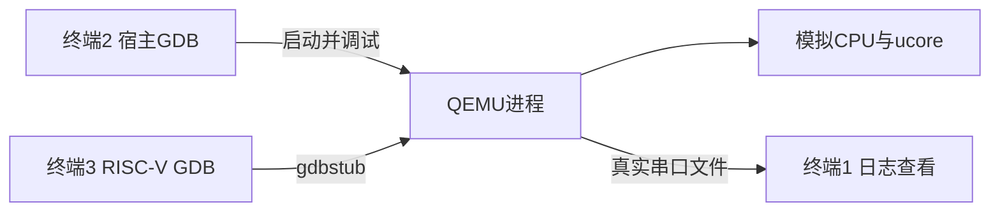

QEMU 的 `-S` 暂停模拟 CPU，`-gdb tcp:127.0.0.1:1234` 开启客体连接；QEMU 进程仍可处理调试请求。宿主断点则暂停 QEMU 本身，此时客体命令等待，需要先继续宿主。区分这两种暂停，才能理解为什么终端 3 看似“没有反应”。相关选项职责见 [QEMU 官方 gdbstub 文档](https://www.qemu.org/docs/master/system/gdb.html)。

宿主设置 `handle SIGPIPE nostop noprint pass`，实际显示 Stop=No、Print=No、Pass=Yes，保留信号传递而不因此暂停。SIGPIPE 通常与向已关闭连接写入有关；本轮未故意复现省略配置后的现象，不写成已观察到的 bug。断点按内核代码页和 `MMU_INST_FETCH` 限定，减少固件访问引起的无关停止。

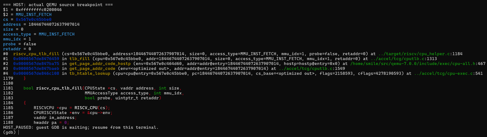

图06是本人现场在宿主端取得的原图。实际请求地址为 `0xffffffffc0200046`，访问类型为取指；调用栈和 `cpu_helper.c:1184` 清晰可见。栈中宿主指针和宿主代码地址属于 QEMU 进程，不能当作模拟机器物理地址。此处只是进入翻译慢路径，还不是完成查表。

宿主继续后，客体在当前 ELF 的 `kern_init` 第一条指令停住。使用 `hbreak *0xffffffffc02000ee` 指定实际入口，避免仅按源码行设置断点时受函数序言影响。

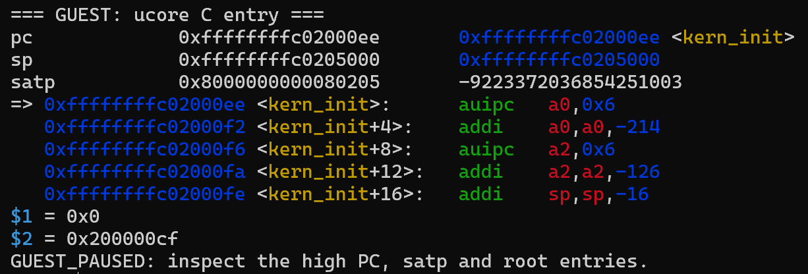

图07的 PC 为 `0xffffffffc02000ee`，SP 为 `0xffffffffc0205000`，satp 为 `0x8000000000080205`。按配置的读取顺序，`$1=0` 是 root[2]，`$2=0x200000cf` 是 root[511]，说明过渡映射已经撤销。寄存器旁的负十进制数是相同位模式的有符号显示，应按十六进制解释 satp 字段。

**观测目标与选择理由。** 本次使用 QEMU 7.0.0，宿主 GDB 调试 QEMU 实现，RISC-V GDB 控制 ucore。选择内核从低地址跳到高地址标签时发生的一次取指，实际虚拟地址为 `0xffffffffc0200046`，访问类型为 `MMU_INST_FETCH`。该位置在现有 `entry.S` 中必然执行，与上述环境验证的观测目标一致，不需要临时向正式代码插入访存或修改页表。

这个地址位于 `kern_init` 所在页，但不是 C 入口 `0xffffffffc02000ee`。按代码页设置条件，可以捕获更早的首次高地址取指，避免该页已经缓存后再期待 C 入口精确地址触发同样的翻译。它是内核指令读取，不是用户程序的数据读写。页表翻译函数还会被调试器读取客体内存时调用，因此断点额外限制 `is_debug=false`，确认捕获的确是 CPU 执行产生的访问。

**源码调用路径和入口分支。** 双 GDB 实测的外层取指路径为 `tb_htable_lookup -> get_page_addr_code -> get_page_addr_code_hostp -> tlb_fill -> riscv_cpu_tlb_fill`。本轮继续观察到 `riscv_cpu_tlb_fill` 在 `target/riscv/cpu_helper.c:1278` 通过单阶段分支调用 `get_physical_address`，宿主调用栈直接显示了这次调用。上述路径属于本次取指翻译慢路径，不能直接替代所有数据访存或 TLB 命中路径。

条件断点按当前 ELF 推导的内核代码页设置：

```gdb
break get_physical_address if (addr & ~0xfffULL) == 0xffffffffc0200000 && access_type == MMU_INST_FETCH && first_stage && !two_stage && !is_debug
```

实际参数为 `first_stage=true`、`two_stage=false`、`is_debug=false`，客体特权级为 1，即 S 态。这里的一阶段/两阶段指虚拟化翻译，与 Sv39 的三级页表不是同一个概念。本次没有进入虚拟化第二阶段，也没有走 M 态或 Bare 的直接返回分支，而是从 `env->satp` 取得普通 S 态的页表配置。

**从 satp 找到页表。** 实测 `satp=0x8000000000080205`。MODE 为 8，对应 Sv39；ASID 为 0；根表物理页号为 `0x80205`。因此根表物理地址为 `0x80205 << 12 = 0x80205000`。这里保存的是物理页号，不是高地址符号 `0xffffffffc0205000`，也不是 QEMU 宿主进程中的对象指针。

`get_physical_address` 的 821～842 行先提取 `base` 和 `vm`，再由模式选择 `levels=3`、`ptidxbits=9`、`ptesize=8`。这说明 Sv39 最多用三个 9 位索引查表，每项 8 字节。随后代码检查虚拟地址高位是否合法，避免将不符合符号扩展要求的地址直接用于遍历；本次高地址通过该检查。Sv39 的三级结构以及各级允许叶项、大页须满足对齐的体系结构依据见 [RISC-V 官方 Supervisor 规范](https://docs.riscv.org/reference/isa/priv/supervisor.html)。

**循环、索引和 PTE 读取。** 本版本的主要遍历循环位于 876 行，`i` 从 0 开始，表示从根向下的第几轮；它与一些教材从顶层编号 2 再递减的写法不同。`ptshift=(levels-1)*ptidxbits` 初值为 18；每向下一层减 9。索引提取还要加上 12 位的普通页内偏移，因此根层取的是虚拟地址的第 38～30 位。

本次真实值为：

```text
VA           = 0xffffffffc0200046
VPN[2]       = 511
VPN[1]       = 1
VPN[0]       = 0
4 KiB offset = 0x46
i            = 0
ptshift      = 18
base         = 0x80205000
```

这里“最多三级”是架构能力，不是已经执行三轮。首轮根索引为 511，代码在普通单阶段分支计算：

```text
pte_addr = base + idx * ptesize
         = 0x80205000 + 511 * 8
         = 0x80205ff8
```

912 行先检查读取该 PTE 所在物理内存的 PMP 权限，RV64 分支在 923 行调用 `address_space_ldq(cs->as, pte_addr, attrs, &res)`。此调用通过 QEMU 的地址空间访问模拟机器的物理内存；不能在宿主 GDB 中直接把客体物理地址强转成普通宿主指针。

本轮先停在读调用之前，确认地址和索引，再用一次 `next` 执行读调用，停在 926 行。实际 `res=0`，即本次内存事务成功；实际读到 `pte=0x200000cf`。这两个值分别说明“读表成功”和“读到什么”，还不能省略后续合法性和权限判断。

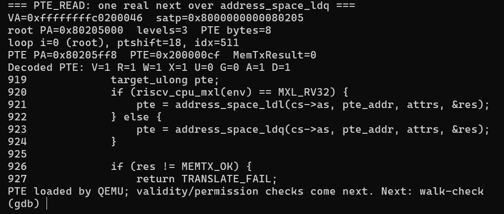

图08是本人现场执行一次 `next` 跨过读表调用后的结果。根表、索引、PTE物理地址、值和标志位都来自当前会话，`MemTxResult=0` 只证明读取成功，访问合法性仍由后面的检查确定。

**有效性、叶项、权限和对齐。** 由实际 PTE 解码，`V=1 R=1 W=1 X=1 U=0 G=0 A=1 D=1`，PPN 为 `0x80000`。源码检查与本次情况如下：

- 941 行检查 V；本次有效。之后还检查扩展和保留位，不能只看 V 就宣告合法。
- 946 行检查 R/W/X 是否全零。全零且其余约束满足时才作为下级表指针继续走；本次 R/W/X 都为 1，是叶项候选，所以不会进入 `base=ppn<<12` 的下级遍历路径。953～957 行还排除了不合法的 W 组合，本次不属于这些组合。
- 958～965 行处理 U/S 权限。本次 `U=0` 且访问来自 S 态，允许继续；S 态不能因为打开 SUM 就任意执行用户页，这也是代码将取指单独考虑的原因。
- 966 行检查大页物理页号对齐。当前 `ptshift=18`，`ppn & ((1<<18)-1)=0`，满足根级 1 GiB 叶项的对齐要求。如果 PPN 的这些低位不为零，不能简单清零后继续使用，而会失败。
- 969～978 行依访问类型检查 R、W、X。本次是取指，X 为 1，通过执行权限检查；这不能代替对其他读写访问分别判断。

叶项位于根级，因此当前覆盖 1 GiB。本次仅读取一个根表项，`i` 仍为 0，并没有读取 VPN[1]、VPN[0] 对应的下层表。低两段 VPN 将参与形成大页内部的位置。

981～985 行根据访问类型计算 `updated_pte`。本次 A 已为 1，且不是存储；D 也已预设为 1，观察到 `updated_pte=0x200000cf` 与原值相同，因此不执行随后映射 RAM、原子比较交换和重走页表的更新路径。报告可以解释这条备选路径的用途，但不能写成本轮真的发生过 A/D 缺失或原子更新冲突。

**物理地址怎样形成。** 单步通过上述检查后，代码在 1033～1035 行形成结果。当前没有走 Svnapot 扩展，`napot_bits=0`。公式可按本轮实际状态化简为：

```text
vpn = VA >> 12
PA  = ((ppn | (vpn & ((1 << ptshift) - 1))) << 12)
      | (VA & 0xfff)
```

大页对齐保证 PPN 的相应低位为零，合并虚拟地址提供的低页号不会覆盖已有物理页号。代入本次观察值，也可以用更直观的大页基址与偏移表示：

```text
1 GiB page base = 0x80000 << 12 = 0x80000000
1 GiB offset    = VA & 0x3fffffff = 0x200046
PA              = 0x80000000 + 0x200046 = 0x80200046
```

`0x46` 只是最低 12 位偏移；若错误地把它直接加到大页物理基址，会漏掉低两段 VPN 对应的位置。代码正是用 `ptshift=18` 把这些位合入结果。

本轮在赋值语句前后各停一次，实际读取 QEMU 写出的 `*physical=0x80200046`，再使用观察到的 PPN 和 VA 独立计算，结果相同。按本实验固定映射偏移核对，`VA - 0xffffffff40000000` 也得到这个地址；固定偏移是对本启动映射的额外核对，不是 QEMU 任意页表都可使用的通用算法。

随后源码根据页表权限形成输出保护位。本次返回调用者后观察 `ret=0`、`pa=0x80200046`、`prot=7`，即翻译成功并带有本轮对应的读写执行保护位。调用者之后还要执行最终物理地址的 PMP 检查，成功才进入 `tlb_set_page`；PTE 本身所在地址的 PMP 检查和最终目标地址的 PMP 检查是两个位置。TLB 查询与填充的详细观察由队友负责，本段只交代与本人页表翻译的接口。

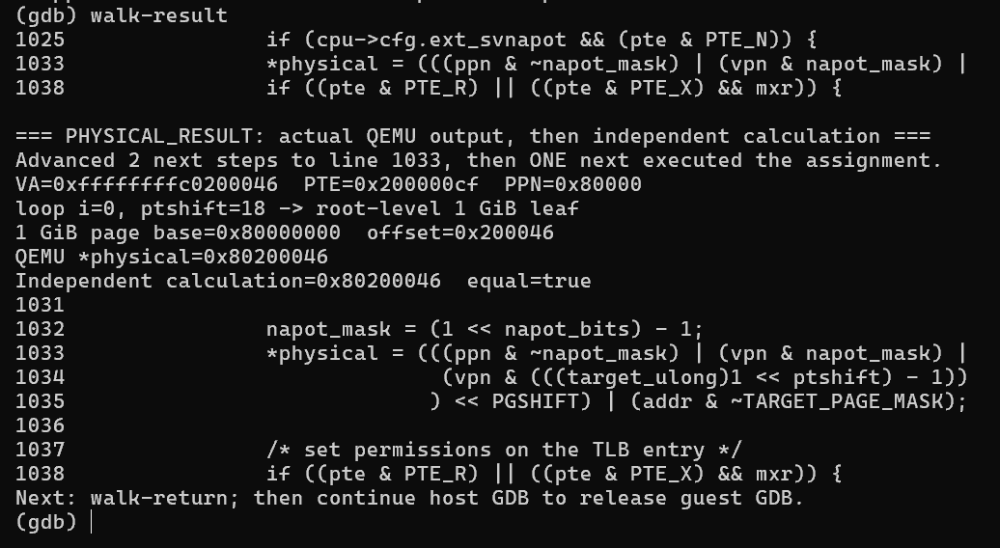

图09是本人现场物理地址赋值后的原图，实际输出和独立计算均为 `0x80200046`，并保留完整拼接语句。随后 `walk-return` 真实返回 `riscv_cpu_tlb_fill`，得到 `ret=0`、`pa=0x80200046`、`prot=7`，返回数据另有JSON记录。

**实际调试细节与 AI 帮助。** `walk_commands.py` 提供分段命令，内部执行真正的 `next`，每次记录源文件、行号和宿主 PC，随后读取变量。原始逐步观察及交付原样配置都实际运行了 52 次 `next`，没有为截屏修改 PC、`satp`、PTE 或指令。自定义命令是缩短重复操作的工具，报告仍需解释每段对应的源码行为，不能把看到一行“equal=true”当作理解完成。

实际单步中遇到的理解难点是现有 QEMU 的 `-g -O2` 优化：部分局部值只在一定范围可读，`next` 也会显示内联函数所在的头文件；返回时甚至显示到共享 `return TRANSLATE_SUCCESS` 的 793 行。不能据此倒推本次走了那里前面的 M 态分支。结合已记录的 `satp`、实际 PTE 读取、i/ptshift 和物理地址，才能确认本次真实走了 Sv39 根级叶项路径。AI 协助定位源码、整理停点和交叉核对值，本轮没有据此重编译 QEMU，也没有虚构新的内核 bug。

另一个容易误判的点是 `env->pc`：源码入口注释明确提醒它在此处不保证是当前异常处理时所用的准确 PC。本次使用实际 `addr` 与访问类型识别正在翻译的请求，并用已知启动代码位置解释目标，避免把宿主 GDB 的 PC、QEMU 保存的客体状态和正在翻译的地址混为一谈。

**最终提示词：** [HYC-P6：双 GDB 环境](prompt.md#hyc-p6)、[HYC-P7：页表单步](prompt.md#hyc-p7)。SPEC 限定真实 CPU 访存而非 debug 读，分开记录读表前后、权限判断、物理地址赋值及正常返回；变量不可读时停止核对，不代入预期数值。

**实际环境与操作问题。** 自动双 GDB、原样交互配置和本人现场源码返回均有实际证据。辅助脚本最初的 MI 中断处理需开启异步模式，另一处关闭启动 shell 却保留字面引号使 QEMU 将 `"-machine"` 当作文件名；只修正附加材料脚本，重跑通过。现场多行粘贴也曾让 GDB 把 `continue` 当作 `disable` 的参数，逐条输入后正常恢复。以上是调试控制问题，不冒充内核算法错误。

#### 4.8.2 TLB 查询、未命中、填充与命中

**负责人：2410933 马禹翔**

##### TLB 为什么有效

没有 TLB 时，每次访存除访问最终数据外，还可能需要逐级读取页表。TLB 缓存近期虚拟页到物理页及权限的翻译，命中后避免重复页表遍历。程序通常具有时间局部性（短时间重复访问相同代码或数据）和空间局部性（相邻地址往往落在同一页或附近页），所以少量翻译项即可覆盖大量访存。

TLB 不是普通数据缓存：它保存地址翻译和权限。修改页表后需要用 `sfence.vma` 建立页表更新与后续翻译之间的正确关系；这不等价于刷新普通数据缓存或指令缓存。

##### QEMU 4.1.1 中的查询、未命中与填充

本机源码位于 `/home/s1nk/qemu-4.1.1`，带调试信息的程序是 `riscv64-softmmu/qemu-system-riscv64`。它与手册版本一致。关键路径如下：

```text
取指或数据访问
  -> 计算 mmu_idx 和 tlb_index
  -> tlb_entry 取得直接映射项
  -> tlb_hit 比较虚拟页号
       命中：使用 entry->addend 形成宿主地址，直接继续访问
       未命中：检查 victim_tlb_hit
           victim 命中：交换回主 TLB
           仍未命中：tlb_fill
               -> riscv_cpu_tlb_fill
               -> get_physical_address 遍历 RISC-V 页表
               -> PMP/权限检查
               -> tlb_set_page
               -> tlb_set_page_with_attrs 写入主 TLB
```

对应源码位置：

- `include/exec/cpu-all.h:348-361`：`tlb_hit_page()` 和 `tlb_hit()`，比较页对齐后的虚拟地址与条目地址。
- `include/exec/cpu_ldst.h:163-181`：`tlb_index()` 与 `tlb_entry()`，根据虚拟页和 MMU 索引选择直接映射槽位。
- `accel/tcg/cputlb.c:1023-1037`：取指路径 `get_page_addr_code()`；主 TLB 不命中时先查 victim TLB，再调用 `tlb_fill()`。
- `accel/tcg/cputlb.c:1252-1280`：数据读取慢路径使用同样的主表、victim 表和 fill 次序。
- `target/riscv/cpu_helper.c:435-474`：`riscv_cpu_tlb_fill()` 调用 `get_physical_address()`，翻译和 PMP 检查成功后调用 `tlb_set_page()`。
- `accel/tcg/cputlb.c:697-838`：`tlb_set_page_with_attrs()` 计算索引，必要时把旧项放入 victim TLB，并写入 `addr_read/addr_code/addr_write`、`addend` 和 IOTLB 数据。

QEMU 的软件 TLB 是模拟器为了加速客体访存而维护的数据结构，不等于真实处理器厂商的硬件阵列实现。但它模拟了软件可见的关键逻辑：按地址空间和虚拟页查翻译、区分权限、未命中时查页表、页表或模式变化后失效。

##### 调试策略与证据边界

只在 `riscv_cpu_tlb_fill()` 断点能证明发生了未命中慢路径，但不能单独证明命中；命中恰恰会绕过该函数。因此现场应取得两类证据：

1. **未命中与填充**：在 `riscv_cpu_tlb_fill`、`tlb_set_page_with_attrs` 设置断点，记录同一虚拟页的 `address/vaddr/paddr/prot/mmu_idx`，证明查页表后写入条目。
2. **随后命中**：在 `get_page_addr_code` 的 `tlb_hit` 判断附近停住，记录 `addr`、`entry->addr_code` 和 `tlb_hit(...)` 返回真，并确认这次没有再次进入 `riscv_cpu_tlb_fill`。

为了避免固件阶段大量无关事件，实际会话先由客体 GDB 启动模拟 CPU，再由宿主 GDB 对 `0xffffffffc0200000` 内核代码页设置条件断点。宿主 GDB 调试的是 x86-64 QEMU 进程，客体 `gdb-multiarch` 调试的是 RISC-V ucore；宿主暂停时客体会等待，不能把等待误判成死机。实际截图表明第一次访问时 `entry->addr_code=0xffffffffffffffff`，随后进入 `riscv_cpu_tlb_fill()` 和 `tlb_set_page_with_attrs()`；填充后再次访问同一页时，`entry->addr_code=0xffffffffc0200000`，与 `addr=0xffffffffc0200046` 的页基址相同。GDB 无法直接调用被优化内联的 `tlb_hit()`，因此结合源码定义和页基址相等关系判断命中，而不把 `No symbol "tlb_hit"` 误认为 QEMU 运行失败。

#### 4.8.3 Bare/Sv39 与软件、硬件 TLB 对比

**负责人：2410936 林子媛**

##### 调试目标与关键模块

本人重点对应手册调试要求 4：比较分页前后的实际路径，解释软件 TLB 与真实 CPU TLB 的逻辑差异。

客体侧用 `hbreak`、`info registers`、`x/i $pc`、`stepi` 确认真实 RISC-V 指令；宿主侧直接启动带符号 QEMU，在已知必经地址设置条件断点。两次观察使用配对的默认内核 ELF/镜像，但客体侧为 QEMU 11.1.1，源码侧为 4.1.1。

```text
客体访存产生地址
  -> QEMU TCG 访存快路径进行软件 TLB 检查
  -> miss 进入相应 helper / tlb_fill
  -> riscv_cpu_tlb_fill
  -> get_physical_address
       Bare：不遍历页表，返回同值物理地址
       Sv39：从 satp 定位根表，读 PTE，校验叶项与权限，形成物理页基址
  -> PMP 等检查
  -> tlb_set_page / tlb_set_page_with_attrs
  -> 继续客体内存访问
```

这不表示每次访存都调用翻译函数：命中可以走快路径。本人 07–10 展示翻译和填充，组员负责的首次 miss、随后 hit 证据不混作本人的独立测量。

| 函数                          | 本人理解                                        |
| --------------------------- | ------------------------------------------- |
| `riscv_cpu_tlb_fill()`      | 调用翻译，结合访问类型、权限处理成功或异常，并建立软件映射               |
| `get_physical_address()`    | 按特权级与分页模式决定是否查表；Sv39 下读取解释 PTE，不是对所有地址减固定偏移 |
| `ldq_phys()`                | 从模拟机物理地址空间读 64 位 PTE，读表地址不同于待翻译虚拟地址         |
| `tlb_set_page_with_attrs()` | 把映射、属性和供宿主访问 RAM 的加数写入软缓存                   |

对应 [QEMU 4.1.1 cpu_helper.c](https://github.com/qemu/qemu/blob/v4.1.1/target/riscv/cpu_helper.c) 与 [cputlb.c](https://github.com/qemu/qemu/blob/v4.1.1/accel/tcg/cputlb.c)，实际停点见 5.5。

##### Bare/Sv39 与真实硬件的比较

两次宿主观察都在 S-mode。Bare 访问 `0x80207000` 时 `satp=0`，直接同值返回，不读页表；Sv39 访问 `0xffffffffc0207018` 时 MODE=8，读取根项并解释叶映射。两者成功后都进入软件 TLB 填充。

| 对比项  | 真实 RISC-V 架构层面             | 本次 QEMU 软件实现                                |
| ---- | -------------------------- | ------------------------------------------- |
| 缓存目的 | 缓存翻译及权限，减少重复查表             | 除减少翻译，还服务于快速访问宿主内存                          |
| Bare | 不执行 S/U 页表翻译，但不等于绕过全部物理保护  | 不遍历页表，仍可能缓存物理内存访问结果                         |
| 缓存内容 | 页映射、权限与地址空间标识；微结构由具体实现决定   | 可见 `addr_read`、`addr_write`、`addend` 等 C 字段 |
| 地址终点 | 架构物理地址                     | 客体物理地址还需定位到宿主 RAM 或设备区域                     |
| 大页   | 架构允许不同大小叶映射，具体 TLB 组织未在此测量 | 此版本此路径按 4096 字节填充条目，即使叶项是 1 GiB             |

最直接的证据是图 08 与 10：高低两种客体页地址对应同一物理页，`addend` 不同，`VA page + addend` 却得到同一宿主 RAM 页指针。这是模拟器的宿主定位过程，不能把这些 C 字段直接当作真实硬件 TLB 字段。

##### 调试中的真实问题与收获

1. **宿主与客体架构不同。** ARM 主机上的 x86 Linux 容器曾使宿主 GDB 报 `Couldn't get registers: Input/output error`。改用原生 Linux ARM64 容器，先验证 GDB 能调试自己启动的进程，再调试 QEMU。RISC-V 是被模拟架构，宿主调试器应匹配真正运行 QEMU 的环境。
2. **固件默认行为随版本不同。** QEMU 4.1.1 首次提示未指定 `-bios`、没有加载固件；显式增加 `-bios default` 后进入目标路径，不能套用另一版本默认行为。
3. **断点未命中不等于指令没执行。** 原计划观察读取 `boot_hartid`，但 `kern_init()` 先 `memset(edata, ...)`，已访问并缓存同一页。最终改为首次 BSS 写入 `0xffffffffc0207018`，稳定进入慢路径。这让我理解“访存执行过”与“翻译函数被调用”不是一回事。
4. **三级模式不等于读三张表。** 根项已是大页叶项，`levels=3、i=0、ptshift=18` 表示从最高级开始检查，不是走完三次循环。
5. **调试读不同于客体 load。** `x/gx` 是辅助检查，不能冒充客体 CPU 普通访存。本次证据结合真实 `sd/ld` 单步与宿主条件断点。

**学习与调试提示词：** [LZY-P5](prompt.md#lzy-p5)。要求区分版本、客体与宿主架构、实际访存与调试读、三级能力与实际叶项深度。

## 五、测试与验证

### 5.1 整体编译运行、评分与配置

**负责人：2410673 韩羽宸**

正式实现位于 `code/`，实际测试副本位于本地附加材料，避免把构建目录、注入调用或临时程序加入提交代码。完整内核验证脚本复制当前源码，使用原有 `tools/inject.py` 只在副本注入任务检查，按 `make -j2 DEFS=-Ducore_test` 构建。`ucore_test` 显示原有分配检查的六个进度点。

本机已执行的入口是：

```bash
cd '/mnt/e/Grade3_1/操作系统/os_lab/lab2/附加材料/阶段3_BestFit'
python3 run_kernel.py
python3 verify_grade.py
```

现场展示在 `kernel_tree` 中使用以下真实命令；它与构建脚本采用相同镜像及加载参数：

```bash
qemu-system-riscv64 -machine virt -nographic -bios default \
  -kernel bin/ucore.img \
  -device loader,file=bin/ucore.img,addr=0x80200000
```

若只下载仓库，辅助脚本不在提交范围，可把 `code/` 复制到本地独立工作目录后，用工程自带 `tools/inject.py` 在该副本注入、执行上述 make 构建并运行。正式源码不应直接注入。该阶段曾通过 `QEMU="qemu-system-riscv64 -kernel bin/ucore.img"` 覆盖适配；当前仓库已把 `-kernel` 纳入默认命令，通常直接 `make qemu` 即可。

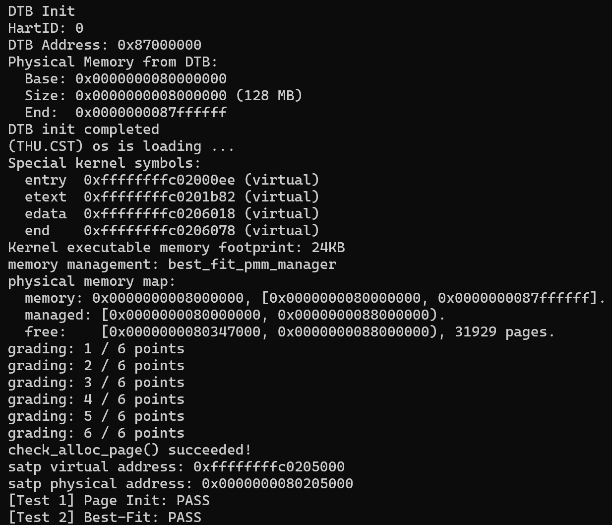

图01从 DTB 信息开始保留完整关键输出：RAM 起点 `0x80000000`，大小 `0x08000000`（128 MiB），闭区间末端 `0x87ffffff`；对应半开管理区间 `[0x80000000,0x88000000)`。管理器名称为 `best_fit_pmm_manager`，空闲区 `[0x80347000,0x88000000)`，共 31929 页。原有检查达到 6/6，`check_alloc_page()` 成功，最后两项任务分别 PASS。

符号输出中 `entry` 实际由 `print_kerninfo()` 打印 `kern_init` 的地址，不等于汇编 `kern_entry`；`etext`、`edata`、`end` 分别对应相关段边界。此次输出内核占用约 24 KiB，是由实际符号算出的展示值，空闲区还需扣除固件保留和描述符数组，不能直接用“128 MiB 减 24 KiB”得到空闲量。根表虚拟、物理地址分别为 `0xffffffffc0205000`、`0x80205000`，符合固定映射偏移。

启动前的 OpenSBI 原始输出记录平台 `riscv-virtio,qemu`、一个 HART、当前 hartid=0、固件基址 `0x80000000`、大小 252 KB、Runtime SBI Version 0.3，下一跳为 `0x80200000`、S-mode。ISA/PMP 信息描述模拟 CPU 能力与物理访问权限，不是分配器给出的空闲区。固件报告的实际镜像大小与手册约定为 OpenSBI 保留的 2 MiB 不同，本实现仍按实验布局排除完整保留区。见 `kernel_boot.log`（本地记录）。

内核完成初始化后进入既有无限循环，终端停留在结果是预期行为。自动脚本观察到完整检查后结束五秒等待，不把 QEMU 未自行退出判作初始化失败。

评分脚本在另一副本运行原始 `make grade`，同时把 `GRADE_TMP` 指向附加材料工作区，并覆盖本机需要的 QEMU 参数。没有修改测试断言或评分条件。

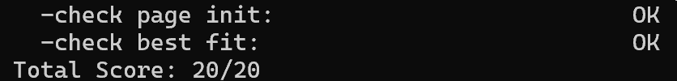

图04显示 `check page init: OK`、`check best fit: OK`，总分 20/20。它只覆盖原有评分中的这两项，不能证明 Buddy、SLUB、理论题或全部调试要求完成。原日志保留了 Windows/WSL 文件时间的亚秒级偏差警告及编译、运行输出，没有隐藏警告或改系统时钟，见 `official_grade.log`（本地记录）。

韩羽宸已在其实施阶段核对源文件标记、原有检查不变和已测源码。全组的 Buddy、SLUB 与调试证据现分别合入下文；本次文档整理未重新构建或评分，也未执行 Git 提交、推送。

**当前仓库的最小复现入口。** 以下是依据现有 Makefile 整理的命令，不替代上述既有实测记录。先进入仓库的 `code` 目录；切换配置均使用干净构建。

```sh
# 默认 Best Fit + SLUB 初始化
make clean
make
make qemu

# 运行原有 Page Init / Best Fit 评分，预期 20/20
make grade

# 独立 Buddy 页级检查，不启用 SLUB
make clean
make BUDDY=1
make BUDDY=1 qemu

# 恢复默认页分配器，启用已提交的 SLUB 内核测试
make clean
make BUDDY=0 DEFS=-DSLUB_TEST
make BUDDY=0 DEFS=-DSLUB_TEST qemu
```

本机工具前缀不是 `riscv64-unknown-elf-` 时，应在每次 make 调用加实际 `GCCPREFIX`；例如林子媛的 macOS 环境使用 `GCCPREFIX=riscv64-elf-`。`BUDDY=1` 与 `SLUB_TEST` 不可组合，当前 `init.c` 会在编译期拒绝。常规启动在初始化后进入无限循环，成功要看检查结果而非是否自动退出。

### 5.2 物理初始化与 Best Fit 验证

**负责人：2410673 韩羽宸**

**验证来源。** 原有 `test_page_init()`、`test_best_fit()`、`basic_check()`、`best_fit_check()` 和评分来自工程。下面的 13 个初始化场景、10 组 Best Fit 行为及模型验证是依据手册规格补充设计的测试，不是手册列出的额外作业题。

**初始化边界。** 隔离 RV64 测试内核直接包含正式 `pmm.c`，使用真实结构和宏；默认场景读取真实 DTB，其余场景由测试驱动替换两个 getter 的返回值，不改正式 DTB 模块。13 个场景全部通过：

- 默认真实 DTB 的 128 MiB：调用原有任务一检查，核对页面布局和保留边界。
- 64 MiB、64 MiB 加 123 字节、报告 256 MiB：分别检查较小容量、末尾不足一页和框架上限裁剪。
- 描述符后恰好零页或一页：零页不调用 `init_memmap()`；一页只登记一页，并可分配、耗尽和恢复。
- 起点为零、起点不匹配、零长度、范围相加溢出：必须在放出空闲页前终止。
- RAM 不能覆盖内核、放不下描述符数组、小于一页：检查空间不足与数量下溢防护。

异常场景的 PASS 表示捕获预期 panic，不能说无效输入也完成正常初始化。成功场景逐页检查初始保留标志、引用计数、property 和节点自环，登记后检查保留/空闲边界，再分配全空闲区、确认耗尽、释放并检查恢复。测试镜像故意令 end 不按页对齐，能够检验对齐处理；其空闲起点 `0x80348000` 比图01高一页，源于测试镜像大小，不是正式算法前后矛盾。

**Best Fit 行为。** 在 96 个真实 `Page` 描述符的隔离池中，直接包含实际分配器源码，执行 10 组：空状态、乱序登记及相邻合并、最小合适选择与尾块拆分、后方精确匹配、同尺寸低地址、碎片/总量不足保持状态、左/右/双侧合并、耗尽与恢复、未修改的原有检查，以及独立模型操作。

独立模型只记录每页保留/空闲/已分配，自行从连续空闲段推导预期选择，不读取被测链表和 property 作为答案。3000 次确定性申请/释放逐次比较返回位置、计数、保留边界、块头、双向链表与区间不重叠；最后归还全部存活块，共完成 3060 次状态核对。这样比“程序没有崩溃”更能发现错误选块、漏合并或计数问题，但有限序列仍不是对所有输入的形式化证明。

结果摘要见 `page_init_cases.json`（本地记录） 和 `best_fit_boundary.log`（本地记录）。两张补充截图在下方展示，分别对应初始化边界和 Best Fit 行为/独立模型验证。

**补充测试截图。**

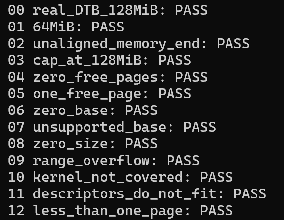

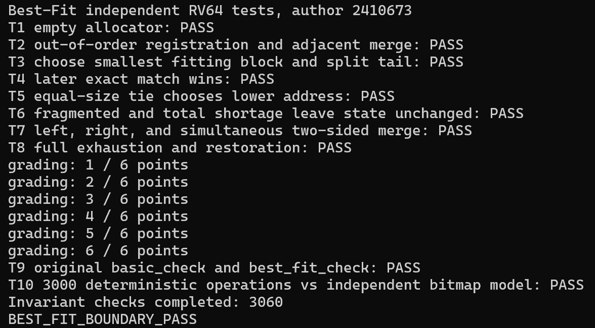

**测试 prompt：** [HYC-P4](prompt.md#hyc-p4)。关键约束是保留原有测试，用独立模型核对返回地址、计数和不重叠；独立驱动通过与完整内核、评分通过分别判断。

### 5.3 Buddy System 验证

**负责人：2410933 马禹翔**

#### 5.3.1 配置和入口

普通 `make` 保持 `best_fit_pmm_manager`。Buddy 使用独立配置：

```bash
cd /home/s1nk/OperatingSystems/lab2/lab2_new
make clean
make BUDDY=1
timeout 10s make BUDDY=1 qemu
```

2026 年 10 月 23 日实际构建成功，并在 128 MiB QEMU 内存中输出：

```text
memory management: buddy_pmm_manager
free:    [0x0000000080347000, 0x0000000088000000), 31929 pages.
[Buddy] oversized allocation: PASS
[Buddy] order split and buddy merge: PASS
[Buddy] rounding, non-overlap and exhaustion: PASS
[Buddy] adjacent non-buddies and recursive merge: PASS
[Buddy] unaligned 13-page range and state restore: PASS
[Buddy] all boundary tests: PASS
check_alloc_page() succeeded!
```

最后出现的 `terminating on signal 15 ... (timeout)` 是测试命令在 10 秒后结束内核的既有无限循环，不是 panic。成功条件是上述 PASS 和 `check_alloc_page() succeeded!` 均已出现，且之前没有 assertion failure。

各输出对应的错误发现能力：

| 测试组                             | 覆盖行为               | 可发现的问题             |
| ------------------------------- | ------------------ | ------------------ |
| oversized allocation            | 请求超过空闲量            | 失败路径错误修改状态或越界寻找    |
| order split and buddy merge     | 单页拆分、两页精确复用        | 拆分阶数、XOR 伙伴或块头错误   |
| rounding/non-overlap/exhaustion | 3→4、5→8、两块不重叠、耗尽   | 非 2 次幂计数、重叠分配和错误成功 |
| adjacent non-buddies            | 相邻但不互为伙伴           | 仅凭地址相邻就错误合并        |
| unaligned 13-page range         | 偏移起点、非 2 次幂长度、保留边界 | 初始区越界、错误对齐、重复分配    |
| state restore                   | 隔离前后总计数相同          | 测试污染真实分配器状态        |

完成上述验证后再次运行默认 `make grade`，原有 Page Init 和 Best Fit 均为 OK，总分仍为 `20/20`，说明测试入口没有改变默认提交行为。

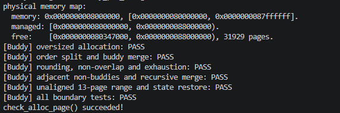

图 1 保留实际物理内存范围、31929 个空闲页、六组 Buddy 边界结果和最终成功行。管理器身份由同一次启动中此前输出的 `memory management: buddy_pmm_manager` 核对。

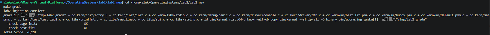

图 2 是恢复默认配置后的原始评分结果。它用于证明新增 Buddy 测试入口没有破坏默认实现，不把这 20 分解释成评分程序已经覆盖 Buddy。

### 5.4 SLUB 验证

**负责人：2410936 林子媛**

#### 5.4.1 第一步：确认启动与接入位置

默认内核先完成 `pmm_init()` 和原有页分配检查，再调用 `slub_init()`。

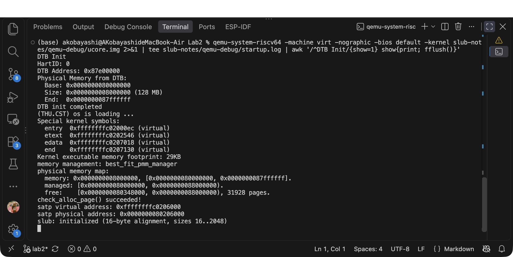

图 01 显示 128 MiB RAM、`best_fit_pmm_manager`，先输出 `check_alloc_page() succeeded!`，最后输出 `slub: initialized`，证明依赖顺序正确、对象层就绪，而不是只凭 OpenSBI 标志判断成功。

#### 5.4.2 第二步：执行原有与新增正向测试

内核侧测试保留在 `code/kern/mm/slub_test.c`。以下独立测试脚本仅作为本地验证辅助文件，不纳入本次提交；命令记录本人实际执行方式，验证方法和结果保留在正文与截图中。

```sh
cd /Users/akobayashi/OSLab/Lab2
python3 tests/slub/run_tests.py
```

运行器为各用例复制干净源码，排除旧 `obj/bin`，显式设置 `BUDDY=0`、`SLUB_TEST` 和用例编号，以链接器 `--wrap=slub_check` 接入独立驱动。正向驱动先调用原有 `slub_check()` 再执行补充检查，没有替换算法或修改评分测试。

原有冒烟由本人实现；分类边界、多 slab、真实 OOM 集成测试由韩羽宸补充。本轮本人复用这些检查，新增分类容量、大对象含头边界、混合释放顺序和独立非法释放测试。

| 操作              | 预期                   | 实际及有效性                                       |
| --------------- | -------------------- | -------------------------------------------- |
| 最小 1 字节、分类边界及两侧 | 最小合适类别，16 字节对齐，不跨有效槽 | PASS；补充 24 个小对象请求点，填满分类 slab 后验证扩页           |
| 600 个 16 字节对象   | 跨多 slab，部分释放后复用，不多占页 | PASS；验证 full/partial 切换与最终整页回收               |
| 48 个混合对象、三种释放顺序 | 不重叠、不串改，数量逐次减少       | PASS；正序、逆序、`step * 17 % 48` 置换释放均通过          |
| 大对象及含头临界点两侧     | 连续页数含头，完整归还          | PASS；观察到 64 字节填充，检查 `4096-64`、`8192-64` 附近请求 |
| 释放后同类申请         | 复用槽位，其他对象不变          | PASS；冒烟直接验证释放槽再次返回                           |
| 真实耗尽底层页         | 需新页时 NULL，已有同类空闲槽仍可用 | PASS；持有底层页直至空闲数为零，核对存活数据与统计                  |
| 0、NULL、超大、溢出输入  | 符合约定且不破坏状态           | PASS；保留小/大对象并检查数据、页数不变                       |
| 全部释放            | 对象/页统计归零，恢复本轮基线      | PASS；不硬编码其他镜像的绝对初始页数                         |

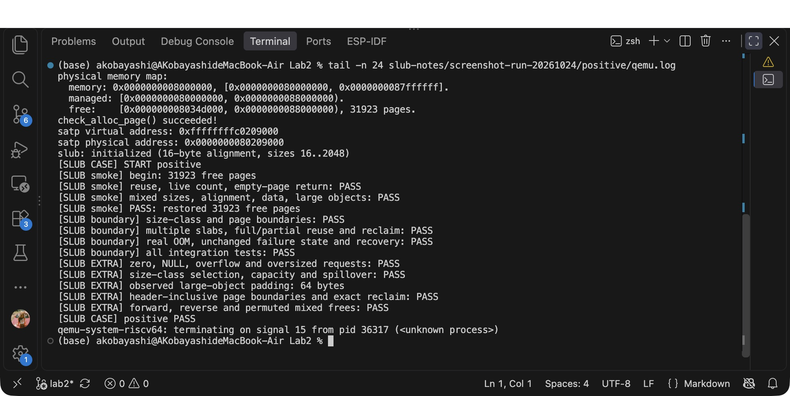

图 02 展示原有 `[SLUB smoke]`、`[SLUB boundary]` 和新增 `[SLUB EXTRA]` 均通过。本轮正向镜像起始可用页为 31923，冒烟结束恢复到 31923，后续检查也按自身基线恢复。

容量测试根据本实现新 slab 先返回首槽的约定观察偏移，验证当前布局，不要求所有 `kmalloc()` 保持相同返回顺序。

#### 5.4.3 第三步：独立验证非法释放

每个危险调用前输出 `ARMED`。只有其后来自 `kern/mm/slub.c`、内容符合预期的真实 panic 才判通过；正常返回、其他断言/崩溃、提前退出、超时均不能算成功。

| 用例                    | 操作                        | 预期保护信息                                      | 实际   |
| --------------------- | ------------------------- | ------------------------------------------- | ---- |
| `small_unaligned`     | 对象地址加 1                   | `invalid free pointer`                      | PASS |
| `small_interior`      | 32 字节槽内地址加 16             | `pointer is not an object start`            | PASS |
| `foreign_pointer`     | 释放直接向 PMM 申请、未登记给 SLUB 的页 | `pointer is not owned by a live allocation` | PASS |
| `slab_header`         | 释放 slab 管理头               | `pointer is not an object start`            | PASS |
| `small_double_live`   | 同页另一对象仍存活时重复释放            | `double free of a slab object`              | PASS |
| `small_after_reclaim` | slab 整页回收后再次释放旧地址         | `pointer is not owned by a live allocation` | PASS |
| `large_interior`      | 大对象地址加 16                 | `pointer is not a large-object start`       | PASS |
| `large_interior_page` | 多页大对象地址加一页                | `pointer is not a large-object start`       | PASS |
| `large_double`        | 大对象释放后再次释放                | `pointer is not owned by a live allocation` | PASS |

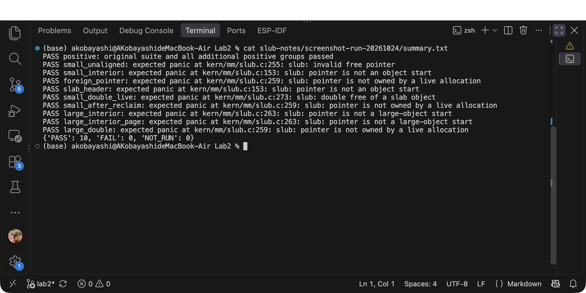

图 03 为 **10 PASS、0 FAIL、0 NOT_RUN**，含 1 个完整正向用例与 9 个负向用例，不是只测十种对象大小。判定器另有 7 项宿主单元测试，防止仅打印预期文字或出现其他 panic 就误判。

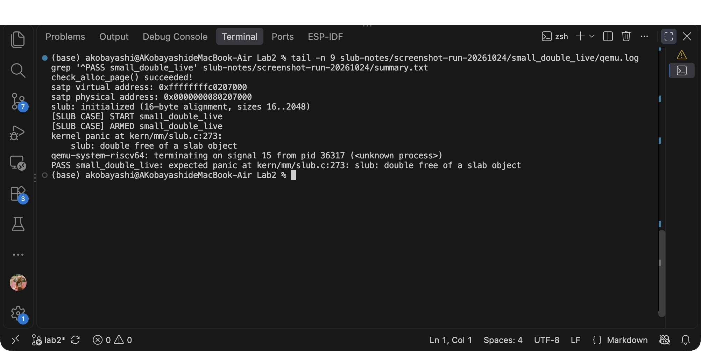

图 04 中先出现 `ARMED small_double_live`，之后实际在 `slub.c:273` 输出 `slub: double free of a slab object`。保留同页另一对象，是为了验证 bitmap 分支，而不是整页先回收后只命中“未登记”分支。

panic 是本用例要求的终止行为，不代表内核能恢复继续执行。末尾 SIGTERM 是运行器识别结果后清理 QEMU，不是通过依据。地址若已被新对象复用，裸指针无法可靠区分新对象与旧悬空引用，本次没有作超范围承诺。

### 5.5 页表、TLB 与模式对比调试证据

#### 5.5.1 页表翻译的复现与证据边界

**负责人：2410673 韩羽宸**

韩羽宸的图 05～09 已分别放在启动分析、双 GDB 环境和具体读表/地址形成处，本节不重复插图。马禹翔的 TLB 和林子媛的 Bare/Sv39 现场分别见 5.5.2、5.5.3；它们补齐不同观察目标，不能用单条 Sv39 轨迹代替。

本地已验证流程为：终端1准备串口文件并跟踪，终端2启动宿主，终端3连接客体；宿主按页和访问类型停在 `get_physical_address`，再逐条执行 `walk-to-load`、`walk-read`、`walk-check`、`walk-result`、`walk-return`、`continue`。这些命令内部执行真正的 next，原始与交互配置各记录52次。单步前后变量与物理地址不是预置打印值。

脱离辅助命令也可以用标准 GDB复现同样核心过程：宿主加载对应 QEMU，设置带 `-S -gdb tcp:127.0.0.1:1234` 的加载参数和4.8所列条件断点后 run；客体加载当前 ELF、`target remote 127.0.0.1:1234`、按实际入口 hbreak 后 continue。宿主逐次 next 到当前源码923行，读取 base/idx/pte_addr；再 next 读取 pte/res；继续经过检查，在1033行前后读取 `*physical`，最后返回调用者。关键源码行只对应本次构建，换版本必须重新定位，不保证 next 次数固定。

手动查看本轮核心值时，在对应仍可读的停点使用 `p/x addr`、`p/x env->satp`、`p/x base`、`p idx`、`p/x pte_addr`、`p/x pte`、`p/x ppn`。`physical` 是宿主输出指针，`*physical` 才是本次客体物理地址数值。调试器中临时保存输出指针只改变 GDB 自身便利变量，不修改客体寄存器或页表。

两个 GDB 联动的源码断点和 C 入口见 `host_dual_gdb.log`（本地记录）、`guest_C_entry.log`（本地记录）。页表现场单步见 `page_walk_user.log`（本地记录）、`page_walk_user.json`（本地记录），独立核对见 `page_walk_summary.json`（本地记录）。自动原样交互验证见 `page_walk_config_verification.json`（本地记录）。本地证据清单记录来源与哈希，原始文件不随仓库上传。

证据范围也需要诚实说明：本人现场完成了页表返回并确认结束会话；本轮现场客体日志没有保留恢复后再次到 C 入口的完整输出，且末尾有命令时机和输入流提示。因此“宿主继续后客体正常到 C”采用已通过的原样配置自动验证，并另有图07的现场入口证据，不补写本轮未保留的画面，也不把结束阶段的提示当作新的内核算法错误。

正常顺序是客体到断点后逐条 detach、quit，再在宿主 Ctrl+C 返回提示符后逐条 kill、quit，最后退出 tail。宿主停住期间不要催客体继续或多行粘贴；暂停层次和命令提示符应先确认。中断到宿主 `__ppoll` 时缺少 glibc 源码不等于 QEMU 源码匹配失败。

#### 5.5.2 TLB 未命中、填充与随后命中

**负责人：2410933 马禹翔**

本人负责 TLB 查询、未命中和填充，不重复其他成员的完整页表遍历或 Bare/Sv39 对比。本次在带调试信息的 QEMU 4.1.1 中对内核高地址代码页设置条件断点，取得了以下实际证据。

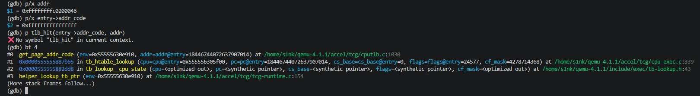

图 3 停在 `cputlb.c:1030` 的 `get_page_addr_code()`：请求地址为 `0xffffffffc0200046`，当前 `entry->addr_code=0xffffffffffffffff`，不是目标页基址，因此主 TLB 未命中。`tlb_hit()` 是头文件中的 `static inline` 函数，优化构建中没有独立 GDB 符号；红色提示只表示无法从 GDB 直接调用该内联函数，不改变两个实际数值所表示的未命中状态。

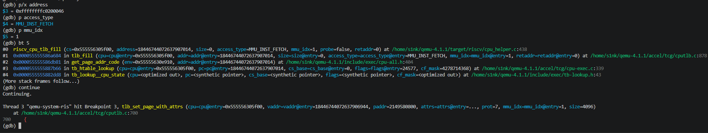

图 4 记录随后进入 `riscv_cpu_tlb_fill()`：`address=0xffffffffc0200046`、`access_type=MMU_INST_FETCH`、`mmu_idx=1`。调用栈从 `get_page_addr_code()` 经 `tlb_fill()` 到 RISC-V 架构相关填充函数，之后命中 `tlb_set_page_with_attrs()`，证明本次确实走了未命中慢路径，而不是只阅读到源码分支。

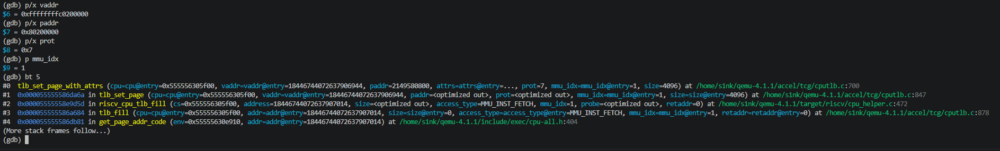

图 5 在 `tlb_set_page_with_attrs()` 中记录 `vaddr=0xffffffffc0200000`、`paddr=0x80200000`、`prot=7`、`mmu_idx=1`。虚拟地址和物理地址均按 4 KiB 页基址传入，权限值 7 对应本次可读、可写、可执行的启动映射；调用栈能够回溯到 `riscv_cpu_tlb_fill()`。

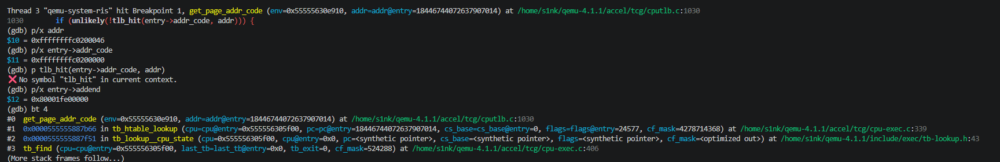

图 6 再次停在同一查询位置：`addr=0xffffffffc0200046`，而 `entry->addr_code=0xffffffffc0200000`。将请求地址按 4 KiB 向下对齐也得到 `0xffffffffc0200000`，两者页基址一致，因此按照 `tlb_hit_page()` 的源码定义判断为命中；此时还可看到已建立的 `entry->addend`。这与图 3 的无效条目形成前后状态对照，完成“未命中—页表翻译—填充—随后命中”的证据链。

#### 5.5.3 Bare/Sv39 的六步对比

**负责人：2410936 林子媛**

##### 5.5.3.1 第一步：客体分页前的真实 store

QEMU 用 `-S -gdb tcp:127.0.0.1:1235` 启动，RISC-V GDB 加载配对内核 ELF，而不是没有源码符号的裸镜像。本次在 `0x80200014` 设断点并单步执行 `sd a1,0(t0)`。

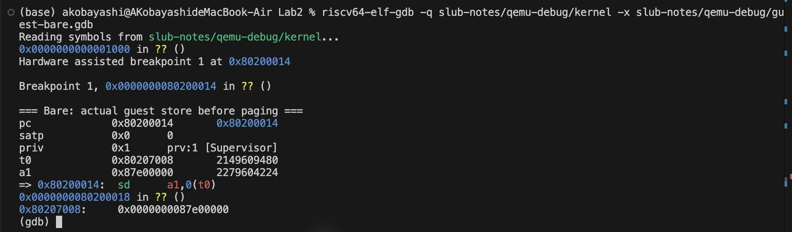

图 05 中 `priv=1` 为 S-mode，`satp=0`，目的地址 `t0=0x80207008`，数据 `a1=0x87e00000`。执行后 PC 到 `0x80200018`，目的位置保存了 DTB 地址，证明真实 store 已执行。

物理 PC 显示 `??` 不代表失败：符号按高虚拟地址链接，此时尚未跳到高地址。`Hardware assisted breakpoint` 是 QEMU 为客体调试提供的断点类型，不代表用了真实 RISC-V 硬件。

##### 5.5.3.2 第二步：客体分页后的真实 load

继续到 `dtb_init+0x2e`，本次为 `0xffffffffc0200270`，执行 `ld a1,0(s0)`：

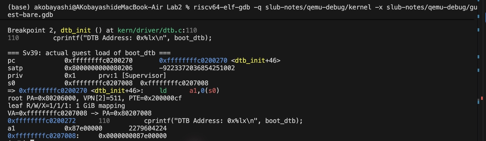

图 06 中 `satp=0x8000000000080206`，MODE=8、ASID=0、根表物理基址 `0x80206000`。`s0=0xffffffffc0207008`，根索引 511，PTE 为 `0x200000cf`。根级叶项给出物理基址 `0x80000000`，低 30 位偏移是 `0x207008`，故物理地址为 `0x80207008`。load 后 `a1` 得到先前保存的 `0x87e00000`。

这联系了低地址写入与高地址读回，但图中 PTE 解码仍是调试辅助计算；QEMU 真正执行读表的证据在后续宿主截图。

##### 5.5.3.3 第三步：宿主观察 Bare 分支

宿主 GDB 加载调试版 QEMU，显式指定 `-bios default` 和内核镜像，设置条件：

```gdb
break get_physical_address if addr == 0x80207000 && mmu_idx == 1 && access_type == 1
run
```

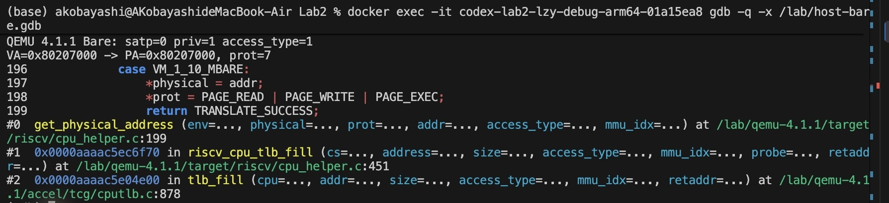

图 07 中 `satp=0、priv=1、access_type=1`，是 S-mode Bare store。实际进入 `VM_1_10_MBARE` 分支，得到 `VA=PA=0x80207000、prot=7`。`prot` 是 QEMU 页访问权限组合，不是全部物理安全授权，之后仍有 PMP 等检查。

调用栈包含 `get_physical_address -> riscv_cpu_tlb_fill -> tlb_fill`。因此结论是“不走 S/U 页表遍历”，不是“模拟器完全跳过所有辅助访存路径”。

##### 5.5.3.4 第四步：确认 Bare 仍填充软 TLB

翻译函数返回后继续到 `tlb_set_page_with_attrs()`，观察条目写入完成的状态：

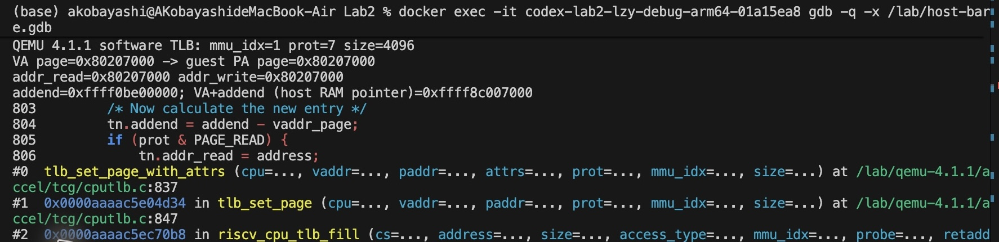

图 08 中 `mmu_idx=1、prot=7、size=4096`，虚拟页与客体物理页都是 `0x80207000`。条目还有 `addend=0xffff0be00000`，客体页地址加上它得到宿主 RAM 页指针 `0xffff8c007000`。

即使没有启用页表翻译，模拟器仍要高效找到宿主进程中承载 RAM 的位置。不能由软件 TLB 的存在推断 Bare 下硬件仍在查 Sv39 页表。

##### 5.5.3.5 第五步：读取 Sv39 根项并形成物理地址

为避开同页已被缓存的后续读，选择首次 BSS 写入：

```gdb
break get_physical_address if addr == 0xffffffffc0207018 && mmu_idx == 1 && access_type == 1
```

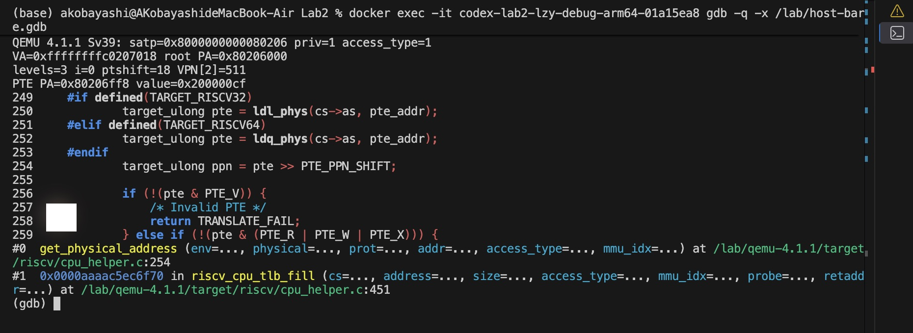

按图 09 可逐步核对：

1. `satp=0x8000000000080206`，根表物理地址为 `0x80206000`。
2. `VA=0xffffffffc0207018`，`VPN[2]=511`。
3. 一项 8 字节，所以 PTE 地址为 `0x80206000 + 511*8 = 0x80206ff8`。
4. RV64 分支用 `ldq_phys()` 读得 `0x200000cf`，是有效大页叶项，不继续查下一级。
5. `levels=3、i=0、ptshift=18` 表示从根级开始。根级物理基址结合低 30 位偏移形成 `0x80207018`。

QEMU 4.1.1 该函数返回的是基本页对齐的物理基址 `0x80207000`，完整字节地址还需加本次偏移 `0x18`，不能混淆页基址与实际访存地址。

##### 5.5.3.6 第六步：比较两种模式的软件缓存结果

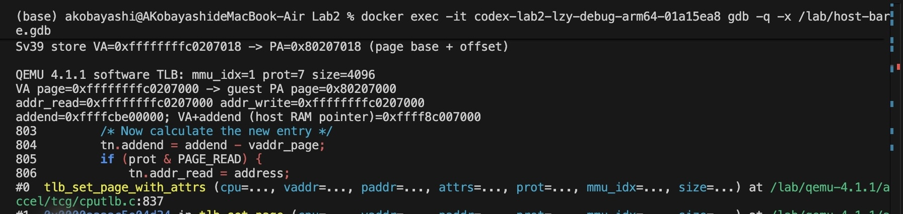

图 10 中请求 `0xffffffffc0207018` 对应 `0x80207018`，缓存的页映射为 `0xffffffffc0207000 -> 0x80207000`，大小 4096。其 `addend=0xffffcbe00000`，相加仍得到 `0xffff8c007000`，与图 08 相同。

两图来自同一宿主运行：客体地址和加数不同，但定位到同一宿主 RAM 页。根级 1 GiB 叶映射与此版本按 4 KiB 建立缓存条目不矛盾，两者处于不同实现层面。宿主 ASLR 保持开启，重启后宿主指针可以变化，不能把该绝对值写入算法。

最后用全新 QEMU 进程再次复现，核对 Bare 同值翻译、Sv39 store 结果、根叶项、软 TLB 页与权限、两种模式的宿主页一致性，5 项检查全部通过。关键输入和结果已写入正文，不依赖额外调试说明文档作为论证。

## 六、实验总结与收获

### 6.1 实验知识与 OS 原理的联系

| 知识点         | OS 原理中的含义              | 本实验的对应、关系与差异                                       | 主要负责人   |
| ----------- | ---------------------- | -------------------------------------------------- | ------- |
| 虚拟地址空间与隔离   | 通过映射和权限提供独立、可共享的受控内存视图 | 只有内核启动映射，尚无多个进程地址空间；链接地址、运行 PC 和物理加载地址不同           | 韩羽宸、林子媛 |
| 分页、多级页表与大页  | 页号用于索引映射，偏移保留；按需分配下级表  | Sv39 最多三级；实测根级就是 1 GiB 叶项，只读根项，低 30 位形成大页偏移        | 韩羽宸、林子媛 |
| 物理页框与管理元数据  | 将物理资源组织为可分配、可统计的单位     | `Page` 不是页面内容；描述符本身占 RAM，固件/内核/对齐空隙不能释放            | 韩羽宸、马禹翔 |
| 策略与机制分离     | 通用接口隔离资源管理机制和具体选择算法    | `pmm_manager` 使用回调；可替换还要求页数、失败和释放语义一致              | 三人      |
| 连续分配和外部碎片   | 找到连续空闲块；物理相邻块才可合并      | First Fit 首个合适，Best Fit 最小合适；总量足够不代表存在大连续块         | 韩羽宸、马禹翔 |
| Buddy 与内部碎片 | 规则的幂次拆分与伙伴合并降低组织复杂度    | 非 2 次幂向上取整；必须同阶且满足 XOR，不可只按地址相邻合并                  | 马禹翔     |
| 对象分配与内部碎片   | 页面批量取得后按对象复用，降低整页浪费    | 简化 SLUB 为八档大小，bitmap 和 freelist 管槽；仍有分类取整、元数据和尾部余量 | 林子媛     |
| 局部性与翻译缓存    | 缓存近期页映射和权限，命中时避免重复查表   | 实测 miss—fill—hit；QEMU 还缓存宿主 RAM 定位信息，不等同真实硬件布局     | 马禹翔、林子媛 |
| 翻译同步        | 页表更新后需要保证后续访问使用正确翻译    | `sfence.vma` 用于翻译一致性，不是普通数据缓存的通用刷新                 | 三人      |
| 对象生命周期和不变量  | 分配、使用、释放保持资源状态一致       | bitmap、inuse、活动块与底层页数交叉核对；先注销管理头再归还页面              | 林子媛     |

最重要的区分是：**PTE 改变映射与权限，`alloc_pages()` 改变页面归属，`kmalloc()` 改变对象归属。** 已映射、已分配页面、已分配对象是三个维度，不能互相代替。

### 6.2 重要但本实验未覆盖的 OS 知识

三人的总结合并如下，不把理论理解写成已实现功能：

1. **进程独立地址空间与用户隔离。** 尚无完整进程页表创建、切换和销毁，当前内核大页并非用户内存管理。
2. **缺页异常、按需分页和页面置换。** 尚无磁盘后备存储、工作集、Clock/LRU 或换入换出；有 A/D 位不等于实现了这些策略。
3. **写时复制、共享内存和文件映射。** 缺少进程、文件系统及引用计数驱动的映射生命周期。
4. **多核和中断并发。** 尚无分配器锁、per-CPU slab、远程释放和完整内存序保证，不能将顺序测试通过外推为 SMP 安全。
5. **跨核 TLB shootdown 与 ASID 管理。** 当前单 HART、ASID=0，没有跨 CPU 失效、ASID 回收复用验证。
6. **通用物理内存拓扑。** 多段 RAM、保留区洞、NUMA、热插拔、迁移、压缩和设备内存尚未完整处理。
7. **生产级对象缓存和内存错误检测。** 尚无压力回收、保留阈值、构造析构、完整分配历史；当前保护不覆盖全部越界、错误指针或地址复用后的悬空引用。
8. **调度、进程同步与文件系统。** 它们会依赖动态内存，但不在本次页和对象分配的实现范围。

### 6.3 AI 协作开发的经验与真实问题

#### 韩羽宸：规格、独立模型与启动证据

**负责人：2410673 韩羽宸**

有效提示词应先说完整模块目标，再给真实依赖、交付接口和行为规格。只说“实现某函数”容易漏掉保留区和失败状态；逐行伪代码又会把未经验证的实现细节写死。本次把最小合适选择、同尺寸策略、失败不改状态、零空闲页不登记等要求先变为可检查条件，再让 AI 设计实现。

最有价值的核验不是让同一模型再口头确认一次，而是检查原有断言、对照独立状态模型、读取寄存器与PTE。声明存在不代表链接时有实现，初始化顺序应以真实源码为准，开启分页不自动改变PC；这些都是仅看生成代码容易漏掉的工程语义。

实际问题按性质记录：测试驱动的缺失定义、启动取指映射、GDB导出文件名、MI异步控制、启动参数引用和现场输入顺序。没有为了报告形式虚构page_init或Best Fit算法bug。附加材料保留实现前备份、失败与成功记录；版本提交另按审核执行，不把本次未发生的commit或push编写进经历。

报告中的提示词经过规范整理，正文解释与代码、图和原始日志逐一对应。AI帮助提高了定位和整理效率，但学号只标明本人主责任务，不能代替本人对模块行为和答辩内容的理解。

#### 马禹翔：不变量、隔离测试与接口收紧

**负责人：2410933 马禹翔**

本次最有效的方法是先把自然语言需求变成可验证不变量，再生成和审查代码。例如“实现 Buddy”过于宽泛，而“非 2 次幂如何计数、伙伴以哪个页号为基准、相邻非伙伴是否合并、失败是否改状态”都可以直接写成断言。

AI 的第一次实现和测试仍可能隐含布局假设。把自检改成隔离 arena、扩大到 16 页并恢复真实链表，是人工审查后得到的改进。后来为截图增加输出又真实触发了缺少 `<stdio.h>` 的编译错误，说明即使算法未变也必须重新构建。对于调试问题，源码定位只能说明“可能经过哪里”，真正的命中、未命中和参数仍需 GDB 现场核对。

#### 林子媛：两层接口、对象测试与模式对比

**负责人：2410936 林子媛**

本次不是一次输入“实现 SLUB”就结束。我先要求解释页、`Page` 与地址转换，再明确接口、小对象布局、大对象页数和失败行为，用 LZY-P1 生成实现；默认内核可运行后，再用 LZY-P2 针对实际代码补测试。

**先确定规格，再接受实现。** “任意大小”没有边界时，AI 可能扩展成复杂 Linux 机制，也可能只支持少量大小而不说明。本次明确八档分类、连续页大对象、立即回收和单执行流，才使代码可以检查。

**用真实上下文定位问题。** 工具链错误提供命令与报错，Buddy 冲突提供选定管理器与保护信息，OpenSBI 后无内核输出则核对下一跳与入口。不能只说“运行失败”，更不能修改已有检查来掩盖不一致。

**让测试观察数据与资源。** 地址不同不代表有效载荷不重叠，对象数归零不代表页已归还，看到 panic 不代表命中目标分支。因此同时检查数据模式、各层统计和精确失败信息。

**用调试修正解释。** 我曾把三级页表理解成必走三层，把 Bare 理解成不用任何 TLB。根级叶项和 Bare 软件缓存的观察纠正了这些认识。AI 用于形成假设和设计操作，结论仍接受指令、寄存器、PTE、调用栈和测试检验。

报告因此保留“未发现新算法 bug”“未做实机 TLB 测量”“不识别全部悬空指针”等边界，不把未执行内容写成成功结果。

**实际问题汇总。**

| 问题                | 证据或原因                                   | 修正与验证                                   |
| ----------------- | --------------------------------------- | --------------------------------------- |
| 写 satp 后无法取指      | `scause=0xc`、`stval=0x80200038`，PC 仍低地址 | 增加临时恒等映射，进入高地址后删除；GDB 核对根项并运行检查         |
| 独立驱动缺少 SBI 退出定义   | 声明存在但链接无实现                              | 仅在独立驱动使用局部 SBI 退出，不改正式 SBI 模块           |
| GDB MI/参数与现场输入问题  | 异步控制未开启、字面引号或多行命令被误解析                   | 修正辅助脚本与输入顺序，重新执行真实单步                    |
| Buddy 自检隐含全局布局假设  | 测试依赖实际空闲块形状                             | 改为 16 页隔离 arena，保存恢复真实状态                |
| 增加测试输出后编译失败       | 缺少 `<stdio.h>`，被 `-Werror` 拒绝           | 补头文件后重新构建与运行                            |
| 工具链名称或宿主架构不匹配     | macOS 前缀不同；跨架构容器宿主 GDB 取寄存器失败           | 使用实际 `GCCPREFIX`；改原生 ARM64 调试容器并核验      |
| Buddy 与 SLUB 配置冲突 | 向上取整页数与本版精确页数契约不同                       | Buddy 独立配置跳过 SLUB，编译期禁止和 `SLUB_TEST` 同开 |
| 后续读不命中翻译断点        | 同页已被 BSS 清零访问并缓存                        | 选择首次 BSS store 观察 miss 路径，再比较 Bare/Sv39 |

没有观察到的新算法错误不补写成“AI 生成 bug”。生成前限制修改范围，是为了保留接口和已有检查的独立性；补测和独立模型则用于发现看似合理的代码中隐藏的状态错误，二者不能相互替代。

### 6.4 参考资料与提示词对应

- 课程《实验手册完整版》Lab2：地址与页表、物理内存探测、First Fit/Best Fit、Buddy/SLUB、QEMU/GDB 分支任务及报告要求。
- 当前仓库的启动汇编、链接脚本、DTB、PMM、各分配器及测试：韩羽宸重点核对初始化和 Best Fit，马禹翔重点核对 `Page`、链表和 Buddy，林子媛重点核对 `slub.c/.h` 与 `slub_test.c`。
- [RISC-V Supervisor-Level ISA](https://docs.riscv.org/reference/isa/priv/supervisor.html)：Sv39、PTE、`satp` 和 `SFENCE.VMA`，三人用于解释架构行为；新版扩展不代表旧 QEMU 已支持。
- QEMU 源码：韩羽宸的本地 7.0.0；马禹翔与林子媛的 [4.1.1 cpu_helper.c](https://github.com/qemu/qemu/blob/v4.1.1/target/riscv/cpu_helper.c)、[4.1.1 cputlb.c](https://github.com/qemu/qemu/blob/v4.1.1/accel/tcg/cputlb.c) 及相关头文件。版本差异在正文分开说明。
- [QEMU GDB documentation](https://www.qemu.org/docs/master/system/gdb.html)：gdbstub 与客体调试；[Linux Yama](https://docs.kernel.org/admin-guide/LSM/Yama.html)：韩羽宸环境的宿主调试权限。
- Challenge 的平台信息来源：[DeviceTree memory/reserved-memory](https://devicetree-specification.readthedocs.io/en/latest/chapter3-devicenodes.html)、[ACPI 系统地址图](https://uefi.org/specs/ACPI/6.5/15_System_Address_Map_Interfaces.html)。这些为分析参考，不代表项目实现所有平台接口。
- AI 记录统一见 [prompt.md](prompt.md)：HYC-P1～P7、MYX-P1～P10、LZY-P1～P5；SLUB 两份最终 prompt 完整保留，三条理解性 prompt 标注为事后规范整理。
